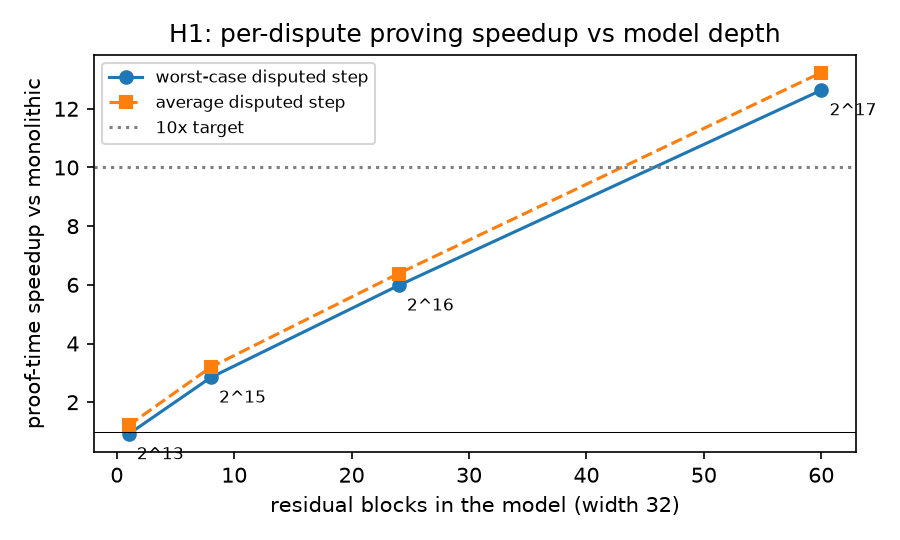
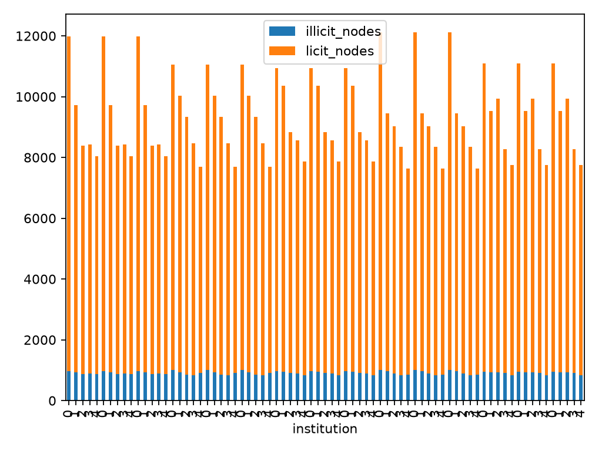
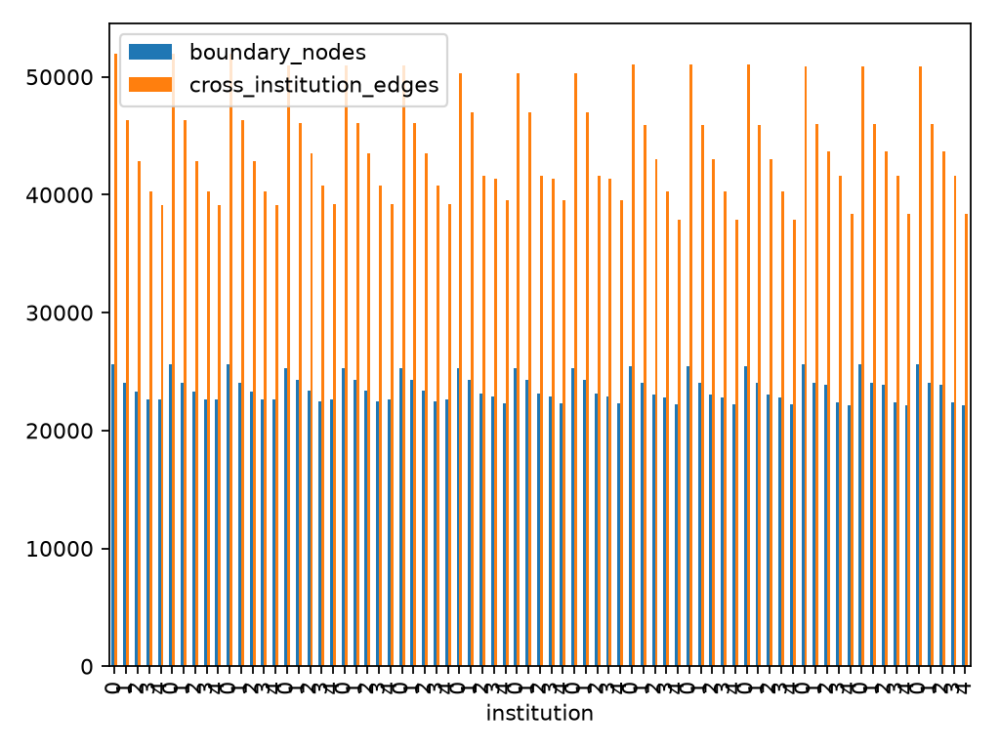
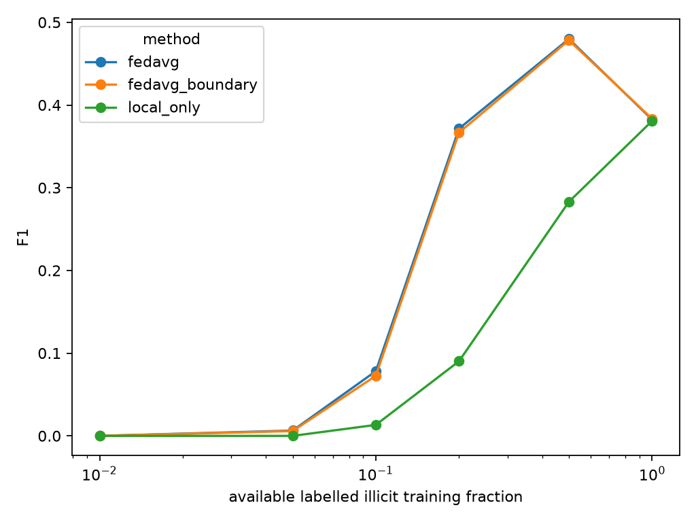
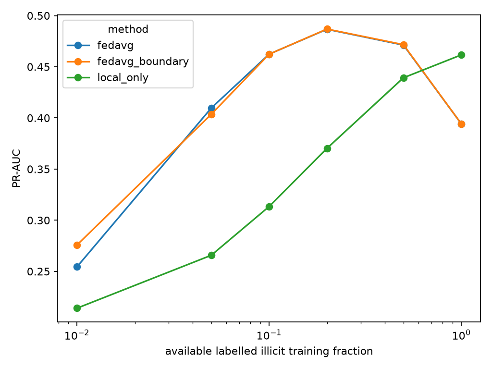
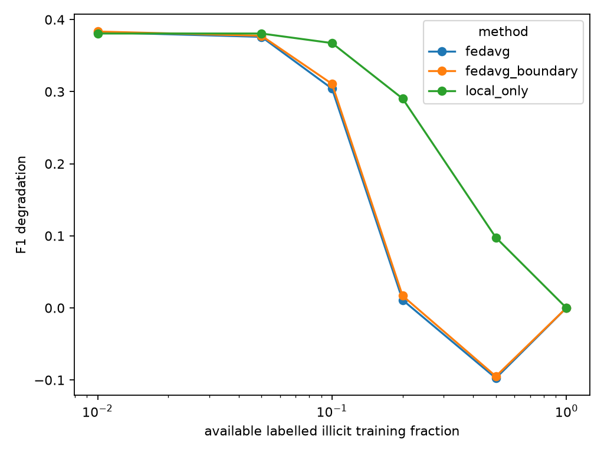
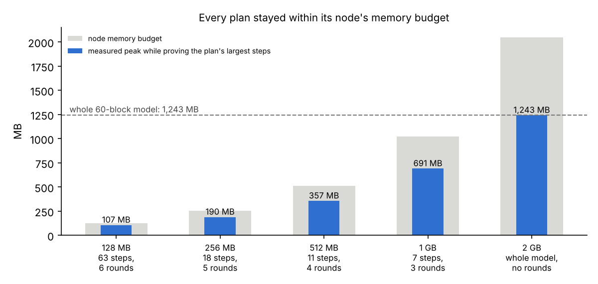

# CBDC – AI – Blockchain Research Programme: Exhaustive Record of Every Experiment

**Repository:** github.com/maanas1234/CBDC (`main`)
**Team:** Aman Hooda (H1), Indrakshi (H2), Anjali (H3), Simran Pundir (H4). Mentor and reviewer: Maanas Tyagi.
**Source proposal:** *Architecting a Secure, Compliant, and Intelligent CBDC Ecosystem* (`docs/CBDC_AI_Blockchain_Research_Proposal.pdf`)
**Updated:** 28 Oct 2026 (includes Aman's integration work, PRs #36–#39, and the hardware integration, Part 6B, PR #43).
**Companion summary:** `docs/FULL_REPORT.md` (short version). This document is the long version.

---

## How this document is built and how to read it

This is the complete record of the programme. It covers:
- every experiment that was run, including versions later withdrawn or superseded;
- every result table;
- every pre-registration;
- every correction and every closed pull request.

Nothing that was run is left out.

**Generated tables.** Tables marked *(generated)* are produced by `docs/exhaustive/build.py` directly from the committed result files (CSV/JSON) at build time. No number in them was retyped by hand. To rebuild, run `python docs/exhaustive/build.py` from the repository root.

**Why a rebuild can differ from the committed copy.** Most of the document is generated from committed
result files and is identical on every rebuild. Five generated parts depend on when and where the build
runs:
1. **Commit count and authors** (§1) are read from `git log` at build time. The committed copy is built
   before the commit that adds it, so a rebuild on a later checkout always shows more commits.
2. **The tracked-file index** (reproducibility section) lists `git ls-files` with file sizes, so any
   added, removed or edited file changes it. (Before 20 Oct 2026 it also listed this report's own size,
   which changed on every rebuild; it now shows "(this file)".)
3. **Embedded Markdown** (the READMEs and write-ups pulled in by `md` include directives) changes whenever those
   files change.
4. **Test listings** are collected live: H2 with `pytest --collect-only`, which needs `torch` and
   `torch-geometric` installed (without them collection fails and the H2 list comes out nearly empty);
   H4 with `cargo test -- --list` in `benchmark_v2`, which needs a working Rust toolchain (an earlier
   committed copy showed "0 tests" for that reason; the correct count is 20). H3 uses `pytest` only.
5. **H3 Sybil output** is produced by running `h3-abt/run_sybil.py` (deterministic, seeded).

Rebuilding twice in a row on the same checkout and environment gives a byte-identical file.

**Hand-written text.** The narrative text was written for this document. Where a number appears in the narrative, it is quoted from a generated table or from a committed write-up, and the source is named.

**Status labels.** Every result carries one of these labels:

| Label | Meaning |
|---|---|
| **Confirmatory, pre-registered** | Parameters, bounds and analysis code were committed to git before the run; the commit is named. |
| **Exploratory** | Run without pre-registration; reported for completeness. |
| **Post-hoc** | Defined or analysed after seeing the data. |
| **Superseded** | Replaced by a later, better-designed version. Kept for the record. |
| **Withdrawn** | Found to be invalid (for example, an unsound circuit). Its numbers must not be cited. |

**Structure:**

| Part | Content |
|---|---|
| 1 | Programme: proposal, hypotheses, team, process, timeline, every PR |
| 2 | H1: verifiable off-chain inference (v1 partial proving; v2 bisection) |
| 3 | H2: federated AML under label scarcity (v1, 5-seed v1, protocol v2, matched-recall test) |
| 4 | H3: AgentBound Tokens (baseline, treatment, confirmatory, agent-level, Sybil, durable liability) |
| 5 | H4: post-quantum ZK-STARK (v1 prototypes, halt, v2, v3, model coverage, composed proof, overhead law) |
| 6 | Cross-cutting findings and the system picture |
| 6A | The integrated system (TRL 4): Besu pipeline, on-chain disputes and registry, Plonky3 proof, independent-validator run, and what was independently verified |
| 6B | Hardware integration (after the faculty review): machine resources, memory-budgeted decomposition, TPM-anchored identity, simulated TEE and offline devices |
| 7 | Corrections, deviations, withdrawn work, and what was not done |
| 8 | Reproducibility and the full artifact index |
| Appendices | Configurations, pre-registrations and original documentation, verbatim |

## Glossary

| Term | Meaning |
|---|---|
| AML / CFT | Anti-money-laundering / countering the financing of terrorism |
| CBDC | Central bank digital currency |
| Elliptic | Public Bitcoin transaction graph dataset: 203,769 transactions, 234,355 edges, 49 time steps. 4,545 transactions are labelled illicit, 42,019 licit, and the rest unknown. |
| ZKML | Zero-knowledge proofs of machine-learning inference |
| zk-OPML | Optimistic ML with zero-knowledge dispute resolution: results are assumed correct unless challenged; a challenge is settled by a targeted proof |
| EZKL | Halo2/KZG-based ZKML toolchain (version 23.0.5 used) |
| Bisection | Binary search over committed intermediate results to find the first step where two parties disagree |
| FedAvg | Federated averaging: each institution trains locally; the server averages the model weights |
| GCN | Graph convolutional network |
| DP, ε, δ | Differential privacy and its privacy-loss parameters |
| RDP | Rényi differential privacy (used here for accounting) |
| Recall / FP | Share of illicit transactions caught / number of licit transactions wrongly flagged |
| Matched recall | Comparing models at thresholds that give them the same recall |
| ABT | AgentBound Token: a non-transferable token binding an AI agent to staked collateral and a violation history |
| Slashing | Automatic confiscation of stake when a violation is detected |
| Sybil attack | Escaping penalties by creating a new identity |
| Judgment-proof | An agent with nothing left to lose: stake fully slashed, so the deterrent is gone |
| STARK | Hash-based transparent proof system; plausibly post-quantum |
| AIR | Algebraic intermediate representation: the constraint system a STARK proves |
| SIS | Short Integer Solution: lattice problem behind the commitment c = G·bits + B·r mod p |
| PQ | Post-quantum |
| RLC | Random linear combination (the v3 proof technique) |
| Winterfell | Rust STARK library (fork `bwesterb/winterfell@b964cfd`, field f23201, p = 7,340,033) |
| Holm | Holm–Bonferroni correction for multiple tests |
| Wilcoxon / Mann–Whitney | Rank-based paired / unpaired tests |


# Part 1 — The programme

## 1.1 Source proposal

The proposal sets out a three-phase research programme for a CBDC stack in which AI and blockchain coexist. It targets three structural contradictions:

1. **The privacy–compliance paradox.** Privacy tools blind AML systems, and AML analytics erode privacy. In Elliptic, 77% of transactions are unlabelled and about 2% are confirmed illicit.
2. **The algorithmic liability void.** No enforceable, automatic liability exists for autonomous AI agents acting in a CBDC network.
3. **The determinism–adaptability trade-off.** Consensus needs determinism; AI is probabilistic and too expensive to run on-chain.

The proposal decomposes its objectives into four falsifiable hypotheses, each with a stated failure criterion:

| ID | Hypothesis (proposal wording, condensed) | Proposal's failure criterion |
|---|---|---|
| H1 | Restructuring AML/credit inference as a bisectable ONNX graph under an optimistic dispute protocol (zk-OPML) cuts proof-generation latency **and** on-chain verification cost by ≥ 10× versus monolithic ZKML, with ≤ 1 pp accuracy loss | Bisection fails to isolate the disputed operator in bounded rounds on deep models, or the reduction is below one order of magnitude |
| H2 | Blockchain-orchestrated federated learning across simulated institutions gives a statistically significant ≥ 20% reduction in false-positive AML flags versus a centralized baseline on the same label-scarce data, with PII leakage formally bounded by DP (target ε) | The reduction is not significant, or the ε needed is unacceptable |
| H3 | Staked, non-transferable ABTs with coded slashing measurably reduce policy-violating agent actions versus unstaked control agents | No significant deterrence, **or** slashing can be circumvented by Sybil-style re-identification |
| H4 | A lattice-based ZK-STARK can secure ZKML verification for the H1–H3 model classes with proof size and verifier latency within a bounded overhead factor versus classical STARKs | The overhead exceeds the bound needed for (near-)real-time verification |

**Out of scope for this programme** (proposal items that were not attempted):
- deep-RL monetary policy;
- the Reverse-Kelly AMM;
- ExpProof-style verifiable explanations;
- secure multi-party aggregation and blockchain orchestration of the federated-learning layer;
- an on-chain ABT contract (built later, see Part 6A);
- settlement-layer integration (a lab-scale version was built later, see Part 6A).

See §7.4.

## 1.2 Team and responsibilities

Each hypothesis was owned end to end by one student. The mentor reviewed and merged every PR, audited the work, and in the final phase carried out the corrective and extension work recorded in Part 7.

| Hypothesis | Owner | Folder |
|---|---|---|
| H1 | Aman Hooda | `h1-zkopml-v2/` (v1 was `h1-zkopml/`, deleted 2026-09-19, recovered from git for this report) |
| H2 | Indrakshi | `h2-federated-aml/` |
| H3 | Anjali | `h3-abt/` |
| H4 | Simran Pundir | `h4-pqc-stark/` |

## 1.3 Process

- **Monorepo:**
  - one folder per hypothesis, no shared code;
  - branches named `<name>/<topic>`;
  - every change goes through a PR into `main` and is reviewed before merge.
- **Pre-registration (from 2026-10-06):** parameters, bounds and analysis code are committed before a confirmatory run. Post-hoc items are labelled as such, and a failed pre-registered result keeps its verdict even if a later version passes.
- **Statistics:** the unit of analysis is the seed (H2) or the agent (H3); paired designs are used where possible; Holm correction is applied across levels or primary tests.
- **Audit (2026-10-06):** a repository-wide audit found:
  - an unsound H4 circuit;
  - an H2 design that could not test its own criterion;
  - pseudo-replication in the H3 statistics;
  - missing caveats in H1.

  Each was corrected through PRs #13–#22.

## 1.4 Timeline

154 commits between 2026-09-03 and 2026-10-28. By author name: Maanas Tyagi 75, Aman Hooda 28, Indrakshi 24, simranpundirr 12, amanhooda2005 8, Anjali503 5, Claude 1, Simran Pundir 1.

| Date | Milestone |
|---|---|
| 2026-09-03 | Repository created: folders, READMEs, proposal |
| 2026-09-06 – 09-11 | First submissions: H1 v1 (partial proving), H3 protocol and baseline, H2 v1 code, H4 classical baseline |
| 2026-09-11 – 09-19 | H1 v2 (bisection), H3 staking, H2 v1 results, H4 v1 lattice prototype (PR #9), H3 statistical analysis and Sybil probe |
| 2026-09-22 | H4 research-candidate SIS parameters |
| 2026-10-06 | Audit. H3 confirmatory recorded, H1 caveats, H2 status correction; H4 confirmatory pre-registered and **halted** (soundness defect) |
| 2026-10-07 – 10-10 | PR #18 (H4 fix attempt) closed; H2 5-seed results (PR #19); H3 agent-level re-analysis |
| 2026-10-11 | H4 v2 sound circuit; H2 protocol v2; lattice estimator; H4 v3; H1–H3 model coverage; overhead law; H2 matched-recall; composed PQ proof |
| 2026-10-13 | H3 durable liability; full reports |

## 1.5 Every pull request *(generated)*

| PR | State | Author | Opened | Merged | Branch | Title |
|---|---|---|---|---|---|---|
| #1 | merged | maanas1234 | 2026-09-06 | 2026-09-06 | `aman/H1-baseline` | Add files via upload |
| #2 | merged | Anjali503 | 2026-09-06 | 2026-09-07 | `anjali/h3-baseline` | feat(h3): establish ABT behavioral protocol |
| #3 | merged | indrakshi2006-boop | 2026-09-07 | 2026-09-10 | `h2_aml-patch-1` | Add files via upload |
| #4 | merged | maanas1234 | 2026-09-10 | 2026-09-10 | `maanas/fix-h1-folder-path` | fix(h1): move content out of misfiled 'h1-zkopml 5' folder |
| #5 | merged | Anjali503 | 2026-09-11 | 2026-09-11 | `anjali/h3-baseline` | feat(h3): add unstaked baseline simulation |
| #6 | merged | Anjali503 | 2026-09-11 | 2026-09-16 | `anjali/h3-staking` | Anjali/h3 staking |
| #7 | merged | amanhooda2005 | 2026-09-14 | 2026-09-16 | `aman/H1-zkopml-v2` | H1 zk-OPML v2 |
| #8 | merged | indrakshi2006-boop | 2026-09-16 | 2026-09-18 | `h2-federated-aml-ii` | H2 federated aml ii |
| #9 | merged | simranpundirr | 2026-09-18 | 2026-09-19 | `simran/h4-pqc-stark` | Simran/h4 pqc stark H4: Add lattice-backed ZK-STARK prototype and benchmark comparison |
| #10 | merged | Anjali503 | 2026-09-19 | 2026-09-19 | `anjali/h3-analysis` | feat(h3): add control treatment statistical analysis |
| #11 | merged | Anjali503 | 2026-09-19 | 2026-09-20 | `anjali/h3-sybil` | feat(h3): Sybil Identity-Reset Attack Test |
| #12 | merged | simranpundirr | 2026-10-06 | 2026-10-06 | `simran/h4-production-params` | Simran/h4 production params |
| #13 | merged | maanas1234 | 2026-10-06 | 2026-10-06 | `maanas/h3-confirmatory-record` | docs(h3): commit confirmatory result and record limitations |
| #14 | merged | maanas1234 | 2026-10-06 | 2026-10-06 | `maanas/h1-verdict-summary` | docs(h1): add verdict summary and caveats to README |
| #15 | merged | maanas1234 | 2026-10-06 | 2026-10-06 | `maanas/h2-status-correction` | docs(h2): record verified findings and open H2 criteria |
| #16 | merged | maanas1234 | 2026-10-06 | 2026-10-06 | `maanas/h4-confirmatory-params` | docs(h4): pre-register confirmatory params; halt run on soundness defect |
| #17 | closed | maanas1234 | 2026-10-06 | — | `maanas/h2-dp-fedavg` | feat(h2): client-level DP-FedAvg and centralized scarcity option |
| #18 | closed | simranpundirr | 2026-10-07 | — | `simran/h4-production-params` | Validate H4 PQ-STARK matched benchmark |
| #19 | merged | indrakshi2006-boop | 2026-10-09 | 2026-10-10 | `h2-federated-aml-ii` | Complete H2 multi-seed and privacy experiments |
| #20 | merged | maanas1234 | 2026-10-10 | 2026-10-10 | `maanas/h3-agent-level-test` | feat(h3): agent-level re-analysis and final verdict |
| #21 | merged | maanas1234 | 2026-10-11 | 2026-10-11 | `maanas/h4-sound-v2` | H4 v2: sound SIS-STARK circuit, secure options, final benchmark |
| #22 | merged | maanas1234 | 2026-10-11 | 2026-10-11 | `maanas/h2-protocol-v2` | H2 protocol v2: pre-registered 10-seed study, pooled centralized baseline, DP |
| #23 | merged | maanas1234 | 2026-10-11 | 2026-10-11 | `maanas/final-readme` | docs: final results for H1-H4 |
| #24 | merged | maanas1234 | 2026-10-11 | 2026-10-11 | `maanas/h4-lattice-estimator` | docs(h4): lattice-estimator security result for v2 parameters |
| #25 | merged | maanas1234 | 2026-10-11 | 2026-10-11 | `maanas/h4-clean-warnings` | chore(h4): warning-free build |
| #26 | merged | maanas1234 | 2026-10-11 | 2026-10-11 | `maanas/h4-v3-rlc` | H4 v3: random-linear-combination proof; passes all bounds |
| #27 | merged | maanas1234 | 2026-10-11 | 2026-10-11 | `maanas/h4-model-coverage` | H4: prove full H1 MLP, H2 GCN, and H3 rule inference; overhead within bounds |
| #28 | merged | maanas1234 | 2026-10-11 | 2026-10-11 | `maanas/handoff-next-session` | docs: next-session handoff and stale H2 note fixes |
| #29 | merged | maanas1234 | 2026-10-11 | 2026-10-11 | `maanas/h4-overhead-law` | H4: post-hoc overhead law (no new runs) |
| #30 | merged | maanas1234 | 2026-10-11 | 2026-10-11 | `maanas/h2-matched-recall` | H2 Finding B: FP criterion is gameable — matched-recall test (pre-registered) |
| #31 | merged | maanas1234 | 2026-10-11 | 2026-10-11 | `maanas/h4-composed` | H4 Finding A: one PQ proof for a whole transaction decision (H1 -> risk -> H3 -> committed amount) |
| #32 | merged | maanas1234 | 2026-10-11 | 2026-10-11 | `maanas/final-findings` | README: cross-cutting findings (composed PQ proof, gameable FP criterion, overhead law); handoff refresh |
| #33 | merged | maanas1234 | 2026-10-13 | 2026-10-13 | `maanas/h3-durable-liability` | H3 Finding C: deterrence wears out; stake maintenance + operator-bound history fix it (pre-registered) |
| #34 | merged | maanas1234 | 2026-10-13 | 2026-10-13 | `maanas/full-report` | Full end-to-end results report (docs/FULL_REPORT.md) |
| #35 | merged | maanas1234 | 2026-10-13 | 2026-10-13 | `maanas/exhaustive-report` | Exhaustive record of every experiment (docs/EXHAUSTIVE_REPORT.md) |
| #36 | closed | amanhooda2005 | 2026-10-15 | — | `aman/trl4-integration` | TRL 4: integrated CBDC pipeline on Besu QBFT, real EZKL dispute verifiers, ZK composed proof, on-chain H3 registry |
| #37 | merged | amanhooda2005 | 2026-10-15 | 2026-10-15 | `aman/trl4-integration` | TRL 4: integrated CBDC pipeline on Besu QBFT, real EZKL dispute verifiers, ZK composed proof, on-chain H3 registry |
| #38 | merged | amanhooda2005 | 2026-10-20 | 2026-10-20 | `aman/trl4-evidence` | Evidence, reproducibility fixes and independent-validator setup |
| #39 | merged | amanhooda2005 | 2026-10-20 | 2026-10-21 | `aman/independent-validator-result` | Evidence: independent-validator run on two machines (4-of-4 gate) |
| #40 | merged | maanas1234 | 2026-10-21 | 2026-10-21 | `maanas/final-docs-update` | Docs: update both reports for the integrated system (TRL 4); correct quantum-security wording |
| #41 | merged | amanhooda2005 | 2026-10-26 | 2026-10-26 | `aman/independent-ledger-export` | Evidence: exported ledger of the two-machine run, checked against the host's record |
| #42 | merged | maanas1234 | 2026-10-26 | 2026-10-26 | `maanas/fix-break-even` | docs: fix gas break-even rate, record the exported independent ledger |
| #43 | merged | amanhooda2005 | 2026-10-28 | 2026-10-28 | `aman/hardware-resources` | Hardware integration: memory-budgeted proving, machine resource measurements, TPM-anchored operator identity |


# Part 2 — H1: Verifiable off-chain inference (zk-OPML)

**Owner:** Aman Hooda.

**Hypothesis:** a bisectable computation graph under an optimistic dispute protocol cuts proof-generation latency and on-chain verification cost by ≥ 10× versus a monolithic ZKML proof, with ≤ 1 pp accuracy loss.

H1 went through two versions:

| Version | Approach | Status |
|---|---|---|
| v1 (`h1-zkopml/`, Sept 6–19) | Split the model at a layer boundary, commit the early layers by hash, prove only the late layers | Failed; superseded |
| v2 (`h1-zkopml-v2/`, from Sept 11) | Bisection over many committed steps | Final |

## 2.1 H1 v1 — "partial proving" (superseded)

Status: **exploratory, superseded.** Recovered from git (the folder was deleted in commit `3d6e84c`). The full original README is reproduced in Appendix C.1.

### Data and classifier

- **Data:** Kaggle Elliptic, 203,769 transactions, of which 46,564 are labelled (4,545 illicit, 42,019 licit).
- **Split:** temporal — time steps 1–30 train, 31–34 validation, 35–49 test.
  - A first version used a random split and reached F1 0.7405. Under the temporal split the same architecture fell to F1 0.3485.
  - The README correctly notes that random splits leak information through Elliptic's neighbour-aggregated features.
- **Model:** MLP 165→64→32→1 with BatchNorm and Dropout. Tuning:
  - a `pos_weight_power` × width sweep took F1 to 0.6057;
  - a second sweep (mini-batch vs full-batch, focal loss, SMOTE, robust scaling with 1st/99th-percentile clipping) took it to F1 0.6982.

Reported test metrics, with tree references on the same split:

| Model | Accuracy | Precision | Recall | F1 | PR-AUC | Provable? | Prove time | Verify time | Proof size |
|---|---|---|---|---|---|---|---|---|---|
| MLP 165→64→32→1 | 96.60% | 82.41% | 60.57% | 0.6982 | 0.6118 | yes | 0.758 s | 0.007 s | 41.73 KB |
| Random forest | 97.49% | 86.42% | 72.85% | 0.7906 | 0.7864 | no | — | — | — |
| Gradient boosting | 89.24% | 35.22% | 78.12% | 0.4855 | 0.7850 | no | — | — | — |

**Caveat recorded later (v2 write-up):** the v1 F1 of 0.6982 is *not comparable* to v2 numbers, because v1's configuration and threshold were chosen using the test set. Under v2's validation-only selection, comparable MLPs score F1 ≈ 0.47–0.52.

### Proving pipeline and partial proofs

**Full-model EZKL pipeline** (one inference, 64-32 model):

| Stage | Time |
|---|---|
| gen_settings | 0.033 s |
| calibrate | 0.431 s |
| compile | 0.002 s |
| get_srs | 0.909 s |
| setup | 0.633 s |
| witness | 0.023 s |
| **prove** | **0.716 s** |
| verify | 0.007 s |

Proof size: 41.72 KB.

**Partial-proving mechanism:** split at a layer boundary, commit the early part with a Poseidon hash, and prove only the late layers. The split is exact, with zero accuracy loss. Measured on the *earlier 32-16 model*, at logrows 12, mean of 3 trials:

| Split | Late part | Rows | Prove |
|---|---|---|---|
| after layer 1 | 32→16→1 | 962 | 2.973 s |
| after layer 2 | 16→1 | 99 | 2.956 s |

### v1 finding

Both split points bottom out at the same prove time (about 2.95 s), however small the proven slice. The reason: Halo2/EZKL cost is set by the padded circuit size (2^logrows) and the lookup-table columns, not by the constraint count.

The best reported speedup is ~2.9×, so v1 **failed** the ≥ 10× target.

**Internal inconsistency (noted for this report):** the reported 0.716 s full-model proof (64-32 model, scale 13) and the 2.96–2.97 s partial proofs (32-16 model) come from different models and settings. The 2.9× figure therefore cannot be reconstructed from the numbers in the v1 README.

v1 listed four directions for improvement:
1. a lower input/parameter scale;
2. lookup-free nonlinearities;
3. batching disputes;
4. a different backend.

v2 adopted (1), together with a deeper model and many small steps.

## 2.2 H1 v2 — bisection over committed steps (final)

### Setup

- **Data:** Elliptic, 46,564 labelled transactions.
  - Temporal split: train steps 1–30, validation 31–34, test 35–49.
  - Preprocessing: clip to the 1st/99th percentile, then divide by max(IQR, std). The earlier IQR + 1e-8 scaling produced values up to 1e9; values now lie within ±9.4.
- **Models:** residual MLP of width 32: a 165→32 projection, then B blocks h ← h + ReLU(Wh + b), then a 32→1 head.
  - B ∈ {1, 8, 24, 60}, 3 seeds per depth.
  - Selection on validation only: early stopping, seed, and threshold (by validation PR-AUC).
- **Proof system:** EZKL 23.0.5.
  - Input and parameter scale 2⁹; `decomp_base` 256 with 4 legs, which removes the 2¹⁵-row floor.
  - Weights are fixed in the verifying key.
  - Each circuit was calibrated on real transactions and given the faster of `num_inner_cols` ∈ {2, 4}.
- **Bisectable graph:** the model becomes a chain of steps. The 165→32 projection is split into two 16-neuron halves, and a join block follows. B = 60 gives 63 steps.
- **Commitments:**
  - leaf_i = Poseidon(step i output), the same hash EZKL computes in-circuit (checked to match);
  - running hash P_i = H(P_{i−1} ‖ leaf_i);
  - a Merkle root over (leaf_i, P_i) is posted with the output.
  - A NumPy fixed-point emulator reproduces EZKL's arithmetic exactly, so honest parties always agree.
- **Dispute protocol:**
  1. The asserter posts the output and the root.
  2. A challenger disputes.
  3. Binary search over the running hashes finds the first differing step k, in ⌈log₂ n⌉ rounds.
  4. One EZKL proof of step k is generated on the agreed inputs.
  5. The verifier checks the proof, checks that its input hashes equal the agreed leaves, and compares its output hash with the asserter's leaf_k.

### Models: every depth and seed *(generated from `results/accuracy_suite.json`)*

The "selected" seed is the one with the best validation PR-AUC. The last two columns split the test period: dark-market shutdown effects make steps 43–49 nearly unlearnable for every model, a known property of Elliptic.

| Blocks | Seed | Selected (val) | Val PR-AUC | Threshold | Test F1 | Precision | Recall | Accuracy | Test PR-AUC | F1 steps 35–42 | F1 steps 43–49 |
|---|---|---|---|---|---|---|---|---|---|---|---|
| 1 | 0 |  | 0.893 | 0.80 | 0.485 | 0.405 | 0.605 | 91.65% | 0.552 | 0.590 | 0.042 |
| 1 | 1 | **yes** | 0.905 | 0.77 | 0.512 | 0.444 | 0.605 | 92.51% | 0.559 | 0.620 | 0.042 |
| 1 | 2 |  | 0.851 | 0.83 | 0.414 | 0.314 | 0.604 | 88.87% | 0.422 | 0.508 | 0.032 |
| 8 | 0 | **yes** | 0.875 | 0.82 | 0.446 | 0.344 | 0.633 | 89.78% | 0.543 | 0.567 | 0.047 |
| 8 | 1 |  | 0.864 | 0.39 | 0.470 | 0.407 | 0.558 | 91.84% | 0.364 | 0.597 | 0.035 |
| 8 | 2 |  | 0.741 | 0.80 | 0.502 | 0.451 | 0.565 | 92.71% | 0.466 | 0.602 | 0.081 |
| 24 | 0 | **yes** | 0.873 | 0.74 | 0.549 | 0.451 | 0.702 | 92.52% | 0.553 | 0.686 | 0.047 |
| 24 | 1 |  | 0.857 | 0.46 | 0.488 | 0.426 | 0.570 | 92.22% | 0.342 | 0.612 | 0.040 |
| 24 | 2 |  | 0.779 | 0.65 | 0.435 | 0.335 | 0.621 | 89.53% | 0.494 | 0.551 | 0.063 |
| 60 | 0 |  | 0.814 | 0.78 | 0.458 | 0.355 | 0.642 | 90.11% | 0.491 | 0.615 | 0.052 |
| 60 | 1 | **yes** | 0.869 | 0.59 | 0.516 | 0.487 | 0.549 | 93.31% | 0.514 | 0.627 | 0.028 |
| 60 | 2 |  | 0.821 | 0.89 | 0.481 | 0.371 | 0.681 | 90.43% | 0.485 | 0.612 | 0.037 |

A random forest on the same split scores F1 0.77. The provable MLPs trail it, as in v1.

### Accuracy cost of the fixed-point circuit, three scales *(generated from `results/quant_accuracy_S{7,9,10}.json`)*

Scale 2⁹ was adopted: its worst accuracy drop is 0.13 pp (B = 60). At 2⁷, the 24-block model loses 1.42 pp accuracy and 3.5 pp F1, which **fails** the ≤ 1 pp criterion. The scale choice therefore matters.

| Scale | Blocks | Float acc | Fixed acc | Acc drop (pp) | Float F1 | Fixed F1 | F1 drop (pp) | Float PR-AUC | Fixed PR-AUC | Decisions unchanged |
|---|---|---|---|---|---|---|---|---|---|---|
| 2^7 | 1 | 92.51% | 92.41% | 0.10 | 0.512 | 0.509 | 0.28 | 0.559 | 0.557 | 99.75% |
| 2^7 | 8 | 89.78% | 90.11% | -0.33 | 0.446 | 0.453 | -0.67 | 0.543 | 0.527 | 99.41% |
| 2^7 | 24 | 92.52% | 91.10% | 1.42 | 0.549 | 0.514 | 3.51 | 0.553 | 0.532 | 98.28% |
| 2^7 | 60 | 93.31% | 93.44% | -0.13 | 0.516 | 0.526 | -0.93 | 0.514 | 0.530 | 99.49% |
| 2^9 | 1 | 92.51% | 92.48% | 0.02 | 0.512 | 0.511 | 0.12 | 0.559 | 0.559 | 99.94% |
| 2^9 | 8 | 89.78% | 89.78% | 0.00 | 0.446 | 0.446 | 0.00 | 0.543 | 0.541 | 99.86% |
| 2^9 | 24 | 92.52% | 92.55% | -0.03 | 0.549 | 0.549 | 0.03 | 0.553 | 0.547 | 99.81% |
| 2^9 | 60 | 93.31% | 93.18% | 0.13 | 0.516 | 0.513 | 0.32 | 0.514 | 0.512 | 99.81% |
| 2^10 | 1 | 92.51% | 92.51% | -0.01 | 0.512 | 0.512 | -0.02 | 0.559 | 0.558 | 99.99% |
| 2^10 | 8 | 89.78% | 89.78% | 0.00 | 0.446 | 0.446 | 0.00 | 0.543 | 0.543 | 99.92% |
| 2^10 | 24 | 92.52% | 92.51% | 0.01 | 0.549 | 0.549 | -0.01 | 0.553 | 0.551 | 99.93% |
| 2^10 | 60 | 93.31% | 93.27% | 0.04 | 0.516 | 0.513 | 0.28 | 0.514 | 0.510 | 99.91% |

### Every proven circuit *(generated from `results/steps_B*.json`)*

`mono` is the monolithic proof of the whole model. The other rows are single bisection steps of the B = 60 model:
- `proj0`, `proj1`: projection halves;
- `u1`: join block;
- `u2`, `u30`, `u60`: residual blocks;
- `u61`: output head.

**Hardware provenance.** These committed timing files come from the **multi-core** laptop run. The single-core figures quoted in the write-up (§2.3) are not committed as raw files. See §7.2.

| Blocks | Circuit | logrows | Rows | Assignments | Calibrate s | Setup s | Witness s | Prove s (3 trials) | Prove mean s | Verify s | Verified |
|---|---|---|---|---|---|---|---|---|---|---|---|
| 1 | mono | 13 | 7,353 | 14,707 | 0.266 | 0.252 | 0.014 | 0.247 / 0.246 / 0.291 | 0.262 | 0.0034 | yes |
| 8 | mono | 15 | 20,793 | 41,587 | 0.947 | 0.798 | 0.052 | 0.828 / 0.812 / 0.810 | 0.817 | 0.0071 | yes |
| 24 | mono | 16 | 51,513 | 103,027 | 2.496 | 1.783 | 0.133 | 1.723 / 1.746 / 1.687 | 1.719 | 0.0117 | yes |
| 60 | proj0 | 11 | 1,681 | 6,724 | 0.145 | 0.200 | 0.008 | 0.213 / 0.218 / 0.217 | 0.216 | 0.0035 | yes |
| 60 | proj1 | 11 | 1,681 | 6,724 | 0.146 | 0.202 | 0.008 | 0.214 / 0.213 / 0.217 | 0.215 | 0.0035 | yes |
| 60 | u1 | 12 | 3,248 | 6,496 | 0.286 | 0.249 | 0.016 | 0.286 / 0.289 / 0.288 | 0.287 | 0.0030 | yes |
| 60 | u2 | 12 | 2,628 | 4,352 | 0.206 | 0.228 | 0.012 | 0.273 / 0.279 / 0.278 | 0.277 | 0.0030 | yes |
| 60 | u30 | 12 | 2,628 | 4,352 | 0.208 | 0.227 | 0.012 | 0.276 / 0.281 / 0.278 | 0.278 | 0.0031 | yes |
| 60 | u60 | 12 | 2,628 | 4,352 | 0.206 | 0.227 | 0.012 | 0.274 / 0.276 / 0.277 | 0.276 | 0.0030 | yes |
| 60 | u61 | 11 | 1,314 | 643 | 0.086 | 0.115 | 0.005 | 0.153 / 0.144 / 0.147 | 0.148 | 0.0026 | yes |
| 60 | mono | 17 | 120,633 | 241,267 | 6.065 | 3.975 | 0.323 | 3.657 / 3.619 / 3.619 | 3.631 | 0.0254 | yes |

### Speedup sweep as committed *(generated from `results/summary.json`, multi-core)*

| Blocks | Steps | Mono logrows | Mono rows | Mono prove s | Worst step s | Worst-case speedup | Mean speedup | Rounds | Acc drop pp | F1 drop pp | Selected F1 | F1 over 3 seeds |
|---|---|---|---|---|---|---|---|---|---|---|---|---|
| 1 | 4 | 13 | 7,353 | 0.262 | 0.287 | 0.91× | 1.21× | 2 | 0.024 | 0.118 | 0.512 | 0.470 ± 0.041 |
| 8 | 11 | 15 | 20,793 | 0.817 | 0.287 | 2.84× | 3.19× | 4 | 0.000 | 0.000 | 0.446 | 0.473 ± 0.023 |
| 24 | 27 | 16 | 51,513 | 1.719 | 0.287 | 5.98× | 6.39× | 5 | -0.030 | 0.031 | 0.549 | 0.491 ± 0.047 |
| 60 | 63 | 17 | 120,633 | 3.631 | 0.287 | 12.63× | 13.23× | 6 | 0.132 | 0.321 | 0.516 | 0.485 ± 0.024 |

### Dispute game: all 7 scenarios, B = 60 *(generated from `results/disputes_B60.json`)*

In every scenario:
- the tampered step is located exactly;
- the single-step proof verifies;
- its input instances match the agreed leaves;
- the correct party wins.

Rows where the asserter's and the challenger's decisions differ are disputes in which the cheat flips the AML decision itself. Scenario 6 is a false challenge against an honest asserter, and the asserter's claim is upheld.

| # | Test tx | Who cheats | Tampered step | Step name | First differing step | Located | Rounds | Step proof verified | Inputs match agreed leaves | Asserter claim | Asserter's decision | Challenger's decision | Correct outcome | Prove s (multi-core) |
|---|---|---|---|---|---|---|---|---|---|---|---|---|---|---|
| 0 | 3 | asserter | 0 | proj0 | 0 | yes | 5 | yes | yes | rejected | illicit | illicit | yes | 0.213 |
| 1 | 53 | asserter | 1 | proj1 | 1 | yes | 6 | yes | yes | rejected | licit | illicit | yes | 0.213 |
| 2 | 5 | asserter | 17 | u16 | 17 | yes | 6 | yes | yes | rejected | licit | licit | yes | 0.274 |
| 3 | 82 | asserter | 61 | u60 | 61 | yes | 6 | yes | yes | rejected | illicit | illicit | yes | 0.270 |
| 4 | 13 | asserter | 62 | u61 | 62 | yes | 6 | yes | yes | rejected | illicit | licit | yes | 0.143 |
| 5 | 18 | asserter | 40 | u39 | 40 | yes | 6 | yes | yes | rejected | illicit | illicit | yes | 0.274 |
| 6 | 23 | challenger | 33 | u32 | 33 | yes | 6 | yes | yes | upheld | licit | licit | yes | 0.275 |

### On-chain gas, local anvil chain *(generated from `results/gas.json` and `results/summary.json`)*

| Verifier | Verify tx gas | Deploy gas | Bytecode KB | Calldata bytes | Public instances | Returns true |
|---|---|---|---|---|---|---|
| u2 | 645,981 | 3,943,698 | 17.6 | 4,068 | 2 | yes |
| u61 | 645,492 | 3,957,194 | 17.7 | 4,068 | 2 | yes |
| mono | 696,984 | 2,956,155 | 13.1 | 8,548 | 166 | yes |
| proj0 | 1,057,745 | 5,346,074 | 23.9 | 11,492 | 166 | yes |
| u1 | 647,260 | 3,942,942 | 17.6 | 4,100 | 3 | yes |

Dispute-game contract:

| Item | Gas |
|---|---|
| Commit, first (full) | 133,767 |
| Commit, steady (full) | 116,667 |
| Commit, first (compact) | 67,062 |
| Commit, steady (compact) — used as per-inference cost | 49,962 |
| Bisection rounds measured | 5 |
| Reveal gas per round | 74,965, 74,967, 74,957, 74,959, 74,937 |
| Respond gas per round | 27,029, 27,029, 27,029, 27,029, 22,217 |
| Bisection total (5 rounds) | 505,118 |

Derived (from `summary.json`):

| Quantity | Value |
|---|---|
| Monolithic verify | 696,984 |
| Commit per inference | 49,962 |
| Bisection round (mean reveal+respond) | 101,991 |
| Full dispute, typical | 1,257,927 |
| Full dispute, worst (projection-half step) | 1,669,691 |
| Undisputed cost ratio (mono / commit) | 13.95× |
| Per-dispute cost ratio (mono / worst dispute) | 0.417× |
| Max dispute rate for 10× (worst case) | 1.18% |

## 2.3 H1 results as reported in the write-up (single-core machine)

The H1 write-up (`h1-zkopml-v2/WRITEUP.md`, reproduced in Appendix C.2) reports the headline latency on a **single-CPU** machine:

| Blocks | Steps | Full circuit | Full proof | Slowest step | Worst-case speedup | Average speedup | Rounds |
|---|---|---|---|---|---|---|---|
| 1 | 4 | 2¹³ rows | 2.11 s | 1.98 s | 1.07× | 1.38× | 2 |
| 8 | 11 | 2¹⁵ rows | 7.67 s | 1.98 s | 3.88× | 4.24× | 4 |
| 24 | 27 | 2¹⁶ rows | 15.16 s | 1.98 s | 7.67× | 7.94× | 5 |
| 60 | 63 | 2¹⁷ rows | 29.43 s | 1.98 s | **14.9×** | 15.1× | 6 |

**Single-core per-step times, B = 60:**

| Step | Time |
|---|---|
| Projection halves | 1.50 s and 1.63 s |
| Join | 1.95 s |
| Other blocks | 1.86–1.98 s |
| Head | 1.01 s |

The unsplit projection took about 3.1 s, which is why it was split. The mean single-core dispute proof time was 1.64 s.

**Single-core versus multi-core:**

| Measure | Single-core | Multi-core |
|---|---|---|
| Speedup at 60 blocks | 14.9× | 12.6× |
| Speedups at 1, 8, 24 blocks | as in the table above | 0.91×, 2.84×, 5.98× (committed `summary.json`) |

Fixed per-proof overhead is a larger share of small proofs when cores are available, so the speedup ratio shrinks on multi-core hardware.

**Why depth matters:** every step has the same width at every depth, so the slowest step costs about the same at any depth, while the full proof grows with depth. The 10× crossover therefore lies between 24 and 60 blocks; only four depths were measured.

**Gas** (single-core and multi-core runs give the same gas):

| Item | Gas |
|---|---|
| Monolithic verification | 696,984 |
| Commit per inference | 49,962 |
| Bisection round | ≈ 102,000 |
| Step verify | ≈ 646,000 (projection half: 1,057,745) |
| Full dispute | 1.26 M (typical), 1.67 M (worst) |

- An undisputed inference is 13.9× cheaper.
- A disputed one costs 1.8–2.4× **more** than monolithic verification.
- The 10× gas target holds on average only for dispute rates below ≈ 1.2% (worst case) or ≈ 1.6% (typical) with the figures above. The table above is the first accounting (v1); the complete one (v2: challenge, opening and adjudication included, real step verifiers: commit 54,673 gas = 12.8× cheaper, dispute 1.58 M typical / 1.91 M worst) gives **≈ 0.8% worst / ≈ 0.9% typical**, which is the figure to cite.

## 2.4 H1 verdict

| Criterion (proposal) | Result |
|---|---|
| ≥ 10× proof latency | **Pass only at 60 blocks.** 14.9× single-core, 12.6× multi-core. **Fail** at ≤ 24 blocks. |
| ≥ 10× on-chain cost | **Pass amortized** (13.9×) when the dispute rate is below about 0.8% (1.2% in the first accounting). **Fail per dispute** (0.42× worst, 0.55× typical). |
| ≤ 1 pp accuracy loss | **Pass** at scale 2⁹ (worst 0.13 pp). Fails at 2⁷. |
| Bisection isolates the operator in bounded rounds | **Pass** (⌈log₂ n⌉; 7/7). |

**Overall: partly supported.**

**Limitations:**
- The 60-block model is a depth benchmark, not a better AML model.
- Preprocessing is outside the circuit.
- The dispute game has no bonds or timeouts, and the simulation hashes with SHA-256 where the contract uses keccak.
- The projection halves use the costlier column layout.
- The gain is in proving time, not in time-to-finality.
- Single-core raw timing files are not committed (§7.2).


# Part 3 — H2: Federated AML detection under label scarcity

**Owner:** Indrakshi.

**Hypothesis:** federated training across simulated institutions gives a statistically significant ≥ 20% reduction in false-positive AML flags relative to a centralized baseline trained on the same label-scarce data, with leakage bounded by differential privacy.

H2 ran in four stages:

| Stage | PRs | Status |
|---|---|---|
| v1, single seed | #3, #8 | Superseded |
| v1, five seeds plus a privacy run | #19 | Superseded |
| Protocol v2, 10 seeds | #22 | Confirmatory, pre-registered |
| Matched-recall test | #30 | Confirmatory, pre-registered |

## 3.1 Common setup (all stages)

- **Data:** Elliptic1 from `data/elliptic1/`. The supplied raw CSVs are mapped to contiguous node indices.
  - Labels: 1 = illicit, 0 = licit, −1 = unknown.
  - Unknown nodes are never used as licit, in the loss, or in evaluation.
  - The graph has 203,769 nodes and 234,355 edges; each node has 166 features (the time step included).
- **Split:** one deterministic stratified 70/15/15 train/validation/test split over labelled nodes, fixed per seed.
- **Label scarcity:** only *illicit training* labels are removed, at 100%, 50%, 20%, 10%, 5% and 1% kept. Removal is per institution. Licit training labels and all validation and test labels are unchanged.
- **Institutions:** simulated. Elliptic has no real VASP ownership, so nodes are split into K institutions (K = 3 by default) by a deterministic graph-aware neighbour-vote partition.
- **Model:** two-layer GCN (hidden size 64). Each institution trains on its own induced subgraph.
  - **FedAvg:** parameters are averaged, weighted by local labelled count.
  - **Boundary channel (FedAvg + boundary):** after local training, institutions exchange `{boundary node ID, embedding}` for nodes on cross-institution edges. A label-free alignment loss λ·(1 − cos(h_local, h_foreign)) is then added. The node IDs are a simulated identity channel.
- **Metrics:** accuracy, precision, recall, F1, PR-AUC, ROC-AUC and the confusion matrix, at decision threshold 0.5.

**Institution statistics, K = 3, graph-aware partition** *(generated)*:

| institution | nodes | labelled_nodes | illicit_nodes | licit_nodes | boundary_nodes | cross_institution_edges | internal_edges | mean_internal_out_degree |
|---|---|---|---|---|---|---|---|---|
| 0 | 73838 | 17274 | 1625 | 15649 | 35553 | 63756 | 57869 | 0.784 |
| 1 | 66460 | 14946 | 1490 | 13456 | 34410 | 60084 | 45628 | 0.687 |
| 2 | 63471 | 14344 | 1430 | 12914 | 33992 | 56598 | 40639 | 0.640 |

**Illicit training labels per institution at full labels** *(generated)*:

| institution | scarcity | illicit_train_before | illicit_train_after | labelled_train_after |
|---|---|---|---|---|
| 0 | 1.0 | 1156 | 1156 | 12099 |
| 1 | 1.0 | 1028 | 1028 | 10400 |
| 2 | 1.0 | 997 | 997 | 10095 |

## 3.2 v1 — single seed (superseded)

**Status:** exploratory, superseded.

**Training budgets differed by method**, which later made the comparison unfair:

| Method | Budget |
|---|---|
| Centralized | 100 epochs, best validation checkpoint |
| FedAvg | 10 rounds × 1 local epoch, no selection |
| Local-only | No selection |

**Centralized baseline and the first privacy run** *(generated from `baseline_results.csv`, `federated_results.csv`)*:

| method | accuracy | precision | recall | f1 | pr_auc | roc_auc | confusion_matrix |
|---|---|---|---|---|---|---|---|
| centralized_gcn | 0.953 | 0.805 | 0.691 | 0.743 | 0.797 | 0.954 | [[6190, 114], [211, 471]] |
| fedavg_institution_privacy | 0.835 | 0.046 | 0.035 | 0.040 | 0.094 | 0.499 | [[5806, 498], [658, 24]] |

The `fedavg_institution_privacy` row is the v1 institution-level perturbation run: clip 1.0, noise multiplier 1.0, no accountant, and therefore no ε. F1 collapsed to 0.04.

**All main-scarcity runs, seed 42** *(generated from `scarcity_results.csv`)*:

| method | scarcity | f1 | precision | recall | pr_auc | roc_auc | confusion_matrix | degradation_f1 |
|---|---|---|---|---|---|---|---|---|
| local_only | 1.0 | 0.499 | 0.508 | 0.490 | 0.481 | 0.883 | [[5981, 323], [348, 334]] | 0.000 |
| fedavg | 1.0 | 0.401 | 0.272 | 0.764 | 0.325 | 0.843 | [[4910, 1394], [161, 521]] | 0.000 |
| fedavg_boundary | 1.0 | 0.402 | 0.273 | 0.765 | 0.325 | 0.843 | [[4913, 1391], [160, 522]] | 0.000 |
| local_only | 0.5 | 0.141 | 0.757 | 0.078 | 0.493 | 0.875 | [[6287, 17], [629, 53]] | 0.358 |
| fedavg | 0.5 | 0.464 | 0.432 | 0.501 | 0.432 | 0.863 | [[5854, 450], [340, 342]] | -0.063 |
| fedavg_boundary | 0.5 | 0.458 | 0.426 | 0.496 | 0.433 | 0.863 | [[5849, 455], [344, 338]] | -0.056 |
| local_only | 0.2 | 0.214 | 0.535 | 0.133 | 0.377 | 0.842 | [[6225, 79], [591, 91]] | 0.285 |
| fedavg | 0.2 | 0.374 | 0.601 | 0.271 | 0.463 | 0.867 | [[6181, 123], [497, 185]] | 0.027 |
| fedavg_boundary | 0.2 | 0.374 | 0.601 | 0.271 | 0.463 | 0.866 | [[6181, 123], [497, 185]] | 0.029 |
| local_only | 0.1 | 0.009 | 0.600 | 0.004 | 0.343 | 0.830 | [[6302, 2], [679, 3]] | 0.490 |
| fedavg | 0.1 | 0.147 | 0.833 | 0.081 | 0.495 | 0.867 | [[6293, 11], [627, 55]] | 0.254 |
| fedavg_boundary | 0.1 | 0.128 | 0.855 | 0.069 | 0.499 | 0.868 | [[6296, 8], [635, 47]] | 0.275 |
| local_only | 0.05 | 0.000 | 0.000 | 0.000 | 0.287 | 0.808 | [[6304, 0], [682, 0]] | 0.499 |
| fedavg | 0.05 | 0.000 | 0.000 | 0.000 | 0.277 | 0.751 | [[6304, 0], [682, 0]] | 0.401 |
| fedavg_boundary | 0.05 | 0.000 | 0.000 | 0.000 | 0.264 | 0.750 | [[6304, 0], [682, 0]] | 0.402 |
| local_only | 0.01 | 0.000 | 0.000 | 0.000 | 0.226 | 0.772 | [[6304, 0], [682, 0]] | 0.499 |
| fedavg | 0.01 | 0.000 | 0.000 | 0.000 | 0.204 | 0.710 | [[6304, 0], [682, 0]] | 0.401 |
| fedavg_boundary | 0.01 | 0.000 | 0.000 | 0.000 | 0.184 | 0.694 | [[6304, 0], [682, 0]] | 0.402 |

**v1 reading, as recorded in the H2 README after the audit:**
- At full labels, FedAvg produced about 12× the false positives of the centralized model (1,394 vs 114) and had a lower F1 (0.401 vs 0.743).
- The apparent "federation degrades less" pattern is a floor artefact: FedAvg starts lower, so it has less to lose.
- The boundary channel stays within ±0.02 of FedAvg, and the sign of the difference changes across levels.
- **The original H2 criterion could not be tested by v1.** It had no centralized model at each scarcity level, a single seed, no significance test and no ε.

## 3.3 v1 — five seeds plus a privacy option (superseded)

**Status:** exploratory, superseded. Config: `experiments/configs/default.yaml` (Appendix A.1).

Seeds 42–46. Ablations:
- λ ∈ {0, 0.01, 0.05, 0.1, 0.5, 1} at 10% labels;
- K ∈ {2, 3, 5} at 10% labels.

**Summary across 5 seeds** *(generated from `scarcity_summary.csv`)*:

| Experiment | Method | Scarcity | K | λ | F1 (mean ± sd, 5 seeds) | PR-AUC | Precision | Recall | F1 degradation |
|---|---|---|---|---|---|---|---|---|---|
| main_scarcity | fedavg | 0.01 | 3 | 0.0 | 0.000 ± 0.000 | 0.254 ± 0.111 | 0.000 | 0.000 | 0.382 |
| main_scarcity | fedavg | 0.05 | 3 | 0.0 | 0.006 ± 0.008 | 0.410 ± 0.111 | 0.600 | 0.003 | 0.376 |
| main_scarcity | fedavg | 0.1 | 3 | 0.0 | 0.078 ± 0.078 | 0.462 ± 0.071 | 0.665 | 0.043 | 0.304 |
| main_scarcity | fedavg | 0.2 | 3 | 0.0 | 0.371 ± 0.023 | 0.487 ± 0.055 | 0.640 | 0.262 | 0.011 |
| main_scarcity | fedavg | 0.5 | 3 | 0.0 | 0.480 ± 0.028 | 0.471 ± 0.054 | 0.512 | 0.476 | -0.097 |
| main_scarcity | fedavg | 1.0 | 3 | 0.0 | 0.382 ± 0.218 | 0.394 ± 0.086 | 0.409 | 0.531 | 0.000 |
| main_scarcity | fedavg_boundary | 0.01 | 3 | 0.05 | 0.000 ± 0.000 | 0.276 ± 0.127 | 0.000 | 0.000 | 0.383 |
| main_scarcity | fedavg_boundary | 0.05 | 3 | 0.05 | 0.006 ± 0.007 | 0.404 ± 0.116 | 0.600 | 0.003 | 0.378 |
| main_scarcity | fedavg_boundary | 0.1 | 3 | 0.05 | 0.073 ± 0.072 | 0.462 ± 0.072 | 0.682 | 0.040 | 0.311 |
| main_scarcity | fedavg_boundary | 0.2 | 3 | 0.05 | 0.367 ± 0.020 | 0.487 ± 0.055 | 0.642 | 0.257 | 0.017 |
| main_scarcity | fedavg_boundary | 0.5 | 3 | 0.05 | 0.478 ± 0.030 | 0.472 ± 0.056 | 0.512 | 0.474 | -0.095 |
| main_scarcity | fedavg_boundary | 1.0 | 3 | 0.05 | 0.383 ± 0.218 | 0.394 ± 0.086 | 0.410 | 0.532 | 0.000 |
| main_scarcity | local_only | 0.01 | 3 | 0.0 | 0.000 ± 0.000 | 0.214 ± 0.013 | 0.000 | 0.000 | 0.381 |
| main_scarcity | local_only | 0.05 | 3 | 0.0 | 0.000 ± 0.000 | 0.266 ± 0.015 | 0.000 | 0.000 | 0.381 |
| main_scarcity | local_only | 0.1 | 3 | 0.0 | 0.013 ± 0.019 | 0.313 ± 0.023 | 0.578 | 0.007 | 0.367 |
| main_scarcity | local_only | 0.2 | 3 | 0.0 | 0.090 ± 0.098 | 0.370 ± 0.017 | 0.492 | 0.054 | 0.290 |
| main_scarcity | local_only | 0.5 | 3 | 0.0 | 0.283 ± 0.158 | 0.439 ± 0.049 | 0.600 | 0.234 | 0.098 |
| main_scarcity | local_only | 1.0 | 3 | 0.0 | 0.381 ± 0.113 | 0.462 ± 0.029 | 0.567 | 0.331 | 0.000 |

**Paired two-sided Wilcoxon tests, 5 seeds** *(generated from `paired_significance.csv`)*. With only 5 seeds, the smallest attainable two-sided p is 2/2⁵ = 0.0625, so **no test in this table could reach p < 0.05**. That limitation was the main reason for protocol v2.

| Scarcity | K | Comparison | Metric | Seeds | Mean diff (first − second) | Direction | p (two-sided Wilcoxon) | Significant |
|---|---|---|---|---|---|---|---|---|
| 0.01 | 3 | local_only vs fedavg | f1 | 5 | 0.0000 | no_difference | 1.0000 | False |
| 0.01 | 3 | local_only vs fedavg | pr_auc | 5 | -0.0405 | second_higher | 0.8125 | False |
| 0.01 | 3 | local_only vs fedavg | roc_auc | 5 | 0.0159 | first_higher | 0.6250 | False |
| 0.01 | 3 | local_only vs fedavg | accuracy | 5 | 0.0000 | no_difference | 1.0000 | False |
| 0.01 | 3 | local_only vs fedavg | precision | 5 | 0.0000 | no_difference | 1.0000 | False |
| 0.01 | 3 | local_only vs fedavg | recall | 5 | 0.0000 | no_difference | 1.0000 | False |
| 0.01 | 3 | fedavg_boundary vs fedavg | f1 | 5 | 0.0000 | no_difference | 1.0000 | False |
| 0.01 | 3 | fedavg_boundary vs fedavg | pr_auc | 5 | 0.0214 | first_higher | 0.8125 | False |
| 0.01 | 3 | fedavg_boundary vs fedavg | roc_auc | 5 | 0.0198 | first_higher | 1.0000 | False |
| 0.01 | 3 | fedavg_boundary vs fedavg | accuracy | 5 | 0.0000 | no_difference | 1.0000 | False |
| 0.01 | 3 | fedavg_boundary vs fedavg | precision | 5 | 0.0000 | no_difference | 1.0000 | False |
| 0.01 | 3 | fedavg_boundary vs fedavg | recall | 5 | 0.0000 | no_difference | 1.0000 | False |
| 0.05 | 3 | local_only vs fedavg | f1 | 5 | -0.0064 | second_higher | 0.2500 | False |
| 0.05 | 3 | local_only vs fedavg | pr_auc | 5 | -0.1439 | second_higher | 0.1250 | False |
| 0.05 | 3 | local_only vs fedavg | roc_auc | 5 | -0.0368 | second_higher | 0.3125 | False |
| 0.05 | 3 | local_only vs fedavg | accuracy | 5 | -0.0004 | second_higher | 0.2500 | False |
| 0.05 | 3 | local_only vs fedavg | precision | 5 | -0.6000 | second_higher | 0.2500 | False |
| 0.05 | 3 | local_only vs fedavg | recall | 5 | -0.0032 | second_higher | 0.2500 | False |
| 0.05 | 3 | fedavg_boundary vs fedavg | f1 | 5 | -0.0006 | second_higher | 1.0000 | False |
| 0.05 | 3 | fedavg_boundary vs fedavg | pr_auc | 5 | -0.0061 | second_higher | 0.1250 | False |
| 0.05 | 3 | fedavg_boundary vs fedavg | roc_auc | 5 | -0.0003 | second_higher | 0.3125 | False |
| 0.05 | 3 | fedavg_boundary vs fedavg | accuracy | 5 | -0.0000 | second_higher | 1.0000 | False |
| 0.05 | 3 | fedavg_boundary vs fedavg | precision | 5 | 0.0000 | no_difference | 1.0000 | False |
| 0.05 | 3 | fedavg_boundary vs fedavg | recall | 5 | -0.0003 | second_higher | 1.0000 | False |
| 0.1 | 3 | local_only vs fedavg | f1 | 5 | -0.0650 | second_higher | 0.1250 | False |
| 0.1 | 3 | local_only vs fedavg | pr_auc | 5 | -0.1489 | second_higher | 0.0625 | False |
| 0.1 | 3 | local_only vs fedavg | roc_auc | 5 | -0.0454 | second_higher | 0.1250 | False |
| 0.1 | 3 | local_only vs fedavg | accuracy | 5 | -0.0035 | second_higher | 0.1875 | False |
| 0.1 | 3 | local_only vs fedavg | precision | 5 | -0.0874 | second_higher | 0.6875 | False |
| 0.1 | 3 | local_only vs fedavg | recall | 5 | -0.0361 | second_higher | 0.1250 | False |
| 0.1 | 3 | fedavg_boundary vs fedavg | f1 | 5 | -0.0056 | second_higher | 0.2500 | False |
| 0.1 | 3 | fedavg_boundary vs fedavg | pr_auc | 5 | -0.0000 | second_higher | 0.8125 | False |
| 0.1 | 3 | fedavg_boundary vs fedavg | roc_auc | 5 | 0.0001 | first_higher | 1.0000 | False |
| 0.1 | 3 | fedavg_boundary vs fedavg | accuracy | 5 | -0.0001 | second_higher | 1.0000 | False |
| 0.1 | 3 | fedavg_boundary vs fedavg | precision | 5 | 0.0167 | first_higher | 0.2500 | False |
| 0.1 | 3 | fedavg_boundary vs fedavg | recall | 5 | -0.0035 | second_higher | 0.2500 | False |
| 0.2 | 3 | local_only vs fedavg | f1 | 5 | -0.2812 | second_higher | 0.0625 | False |
| 0.2 | 3 | local_only vs fedavg | pr_auc | 5 | -0.1164 | second_higher | 0.0625 | False |
| 0.2 | 3 | local_only vs fedavg | roc_auc | 5 | -0.0369 | second_higher | 0.0625 | False |
| 0.2 | 3 | local_only vs fedavg | accuracy | 5 | -0.0101 | second_higher | 0.0625 | False |
| 0.2 | 3 | local_only vs fedavg | precision | 5 | -0.1474 | second_higher | 0.0625 | False |
| 0.2 | 3 | local_only vs fedavg | recall | 5 | -0.2085 | second_higher | 0.0625 | False |
| 0.2 | 3 | fedavg_boundary vs fedavg | f1 | 5 | -0.0048 | second_higher | 0.1250 | False |
| 0.2 | 3 | fedavg_boundary vs fedavg | pr_auc | 5 | 0.0002 | first_higher | 1.0000 | False |
| 0.2 | 3 | fedavg_boundary vs fedavg | roc_auc | 5 | 0.0000 | first_higher | 0.8125 | False |
| 0.2 | 3 | fedavg_boundary vs fedavg | accuracy | 5 | -0.0001 | second_higher | 0.8750 | False |
| 0.2 | 3 | fedavg_boundary vs fedavg | precision | 5 | 0.0020 | first_higher | 0.6250 | False |
| 0.2 | 3 | fedavg_boundary vs fedavg | recall | 5 | -0.0050 | second_higher | 0.1250 | False |
| 0.5 | 3 | local_only vs fedavg | f1 | 5 | -0.1969 | second_higher | 0.0625 | False |
| 0.5 | 3 | local_only vs fedavg | pr_auc | 5 | -0.0320 | second_higher | 0.4375 | False |
| 0.5 | 3 | local_only vs fedavg | roc_auc | 5 | -0.0142 | second_higher | 0.3125 | False |
| 0.5 | 3 | local_only vs fedavg | accuracy | 5 | 0.0029 | first_higher | 0.8125 | False |
| 0.5 | 3 | local_only vs fedavg | precision | 5 | 0.0876 | first_higher | 0.3125 | False |
| 0.5 | 3 | local_only vs fedavg | recall | 5 | -0.2419 | second_higher | 0.0625 | False |
| 0.5 | 3 | fedavg_boundary vs fedavg | f1 | 5 | -0.0016 | second_higher | 0.4375 | False |
| 0.5 | 3 | fedavg_boundary vs fedavg | pr_auc | 5 | 0.0004 | first_higher | 1.0000 | False |
| 0.5 | 3 | fedavg_boundary vs fedavg | roc_auc | 5 | -0.0001 | second_higher | 0.8125 | False |
| 0.5 | 3 | fedavg_boundary vs fedavg | accuracy | 5 | -0.0001 | second_higher | 1.0000 | False |
| 0.5 | 3 | fedavg_boundary vs fedavg | precision | 5 | 0.0000 | first_higher | 1.0000 | False |
| 0.5 | 3 | fedavg_boundary vs fedavg | recall | 5 | -0.0026 | second_higher | 0.2500 | False |
| 1.0 | 3 | local_only vs fedavg | f1 | 5 | -0.0018 | second_higher | 0.8125 | False |
| 1.0 | 3 | local_only vs fedavg | pr_auc | 5 | 0.0673 | first_higher | 0.1875 | False |
| 1.0 | 3 | local_only vs fedavg | roc_auc | 5 | 0.0230 | first_higher | 0.8125 | False |
| 1.0 | 3 | local_only vs fedavg | accuracy | 5 | 0.0418 | first_higher | 0.1875 | False |
| 1.0 | 3 | local_only vs fedavg | precision | 5 | 0.1581 | first_higher | 0.1250 | False |
| 1.0 | 3 | local_only vs fedavg | recall | 5 | -0.2000 | second_higher | 0.6250 | False |
| 1.0 | 3 | fedavg_boundary vs fedavg | f1 | 5 | 0.0010 | first_higher | 0.8750 | False |
| 1.0 | 3 | fedavg_boundary vs fedavg | pr_auc | 5 | 0.0000 | first_higher | 1.0000 | False |
| 1.0 | 3 | fedavg_boundary vs fedavg | roc_auc | 5 | -0.0001 | second_higher | 0.4375 | False |
| 1.0 | 3 | fedavg_boundary vs fedavg | accuracy | 5 | 0.0003 | first_higher | 0.5000 | False |
| 1.0 | 3 | fedavg_boundary vs fedavg | precision | 5 | 0.0010 | first_higher | 0.8750 | False |
| 1.0 | 3 | fedavg_boundary vs fedavg | recall | 5 | 0.0009 | first_higher | 1.0000 | False |

**Ablations, aggregated** *(generated)*:

`lambda_ablation_results.csv` (10% labels, aggregated over seeds):

| Method | K | λ | Runs | F1 mean | PR-AUC mean | FP mean |
|---|---|---|---|---|---|---|
| fedavg_boundary | 3 | 0.0 | 5 | 0.078 | 0.462 | 9.0 |
| fedavg_boundary | 3 | 0.01 | 5 | 0.076 | 0.463 | 8.2 |
| fedavg_boundary | 3 | 0.05 | 5 | 0.073 | 0.462 | 7.0 |
| fedavg_boundary | 3 | 0.1 | 5 | 0.067 | 0.461 | 6.0 |
| fedavg_boundary | 3 | 0.5 | 5 | 0.029 | 0.407 | 2.6 |
| fedavg_boundary | 3 | 1.0 | 5 | 0.014 | 0.390 | 0.8 |

`institution_count_ablation_results.csv` (10% labels, aggregated over seeds):

| Method | K | λ | Runs | F1 mean | PR-AUC mean | FP mean |
|---|---|---|---|---|---|---|
| fedavg | 2 | 0.0 | 5 | 0.096 | 0.458 | 10.2 |
| fedavg | 3 | 0.0 | 5 | 0.078 | 0.462 | 9.0 |
| fedavg | 5 | 0.0 | 5 | 0.054 | 0.421 | 4.2 |
| fedavg_boundary | 2 | 0.05 | 5 | 0.094 | 0.452 | 10.0 |
| fedavg_boundary | 3 | 0.05 | 5 | 0.073 | 0.462 | 7.0 |
| fedavg_boundary | 5 | 0.05 | 5 | 0.052 | 0.421 | 4.2 |
| local_only | 2 | 0.0 | 5 | 0.010 | 0.311 | 9.8 |
| local_only | 3 | 0.0 | 5 | 0.013 | 0.313 | 8.8 |
| local_only | 5 | 0.0 | 5 | 0.015 | 0.299 | 7.6 |

**Closed PR #17.** The mentor's client-level DP-FedAvg with RDP accounting and a centralized `--scarcity` flag was closed unmerged. PR #19 had already merged a separate institution-level DP path. The useful parts of #17 (the accountant and the centralized-under-scarcity baseline) were ported into protocol v2.

## 3.4 Protocol v2 (confirmatory, pre-registered)

**Pre-registration:** `experiments/PREREGISTRATION_v2.md`, committed before any v2 run (commit `499de3b`, PR #22). It is reproduced verbatim in Appendix B.1. Config: `experiments/configs/protocol_v2.yaml` (Appendix A.2).

### What v2 fixed

| Problem in v1 | v2 fix |
|---|---|
| 5 seeds cannot reach p < 0.05 | 10 seeds (minimum two-sided p ≈ 0.002) |
| Unequal training budgets | 200 epochs for every method (FedAvg 40 rounds × 5 local epochs), best checkpoint by validation F1 for every method |
| No centralized model under scarcity | **Pooled centralized baseline on the identical scarce label mask.** It differs from the federated run only in the data boundary. |
| No ε | Institution-level DP with RDP accounting (`src/dp_accounting.py`) |

**Primary test (the original H2 criterion):**
- Outcome: test false positives at each scarcity level.
- One-sided paired Wilcoxon, H1: FP_fedavg < FP_centralized.
- Holm correction across the 6 levels.
- Criterion met iff FP reduction ≥ 20% and Holm p < 0.05.

**Secondary and refined tests** (exploratory, as pre-registered):
- two-sided tests on F1, PR-AUC and false positives for: FedAvg vs centralized, FedAvg vs local-only, boundary vs FedAvg;
- the boundary-mitigation test;
- λ and K ablations;
- a DP sweep with z ∈ {0.001, 0.01, 0.1, 1}, clip C = 1.5, δ = 1e-5, 40 rounds, at 100% labels.

### Primary result *(generated from `results/v2/h2_primary_fp_criterion.csv`)*

| Labels kept | Seeds | FP centralized | FP FedAvg | FP reduction | p one-sided | p Holm | Criterion met |
|---|---|---|---|---|---|---|---|
| 1.0 | 10 | 113.7 | 62.3 | 45.2% | 0.0127 | 0.0254 | True |
| 0.5 | 10 | 52.7 | 9.5 | 82.0% | 9.77e-04 | 0.0059 | True |
| 0.2 | 10 | 27.1 | 9.0 | 66.8% | 0.0312 | 0.0312 | True |
| 0.1 | 10 | 504.3 | 0.5 | 99.9% | 0.0020 | 0.0078 | True |
| 0.05 | 10 | 500.3 | 24.7 | 95.1% | 0.0039 | 0.0117 | True |
| 0.01 | 10 | 515.9 | 26.5 | 94.9% | 9.77e-04 | 0.0059 | True |

### Secondary comparisons, all of them *(generated from `results/v2/h2_secondary_comparisons.csv`)*

| Labels kept | Comparison | Metric | Seeds | Mean difference | p two-sided |
|---|---|---|---|---|---|
| 1.0 | fedavg - centralized | f1 | 10 | -0.1089 | 0.0020 |
| 1.0 | fedavg - centralized | pr_auc | 10 | -0.0341 | 0.0137 |
| 1.0 | fedavg - centralized | false_positives | 10 | -51.4000 | 0.0254 |
| 1.0 | fedavg - local_only | f1 | 10 | -0.0940 | 0.0020 |
| 1.0 | fedavg - local_only | pr_auc | 10 | -0.0150 | 0.6250 |
| 1.0 | fedavg - local_only | false_positives | 10 | -58.8000 | 0.0137 |
| 1.0 | fedavg_boundary - fedavg | f1 | 10 | -0.0058 | 0.0371 |
| 1.0 | fedavg_boundary - fedavg | pr_auc | 10 | -0.0026 | 0.3223 |
| 1.0 | fedavg_boundary - fedavg | false_positives | 10 | -5.5000 | 0.0156 |
| 0.5 | fedavg - centralized | f1 | 10 | -0.1882 | 0.0020 |
| 0.5 | fedavg - centralized | pr_auc | 10 | -0.0207 | 0.0137 |
| 0.5 | fedavg - centralized | false_positives | 10 | -43.2000 | 0.0020 |
| 0.5 | fedavg - local_only | f1 | 10 | -0.1635 | 0.0020 |
| 0.5 | fedavg - local_only | pr_auc | 10 | 0.0072 | 0.1055 |
| 0.5 | fedavg - local_only | false_positives | 10 | -51.1000 | 0.0020 |
| 0.5 | fedavg_boundary - fedavg | f1 | 10 | -0.0119 | 0.0137 |
| 0.5 | fedavg_boundary - fedavg | pr_auc | 10 | -0.0228 | 0.1055 |
| 0.5 | fedavg_boundary - fedavg | false_positives | 10 | 15.5000 | 0.2656 |
| 0.2 | fedavg - centralized | f1 | 10 | -0.1809 | 0.0039 |
| 0.2 | fedavg - centralized | pr_auc | 10 | -0.0257 | 0.2324 |
| 0.2 | fedavg - centralized | false_positives | 10 | -18.1000 | 0.0625 |
| 0.2 | fedavg - local_only | f1 | 10 | -0.2031 | 0.0020 |
| 0.2 | fedavg - local_only | pr_auc | 10 | -0.0087 | 0.1309 |
| 0.2 | fedavg - local_only | false_positives | 10 | -14.1000 | 0.0801 |
| 0.2 | fedavg_boundary - fedavg | f1 | 10 | -0.0298 | 0.0156 |
| 0.2 | fedavg_boundary - fedavg | pr_auc | 10 | -0.0030 | 0.0977 |
| 0.2 | fedavg_boundary - fedavg | false_positives | 10 | -0.2000 | 0.5000 |
| 0.1 | fedavg - centralized | f1 | 10 | -0.1766 | 0.0020 |
| 0.1 | fedavg - centralized | pr_auc | 10 | 0.1636 | 0.5566 |
| 0.1 | fedavg - centralized | false_positives | 10 | -503.8000 | 0.0039 |
| 0.1 | fedavg - local_only | f1 | 10 | -0.2011 | 0.0020 |
| 0.1 | fedavg - local_only | pr_auc | 10 | 0.1702 | 0.0020 |
| 0.1 | fedavg - local_only | false_positives | 10 | -417.5000 | 0.0020 |
| 0.1 | fedavg_boundary - fedavg | f1 | 10 | -0.0487 | 0.0039 |
| 0.1 | fedavg_boundary - fedavg | pr_auc | 10 | -0.1043 | 0.1055 |
| 0.1 | fedavg_boundary - fedavg | false_positives | 10 | 24.3000 | 0.7500 |
| 0.05 | fedavg - centralized | f1 | 10 | -0.1250 | 0.0020 |
| 0.05 | fedavg - centralized | pr_auc | 10 | 0.0778 | 1.0000 |
| 0.05 | fedavg - centralized | false_positives | 10 | -475.6000 | 0.0078 |
| 0.05 | fedavg - local_only | f1 | 10 | -0.1530 | 0.0020 |
| 0.05 | fedavg - local_only | pr_auc | 10 | 0.0484 | 0.1602 |
| 0.05 | fedavg - local_only | false_positives | 10 | -492.7000 | 0.0039 |
| 0.05 | fedavg_boundary - fedavg | f1 | 10 | -0.0100 | 0.0156 |
| 0.05 | fedavg_boundary - fedavg | pr_auc | 10 | -0.1828 | 0.0156 |
| 0.05 | fedavg_boundary - fedavg | false_positives | 10 | 0.0000 | 1.0000 |
| 0.01 | fedavg - centralized | f1 | 10 | -0.0660 | 0.0312 |
| 0.01 | fedavg - centralized | pr_auc | 10 | 0.0314 | 0.0098 |
| 0.01 | fedavg - centralized | false_positives | 10 | -489.4000 | 0.0020 |
| 0.01 | fedavg - local_only | f1 | 10 | -0.0639 | 0.0156 |
| 0.01 | fedavg - local_only | pr_auc | 10 | 0.0269 | 0.0195 |
| 0.01 | fedavg - local_only | false_positives | 10 | -500.9000 | 0.0039 |
| 0.01 | fedavg_boundary - fedavg | f1 | 10 | 0.0000 | 1.0000 |
| 0.01 | fedavg_boundary - fedavg | pr_auc | 10 | 0.0000 | 1.0000 |
| 0.01 | fedavg_boundary - fedavg | false_positives | 10 | 0.0000 | 1.0000 |

### Refined H2: does the boundary channel mitigate scarcity? *(generated)*

| Labels kept | Seeds | F1 degradation FedAvg | F1 degradation boundary | Mitigation | p one-sided |
|---|---|---|---|---|---|
| 0.5 | 10 | 0.132 | 0.138 | -0.006 | 0.9473 |
| 0.2 | 10 | 0.334 | 0.358 | -0.024 | 0.9902 |
| 0.1 | 10 | 0.501 | 0.544 | -0.043 | 0.9990 |
| 0.05 | 10 | 0.608 | 0.612 | -0.004 | 0.6875 |
| 0.01 | 10 | 0.619 | 0.613 | 0.006 | 0.0186 |

### Privacy–utility *(generated from `results/v2/h2_privacy_tradeoff.csv`)*

| Noise z | ε (δ = 1e-5, 40 rounds) | F1 | PR-AUC | False positives |
|---|---|---|---|---|
| 0.001 | 20,201,151.3 | 0.627 ± 0.018 | 0.792 | 32.1 |
| 0.01 | 203,151.3 | 0.653 ± 0.028 | 0.786 | 47.0 |
| 0.1 | 2,303.9 | 0.527 ± 0.038 | 0.495 | 511.5 |
| 1.0 | 50.3 | 0.287 ± 0.046 | 0.164 | 1810.7 |

The DP guarantee:
- is **institution-level**, covering the model-update channel only, with full participation;
- does not cover individual transactions, the boundary embeddings, or the FedAvg sample-count weights.

With three institutions, each round's noise is averaged over only three updates. No tested setting gives both meaningful privacy and usable detection.

### Every configuration, mean ± sd over 10 seeds *(generated from `results/v2/summary.csv`)*

| Experiment | Method | Labels kept | K | λ | Noise z | F1 | PR-AUC | ROC-AUC | Precision | Recall | False positives | False negatives |
|---|---|---|---|---|---|---|---|---|---|---|---|---|
| institution_count_ablation | centralized | 0.1 | 2 | 0.0 | — | 0.312 ± 0.076 | 0.562 ± 0.257 | 0.874 | 0.723 | 0.321 | 502.8 ± 901.6 | 462.8 |
| institution_count_ablation | centralized | 0.1 | 3 | 0.0 | — | 0.324 ± 0.076 | 0.558 ± 0.257 | 0.874 | 0.718 | 0.331 | 504.3 ± 900.5 | 456.5 |
| institution_count_ablation | centralized | 0.1 | 5 | 0.0 | — | 0.309 ± 0.042 | 0.558 ± 0.254 | 0.873 | 0.724 | 0.318 | 503.7 ± 901.2 | 465.2 |
| institution_count_ablation | fedavg | 0.1 | 2 | 0.0 | — | 0.126 ± 0.024 | 0.674 ± 0.161 | 0.901 | 0.925 | 0.069 | 13.5 ± 41.3 | 635.0 |
| institution_count_ablation | fedavg | 0.1 | 3 | 0.0 | — | 0.148 ± 0.040 | 0.722 ± 0.018 | 0.916 | 0.992 | 0.080 | 0.5 ± 0.7 | 627.2 |
| institution_count_ablation | fedavg | 0.1 | 5 | 0.0 | — | 0.134 ± 0.034 | 0.723 ± 0.019 | 0.914 | 0.988 | 0.072 | 0.6 ± 0.8 | 632.9 |
| institution_count_ablation | local_only | 0.1 | 2 | 0.0 | — | 0.335 ± 0.065 | 0.559 ± 0.243 | 0.871 | 0.729 | 0.338 | 511.3 ± 916.1 | 451.6 |
| institution_count_ablation | local_only | 0.1 | 3 | 0.0 | — | 0.349 ± 0.066 | 0.552 ± 0.235 | 0.867 | 0.732 | 0.321 | 418.0 ± 731.4 | 462.9 |
| institution_count_ablation | local_only | 0.1 | 5 | 0.0 | — | 0.334 ± 0.032 | 0.531 ± 0.222 | 0.860 | 0.726 | 0.305 | 395.5 ± 652.7 | 474.2 |
| lambda_ablation | fedavg_boundary | 0.1 | 3 | 0.0 | — | 0.148 ± 0.040 | 0.722 ± 0.018 | 0.916 | 0.992 | 0.080 | 0.5 ± 0.7 | 627.2 |
| lambda_ablation | fedavg_boundary | 0.1 | 3 | 0.01 | — | 0.142 ± 0.039 | 0.723 ± 0.018 | 0.916 | 0.993 | 0.077 | 0.4 ± 0.7 | 629.7 |
| lambda_ablation | fedavg_boundary | 0.1 | 3 | 0.05 | — | 0.099 ± 0.045 | 0.618 ± 0.214 | 0.882 | 0.864 | 0.055 | 24.8 ± 52.5 | 644.3 |
| lambda_ablation | fedavg_boundary | 0.1 | 3 | 0.1 | — | 0.075 ± 0.050 | 0.611 ± 0.210 | 0.882 | 0.864 | 0.042 | 24.8 ± 52.5 | 653.3 |
| lambda_ablation | fedavg_boundary | 0.1 | 3 | 0.5 | — | 0.030 ± 0.055 | 0.456 ± 0.231 | 0.836 | 0.364 | 0.018 | 24.8 ± 52.5 | 669.4 |
| lambda_ablation | fedavg_boundary | 0.1 | 3 | 1.0 | — | 0.029 ± 0.056 | 0.490 ± 0.217 | 0.847 | 0.364 | 0.018 | 24.8 ± 52.5 | 669.7 |
| main_scarcity | centralized | 0.01 | 3 | 0.0 | — | 0.096 ± 0.151 | 0.177 ± 0.030 | 0.725 | 0.093 | 0.190 | 515.9 ± 893.8 | 552.6 |
| main_scarcity | centralized | 0.05 | 3 | 0.0 | — | 0.166 ± 0.111 | 0.467 ± 0.222 | 0.852 | 0.676 | 0.227 | 500.3 ± 902.9 | 527.2 |
| main_scarcity | centralized | 0.1 | 3 | 0.0 | — | 0.324 ± 0.076 | 0.558 ± 0.257 | 0.874 | 0.718 | 0.331 | 504.3 ± 900.5 | 456.5 |
| main_scarcity | centralized | 0.2 | 3 | 0.0 | — | 0.495 ± 0.098 | 0.742 ± 0.105 | 0.931 | 0.914 | 0.346 | 27.1 ± 49.4 | 446.0 |
| main_scarcity | centralized | 0.5 | 3 | 0.0 | — | 0.705 ± 0.045 | 0.802 ± 0.025 | 0.951 | 0.885 | 0.589 | 52.7 ± 11.8 | 280.4 |
| main_scarcity | centralized | 1.0 | 3 | 0.0 | — | 0.757 ± 0.024 | 0.816 ± 0.022 | 0.960 | 0.811 | 0.712 | 113.7 ± 20.0 | 196.5 |
| main_scarcity | fedavg | 0.01 | 3 | 0.0 | — | 0.030 ± 0.055 | 0.208 ± 0.015 | 0.750 | 0.203 | 0.019 | 26.5 ± 51.8 | 669.3 |
| main_scarcity | fedavg | 0.05 | 3 | 0.0 | — | 0.041 ± 0.053 | 0.545 ± 0.229 | 0.859 | 0.764 | 0.024 | 24.7 ± 52.2 | 665.6 |
| main_scarcity | fedavg | 0.1 | 3 | 0.0 | — | 0.148 ± 0.040 | 0.722 ± 0.018 | 0.916 | 0.992 | 0.080 | 0.5 ± 0.7 | 627.2 |
| main_scarcity | fedavg | 0.2 | 3 | 0.0 | — | 0.314 ± 0.027 | 0.717 ± 0.095 | 0.920 | 0.949 | 0.189 | 9.0 ± 21.1 | 553.0 |
| main_scarcity | fedavg | 0.5 | 3 | 0.0 | — | 0.517 ± 0.025 | 0.781 ± 0.012 | 0.941 | 0.962 | 0.354 | 9.5 ± 3.1 | 440.8 |
| main_scarcity | fedavg | 1.0 | 3 | 0.0 | — | 0.649 ± 0.017 | 0.782 ± 0.040 | 0.947 | 0.874 | 0.526 | 62.3 ± 66.9 | 323.6 |
| main_scarcity | fedavg_boundary | 0.01 | 3 | 0.05 | — | 0.030 ± 0.055 | 0.208 ± 0.015 | 0.750 | 0.203 | 0.019 | 26.5 ± 51.8 | 669.3 |
| main_scarcity | fedavg_boundary | 0.05 | 3 | 0.05 | — | 0.031 ± 0.055 | 0.362 ± 0.220 | 0.806 | 0.364 | 0.019 | 24.7 ± 52.2 | 669.1 |
| main_scarcity | fedavg_boundary | 0.1 | 3 | 0.05 | — | 0.099 ± 0.045 | 0.618 ± 0.214 | 0.882 | 0.864 | 0.055 | 24.8 ± 52.5 | 644.3 |
| main_scarcity | fedavg_boundary | 0.2 | 3 | 0.05 | — | 0.285 ± 0.023 | 0.714 ± 0.094 | 0.919 | 0.949 | 0.168 | 8.8 ± 21.2 | 567.2 |
| main_scarcity | fedavg_boundary | 0.5 | 3 | 0.05 | — | 0.505 ± 0.026 | 0.759 ± 0.063 | 0.937 | 0.928 | 0.351 | 25.0 ± 46.5 | 442.5 |
| main_scarcity | fedavg_boundary | 1.0 | 3 | 0.05 | — | 0.643 ± 0.020 | 0.779 ± 0.039 | 0.946 | 0.881 | 0.515 | 56.8 ± 61.0 | 330.8 |
| main_scarcity | local_only | 0.01 | 3 | 0.0 | — | 0.094 ± 0.148 | 0.182 ± 0.035 | 0.720 | 0.196 | 0.189 | 527.4 ± 936.7 | 553.0 |
| main_scarcity | local_only | 0.05 | 3 | 0.0 | — | 0.194 ± 0.100 | 0.496 ± 0.204 | 0.853 | 0.725 | 0.244 | 517.4 ± 943.1 | 515.4 |
| main_scarcity | local_only | 0.1 | 3 | 0.0 | — | 0.349 ± 0.066 | 0.552 ± 0.235 | 0.867 | 0.732 | 0.321 | 418.0 ± 731.4 | 462.9 |
| main_scarcity | local_only | 0.2 | 3 | 0.0 | — | 0.518 ± 0.068 | 0.725 ± 0.037 | 0.921 | 0.915 | 0.364 | 23.1 ± 6.7 | 433.8 |
| main_scarcity | local_only | 0.5 | 3 | 0.0 | — | 0.680 ± 0.037 | 0.774 ± 0.016 | 0.940 | 0.865 | 0.563 | 60.6 ± 15.0 | 297.9 |
| main_scarcity | local_only | 1.0 | 3 | 0.0 | — | 0.743 ± 0.016 | 0.797 ± 0.019 | 0.953 | 0.798 | 0.696 | 121.1 ± 21.6 | 207.6 |
| privacy_sweep | fedavg_dp | 1.0 | 3 | 0.0 | 0.001 | 0.627 ± 0.018 | 0.792 ± 0.012 | 0.948 | 0.911 | 0.478 | 32.1 ± 5.9 | 355.8 |
| privacy_sweep | fedavg_dp | 1.0 | 3 | 0.0 | 0.01 | 0.653 ± 0.028 | 0.786 ± 0.016 | 0.948 | 0.886 | 0.519 | 47.0 ± 19.1 | 328.1 |
| privacy_sweep | fedavg_dp | 1.0 | 3 | 0.0 | 0.1 | 0.527 ± 0.038 | 0.495 ± 0.052 | 0.892 | 0.479 | 0.619 | 511.5 ± 274.2 | 259.6 |
| privacy_sweep | fedavg_dp | 1.0 | 3 | 0.0 | 1.0 | 0.287 ± 0.046 | 0.164 ± 0.026 | 0.680 | 0.203 | 0.615 | 1810.7 ± 861.8 | 262.8 |

### Every main-scarcity run, per seed *(generated from `results/v2/all_results.csv`)*

Each cell gives: test F1 / false positives / recall / the epoch (centralized) or round (FedAvg) chosen on validation. In the 1%-label rows, centralized often selected epoch 1 because its validation F1 stayed at 0.

| Labels kept | Seed | centralized: F1 / FP / recall / best epoch-round | local_only: F1 / FP / recall / best epoch-round | fedavg: F1 / FP / recall / best epoch-round | fedavg_boundary: F1 / FP / recall / best epoch-round |
|---|---|---|---|---|---|
| 1.0 | 42 | 0.769 / 97 / 0.71 / 198.0 | 0.760 / 100 / 0.70 /  | 0.638 / 37 / 0.49 / 37.0 | 0.634 / 33 / 0.49 / 39.0 |
| 1.0 | 43 | 0.771 / 135 / 0.75 / 200.0 | 0.751 / 147 / 0.73 /  | 0.676 / 190 / 0.65 / 7.0 | 0.678 / 180 / 0.65 / 7.0 |
| 1.0 | 44 | 0.753 / 84 / 0.68 / 199.0 | 0.732 / 155 / 0.71 /  | 0.641 / 33 / 0.49 / 39.0 | 0.642 / 26 / 0.49 / 39.0 |
| 1.0 | 45 | 0.752 / 140 / 0.73 / 188.0 | 0.728 / 148 / 0.70 /  | 0.631 / 27 / 0.48 / 40.0 | 0.621 / 24 / 0.47 / 40.0 |
| 1.0 | 46 | 0.760 / 125 / 0.73 / 200.0 | 0.741 / 124 / 0.70 /  | 0.678 / 188 / 0.65 / 12.0 | 0.672 / 164 / 0.63 / 11.0 |
| 1.0 | 47 | 0.725 / 110 / 0.66 / 199.0 | 0.727 / 101 / 0.66 /  | 0.636 / 30 / 0.49 / 40.0 | 0.634 / 33 / 0.49 / 40.0 |
| 1.0 | 48 | 0.735 / 99 / 0.67 / 199.0 | 0.722 / 98 / 0.65 /  | 0.629 / 24 / 0.48 / 39.0 | 0.619 / 19 / 0.46 / 39.0 |
| 1.0 | 49 | 0.765 / 140 / 0.75 / 190.0 | 0.753 / 118 / 0.71 /  | 0.655 / 35 / 0.51 / 33.0 | 0.656 / 35 / 0.51 / 39.0 |
| 1.0 | 50 | 0.808 / 99 / 0.78 / 188.0 | 0.773 / 112 / 0.73 /  | 0.657 / 26 / 0.51 / 40.0 | 0.643 / 25 / 0.49 / 36.0 |
| 1.0 | 51 | 0.736 / 108 / 0.67 / 191.0 | 0.740 / 108 / 0.68 /  | 0.646 / 33 / 0.50 / 37.0 | 0.629 / 29 / 0.48 / 39.0 |
| 0.5 | 42 | 0.737 / 61 / 0.64 / 197.0 | 0.723 / 69 / 0.62 /  | 0.540 / 7 / 0.37 / 40.0 | 0.541 / 157 / 0.46 / 3.0 |
| 0.5 | 43 | 0.713 / 48 / 0.59 / 163.0 | 0.688 / 84 / 0.59 /  | 0.518 / 13 / 0.36 / 40.0 | 0.507 / 15 / 0.35 / 39.0 |
| 0.5 | 44 | 0.734 / 71 / 0.64 / 200.0 | 0.687 / 57 / 0.57 /  | 0.545 / 6 / 0.38 / 40.0 | 0.525 / 10 / 0.36 / 39.0 |
| 0.5 | 45 | 0.730 / 68 / 0.63 / 190.0 | 0.707 / 72 / 0.60 /  | 0.499 / 12 / 0.34 / 38.0 | 0.472 / 14 / 0.32 / 40.0 |
| 0.5 | 46 | 0.722 / 55 / 0.61 / 187.0 | 0.688 / 74 / 0.58 /  | 0.467 / 11 / 0.31 / 40.0 | 0.472 / 11 / 0.31 / 39.0 |
| 0.5 | 47 | 0.629 / 48 / 0.49 / 198.0 | 0.620 / 43 / 0.48 /  | 0.524 / 9 / 0.36 / 40.0 | 0.520 / 10 / 0.36 / 39.0 |
| 0.5 | 48 | 0.664 / 38 / 0.52 / 200.0 | 0.648 / 44 / 0.51 /  | 0.517 / 7 / 0.35 / 39.0 | 0.501 / 6 / 0.34 / 40.0 |
| 0.5 | 49 | 0.719 / 52 / 0.60 / 199.0 | 0.692 / 55 / 0.57 /  | 0.540 / 13 / 0.38 / 39.0 | 0.527 / 12 / 0.36 / 38.0 |
| 0.5 | 50 | 0.763 / 52 / 0.66 / 185.0 | 0.724 / 68 / 0.62 /  | 0.492 / 5 / 0.33 / 39.0 | 0.468 / 5 / 0.31 / 35.0 |
| 0.5 | 51 | 0.639 / 34 / 0.49 / 199.0 | 0.626 / 40 / 0.48 /  | 0.527 / 12 / 0.36 / 36.0 | 0.517 / 10 / 0.35 / 40.0 |
| 0.2 | 42 | 0.560 / 9 / 0.39 / 194.0 | 0.540 / 19 / 0.38 /  | 0.299 / 1 / 0.18 / 39.0 | 0.264 / 1 / 0.15 / 40.0 |
| 0.2 | 43 | 0.404 / 167 / 0.32 / 18.0 | 0.480 / 18 / 0.32 /  | 0.343 / 3 / 0.21 / 37.0 | 0.321 / 3 / 0.19 / 39.0 |
| 0.2 | 44 | 0.586 / 20 / 0.43 / 195.0 | 0.574 / 31 / 0.42 /  | 0.326 / 1 / 0.20 / 40.0 | 0.262 / 1 / 0.15 / 32.0 |
| 0.2 | 45 | 0.545 / 13 / 0.38 / 199.0 | 0.564 / 26 / 0.41 /  | 0.271 / 2 / 0.16 / 40.0 | 0.280 / 1 / 0.16 / 39.0 |
| 0.2 | 46 | 0.553 / 17 / 0.39 / 200.0 | 0.525 / 29 / 0.37 /  | 0.298 / 3 / 0.18 / 39.0 | 0.270 / 3 / 0.16 / 34.0 |
| 0.2 | 47 | 0.417 / 12 / 0.27 / 195.0 | 0.460 / 32 / 0.31 /  | 0.319 / 4 / 0.19 / 38.0 | 0.319 / 4 / 0.19 / 35.0 |
| 0.2 | 48 | 0.386 / 7 / 0.24 / 197.0 | 0.433 / 17 / 0.28 /  | 0.307 / 1 / 0.18 / 36.0 | 0.275 / 1 / 0.16 / 39.0 |
| 0.2 | 49 | 0.499 / 3 / 0.33 / 200.0 | 0.553 / 19 / 0.39 /  | 0.340 / 1 / 0.21 / 40.0 | 0.264 / 1 / 0.15 / 34.0 |
| 0.2 | 50 | 0.647 / 13 / 0.49 / 187.0 | 0.630 / 27 / 0.48 /  | 0.285 / 69 / 0.18 / 1.0 | 0.285 / 69 / 0.18 / 1.0 |
| 0.2 | 51 | 0.356 / 10 / 0.22 / 200.0 | 0.419 / 13 / 0.27 /  | 0.356 / 5 / 0.22 / 39.0 | 0.306 / 4 / 0.18 / 36.0 |
| 0.1 | 42 | 0.332 / 2 / 0.20 / 200.0 | 0.337 / 4 / 0.20 /  | 0.124 / 0 / 0.07 / 33.0 | 0.100 / 0 / 0.05 / 40.0 |
| 0.1 | 43 | 0.256 / 47 / 0.16 / 27.0 | 0.279 / 4 / 0.16 /  | 0.123 / 2 / 0.07 / 35.0 | 0.082 / 0 / 0.04 / 32.0 |
| 0.1 | 44 | 0.357 / 9 / 0.22 / 197.0 | 0.390 / 16 / 0.25 /  | 0.108 / 0 / 0.06 / 35.0 | 0.062 / 0 / 0.03 / 39.0 |
| 0.1 | 45 | 0.330 / 5 / 0.20 / 197.0 | 0.406 / 8 / 0.26 /  | 0.126 / 0 / 0.07 / 39.0 | 0.026 / 0 / 0.01 / 33.0 |
| 0.1 | 46 | 0.295 / 5 / 0.17 / 198.0 | 0.368 / 10 / 0.23 /  | 0.149 / 1 / 0.08 / 39.0 | 0.082 / 0 / 0.04 / 39.0 |
| 0.1 | 47 | 0.315 / 876 / 0.43 / 2.0 | 0.310 / 658 / 0.36 /  | 0.188 / 1 / 0.10 / 33.0 | 0.129 / 115 / 0.08 / 1.0 |
| 0.1 | 48 | 0.335 / 1459 / 0.63 / 2.0 | 0.331 / 1471 / 0.63 /  | 0.137 / 0 / 0.07 / 32.0 | 0.139 / 133 / 0.09 / 1.0 |
| 0.1 | 49 | 0.224 / 0 / 0.13 / 198.0 | 0.310 / 5 / 0.18 /  | 0.132 / 0 / 0.07 / 37.0 | 0.076 / 0 / 0.04 / 35.0 |
| 0.1 | 50 | 0.510 / 5 / 0.34 / 193.0 | 0.489 / 13 / 0.33 /  | 0.147 / 0 / 0.08 / 36.0 | 0.108 / 0 / 0.06 / 38.0 |
| 0.1 | 51 | 0.291 / 2635 / 0.83 / 1.0 | 0.269 / 1991 / 0.61 /  | 0.244 / 1 / 0.14 / 26.0 | 0.186 / 0 / 0.10 / 35.0 |
| 0.05 | 42 | 0.048 / 7 / 0.02 / 23.0 | 0.097 / 4 / 0.05 /  | 0.035 / 0 / 0.02 / 36.0 | 0.000 / 0 / 0.00 / 26.0 |
| 0.05 | 43 | 0.068 / 0 / 0.04 / 36.0 | 0.079 / 0 / 0.04 /  | 0.012 / 0 / 0.01 / 32.0 | 0.009 / 0 / 0.00 / 38.0 |
| 0.05 | 44 | 0.105 / 4 / 0.06 / 200.0 | 0.151 / 6 / 0.08 /  | 0.009 / 0 / 0.00 / 36.0 | 0.003 / 0 / 0.00 / 1.0 |
| 0.05 | 45 | 0.100 / 0 / 0.05 / 195.0 | 0.170 / 6 / 0.09 /  | 0.006 / 0 / 0.00 / 36.0 | 0.000 / 0 / 0.00 / 1.0 |
| 0.05 | 46 | 0.131 / 1 / 0.07 / 199.0 | 0.131 / 3 / 0.07 /  | 0.006 / 0 / 0.00 / 39.0 | 0.000 / 0 / 0.00 / 1.0 |
| 0.05 | 47 | 0.315 / 876 / 0.43 / 2.0 | 0.311 / 906 / 0.43 /  | 0.129 / 115 / 0.08 / 1.0 | 0.129 / 115 / 0.08 / 1.0 |
| 0.05 | 48 | 0.335 / 1459 / 0.63 / 2.0 | 0.331 / 1472 / 0.63 /  | 0.139 / 132 / 0.09 / 1.0 | 0.139 / 132 / 0.09 / 1.0 |
| 0.05 | 49 | 0.061 / 19 / 0.03 / 29.0 | 0.090 / 1 / 0.05 /  | 0.000 / 0 / 0.00 / 1.0 | 0.000 / 0 / 0.00 / 1.0 |
| 0.05 | 50 | 0.202 / 2 / 0.11 / 197.0 | 0.296 / 2 / 0.17 /  | 0.006 / 0 / 0.00 / 33.0 | 0.000 / 0 / 0.00 / 1.0 |
| 0.05 | 51 | 0.291 / 2635 / 0.83 / 1.0 | 0.281 / 2774 / 0.83 /  | 0.065 / 0 / 0.03 / 35.0 | 0.026 / 0 / 0.01 / 32.0 |
| 0.01 | 42 | 0.000 / 10 / 0.00 / 1.0 | 0.000 / 6 / 0.00 /  | 0.000 / 0 / 0.00 / 1.0 | 0.000 / 0 / 0.00 / 1.0 |
| 0.01 | 43 | 0.005 / 100 / 0.00 / 1.0 | 0.003 / 28 / 0.00 /  | 0.000 / 0 / 0.00 / 1.0 | 0.000 / 0 / 0.00 / 1.0 |
| 0.01 | 44 | 0.009 / 11 / 0.00 / 1.0 | 0.006 / 6 / 0.00 /  | 0.003 / 0 / 0.00 / 1.0 | 0.003 / 0 / 0.00 / 1.0 |
| 0.01 | 45 | 0.000 / 9 / 0.00 / 1.0 | 0.000 / 14 / 0.00 /  | 0.000 / 0 / 0.00 / 1.0 | 0.000 / 0 / 0.00 / 1.0 |
| 0.01 | 46 | 0.000 / 12 / 0.00 / 1.0 | 0.000 / 11 / 0.00 /  | 0.000 / 0 / 0.00 / 1.0 | 0.000 / 0 / 0.00 / 1.0 |
| 0.01 | 47 | 0.316 / 876 / 0.43 / 2.0 | 0.311 / 906 / 0.43 /  | 0.129 / 115 / 0.08 / 1.0 | 0.129 / 115 / 0.08 / 1.0 |
| 0.01 | 48 | 0.335 / 1459 / 0.63 / 2.0 | 0.331 / 1471 / 0.63 /  | 0.137 / 133 / 0.09 / 1.0 | 0.137 / 133 / 0.09 / 1.0 |
| 0.01 | 49 | 0.005 / 45 / 0.00 / 1.0 | 0.005 / 59 / 0.00 /  | 0.000 / 0 / 0.00 / 1.0 | 0.000 / 0 / 0.00 / 1.0 |
| 0.01 | 50 | 0.000 / 2 / 0.00 / 1.0 | 0.003 / 0 / 0.00 /  | 0.000 / 0 / 0.00 / 1.0 | 0.000 / 0 / 0.00 / 1.0 |
| 0.01 | 51 | 0.291 / 2635 / 0.83 / 1.0 | 0.281 / 2773 / 0.83 /  | 0.031 / 17 / 0.02 / 1.0 | 0.031 / 17 / 0.02 / 1.0 |

### Every ablation and privacy run, per seed *(generated)*

| Experiment | Seed | Method | K | λ | Noise z | F1 | PR-AUC | FP | Recall |
|---|---|---|---|---|---|---|---|---|---|
| lambda_ablation | 42 | fedavg_boundary | 3 | 0.0 | — | 0.124 | 0.707 | 0 | 0.066 |
| lambda_ablation | 42 | fedavg_boundary | 3 | 0.01 | — | 0.126 | 0.706 | 0 | 0.067 |
| lambda_ablation | 42 | fedavg_boundary | 3 | 0.05 | — | 0.100 | 0.711 | 0 | 0.053 |
| lambda_ablation | 42 | fedavg_boundary | 3 | 0.1 | — | 0.095 | 0.701 | 0 | 0.050 |
| lambda_ablation | 42 | fedavg_boundary | 3 | 0.5 | — | 0.003 | 0.637 | 0 | 0.001 |
| lambda_ablation | 42 | fedavg_boundary | 3 | 1.0 | — | 0.012 | 0.632 | 0 | 0.006 |
| institution_count_ablation | 42 | centralized | 2 | 0.0 | — | 0.256 | 0.734 | 0 | 0.147 |
| institution_count_ablation | 42 | local_only | 2 | 0.0 | — | 0.335 | 0.716 | 3 | 0.202 |
| institution_count_ablation | 42 | fedavg | 2 | 0.0 | — | 0.126 | 0.727 | 0 | 0.067 |
| institution_count_ablation | 42 | centralized | 3 | 0.0 | — | 0.332 | 0.744 | 2 | 0.199 |
| institution_count_ablation | 42 | local_only | 3 | 0.0 | — | 0.337 | 0.689 | 4 | 0.204 |
| institution_count_ablation | 42 | fedavg | 3 | 0.0 | — | 0.124 | 0.707 | 0 | 0.066 |
| institution_count_ablation | 42 | centralized | 5 | 0.0 | — | 0.348 | 0.742 | 1 | 0.211 |
| institution_count_ablation | 42 | local_only | 5 | 0.0 | — | 0.356 | 0.666 | 6 | 0.218 |
| institution_count_ablation | 42 | fedavg | 5 | 0.0 | — | 0.159 | 0.711 | 0 | 0.087 |
| privacy_sweep | 42 | fedavg_dp | 3 | 0.0 | 0.001 | 0.619 | 0.786 | 34 | 0.471 |
| privacy_sweep | 42 | fedavg_dp | 3 | 0.0 | 0.01 | 0.665 | 0.780 | 64 | 0.545 |
| privacy_sweep | 42 | fedavg_dp | 3 | 0.0 | 0.1 | 0.532 | 0.525 | 545 | 0.652 |
| privacy_sweep | 42 | fedavg_dp | 3 | 0.0 | 1.0 | 0.290 | 0.159 | 2224 | 0.721 |
| lambda_ablation | 43 | fedavg_boundary | 3 | 0.0 | — | 0.123 | 0.719 | 2 | 0.066 |
| lambda_ablation | 43 | fedavg_boundary | 3 | 0.01 | — | 0.129 | 0.720 | 2 | 0.069 |
| lambda_ablation | 43 | fedavg_boundary | 3 | 0.05 | — | 0.082 | 0.729 | 0 | 0.043 |
| lambda_ablation | 43 | fedavg_boundary | 3 | 0.1 | — | 0.046 | 0.715 | 0 | 0.023 |
| lambda_ablation | 43 | fedavg_boundary | 3 | 0.5 | — | 0.000 | 0.228 | 0 | 0.000 |
| lambda_ablation | 43 | fedavg_boundary | 3 | 1.0 | — | 0.000 | 0.228 | 0 | 0.000 |
| institution_count_ablation | 43 | centralized | 2 | 0.0 | — | 0.233 | 0.483 | 38 | 0.139 |
| institution_count_ablation | 43 | local_only | 2 | 0.0 | — | 0.281 | 0.600 | 21 | 0.169 |
| institution_count_ablation | 43 | fedavg | 2 | 0.0 | — | 0.157 | 0.736 | 1 | 0.085 |
| institution_count_ablation | 43 | centralized | 3 | 0.0 | — | 0.256 | 0.468 | 47 | 0.157 |
| institution_count_ablation | 43 | local_only | 3 | 0.0 | — | 0.279 | 0.692 | 4 | 0.163 |
| institution_count_ablation | 43 | fedavg | 3 | 0.0 | — | 0.123 | 0.719 | 2 | 0.066 |
| institution_count_ablation | 43 | centralized | 5 | 0.0 | — | 0.301 | 0.491 | 45 | 0.189 |
| institution_count_ablation | 43 | local_only | 5 | 0.0 | — | 0.326 | 0.652 | 10 | 0.198 |
| institution_count_ablation | 43 | fedavg | 5 | 0.0 | — | 0.169 | 0.744 | 1 | 0.092 |
| privacy_sweep | 43 | fedavg_dp | 3 | 0.0 | 0.001 | 0.609 | 0.781 | 40 | 0.463 |
| privacy_sweep | 43 | fedavg_dp | 3 | 0.0 | 0.01 | 0.652 | 0.777 | 44 | 0.515 |
| privacy_sweep | 43 | fedavg_dp | 3 | 0.0 | 0.1 | 0.541 | 0.505 | 399 | 0.588 |
| privacy_sweep | 43 | fedavg_dp | 3 | 0.0 | 1.0 | 0.294 | 0.165 | 1916 | 0.657 |
| lambda_ablation | 44 | fedavg_boundary | 3 | 0.0 | — | 0.108 | 0.707 | 0 | 0.057 |
| lambda_ablation | 44 | fedavg_boundary | 3 | 0.01 | — | 0.121 | 0.719 | 0 | 0.065 |
| lambda_ablation | 44 | fedavg_boundary | 3 | 0.05 | — | 0.062 | 0.698 | 0 | 0.032 |
| lambda_ablation | 44 | fedavg_boundary | 3 | 0.1 | — | 0.017 | 0.689 | 0 | 0.009 |
| lambda_ablation | 44 | fedavg_boundary | 3 | 0.5 | — | 0.000 | 0.308 | 0 | 0.000 |
| lambda_ablation | 44 | fedavg_boundary | 3 | 1.0 | — | 0.000 | 0.310 | 0 | 0.000 |
| institution_count_ablation | 44 | centralized | 2 | 0.0 | — | 0.317 | 0.737 | 2 | 0.189 |
| institution_count_ablation | 44 | local_only | 2 | 0.0 | — | 0.348 | 0.707 | 6 | 0.213 |
| institution_count_ablation | 44 | fedavg | 2 | 0.0 | — | 0.100 | 0.706 | 0 | 0.053 |
| institution_count_ablation | 44 | centralized | 3 | 0.0 | — | 0.357 | 0.730 | 9 | 0.220 |
| institution_count_ablation | 44 | local_only | 3 | 0.0 | — | 0.390 | 0.666 | 16 | 0.248 |
| institution_count_ablation | 44 | fedavg | 3 | 0.0 | — | 0.108 | 0.707 | 0 | 0.057 |
| institution_count_ablation | 44 | centralized | 5 | 0.0 | — | 0.257 | 0.729 | 4 | 0.148 |
| institution_count_ablation | 44 | local_only | 5 | 0.0 | — | 0.363 | 0.642 | 16 | 0.227 |
| institution_count_ablation | 44 | fedavg | 5 | 0.0 | — | 0.113 | 0.716 | 2 | 0.060 |
| privacy_sweep | 44 | fedavg_dp | 3 | 0.0 | 0.001 | 0.632 | 0.790 | 28 | 0.481 |
| privacy_sweep | 44 | fedavg_dp | 3 | 0.0 | 0.01 | 0.639 | 0.780 | 38 | 0.496 |
| privacy_sweep | 44 | fedavg_dp | 3 | 0.0 | 0.1 | 0.478 | 0.416 | 522 | 0.554 |
| privacy_sweep | 44 | fedavg_dp | 3 | 0.0 | 1.0 | 0.286 | 0.166 | 2928 | 0.884 |
| lambda_ablation | 45 | fedavg_boundary | 3 | 0.0 | — | 0.126 | 0.722 | 0 | 0.067 |
| lambda_ablation | 45 | fedavg_boundary | 3 | 0.01 | — | 0.082 | 0.713 | 0 | 0.043 |
| lambda_ablation | 45 | fedavg_boundary | 3 | 0.05 | — | 0.026 | 0.700 | 0 | 0.013 |
| lambda_ablation | 45 | fedavg_boundary | 3 | 0.1 | — | 0.032 | 0.700 | 0 | 0.016 |
| lambda_ablation | 45 | fedavg_boundary | 3 | 0.5 | — | 0.000 | 0.666 | 0 | 0.000 |
| lambda_ablation | 45 | fedavg_boundary | 3 | 1.0 | — | 0.000 | 0.639 | 0 | 0.000 |
| institution_count_ablation | 45 | centralized | 2 | 0.0 | — | 0.229 | 0.729 | 5 | 0.130 |
| institution_count_ablation | 45 | local_only | 2 | 0.0 | — | 0.358 | 0.722 | 5 | 0.220 |
| institution_count_ablation | 45 | fedavg | 2 | 0.0 | — | 0.079 | 0.721 | 0 | 0.041 |
| institution_count_ablation | 45 | centralized | 3 | 0.0 | — | 0.330 | 0.741 | 5 | 0.199 |
| institution_count_ablation | 45 | local_only | 3 | 0.0 | — | 0.406 | 0.710 | 8 | 0.258 |
| institution_count_ablation | 45 | fedavg | 3 | 0.0 | — | 0.126 | 0.722 | 0 | 0.067 |
| institution_count_ablation | 45 | centralized | 5 | 0.0 | — | 0.297 | 0.726 | 5 | 0.176 |
| institution_count_ablation | 45 | local_only | 5 | 0.0 | — | 0.375 | 0.650 | 8 | 0.233 |
| institution_count_ablation | 45 | fedavg | 5 | 0.0 | — | 0.068 | 0.699 | 0 | 0.035 |
| privacy_sweep | 45 | fedavg_dp | 3 | 0.0 | 0.001 | 0.626 | 0.796 | 24 | 0.472 |
| privacy_sweep | 45 | fedavg_dp | 3 | 0.0 | 0.01 | 0.647 | 0.795 | 38 | 0.504 |
| privacy_sweep | 45 | fedavg_dp | 3 | 0.0 | 0.1 | 0.528 | 0.469 | 332 | 0.534 |
| privacy_sweep | 45 | fedavg_dp | 3 | 0.0 | 1.0 | 0.311 | 0.167 | 517 | 0.324 |
| lambda_ablation | 46 | fedavg_boundary | 3 | 0.0 | — | 0.149 | 0.701 | 1 | 0.081 |
| lambda_ablation | 46 | fedavg_boundary | 3 | 0.01 | — | 0.149 | 0.702 | 1 | 0.081 |
| lambda_ablation | 46 | fedavg_boundary | 3 | 0.05 | — | 0.082 | 0.698 | 0 | 0.043 |
| lambda_ablation | 46 | fedavg_boundary | 3 | 0.1 | — | 0.043 | 0.682 | 0 | 0.022 |
| lambda_ablation | 46 | fedavg_boundary | 3 | 0.5 | — | 0.006 | 0.636 | 0 | 0.003 |
| lambda_ablation | 46 | fedavg_boundary | 3 | 1.0 | — | 0.003 | 0.631 | 0 | 0.001 |
| institution_count_ablation | 46 | centralized | 2 | 0.0 | — | 0.351 | 0.742 | 8 | 0.216 |
| institution_count_ablation | 46 | local_only | 2 | 0.0 | — | 0.361 | 0.708 | 8 | 0.223 |
| institution_count_ablation | 46 | fedavg | 2 | 0.0 | — | 0.134 | 0.712 | 0 | 0.072 |
| institution_count_ablation | 46 | centralized | 3 | 0.0 | — | 0.295 | 0.732 | 5 | 0.174 |
| institution_count_ablation | 46 | local_only | 3 | 0.0 | — | 0.368 | 0.670 | 10 | 0.229 |
| institution_count_ablation | 46 | fedavg | 3 | 0.0 | — | 0.149 | 0.701 | 1 | 0.081 |
| institution_count_ablation | 46 | centralized | 5 | 0.0 | — | 0.311 | 0.736 | 7 | 0.186 |
| institution_count_ablation | 46 | local_only | 5 | 0.0 | — | 0.343 | 0.669 | 9 | 0.210 |
| institution_count_ablation | 46 | fedavg | 5 | 0.0 | — | 0.141 | 0.692 | 2 | 0.076 |
| privacy_sweep | 46 | fedavg_dp | 3 | 0.0 | 0.001 | 0.595 | 0.777 | 33 | 0.444 |
| privacy_sweep | 46 | fedavg_dp | 3 | 0.0 | 0.01 | 0.604 | 0.776 | 34 | 0.455 |
| privacy_sweep | 46 | fedavg_dp | 3 | 0.0 | 0.1 | 0.493 | 0.476 | 1042 | 0.827 |
| privacy_sweep | 46 | fedavg_dp | 3 | 0.0 | 1.0 | 0.235 | 0.133 | 3056 | 0.730 |
| lambda_ablation | 47 | fedavg_boundary | 3 | 0.0 | — | 0.188 | 0.713 | 1 | 0.104 |
| lambda_ablation | 47 | fedavg_boundary | 3 | 0.01 | — | 0.164 | 0.712 | 1 | 0.089 |
| lambda_ablation | 47 | fedavg_boundary | 3 | 0.05 | — | 0.129 | 0.215 | 115 | 0.081 |
| lambda_ablation | 47 | fedavg_boundary | 3 | 0.1 | — | 0.129 | 0.215 | 115 | 0.081 |
| lambda_ablation | 47 | fedavg_boundary | 3 | 0.5 | — | 0.129 | 0.215 | 115 | 0.081 |
| lambda_ablation | 47 | fedavg_boundary | 3 | 1.0 | — | 0.129 | 0.215 | 115 | 0.081 |
| institution_count_ablation | 47 | centralized | 2 | 0.0 | — | 0.315 | 0.240 | 876 | 0.427 |
| institution_count_ablation | 47 | local_only | 2 | 0.0 | — | 0.311 | 0.243 | 903 | 0.428 |
| institution_count_ablation | 47 | fedavg | 2 | 0.0 | — | 0.123 | 0.705 | 2 | 0.066 |
| institution_count_ablation | 47 | centralized | 3 | 0.0 | — | 0.315 | 0.240 | 876 | 0.427 |
| institution_count_ablation | 47 | local_only | 3 | 0.0 | — | 0.310 | 0.256 | 658 | 0.361 |
| institution_count_ablation | 47 | fedavg | 3 | 0.0 | — | 0.188 | 0.713 | 1 | 0.104 |
| institution_count_ablation | 47 | centralized | 5 | 0.0 | — | 0.315 | 0.240 | 876 | 0.427 |
| institution_count_ablation | 47 | local_only | 5 | 0.0 | — | 0.308 | 0.237 | 917 | 0.427 |
| institution_count_ablation | 47 | fedavg | 5 | 0.0 | — | 0.139 | 0.713 | 0 | 0.075 |
| privacy_sweep | 47 | fedavg_dp | 3 | 0.0 | 0.001 | 0.635 | 0.788 | 36 | 0.490 |
| privacy_sweep | 47 | fedavg_dp | 3 | 0.0 | 0.01 | 0.667 | 0.775 | 65 | 0.548 |
| privacy_sweep | 47 | fedavg_dp | 3 | 0.0 | 0.1 | 0.545 | 0.559 | 181 | 0.474 |
| privacy_sweep | 47 | fedavg_dp | 3 | 0.0 | 1.0 | 0.217 | 0.147 | 420 | 0.196 |
| lambda_ablation | 48 | fedavg_boundary | 3 | 0.0 | — | 0.137 | 0.730 | 0 | 0.073 |
| lambda_ablation | 48 | fedavg_boundary | 3 | 0.01 | — | 0.144 | 0.735 | 0 | 0.078 |
| lambda_ablation | 48 | fedavg_boundary | 3 | 0.05 | — | 0.139 | 0.212 | 133 | 0.089 |
| lambda_ablation | 48 | fedavg_boundary | 3 | 0.1 | — | 0.139 | 0.212 | 133 | 0.089 |
| lambda_ablation | 48 | fedavg_boundary | 3 | 0.5 | — | 0.139 | 0.212 | 133 | 0.089 |
| lambda_ablation | 48 | fedavg_boundary | 3 | 1.0 | — | 0.139 | 0.212 | 133 | 0.089 |
| institution_count_ablation | 48 | centralized | 2 | 0.0 | — | 0.334 | 0.216 | 1460 | 0.630 |
| institution_count_ablation | 48 | local_only | 2 | 0.0 | — | 0.331 | 0.220 | 1480 | 0.628 |
| institution_count_ablation | 48 | fedavg | 2 | 0.0 | — | 0.148 | 0.217 | 131 | 0.095 |
| institution_count_ablation | 48 | centralized | 3 | 0.0 | — | 0.335 | 0.216 | 1459 | 0.630 |
| institution_count_ablation | 48 | local_only | 3 | 0.0 | — | 0.331 | 0.221 | 1471 | 0.626 |
| institution_count_ablation | 48 | fedavg | 3 | 0.0 | — | 0.137 | 0.730 | 0 | 0.073 |
| institution_count_ablation | 48 | centralized | 5 | 0.0 | — | 0.334 | 0.216 | 1461 | 0.630 |
| institution_count_ablation | 48 | local_only | 5 | 0.0 | — | 0.329 | 0.225 | 1235 | 0.554 |
| institution_count_ablation | 48 | fedavg | 5 | 0.0 | — | 0.149 | 0.734 | 0 | 0.081 |
| privacy_sweep | 48 | fedavg_dp | 3 | 0.0 | 0.001 | 0.616 | 0.797 | 23 | 0.460 |
| privacy_sweep | 48 | fedavg_dp | 3 | 0.0 | 0.01 | 0.628 | 0.786 | 28 | 0.477 |
| privacy_sweep | 48 | fedavg_dp | 3 | 0.0 | 0.1 | 0.585 | 0.569 | 352 | 0.626 |
| privacy_sweep | 48 | fedavg_dp | 3 | 0.0 | 1.0 | 0.385 | 0.229 | 1671 | 0.823 |
| lambda_ablation | 49 | fedavg_boundary | 3 | 0.0 | — | 0.132 | 0.738 | 0 | 0.070 |
| lambda_ablation | 49 | fedavg_boundary | 3 | 0.01 | — | 0.119 | 0.736 | 0 | 0.063 |
| lambda_ablation | 49 | fedavg_boundary | 3 | 0.05 | — | 0.076 | 0.734 | 0 | 0.040 |
| lambda_ablation | 49 | fedavg_boundary | 3 | 0.1 | — | 0.057 | 0.724 | 0 | 0.029 |
| lambda_ablation | 49 | fedavg_boundary | 3 | 0.5 | — | 0.000 | 0.233 | 0 | 0.000 |
| lambda_ablation | 49 | fedavg_boundary | 3 | 1.0 | — | 0.000 | 0.647 | 0 | 0.000 |
| institution_count_ablation | 49 | centralized | 2 | 0.0 | — | 0.303 | 0.768 | 1 | 0.179 |
| institution_count_ablation | 49 | local_only | 2 | 0.0 | — | 0.253 | 0.740 | 2 | 0.145 |
| institution_count_ablation | 49 | fedavg | 2 | 0.0 | — | 0.111 | 0.738 | 0 | 0.059 |
| institution_count_ablation | 49 | centralized | 3 | 0.0 | — | 0.224 | 0.738 | 0 | 0.126 |
| institution_count_ablation | 49 | local_only | 3 | 0.0 | — | 0.310 | 0.702 | 5 | 0.185 |
| institution_count_ablation | 49 | fedavg | 3 | 0.0 | — | 0.132 | 0.738 | 0 | 0.070 |
| institution_count_ablation | 49 | centralized | 5 | 0.0 | — | 0.247 | 0.762 | 0 | 0.141 |
| institution_count_ablation | 49 | local_only | 5 | 0.0 | — | 0.295 | 0.687 | 6 | 0.174 |
| institution_count_ablation | 49 | fedavg | 5 | 0.0 | — | 0.147 | 0.738 | 0 | 0.079 |
| privacy_sweep | 49 | fedavg_dp | 3 | 0.0 | 0.001 | 0.657 | 0.801 | 39 | 0.518 |
| privacy_sweep | 49 | fedavg_dp | 3 | 0.0 | 0.01 | 0.710 | 0.801 | 84 | 0.619 |
| privacy_sweep | 49 | fedavg_dp | 3 | 0.0 | 0.1 | 0.521 | 0.500 | 359 | 0.538 |
| privacy_sweep | 49 | fedavg_dp | 3 | 0.0 | 1.0 | 0.281 | 0.155 | 1964 | 0.633 |
| lambda_ablation | 50 | fedavg_boundary | 3 | 0.0 | — | 0.147 | 0.761 | 0 | 0.079 |
| lambda_ablation | 50 | fedavg_boundary | 3 | 0.01 | — | 0.149 | 0.764 | 0 | 0.081 |
| lambda_ablation | 50 | fedavg_boundary | 3 | 0.05 | — | 0.108 | 0.760 | 0 | 0.057 |
| lambda_ablation | 50 | fedavg_boundary | 3 | 0.1 | — | 0.035 | 0.751 | 0 | 0.018 |
| lambda_ablation | 50 | fedavg_boundary | 3 | 0.5 | — | 0.000 | 0.725 | 0 | 0.000 |
| lambda_ablation | 50 | fedavg_boundary | 3 | 1.0 | — | 0.000 | 0.713 | 0 | 0.000 |
| institution_count_ablation | 50 | centralized | 2 | 0.0 | — | 0.493 | 0.792 | 3 | 0.328 |
| institution_count_ablation | 50 | local_only | 2 | 0.0 | — | 0.490 | 0.762 | 9 | 0.328 |
| institution_count_ablation | 50 | fedavg | 2 | 0.0 | — | 0.152 | 0.745 | 1 | 0.082 |
| institution_count_ablation | 50 | centralized | 3 | 0.0 | — | 0.510 | 0.802 | 5 | 0.345 |
| institution_count_ablation | 50 | local_only | 3 | 0.0 | — | 0.489 | 0.747 | 13 | 0.330 |
| institution_count_ablation | 50 | fedavg | 3 | 0.0 | — | 0.147 | 0.761 | 0 | 0.079 |
| institution_count_ablation | 50 | centralized | 5 | 0.0 | — | 0.388 | 0.769 | 3 | 0.242 |
| institution_count_ablation | 50 | local_only | 5 | 0.0 | — | 0.365 | 0.707 | 7 | 0.226 |
| institution_count_ablation | 50 | fedavg | 5 | 0.0 | — | 0.084 | 0.749 | 0 | 0.044 |
| privacy_sweep | 50 | fedavg_dp | 3 | 0.0 | 0.001 | 0.638 | 0.820 | 29 | 0.488 |
| privacy_sweep | 50 | fedavg_dp | 3 | 0.0 | 0.01 | 0.657 | 0.822 | 23 | 0.506 |
| privacy_sweep | 50 | fedavg_dp | 3 | 0.0 | 0.1 | 0.575 | 0.514 | 440 | 0.664 |
| privacy_sweep | 50 | fedavg_dp | 3 | 0.0 | 1.0 | 0.310 | 0.176 | 1829 | 0.676 |
| lambda_ablation | 51 | fedavg_boundary | 3 | 0.0 | — | 0.244 | 0.723 | 1 | 0.139 |
| lambda_ablation | 51 | fedavg_boundary | 3 | 0.01 | — | 0.233 | 0.722 | 0 | 0.132 |
| lambda_ablation | 51 | fedavg_boundary | 3 | 0.05 | — | 0.186 | 0.720 | 0 | 0.103 |
| lambda_ablation | 51 | fedavg_boundary | 3 | 0.1 | — | 0.154 | 0.716 | 0 | 0.084 |
| lambda_ablation | 51 | fedavg_boundary | 3 | 0.5 | — | 0.020 | 0.700 | 0 | 0.010 |
| lambda_ablation | 51 | fedavg_boundary | 3 | 1.0 | — | 0.006 | 0.668 | 0 | 0.003 |
| institution_count_ablation | 51 | centralized | 2 | 0.0 | — | 0.291 | 0.174 | 2635 | 0.828 |
| institution_count_ablation | 51 | local_only | 2 | 0.0 | — | 0.286 | 0.176 | 2676 | 0.823 |
| institution_count_ablation | 51 | fedavg | 2 | 0.0 | — | 0.129 | 0.730 | 0 | 0.069 |
| institution_count_ablation | 51 | centralized | 3 | 0.0 | — | 0.291 | 0.174 | 2635 | 0.828 |
| institution_count_ablation | 51 | local_only | 3 | 0.0 | — | 0.269 | 0.165 | 1991 | 0.610 |
| institution_count_ablation | 51 | fedavg | 3 | 0.0 | — | 0.244 | 0.723 | 1 | 0.139 |
| institution_count_ablation | 51 | centralized | 5 | 0.0 | — | 0.291 | 0.174 | 2635 | 0.828 |
| institution_count_ablation | 51 | local_only | 5 | 0.0 | — | 0.280 | 0.171 | 1741 | 0.579 |
| institution_count_ablation | 51 | fedavg | 5 | 0.0 | — | 0.166 | 0.729 | 1 | 0.091 |
| privacy_sweep | 51 | fedavg_dp | 3 | 0.0 | 0.001 | 0.641 | 0.788 | 35 | 0.496 |
| privacy_sweep | 51 | fedavg_dp | 3 | 0.0 | 0.01 | 0.656 | 0.771 | 52 | 0.525 |
| privacy_sweep | 51 | fedavg_dp | 3 | 0.0 | 0.1 | 0.472 | 0.413 | 943 | 0.736 |
| privacy_sweep | 51 | fedavg_dp | 3 | 0.0 | 1.0 | 0.262 | 0.143 | 1582 | 0.501 |

### v2 reading

- **The primary criterion is met at all 6 levels.**
- **FedAvg's F1 is significantly lower than centralized at every level** (−0.07 to −0.19), and its recall is much lower.
- **PR-AUC is significantly worse** with 50–100% labels.
- **FedAvg is also below local-only** on F1 at every level.
- With ≤ 10% labels, the centralized model is miscalibrated and over-flags (≈ 500 false positives), which inflates the FP reduction.
- **The boundary channel lowers F1** at 5 of 6 levels. In the λ ablation, F1 falls monotonically as λ grows.
- **K does not change the picture:** K = 2, 3 and 5 give similar FedAvg deficits.

## 3.5 Matched-recall test — Finding C4 (confirmatory, pre-registered)

**Pre-registration:** `experiments/PREREGISTRATION_matched_recall.md` (Appendix B.2), commit `107ace1`, before the rerun.

**Code:**
- `src/protocol_v2.py scores` reruns `main_scarcity` and saves every model's illicit-class score on every validation and test node;
- `src/matched_recall.py` runs the analysis.

**Why:** v2's FP "win" coincided with lower recall. A model that flags fewer transactions gets fewer false positives whether or not it is better. The fair question is how many false positives each model makes when both catch the same share of illicit transactions.

**Operating point** (thresholds never see test labels):
1. Target recall r* = the centralized model's **validation** recall at 0.5.
2. For every method, take the largest threshold whose validation recall is ≥ r*.
3. Apply that threshold once to the test set.

A seed and level with r* = 0 is not evaluable.

**Decision rule, fixed in advance:** Finding B is supported if the v2 criterion fails at matched recall at ≥ 4 of 6 levels, counting only levels where all 10 seeds are evaluable.

**Reproducibility of the rerun** against the committed v2 run *(generated)*:

| Pairs compared | Max abs ΔF1, rerun vs v2 | Share with identical FP count |
|---|---|---|
| 240 | 0.0170 | 100.0% |

### Primary result *(generated from `results/v2_scores/matched_recall_primary.csv`)*

| Labels kept | Seeds evaluable | FP reduction at 0.5 | FP centralized (matched) | FP FedAvg (matched) | FP reduction (matched) | Test recall centralized | Test recall FedAvg | p one-sided | Holm | p two-sided | Holm two-sided | Criterion at matched recall |
|---|---|---|---|---|---|---|---|---|---|---|---|---|
| 1.0 | 10 | 45.2% | 112.9 | 203.7 | -80.4% | 0.711 | 0.716 | 1.0000 | 1.0000 | 0.0020 | 0.0117 | False |
| 0.5 | 10 | 82.0% | 52.7 | 87.8 | -66.6% | 0.588 | 0.590 | 0.9971 | 1.0000 | 0.0098 | 0.0488 | False |
| 0.2 | 10 | 66.8% | 27.0 | 51.6 | -91.1% | 0.344 | 0.339 | 0.8193 | 1.0000 | 0.3887 | 0.7773 | False |
| 0.1 | 10 | 99.9% | 503.5 | 100.5 | 80.0% | 0.330 | 0.321 | 0.0117 | 0.0703 | 0.0234 | 0.0938 | False |
| 0.05 | 10 | 95.1% | 499.4 | 401.6 | 19.6% | 0.226 | 0.233 | 0.5273 | 1.0000 | 1.0000 | 1.0000 | False |
| 0.01 | 5 | 94.7% | 993.8 | 1135.0 | -14.2% | 0.377 | 0.381 | 1.0000 | 1.0000 | 0.0625 | 0.1875 | False |

### All four methods at matched recall *(generated from `matched_recall_by_method.csv`)*

| Labels kept | Method | FP matched | Recall matched | Precision matched | FP at 0.5 | Recall at 0.5 |
|---|---|---|---|---|---|---|
| 0.01 | centralized | 993.8 | 0.377 | 0.197 | 1005.2 | 0.379 |
| 0.01 | fedavg | 1135.0 | 0.381 | 0.158 | 53.0 | 0.037 |
| 0.01 | fedavg_boundary | 1135.0 | 0.381 | 0.158 | 53.0 | 0.037 |
| 0.01 | local_only | 1026.8 | 0.374 | 0.178 | 1043.0 | 0.378 |
| 0.05 | centralized | 499.4 | 0.226 | 0.675 | 500.3 | 0.227 |
| 0.05 | fedavg | 401.6 | 0.233 | 0.700 | 24.7 | 0.024 |
| 0.05 | fedavg_boundary | 446.5 | 0.229 | 0.422 | 24.7 | 0.019 |
| 0.05 | local_only | 513.5 | 0.223 | 0.719 | 517.4 | 0.244 |
| 0.1 | centralized | 503.5 | 0.330 | 0.718 | 504.3 | 0.331 |
| 0.1 | fedavg | 100.5 | 0.321 | 0.887 | 0.5 | 0.080 |
| 0.1 | fedavg_boundary | 382.3 | 0.328 | 0.766 | 24.8 | 0.056 |
| 0.1 | local_only | 517.6 | 0.316 | 0.738 | 418.0 | 0.321 |
| 0.2 | centralized | 27.0 | 0.344 | 0.914 | 27.1 | 0.346 |
| 0.2 | fedavg | 51.6 | 0.339 | 0.896 | 9.0 | 0.189 |
| 0.2 | fedavg_boundary | 52.2 | 0.344 | 0.895 | 8.8 | 0.168 |
| 0.2 | local_only | 20.2 | 0.341 | 0.920 | 23.1 | 0.364 |
| 0.5 | centralized | 52.7 | 0.588 | 0.885 | 52.7 | 0.589 |
| 0.5 | fedavg | 87.8 | 0.590 | 0.828 | 9.5 | 0.354 |
| 0.5 | fedavg_boundary | 132.3 | 0.594 | 0.789 | 25.0 | 0.351 |
| 0.5 | local_only | 78.9 | 0.590 | 0.840 | 60.6 | 0.563 |
| 1.0 | centralized | 112.9 | 0.711 | 0.812 | 113.7 | 0.712 |
| 1.0 | fedavg | 203.7 | 0.716 | 0.716 | 62.3 | 0.526 |
| 1.0 | fedavg_boundary | 216.4 | 0.715 | 0.705 | 56.8 | 0.515 |
| 1.0 | local_only | 142.0 | 0.713 | 0.777 | 121.1 | 0.696 |

### Per seed: thresholds, false positives and recalls *(generated from `matched_recall_per_seed.csv`)*

| Labels kept | Seed | Target recall (val) | Threshold centralized | Threshold FedAvg | FP centralized | FP FedAvg | Test recall centralized | Test recall FedAvg |
|---|---|---|---|---|---|---|---|---|
| 1.0 | 42 | 0.760 | 0.5008 | 0.2321 | 96 | 143 | 0.714 | 0.705 |
| 1.0 | 43 | 0.757 | 0.5002 | 0.3655 | 135 | 366 | 0.751 | 0.755 |
| 1.0 | 44 | 0.691 | 0.5019 | 0.2569 | 84 | 151 | 0.679 | 0.707 |
| 1.0 | 45 | 0.755 | 0.5026 | 0.1996 | 137 | 201 | 0.723 | 0.727 |
| 1.0 | 46 | 0.770 | 0.5035 | 0.3838 | 123 | 348 | 0.724 | 0.733 |
| 1.0 | 47 | 0.682 | 0.5005 | 0.2659 | 110 | 140 | 0.660 | 0.673 |
| 1.0 | 48 | 0.713 | 0.5004 | 0.2783 | 99 | 108 | 0.666 | 0.645 |
| 1.0 | 49 | 0.746 | 0.5001 | 0.2035 | 140 | 202 | 0.746 | 0.738 |
| 1.0 | 50 | 0.762 | 0.5021 | 0.1669 | 97 | 230 | 0.776 | 0.786 |
| 1.0 | 51 | 0.672 | 0.5004 | 0.2635 | 108 | 148 | 0.674 | 0.689 |
| 0.5 | 42 | 0.691 | 0.5006 | 0.1928 | 61 | 108 | 0.636 | 0.629 |
| 0.5 | 43 | 0.588 | 0.5005 | 0.2475 | 48 | 81 | 0.591 | 0.598 |
| 0.5 | 44 | 0.651 | 0.5003 | 0.1809 | 71 | 129 | 0.641 | 0.657 |
| 0.5 | 45 | 0.626 | 0.5024 | 0.2075 | 68 | 106 | 0.628 | 0.625 |
| 0.5 | 46 | 0.629 | 0.5001 | 0.1814 | 55 | 100 | 0.610 | 0.581 |
| 0.5 | 47 | 0.488 | 0.5004 | 0.3311 | 48 | 39 | 0.490 | 0.490 |
| 0.5 | 48 | 0.551 | 0.5013 | 0.3063 | 38 | 35 | 0.525 | 0.504 |
| 0.5 | 49 | 0.595 | 0.5013 | 0.2330 | 52 | 89 | 0.604 | 0.619 |
| 0.5 | 50 | 0.672 | 0.5024 | 0.1403 | 52 | 137 | 0.664 | 0.682 |
| 0.5 | 51 | 0.522 | 0.5011 | 0.3162 | 34 | 54 | 0.490 | 0.519 |
| 0.2 | 42 | 0.411 | 0.5009 | 0.2406 | 9 | 16 | 0.394 | 0.370 |
| 0.2 | 43 | 0.333 | 0.5009 | 0.3137 | 167 | 13 | 0.314 | 0.346 |
| 0.2 | 44 | 0.425 | 0.5024 | 0.2208 | 20 | 25 | 0.424 | 0.400 |
| 0.2 | 45 | 0.390 | 0.5039 | 0.2398 | 13 | 17 | 0.375 | 0.362 |
| 0.2 | 46 | 0.386 | 0.5001 | 0.2457 | 17 | 27 | 0.391 | 0.368 |
| 0.2 | 47 | 0.239 | 0.5008 | 0.4079 | 11 | 5 | 0.267 | 0.246 |
| 0.2 | 48 | 0.264 | 0.5010 | 0.3833 | 7 | 2 | 0.242 | 0.260 |
| 0.2 | 49 | 0.328 | 0.5001 | 0.3168 | 3 | 10 | 0.334 | 0.356 |
| 0.2 | 50 | 0.484 | 0.5001 | 0.2078 | 13 | 394 | 0.487 | 0.452 |
| 0.2 | 51 | 0.208 | 0.5018 | 0.4745 | 10 | 7 | 0.214 | 0.235 |
| 0.1 | 42 | 0.205 | 0.5022 | 0.2873 | 2 | 3 | 0.199 | 0.192 |
| 0.1 | 43 | 0.148 | 0.5006 | 0.3358 | 47 | 4 | 0.157 | 0.173 |
| 0.1 | 44 | 0.227 | 0.5010 | 0.2732 | 9 | 6 | 0.218 | 0.221 |
| 0.1 | 45 | 0.214 | 0.5057 | 0.3056 | 5 | 4 | 0.198 | 0.191 |
| 0.1 | 46 | 0.173 | 0.5004 | 0.3365 | 5 | 5 | 0.174 | 0.186 |
| 0.1 | 47 | 0.396 | 0.5035 | 0.1334 | 868 | 33 | 0.425 | 0.428 |
| 0.1 | 48 | 0.663 | 0.5002 | 0.0387 | 1459 | 145 | 0.630 | 0.601 |
| 0.1 | 49 | 0.117 | 0.5003 | 0.3951 | 0 | 0 | 0.126 | 0.136 |
| 0.1 | 50 | 0.290 | 0.5026 | 0.2461 | 5 | 3 | 0.340 | 0.280 |
| 0.1 | 51 | 0.792 | 0.5000 | 0.0055 | 2635 | 802 | 0.828 | 0.804 |
| 0.05 | 42 | 0.047 | 0.5013 | 0.3372 | 7 | 0 | 0.025 | 0.056 |
| 0.05 | 43 | 0.041 | 0.5016 | 0.3086 | 0 | 0 | 0.035 | 0.045 |
| 0.05 | 44 | 0.040 | 0.5006 | 0.2955 | 4 | 0 | 0.056 | 0.060 |
| 0.05 | 45 | 0.060 | 0.5014 | 0.2996 | 0 | 0 | 0.051 | 0.050 |
| 0.05 | 46 | 0.051 | 0.5000 | 0.2962 | 1 | 0 | 0.070 | 0.057 |
| 0.05 | 47 | 0.396 | 0.5033 | 0.0011 | 868 | 1167 | 0.425 | 0.443 |
| 0.05 | 48 | 0.663 | 0.5000 | 0.0003 | 1459 | 1786 | 0.630 | 0.652 |
| 0.05 | 49 | 0.032 | 0.5084 | 0.0174 | 18 | 74 | 0.029 | 0.034 |
| 0.05 | 50 | 0.116 | 0.5024 | 0.2534 | 2 | 0 | 0.113 | 0.138 |
| 0.05 | 51 | 0.792 | 0.5000 | 0.0019 | 2635 | 989 | 0.828 | 0.793 |
| 0.01 | 42 | 0.000 | not evaluable |  |  |  |  |  |
| 0.01 | 43 | 0.000 | not evaluable |  |  |  |  |  |
| 0.01 | 44 | 0.003 | 0.5704 | 0.0489 | 4 | 25 | 0.003 | 0.001 |
| 0.01 | 45 | 0.000 | not evaluable |  |  |  |  |  |
| 0.01 | 46 | 0.000 | not evaluable |  |  |  |  |  |
| 0.01 | 47 | 0.396 | 0.5032 | 0.0010 | 869 | 1168 | 0.425 | 0.441 |
| 0.01 | 48 | 0.661 | 0.5021 | 0.0003 | 1455 | 1791 | 0.628 | 0.652 |
| 0.01 | 49 | 0.001 | 0.7079 | 0.0718 | 6 | 14 | 0.000 | 0.004 |
| 0.01 | 50 | 0.000 | not evaluable |  |  |  |  |  |
| 0.01 | 51 | 0.792 | 0.5000 | 0.0000 | 2635 | 2677 | 0.828 | 0.804 |

### Result

- **Verdict: supported.** The criterion fails at all 5 fully evaluable levels, although it passed at all 6 at the default threshold.
- With 50–100% labels, FedAvg makes **67–80% more** false positives at equal recall (two-sided Holm p = 0.012 and 0.049).
- **Exception:** at 10% labels, FedAvg's whole PR curve lies above centralized's, giving 80% fewer false positives, but this is not significant after Holm (p = 0.070).
- The 1% level is not evaluable: in 5 of 10 seeds the centralized validation recall is 0.
- The test-recall gap at the matched thresholds is ≤ 0.009.
- Figure: `results/v2_scores/pr_curves.png` (embedded in the figures section).

**Methodological message:** false-positive reduction targets for federated AML must be stated at a fixed recall, or as a full PR curve. Otherwise a model that simply flags less satisfies them.

## 3.6 H2 tests in the repository *(generated by `pytest --collect-only`)*

25 tests:

- `tests/test_boundary.py` (3): `test_payload_shape_validation_and_embedding_dimension`, `test_boundary_identity_pairs_match_foreign_owner_and_payload_lookup`, `test_alignment_is_cosine_and_receives_no_labels`
- `tests/test_data.py` (5): `test_transaction_mapping_is_contiguous_and_rejects_duplicates`, `test_edge_mapping_drops_only_missing_endpoints`, `test_label_conversion_preserves_unknown_as_minus_one`, `test_splits_exclude_unknown_and_are_reproducible`, `test_scarcity_removes_only_illicit_training_labels`
- `tests/test_experiment_outputs.py` (2): `test_default_config_declares_full_h2_matrix`, `test_result_writer_creates_machine_readable_tables_and_figures`
- `tests/test_federated.py` (4): `test_weighted_fedavg`, `test_partitions_and_boundaries_cover_every_node`, `test_per_institution_scarcity_counts_and_keeps_licit_labels`, `test_local_training_returns_cpu_state_and_payload`
- `tests/test_gcn.py` (1): `test_gcn_forward_and_metrics`
- `tests/test_privacy_and_statistics.py` (3): `test_update_clipping_bounds_institution_delta_without_noise`, `test_boundary_embedding_privacy_preserves_visible_ids_and_bounds_vectors`, `test_seed_summary_and_paired_significance_use_measured_matched_rows`
- `tests/test_protocol_v2.py` (6): `test_epsilon_matches_closed_form_optimum`, `test_epsilon_edge_cases_and_monotonicity`, `test_holm_is_monotone_and_capped`, `test_row_extracts_confusion_counts`, `test_primary_criterion_detects_clear_fp_reduction`, `test_primary_criterion_rejects_when_federated_is_worse`
- `tests/test_result_labels.py` (1): `test_federated_result_label_distinguishes_institution_privacy`

## 3.7 H2 verdict

| Question | Answer |
|---|---|
| ≥ 20% fewer FP, significant (original criterion) | Met at all 6 levels at threshold 0.5. **Fails at all evaluable levels at matched recall.** |
| Does federation detect better? | No. F1 is lower at every level; at equal recall there are more false positives with ample labels. |
| Does the boundary channel mitigate scarcity? | No. It lowers F1. |
| Is the DP bound achievable at useful utility? | No, with K = 3: ε ≈ 50 already cuts F1 from 0.65 to 0.29. |

**Overall:** the criterion is formally met but the hypothesis is **not supported in substance**.

**Limitations:**
- The institutions are simulated.
- One dataset and one architecture.
- The DP covers the model-update channel only.
- No secure aggregation and no blockchain orchestration.


# Part 4 — H3: Cryptoeconomic liability via AgentBound Tokens

**Owner:** Anjali.

**Hypothesis:** binding autonomous financial agents to staked, non-transferable ABTs with coded slashing reduces policy-violating actions relative to unstaked control agents.

**Failure criteria (proposal):**
- no significant deterrence; **or**
- the slashing can be circumvented by Sybil-style re-identification.

**Mentor's additional bar:** a majority bar — at least n/2 staked agents must "pass".

H3 was built in this order:

| PR | Step |
|---|---|
| #2 | Protocol |
| #5 | Unstaked baseline |
| #6 | Staked treatment |
| #10 | Statistical analysis |
| #11 | Sybil probe |
| #13 | Confirmatory record |
| #20 | Agent-level re-analysis |
| #33 | Durable-liability experiment |

## 4.1 Simulation protocol (`src/h3_abt/protocol.py`, `environment.py`)

**Violation rule** (machine-checkable): a transfer is a violation iff amount > 50, or the destination is on the sanctioned list (`sanctioned_0`).

**Opportunity generator** (identical for all agents, from one seeded RNG). Each step, each agent receives one candidate transfer:
- the amount exceeds the limit with probability 0.5 (by up to 50);
- the destination is sanctioned with probability 0.2;
- the compliant payoff is uniform on [1, 10];
- the violation payoff is uniform on [1, 30].

The generator only *offers* transfers. A violation is recorded only if the agent chooses to execute a violating offer.

**Decision rule** (identical code path for both groups):
- Execute iff E[execute] > E[refuse], where E[refuse] = compliant payoff.
- E[execute] = compliant payoff if the offer is compliant; otherwise violation payoff − expected slash.
- Ties refuse.
- Expected slash = detection probability × min(slash, remaining stake) for staked agents, and 0 for unstaked agents.

**ABT registry** (`abt.py`):
- A non-transferable token is keyed by `agent_id`; transfers are rejected.
- Stake is posted against the token.
- `report_violation` checks the violation, slashes min(slash, stake) and appends to the history.
- A fully slashed agent stays registered with stake 0.

**Paired design:** the control and treatment runs consume the same opportunity stream (same seed, same order). Detection draws come from a separate RNG offset by 1,000,003, so enforcement cannot shift the opportunity stream.

## 4.2 Smoke configuration (not confirmatory)

`configs/default.yaml` (Appendix A.3): n = 3 agents per group, 20 steps, stake 100, **slash 100**.

The slash of 100 sits above the whole violation-payoff range [1, 30]. Every staked agent therefore refuses every violation, a 0-violation corner. This configuration only checks the wiring and was never used for inference.

## 4.3 Confirmatory configuration and result (seed 42)

**Config:** `configs/experiment.yaml` (Appendix A.4):
- 20 agents per group, 50 steps;
- stake 100, **slash 15**, detection 1.0.

The config file records the reasoning, written before the p-value was seen. Slash 15 lies inside the payoff range, so a staked agent still executes when its private gain exceeds the expected slash. The proposal sets no minimum effect size, so none was invented.

**Group results and z-test record** *(generated from `results/confirmatory_seed42.json`)*:

| Group | Agents | Actions | Violations | Rate | Total slashed |
|---|---|---|---|---|---|
| control | 20 | 1000 | 542 | 0.542 | — |
| treatment | 20 | 1000 | 319 | 0.319 | — |

z-test record:

| Field | Value |
|---|---|
| z_statistic | -10.070624969264525 |
| p_value | 3.72515725031538e-24 |
| p_value_display | 3.725157e-24 |
| standard_error | 0.022143610816666732 |
| pooled_proportion | 0.4305 |
| alpha | 0.05 |
| defined | True |
| note | one-sided two-proportion z-test, H1: p_treatment < p_control |

The action-level z-test treats 1,000 correlated actions per group as independent (pseudo-replication), so its p-value is overstated. The agent-level re-analysis below is the result to cite.

### Agent-level re-analysis (PR #20) *(generated from `results/agent_level_seed42.json`)*

| Field | Value |
|---|---|
| n_control_agents | 20 |
| n_treatment_agents | 20 |
| control_mean_rate | 0.542000 |
| treatment_mean_rate | 0.319000 |
| mean_difference | -0.223000 |
| mann_whitney_u | 25.500000 |
| mann_whitney_z | -4.728454 |
| mann_whitney_p_one_sided | 0.000001 |
| permutation_p_one_sided | 0.000010 |
| permutations | 100000 |
| permutation_seed | 42 |
| majority_bar_treatment | 19 |
| majority_bar_control | 7 |

### Every agent *(generated from `results/confirmatory_seed42.csv`)*

The majority bar is a **post-hoc** definition: an agent passes if its violation rate is ≤ 50%. It was chosen after seeing per-agent counts. A strict zero-violation reading was considered and rejected: under it, 0 of 20 staked agents pass. The result is staked 19/20 vs control 7/20.

An earlier transcription of 6/20 for the control group was corrected to 7/20; see §7.1.

| Group | Agent | Actions | Violations | Rate | Majority bar (≤ 50%) | Total slashed | Step stake hit 0 |
|---|---|---|---|---|---|---|---|
| control | unstaked_0 | 50 | 32 | 64.0% | fail | 0 | — |
| control | unstaked_1 | 50 | 23 | 46.0% | pass | 0 | — |
| control | unstaked_2 | 50 | 28 | 56.0% | fail | 0 | — |
| control | unstaked_3 | 50 | 31 | 62.0% | fail | 0 | — |
| control | unstaked_4 | 50 | 17 | 34.0% | pass | 0 | — |
| control | unstaked_5 | 50 | 25 | 50.0% | pass | 0 | — |
| control | unstaked_6 | 50 | 29 | 58.0% | fail | 0 | — |
| control | unstaked_7 | 50 | 29 | 58.0% | fail | 0 | — |
| control | unstaked_8 | 50 | 30 | 60.0% | fail | 0 | — |
| control | unstaked_9 | 50 | 27 | 54.0% | fail | 0 | — |
| control | unstaked_10 | 50 | 28 | 56.0% | fail | 0 | — |
| control | unstaked_11 | 50 | 24 | 48.0% | pass | 0 | — |
| control | unstaked_12 | 50 | 25 | 50.0% | pass | 0 | — |
| control | unstaked_13 | 50 | 26 | 52.0% | fail | 0 | — |
| control | unstaked_14 | 50 | 33 | 66.0% | fail | 0 | — |
| control | unstaked_15 | 50 | 29 | 58.0% | fail | 0 | — |
| control | unstaked_16 | 50 | 30 | 60.0% | fail | 0 | — |
| control | unstaked_17 | 50 | 30 | 60.0% | fail | 0 | — |
| control | unstaked_18 | 50 | 23 | 46.0% | pass | 0 | — |
| control | unstaked_19 | 50 | 23 | 46.0% | pass | 0 | — |
| treatment | staked_0 | 50 | 18 | 36.0% | pass | 100 | 29 |
| treatment | staked_1 | 50 | 2 | 4.0% | pass | 30 | — |
| treatment | staked_2 | 50 | 18 | 36.0% | pass | 100 | 24 |
| treatment | staked_3 | 50 | 16 | 32.0% | pass | 100 | 29 |
| treatment | staked_4 | 50 | 8 | 16.0% | pass | 100 | 47 |
| treatment | staked_5 | 50 | 11 | 22.0% | pass | 100 | 45 |
| treatment | staked_6 | 50 | 13 | 26.0% | pass | 100 | 40 |
| treatment | staked_7 | 50 | 24 | 48.0% | pass | 100 | 18 |
| treatment | staked_8 | 50 | 21 | 42.0% | pass | 100 | 28 |
| treatment | staked_9 | 50 | 17 | 34.0% | pass | 100 | 28 |
| treatment | staked_10 | 50 | 9 | 18.0% | pass | 100 | 40 |
| treatment | staked_11 | 50 | 10 | 20.0% | pass | 100 | 47 |
| treatment | staked_12 | 50 | 15 | 30.0% | pass | 100 | 35 |
| treatment | staked_13 | 50 | 23 | 46.0% | pass | 100 | 22 |
| treatment | staked_14 | 50 | 29 | 58.0% | fail | 100 | 16 |
| treatment | staked_15 | 50 | 19 | 38.0% | pass | 100 | 34 |
| treatment | staked_16 | 50 | 16 | 32.0% | pass | 100 | 33 |
| treatment | staked_17 | 50 | 17 | 34.0% | pass | 100 | 36 |
| treatment | staked_18 | 50 | 18 | 36.0% | pass | 100 | 19 |
| treatment | staked_19 | 50 | 15 | 30.0% | pass | 100 | 33 |

### Stake depletion inside the confirmatory run (post-hoc observation)

*(generated)*

| Treatment actions | Count | Violation rate |
|---|---|---|
| stake > 0 before acting | 653 | 20.7% |
| stake = 0 before acting | 347 | 53.0% |
| control (for reference) | 1000 | 54.2% |

| Steps | Control rate | Treatment rate |
|---|---|---|
| 1–10 | 58.0% | 22.0% |
| 11–20 | 56.0% | 20.5% |
| 21–30 | 51.0% | 26.5% |
| 31–40 | 51.5% | 41.0% |
| 41–50 | 54.5% | 49.5% |

19 of 20 staked agents were slashed to zero during the run. Once depleted, they violate as often as the control group. This post-hoc observation motivated the durable-liability experiment (§4.5).

## 4.4 Sybil / identity-reset probe (PR #11)

**Procedure** (`src/h3_abt/sybil.py`):
1. Register an agent and stake it.
2. Commit one violation, which is slashed.
3. Register a new id for the same logical agent.

**Output, regenerated at build time** *(generated by running `python run_sybil.py`)*:

```text
=== SYBIL / IDENTITY-RESET TEST ===
This is a separate evaluation from the H3 z-test.
Do not blend this outcome into the treatment/control verdict.
Do not treat this as a proof of H3.
label: SYBIL IDENTITY-RESET
seed: 42
original_identity: logical_agent_0
original_abt_id: abt_logical_agent_0
original_stake_before: 100.000000
slash_amount: 100.000000
remaining_stake: 0.000000
original_violation_count: 1
new_identity: logical_agent_0_reset
new_registration_succeeded: True
fresh_abt_obtained: True
new_abt_id: abt_logical_agent_0_reset
fresh_stake_obtained: True
new_stake: 100.000000
new_violation_count: 0
previous_liability_bypassed: True
logical_agent_binding_exists: False
outcome: SYBIL_SUCCEEDED
interpretation: The in-simulation ABT registry keys accounts by agent_id string. Non-transferability blocks moving the original ABT to a new id, but a new string can register, receive a new ABT, post fresh stake, and start with empty history. Previous liability stays on the old id only. There is no logical-agent binding, so a penalized operator can reset identity. Outcome is SYBIL_SUCCEEDED. This result is independent of the control-vs-treatment statistical test and is not a claim that H3 is proven.
```

**Outcome: `SYBIL_SUCCEEDED`.** The registry has no logical-agent or operator binding, so a penalized operator gets a fresh ABT, fresh stake and an empty history. Under the proposal's own failure criterion, the original ABT design **fails** the Sybil test.

## 4.5 Durable liability — Finding C3 (confirmatory, pre-registered)

**Pre-registration:** `docs/PREREGISTRATION_durable.md` (Appendix B.3), commit `d08e0ff`, before running seeds 43–52.

**Code:** `src/h3_abt/durable.py`, `run_durable.py`.

**Validation:** tests reproduce the published seed-42 counts exactly (542 control, 319 flat).

**Design:**
- Same config as the confirmatory run.
- 10 *new* seeds (43–52) × 20 agents = 200 agents per regime.
- Every regime sees the same opportunity stream per seed.
- Myopic expected-payoff agents, as in §4.1.

| Regime | Mechanism |
|---|---|
| control | unstaked |
| flat | the original treatment: no top-up, so a depleted agent is judgment-proof |
| maintained | stake topped back up before each action, enough to cover the next slash |
| escalating_id | maintained + repeat-offender slash 15·(1+k), with history k keyed by agent id. An agent resets to a fresh id (k = 0) when that is strictly better one step ahead, paying bond B (B = 0 in the primary tests). |
| escalating_operator | as escalating_id, but k is keyed by the operator credential, so a new id keeps the history |

**Pre-registered primary tests:** agent-level one-sided Mann–Whitney, Holm across both, plus a 100,000-permutation check.
- **T1:** maintained < flat in steps 41–50.
- **T2:** escalating_operator < escalating_id (B = 0) over all steps.

**Analytic bond break-even:**
- B* = V_max − p·s − C_min = 30 − 15 − 1 = 14.
- Derivation: the one-step gain from a reset is at most max(0, V − p·s − C) ≤ V_max − p·s − C_min.

### Results *(generated from `results/durable_report.json`)*

**Tests** (seeds 43–52, 200 agents per regime):

| Test | Agents | Mean rate (first) | Mean rate (second) | Mann–Whitney z | p one-sided | Permutation p | Holm p |
|---|---|---|---|---|---|---|---|
| T1 maintained < flat, steps 41-50 | 200 | 18.4% | 45.1% | -13.08 | < 1e-6 | ≤ 1e-5 | < 1e-6 |
| T2 escalating_operator < escalating_id (B=0), all steps | 200 | 2.0% | 19.6% | -18.51 | < 1e-6 | ≤ 1e-5 | < 1e-6 |
| flat < control, all steps (replication) | 200 | 30.6% | 50.7% | -15.00 | < 1e-6 | ≤ 1e-5 | — |
| flat < control, steps 41-50 | 200 | 45.1% | 50.5% | -2.71 | 0.0033 | 8.00e-04 | — |
| maintained < control, steps 41-50 | 200 | 18.4% | 50.5% | -15.30 | < 1e-6 | ≤ 1e-5 | — |
| escalating_operator < maintained, all steps | 200 | 2.0% | 19.6% | -18.51 | < 1e-6 | ≤ 1e-5 | — |

**Per regime:**

| Regime | Violation rate | Steps 1–10 | 11–20 | 21–30 | 31–40 | 41–50 | Agents ever depleted | Identity resets |
|---|---|---|---|---|---|---|---|---|
| control | 50.7% | 49.8% | 50.1% | 51.9% | 51.3% | 50.5% | 0 | 0 |
| flat | 30.6% | 19.1% | 19.9% | 28.1% | 40.6% | 45.1% | 180 | 0 |
| maintained | 19.6% | 19.1% | 18.7% | 20.2% | 21.6% | 18.4% | 0 | 0 |
| escalating_id | 19.6% | 19.1% | 18.7% | 20.2% | 21.6% | 18.4% | 0 | 1,757 |
| escalating_operator | 2.0% | 8.7% | 1.2% | 0.0% | 0.1% | 0.0% | 0 | 0 |

**Bond sweep** (analytic break-even B* = 14.0):

| Bond B | Violation rate | Identity resets |
|---|---|---|
| 0.0 | 19.6% | 1,757 |
| 5.0 | 10.3% | 833 |
| 10.0 | 3.8% | 176 |
| 14.0 | 2.0% | 0 |
| 20.0 | 2.0% | 0 |
| 40.0 | 2.0% | 0 |

### Per seed *(generated from `results/durable_actions.csv`)*

| Seed | control rate | flat rate | maintained rate | escalating_id rate | escalating_operator rate | flat slashed/agent | maintained slashed/agent | escalating_id slashed/agent | escalating_operator slashed/agent |
|---|---|---|---|---|---|---|---|---|---|
| 43 | 50.0% | 30.6% | 19.8% | 19.8% | 2.0% | 97.0 | 148.5 | 148.5 | 15.0 |
| 44 | 51.3% | 31.7% | 19.7% | 19.7% | 2.0% | 98.2 | 147.8 | 147.8 | 15.0 |
| 45 | 51.4% | 31.5% | 19.7% | 19.7% | 2.0% | 100.0 | 147.8 | 147.8 | 15.0 |
| 46 | 49.0% | 29.4% | 19.6% | 19.6% | 2.0% | 98.2 | 147.0 | 147.0 | 15.0 |
| 47 | 48.9% | 29.3% | 18.1% | 18.1% | 2.0% | 96.2 | 135.8 | 135.8 | 15.0 |
| 48 | 50.2% | 28.4% | 19.0% | 19.0% | 2.0% | 96.2 | 142.5 | 142.5 | 15.0 |
| 49 | 51.3% | 29.6% | 19.3% | 19.3% | 2.0% | 99.5 | 144.8 | 144.8 | 15.0 |
| 50 | 50.7% | 31.5% | 19.5% | 19.5% | 2.0% | 97.5 | 146.2 | 146.2 | 15.0 |
| 51 | 53.1% | 34.4% | 21.6% | 21.6% | 2.0% | 100.0 | 162.0 | 162.0 | 15.0 |
| 52 | 51.4% | 29.2% | 19.4% | 19.4% | 2.0% | 99.5 | 145.5 | 145.5 | 15.0 |

### Reading

- **Wear-out confirmed on fresh seeds.** Flat stakes drive 180 of 200 agents to zero stake. Their violation rate climbs from 19.1% to 45.2% across the run, against control's ≈ 50%.
- **T1 supported:** maintenance holds the late-window rate at 18.3–18.4%.
- **Free identity resets erase escalating penalties exactly.** Agents reset 1,757 times (≈ 9.8 identities each), and their behaviour is identical to maintenance alone.
- **T2 supported:** operator-bound history cuts violations to 2.0%. Each operator commits one violation, after which the escalated slash exceeds any possible gain, and pays 15 in total, against ≈ 147 under maintenance alone.
- **Bond:** the analytic break-even B* = 14 is confirmed exactly — zero resets at B ≥ 14, and the violation rate then equals the operator-bound regime.

## 4.6 H3 tests in the repository *(generated by `pytest --collect-only`)*

99 tests:

- `tests/test_abt.py` (10): `test_register_issues_abt_bound_to_agent`, `test_duplicate_register_rejected`, `test_successful_staking_tracks_remaining`, `test_stake_requires_positive_amount`, `test_abt_is_non_transferable`, `test_report_violation_slashes_and_records_history`, `test_slash_never_goes_negative`, `test_report_rejects_compliant_transfer`, `test_report_unknown_agent_rejected`, `test_agent_state_snapshot_is_staked`
- `tests/test_agent_level.py` (5): `test_per_agent_rates_counts_each_agent_once`, `test_mann_whitney_detects_clear_separation`, `test_mann_whitney_identical_groups_give_p_one_half`, `test_permutation_is_deterministic_and_bounded`, `test_analyze_reports_majority_bar_per_group`
- `tests/test_baseline.py` (10): `test_baseline_label_and_unstaked_only`, `test_n_staked_is_ignored`, `test_same_seed_is_reproducible`, `test_actions_come_from_choose_action`, `test_high_private_gain_on_violating_offers_is_executed`, `test_low_private_gain_on_violating_offers_is_refused`, `test_violation_rate_formula`, `test_zero_agents_has_zero_rate`, `test_default_smoke_config_runs_and_is_labeled`, `test_cli_summary_is_labeled_smoke_test`
- `tests/test_config.py` (9): `test_default_config_loads`, `test_load_config_uses_package_default_when_path_omitted`, `test_missing_file_raises`, `test_detection_probability_out_of_range`, `test_n_steps_must_be_positive`, `test_invalid_tie_break`, `test_payoff_range_must_be_ordered`, `test_invalid_experiment_role`, `test_confirmatory_config_loads`
- `tests/test_durable.py` (6): `test_flat_and_control_reproduce_the_confirmatory_run`, `test_maintained_stake_always_covers_the_slash`, `test_flat_agents_become_judgment_proof`, `test_free_identity_reset_erases_escalation`, `test_operator_binding_makes_resets_pointless`, `test_bond_at_break_even_blocks_every_reset`
- `tests/test_experiment.py` (10): `test_control_and_treatment_wiring`, `test_raw_observations_have_required_fields`, `test_same_seed_is_reproducible`, `test_matched_opportunity_stream_when_counts_equal`, `test_staked_agents_can_still_violate_when_gain_exceeds_slash`, `test_smoke_slash_box_is_not_feasible`, `test_zero_observations_not_supported`, `test_constructed_rates_match_observation_counts`, `test_save_results_writes_json_and_csv`, `test_cli_smoke_banner`
- `tests/test_learning.py` (6): `test_reproducible_and_shapes`, `test_control_is_never_slashed_and_flat_gets_depleted`, `test_resets_only_where_available_and_cost_bond`, `test_learning_reduces_violations_when_slash_dominates`, `test_paired_streams`, `test_helpers`
- `tests/test_metrics.py` (4): `test_violation_rate_known_fraction`, `test_violation_rate_zero_actions`, `test_absolute_difference_treatment_minus_control`, `test_relative_reduction_undefined_when_control_is_zero`
- `tests/test_protocol.py` (10): `test_over_limit_amount_is_a_violation`, `test_sanctioned_destination_is_a_violation`, `test_compliant_transfer_is_not_a_violation`, `test_unstaked_expected_slash_is_zero`, `test_staked_expected_slash_uses_remaining_stake`, `test_zero_remaining_stake_removes_deterrent`, `test_compliant_execute_ignores_slash`, `test_same_opportunity_stake_can_change_choice`, `test_tie_defaults_to_refuse`, `test_tie_can_be_configured_to_execute`
- `tests/test_stats.py` (7): `test_known_two_proportion_example`, `test_zero_actions_undefined`, `test_zero_variance_undefined`, `test_verdict_requires_lower_rate_and_significance`, `test_verdict_not_supported_when_test_undefined`, `test_large_negative_z_is_not_flushed_to_zero`, `test_format_p_value_uses_scientific_notation_for_tiny_tails`
- `tests/test_sybil.py` (11): `test_original_identity_is_registered_and_staked`, `test_violation_is_slashed_and_history_stays_on_original`, `test_same_string_cannot_re_register`, `test_fresh_identity_registers_and_gets_new_abt_and_stake`, `test_previous_liability_does_not_follow_the_new_identity`, `test_original_history_is_not_erased_by_the_reset`, `test_old_abt_still_cannot_be_transferred_to_the_new_id`, `test_outcome_is_sybil_succeeded_not_blocked`, `test_sybil_run_is_deterministic`, `test_full_slash_still_allows_fresh_identity`, `test_cli_labels_result_as_separate_from_z_test`
- `tests/test_treatment.py` (11): `test_treatment_label_and_staked_only`, `test_n_unstaked_is_ignored`, `test_same_seed_is_reproducible`, `test_actions_come_from_choose_action_with_current_stake`, `test_large_slash_deters_violation_on_constructed_payoffs`, `test_zero_slash_does_not_deter_on_constructed_payoffs`, `test_detected_violation_slashes_and_caps_at_zero`, `test_same_environment_stream_as_unstaked_baseline`, `test_make_staked_agent_matches_initial_registry_state`, `test_default_smoke_config_runs_and_is_labeled`, `test_cli_summary_is_labeled_smoke_test`

## 4.7 H3 verdict

| Question | Answer |
|---|---|
| Deterrence (proposal criterion) | **Supported.** 41% relative reduction; agent-level p = 1.1 × 10⁻⁶; replicated on 10 new seeds (z = −15.0). |
| Majority bar (post-hoc) | Met: 19/20 staked vs 7/20 control. |
| Sybil resistance (proposal criterion) | **Fails** with the id-keyed registry (`SYBIL_SUCCEEDED`). Restored by operator-bound history or a bond ≥ B*. |
| Durability | The original design **wears out**; stake maintenance fixes it. |

**Limitations:**
- Simulation only; agents are myopic payoff maximizers.
- Detection probability is 1.
- Operators are assumed to have unlimited capital.
- The operator credential is assumed to exist.
- The simulation has no on-chain contract. One was built later (`LiabilityRegistry`; Part 6A), together with a learning-agent study under imperfect detection that relaxes the myopic-agent assumption.
- The one-step-ahead reset rule.


# Part 5 — H4: Post-quantum ZK-STARK feasibility

**Owner:** Simran Pundir. Versions v2 onward were built in the mentor's corrective phase.

**Hypothesis:** a lattice-based ZK-STARK can secure ZKML verification for the H1–H3 model classes with proof size and verifier latency within a bounded overhead factor relative to classical STARKs.

**Bounds** (set 2026-10-06, commit `67bb47e`):

| Metric | Bound (mean PQ / classical) |
|---|---|
| Proof size | ≤ 20× |
| Prove time | ≤ 200× |
| Verify time | ≤ 10× |

These bounds were first written as *post-hoc exploratory* bounds for v1. They were then fixed for every later confirmatory run and never changed.

H4 went through these versions:

| Version | Content | Status |
|---|---|---|
| v1 | Prototypes, PRs #9 and #12 | Withdrawn |
| — | Confirmatory pre-registration, PR #16 | Halted |
| — | Fix attempt, PR #18 | Closed |
| v2 | Sound circuit, PR #21 | Confirmatory; failed one bound |
| — | Lattice estimator, PR #24 | — |
| v3 | RLC proof, PR #26 | Confirmatory; pass |
| Coverage | Full H1–H3 models, PR #27 | Confirmatory; pass |
| Overhead law | PR #29 | Post-hoc |
| Composed proof | PR #31 | Confirmatory; pass |

## 5.1 v1 — classical baselines and the first lattice prototype (withdrawn)

**Workload:** 2×2 integer matrix product, A = [[1,2],[3,4]], B = [[5,6],[7,8]], C = [[19,22],[43,50]]. The AIR enforces the four product equations.

**Systems:**

| System | Description |
|---|---|
| `classical/matrix_stark` | Winterfell 0.13.1 |
| `classical/matched_matrix_stark` | The Winterfell `f23` fork used by the PQ prototype |
| `pq/matched_matrix_stark` | Matmul plus an "SIS-style" relation C = A·s + B·r (mod q) |

The PQ prototype had two parameter profiles: the first PR #9 version, and `research-candidate-128x256` (q = 8,380,417, M = 128, N = 256, β = 2¹⁷ − 1).

**All v1 measurements, 10 runs each** *(generated from `experiments/benchmark_results.csv` and `pq/matched_matrix_stark/h4_research_candidate_results.txt`)*:

| System | Runs | Proof bytes | Prove ms mean | sd | Verify ms mean | sd |
|---|---|---|---|---|---|---|
| classical | 10 | 7677 | 6.363 | 0.619 | 2.244 | 0.261 |
| classical_matched | 10 | 2233 | 0.448 | 0.184 | 0.187 | 0.090 |
| pq_matched | 10 | 2491 | 0.669 | 0.658 | 0.193 | 0.103 |
| pq_matched_research_candidate (128×256) | 10 | 31792 | 69.998 | 2.412 | 1.103 | 0.091 |

**Overhead ratios reported in v1:**

| Comparison | Size | Prove | Verify |
|---|---|---|---|
| PR #9 prototype vs matched classical | 1.12× | 1.43× | 1.03× |
| PR #12 research candidate vs matched classical | 14.2× | ~156× | 5.9× |

PR #12 reported all three within the *post-hoc* bounds.

**Why v1 is withdrawn.** The audit on 2026-10-06 (PR #16) found that the circuit does not prove what it claims:
1. The SIS matrix B lives in unconstrained trace columns, so the prover can set B = 0.
2. The selector columns are unconstrained, so the amount term can be scaled freely.
3. The relation is checked mod p = 0x700001 instead of mod Q = 8,380,417, with an unconstrained quotient k. For any amount, k = (acc − C)·Q⁻¹ mod p satisfies it.
4. r is not range-checked, so the "short" condition SIS needs is never enforced.
5. The proof options give about 11–17 bits of STARK security, on **both** the classical and PQ sides.

**v1 numbers must not be cited.**

**PR #16 — halted pre-registration.**
- It pre-registered a confirmatory run with M = 576, N = 1152 for a 128-bit quantum target (heuristic core-SVP ≈ 138 bits).
- It reused the PR #12 bounds.
- It halted the run because of the soundness defect.

The document is reproduced verbatim in Appendix B.4.

**PR #18 — closed without merge.**
- It reported 33,214 B / 68.74 ms / 1.135 ms against the matched classical 2,233 B / 0.340 ms / 0.158 ms: 14.87× / **202.05×** / 7.17×. Proving exceeded the 200× bound.
- It did **not** fix the defect: the relation was still mod p and the quotient was still free.
- It **deleted** the matrix-multiplication constraints.
- Its negative test swapped a public input after proving, which fails trivially in any STARK.
- Simran's branch was later deleted after confirming that the commits are preserved in PR #18.

## 5.2 v2 — a sound SIS-STARK (confirmatory, pre-registered)

**Pre-registration and design:** `docs/h4_v2_security.md` (Appendix B.5), with amendments committed before the run (commits `fac8d62`, `ee6519b`).

**Statement:** "I know the workload result, and a short opening (bits, r) of the public commitment c = G·bits + B·r mod p."
- The commitment is computed **in the STARK field itself**, p = 7·2²⁰ + 1 = 7,340,033, so no quotient exists.
- G and B are public, generated by a deterministic PRG (uniform mod p), and served as **verifier-computed periodic columns**.
- n = 80 commitment rows; bits ∈ {0,1}⁶⁴; r ∈ {−1,0,1}⁴⁴⁸, enforced exactly via r + 1 = u₀ + 2u₁ with u₀, u₁ boolean and u₀·u₁ = 0.
- One accumulator per SIS row (80 columns), asserted equal to c at the final row.

**Proof options** (identical for the classical and PQ systems): sextic extension field (138 bits), blowup 8, 42 queries, 16-bit grinding, Blake3-256. Conjectured security is 125–128 bits.

**Workloads:** 2×2 matmul (primary) and the H1 dense layer 165→32 (added for coverage before the run).

**Binding security:**
- Two openings give z with [G|B]z = 0, ‖z‖∞ ≤ 2 and m = 512.
- First estimate: the root-Hermite heuristic.
- Then the lattice estimator (Albrecht et al., commit `53da598`, in the SageMath Docker image).
- Binding is in fact **statistical**:
  - there are at most 5⁵¹² ≈ 2¹¹⁸⁸·⁸ candidate z, against q⁸⁰ ≈ 2¹⁸²⁴·⁶ syndromes;
  - so a random matrix has about 2⁻⁶³⁵·⁸ expected short collisions.

**Lattice-estimator raw output** *(generated from `docs/h4_lattice_estimator.json`)*:

| Key | Value |
|---|---|
| `v2_inf.params.n` | 80 |
| `v2_inf.params.q` | 7340033 |
| `v2_inf.params.m` | 512 |
| `v2_inf.params.length_bound` | 2 |
| `v2_inf.params.norm` | +Infinity |
| `v2_inf.MATZOV (default).best_attack` | lattice |
| `v2_inf.MATZOV (default).log2_rop` | 704.84 |
| `v2_inf.MATZOV (default).beta` | 507 |
| `v2_inf.MATZOV (default).all.lattice` | 704.84 |
| `v2_inf.ADPS16 classical.best_attack` | lattice |
| `v2_inf.ADPS16 classical.log2_rop` | 633.19 |
| `v2_inf.ADPS16 classical.beta` | 511 |
| `v2_inf.ADPS16 classical.all.lattice` | 633.19 |
| `v2_inf.ADPS16 quantum.best_attack` | lattice |
| `v2_inf.ADPS16 quantum.log2_rop` | 619.39 |
| `v2_inf.ADPS16 quantum.beta` | 511 |
| `v2_inf.ADPS16 quantum.all.lattice` | 619.39 |
| `v2_inf.ChaLoy21 quantum.best_attack` | lattice |
| `v2_inf.ChaLoy21 quantum.log2_rop` | 615.30 |
| `v2_inf.ChaLoy21 quantum.beta` | 511 |
| `v2_inf.ChaLoy21 quantum.all.lattice` | 615.30 |
| `v2_l2.params.n` | 80 |
| `v2_l2.params.q` | 7340033 |
| `v2_l2.params.m` | 512 |
| `v2_l2.params.length_bound` | 45.254833995939045 |
| `v2_l2.params.norm` | 2 |
| `v2_l2.MATZOV (default).best_attack` | lattice |
| `v2_l2.MATZOV (default).log2_rop` | inf |
| `v2_l2.MATZOV (default).beta` | 512 |
| `v2_l2.MATZOV (default).all.lattice` | inf |
| `v2_l2.ADPS16 classical.best_attack` | lattice |
| `v2_l2.ADPS16 classical.log2_rop` | inf |
| `v2_l2.ADPS16 classical.beta` | 512 |
| `v2_l2.ADPS16 classical.all.lattice` | inf |
| `v2_l2.ADPS16 quantum.best_attack` | lattice |
| `v2_l2.ADPS16 quantum.log2_rop` | inf |
| `v2_l2.ADPS16 quantum.beta` | 512 |
| `v2_l2.ADPS16 quantum.all.lattice` | inf |
| `v2_l2.ChaLoy21 quantum.best_attack` | lattice |
| `v2_l2.ChaLoy21 quantum.log2_rop` | inf |
| `v2_l2.ChaLoy21 quantum.beta` | 512 |
| `v2_l2.ChaLoy21 quantum.all.lattice` | inf |
| `v1_inf.params.n` | 128 |
| `v1_inf.params.q` | 8380417 |
| `v1_inf.params.m` | 260 |
| `v1_inf.params.length_bound` | 262142 |
| `v1_inf.params.norm` | +Infinity |
| `v1_inf.MATZOV (default).error` | ValueError('min() iterable argument is empty') |
| `v1_inf.ADPS16 classical.error` | ValueError('min() iterable argument is empty') |
| `v1_inf.ADPS16 quantum.error` | ValueError('min() iterable argument is empty') |
| `v1_inf.ChaLoy21 quantum.error` | ValueError('min() iterable argument is empty') |

**v2 results, 3 warm-up + 30 measured runs per system, interleaved, idle machine** *(generated from `benchmark_v2/results/benchmark_v2.csv`)*:

| Workload | System | Runs | Trace rows × cols | Security bits | Proof bytes | Prove ms mean ± sd | min | median | max | Verify ms mean ± sd | min | median | max |
|---|---|---|---|---|---|---|---|---|---|---|---|---|---|
| matmul_2x2 | classical | 30 | 8 × 17 | 128 | 6,683 | 2.59 ± 0.19 | 2.41 | 2.51 | 3.15 | 1.37 ± 0.16 | 1.23 | 1.29 | 1.79 |
| matmul_2x2 | pq_sis | 30 | 512 × 164 | 125 | 60,844 | 184.86 ± 5.61 | 175.93 | 184.26 | 197.52 | 19.28 ± 0.75 | 17.94 | 19.20 | 20.77 |
| dense_165x32 | classical | 30 | 256 × 33 | 126 | 33,710 | 22.39 ± 1.55 | 20.61 | 21.87 | 27.04 | 5.15 ± 0.49 | 4.81 | 4.96 | 6.87 |
| dense_165x32 | pq_sis | 30 | 512 × 180 | 125 | 63,539 | 221.75 ± 5.29 | 212.59 | 221.62 | 233.04 | 22.54 ± 1.15 | 21.46 | 22.10 | 25.91 |

| Workload | PQ system | Metric | Classical mean | PQ mean | Ratio | Bound | Result |
|---|---|---|---|---|---|---|---|
| matmul_2x2 | pq_sis | proof_bytes | 6683.00 | 60844.00 | 9.10× | ≤ 20× | PASS |
| matmul_2x2 | pq_sis | prove_ms | 2.59 | 184.86 | 71.50× | ≤ 200× | PASS |
| matmul_2x2 | pq_sis | verify_ms | 1.37 | 19.28 | 14.10× | ≤ 10× | **FAIL** |
| dense_165x32 | pq_sis | proof_bytes | 33710.00 | 63539.00 | 1.88× | ≤ 20× | PASS |
| dense_165x32 | pq_sis | prove_ms | 22.39 | 221.75 | 9.90× | ≤ 200× | PASS |
| dense_165x32 | pq_sis | verify_ms | 5.15 | 22.54 | 4.37× | ≤ 10× | PASS |

**v2 verdict:** the primary 2×2 workload **fails the verify bound (14.1× > 10×)**. The dense layer passes everything. This verdict stands as recorded.

The SIS opening adds a roughly fixed cost of about 180–200 ms to prove and about 18 ms to verify.

## 5.3 v3 — random-linear-combination proof of the same statement (confirmatory, pre-registered)

**Pre-registration and disclosure:** `docs/h4_v3.md` (Appendix B.6), committed before the v3 confirmatory run.

**Disclosure:** v3 was designed *after* v2's miss. Exploratory development timings (5 runs) are disclosed in the document. K = 4 was fixed before any timing.

**Diagnosis:** instrumenting the Winterfell verifier showed that DEEP composition over v2's 80 accumulator columns (which scales with width × queries) took about 15 ms of the 19 ms verify. Two earlier theories were wrong:
- that the public matrix evaluation was the bottleneck;
- the Vandermonde-structure attempt, which gave no gain.

**Change (proof only; the statement is identical):**
- Pack s = (bits, r) four coordinates per row, giving 128 rows.
- After s is committed, the verifier draws γ ∈ F_{p⁶}.
- One auxiliary extension-field accumulator proves Σⱼ γʲ(Aⱼ·s − cⱼ) = 0.
- Extra soundness error ≤ 79/p⁶ ≈ 2⁻¹³⁰·⁵ (Schwartz–Zippel).
- The test `v3_commitment_is_identical_to_v2` asserts that the commitments match.

**v3 results** *(generated from `benchmark_v2/results/benchmark_v3.csv`)*:

| Workload | System | Runs | Trace rows × cols | Security bits | Proof bytes | Prove ms mean ± sd | min | median | max | Verify ms mean ± sd | min | median | max |
|---|---|---|---|---|---|---|---|---|---|---|---|---|---|
| matmul_2x2 | classical | 30 | 8 × 17 | 128 | 6,683 | 2.60 ± 0.17 | 2.37 | 2.56 | 2.91 | 1.43 ± 0.29 | 1.24 | 1.30 | 2.39 |
| matmul_2x2 | pq_sis_v3 | 30 | 128 × 35 | 127 | 33,194 | 36.91 ± 3.06 | 33.54 | 36.23 | 48.25 | 10.57 ± 0.78 | 9.59 | 10.43 | 12.73 |
| dense_165x32 | classical | 30 | 256 × 33 | 126 | 33,710 | 24.49 ± 2.14 | 21.44 | 24.20 | 29.80 | 5.84 ± 0.97 | 4.79 | 5.59 | 9.07 |
| dense_165x32 | pq_sis_v3 | 30 | 256 × 51 | 126 | 41,460 | 63.29 ± 3.28 | 58.27 | 62.34 | 71.58 | 20.14 ± 1.12 | 18.05 | 20.09 | 23.01 |

| Workload | PQ system | Metric | Classical mean | PQ mean | Ratio | Bound | Result |
|---|---|---|---|---|---|---|---|
| matmul_2x2 | pq_sis_v3 | proof_bytes | 6683.00 | 33194.00 | 4.97× | ≤ 20× | PASS |
| matmul_2x2 | pq_sis_v3 | prove_ms | 2.60 | 36.91 | 14.20× | ≤ 200× | PASS |
| matmul_2x2 | pq_sis_v3 | verify_ms | 1.43 | 10.57 | 7.40× | ≤ 10× | PASS |
| dense_165x32 | pq_sis_v3 | proof_bytes | 33710.00 | 41460.00 | 1.23× | ≤ 20× | PASS |
| dense_165x32 | pq_sis_v3 | prove_ms | 24.49 | 63.29 | 2.58× | ≤ 200× | PASS |
| dense_165x32 | pq_sis_v3 | verify_ms | 5.84 | 20.14 | 3.45× | ≤ 10× | PASS |

**v3 verdict:** passes all bounds on both workloads. On the 2×2 workload: 4.97× size, 14.2× prove, 7.40× verify.

## 5.4 Coverage of the complete trained H1–H3 models (confirmatory, pre-registered)

**Pre-registration and fidelity:** `docs/h4_coverage.md` (Appendix B.7), committed before any coverage timing.

**Quantization scripts:** `coverage/quantize_h1.py`, `quantize_h2.py`, `export_h3.py`; reproduction steps in `coverage/README.md` (Appendix C.4).

**Circuits:** exact integer inference with these properties:
- private inputs are range-checked;
- every requantization (floor division) and every ReLU is proven, with remainder and quotient windows totalling ≤ 2²² < p so each decomposition is unique;
- interval-bound propagation over the whole input box keeps every accumulator below (p − 1)/2, so nothing wraps.

| Workload | Circuit | What is proven |
|---|---|---|
| H1 | `h1mlp.rs` | The trained `W32_B1` model (165→32 + ReLU, a 32→32 residual block + ReLU, 32→1 head) on one real illicit test transaction. Streaming layout over 256 rows. |
| H2 | `gcn.rs` | The trained 2-layer GCN (166→64→2) for Elliptic node 36333 over its real 3-node receptive field. Features clipped per feature to the 0.1–99.9 percentile — a declared preprocessing step, chosen on validation (PR-AUC 0.811), because the raw feature box cannot fit a 23-bit field. |
| H3 | `rule.rs` | `choose_action` + `is_violation` for 64 real decisions of the staked run, in exact fixed-point arithmetic. |

**Fidelity on the test splits:**

| Model | Integer model | Float model | Agreement |
|---|---|---|---|
| H1 | F1 0.505 | F1 0.512 | 99.5% |
| H2 | F1 0.732 | F1 0.743 | 99.0% (clipping alone costs 0.001 F1) |
| H3 | — | — | 100% over 1,000 decisions |

**Specification files** *(generated from `benchmark_v2/specs/*.json`; scalar fields and summaries)*:

| Spec | Field | Value |
|---|---|---|
| H1 | model | H1 W32_B1 (proj 165->32 ReLU, residual block 32->32 ReLU, head 32->1) |
| H1 | p | 7340033 |
| H1 | aw | 7 |
| H1 | ax | 8 |
| H1 | ah | 4 |
| H1 | s1 | 11 |
| H1 | s2 | 7 |
| H1 | W1 | list of 32 |
| H1 | b1 | list of 32 |
| H1 | W2 | list of 32 |
| H1 | b2 | list of 32 |
| H1 | W3 | list of 1 |
| H1 | b3 | list of 1 |
| H1 | x_lo | list of 165 |
| H1 | x_hi | list of 165 |
| H1 | bounds | {"a1": [-1990617, 1869277], "a2": [-422597, 516532], "a3": [-2913698, 1808484], "h": 912, "h2": 4881} |
| H1 | worst_abs | 2913698 |
| H1 | half_p | 3670016 |
| H1 | threshold_q | 2474 |
| H1 | example_index_in_test | 3 |
| H1 | example_label | 1 |
| H1 | x | list of 165 |
| H1 | h | list of 32 |
| H1 | h2 | list of 32 |
| H1 | logit | 11040 |
| H1 | flagged | True |
| H1 | accuracy | {"float": {"f1": 0.5119187182493161, "precision": 0.4437669376693767, "recall": 0.6048014773776547, "accuracy": 0.9250749850029995, "pr_auc": 0.5587312613920792}, "quantized": {"f1": 0.5052224371373307, "precision": 0.4347536617842876, "recall": 0.602954755309326, "accuracy": 0.9232753449310138, "pr_auc": 0.5474405022774207}, "decision_agreement": 0.9953209358128374, "n_test": 16670} |
| H2 | model | H2 centralized GCN (GCNConv 165->64 ReLU, GCNConv 64->2), seed 42 |
| H2 | p | 7340033 |
| H2 | aw1 | 6 |
| H2 | aw2 | 4 |
| H2 | clip_percentile | 0.1 |
| H2 | an | 3 |
| H2 | ax | 2 |
| H2 | ah | 3 |
| H2 | s1 | 8 |
| H2 | qbits | 14 |
| H2 | bx | 8 |
| H2 | target | 36333 |
| H2 | label | 1 |
| H2 | layer1_nodes | list of 2 |
| H2 | streams | list of 3 |
| H2 | A | {"36333": {"36333": 4, "36332": 4}, "36332": {"36332": 4, "37168": 4}} |
| H2 | W1 | list of 64 |
| H2 | b1 | list of 64 |
| H2 | W2 | list of 2 |
| H2 | b2 | list of 2 |
| H2 | x_lo | list of 166 |
| H2 | x | {"36332": [28, -1, -1, -5, 0, 0, 0, 0, -1, -1, 0, -1, 0, 0, 0, 0, 0, -1, -1, -1, 4, 4, -1, -1, 0, -1, 0, 0, -1, -1, 0, -1, 0, 0, 0, 0, 0, 0, 0, 0, -1, -1, 0, -1, 0, 0, -1, -1, 0, -1, 0, 0, -2, -2, -1, -2, 0, 0, 0, -1, -1, -1, -5, -5, 0, -1, -1, -1, -5, -5, 0, 0, 0, 0, -10, -10, 0, -1, -1, -1, -6, -6, 0, -1, -1, -1, -6, -6, -1, 1, 3, 1, -4, -4, -1, -1, 0, -1, 0, 0, -4, -4, 0, -4, 0, 0, -1, -1, -1,  |
| H2 | h | {"36333": [0, 0, 0, 12, 3, 1, 0, 0, 5, 12, 0, 4, 0, 3, 11, 0, 0, 6, 0, 0, 0, 15, 0, 16, 0, 3, 0, 0, 0, 2, 15, 1, 0, 6, 0, 0, 13, 0, 11, 16, 2, 0, 0, 1, 9, 0, 15, 1, 6, 5, 0, 0, 0, 0, 2, 0, 0, 23, 0, 0, 2, 0, 0, 8], "36332": [0, 1, 0, 20, 4, 3, 0, 0, 5, 10, 0, 6, 0, 3, 11, 0, 1, 14, 0, 1, 0, 14, 0, 16, 0, 7, 0, 0, 0, 1, 18, 0, 0, 6, 0, 0, 12, 0, 11, 21, 2, 0, 0, 0, 8, 0, 15, 3, 9, 5, 0, 0, 0, 0, 0, |
| H2 | logits | list of 2 |
| H2 | predicted_class | 1 |
| H2 | float_logits | list of 2 |
| H2 | bounds | {"36333": {"a1": [-1390568, 1464241], "q": [-5432, 5719]}, "36332": {"a1": [-1390568, 1464241], "q": [-5432, 5719]}} |
| H2 | worst_abs | 2756210 |
| H2 | half_p | 3670016 |
| H2 | accuracy | {"float_raw": {"f1": 0.7434885556432518, "precision": 0.8051282051282052, "recall": 0.6906158357771262, "accuracy": 0.9534783853421128, "pr_auc": 0.7968536273872268}, "float_clipped": {"f1": 0.7423167848699763, "precision": 0.8023850085178875, "recall": 0.6906158357771262, "accuracy": 0.9531920984826796, "pr_auc": 0.795147952849086}, "quantized": {"f1": 0.7315175097276264, "precision": 0.779436152 |
| H2 | selection | validation PR-AUC (then F1) over feasible scales; clip percentile chosen on validation |
| H2 | val_metrics | list of 2 |
| H3 | model | H3 agent decision rule (protocol.choose_action + is_violation), staked treatment, seed 42 |
| H3 | q | 256 |
| H3 | max_compliant | 12800 |
| H3 | slash | 3840 |
| H3 | p_detect | 256 |
| H3 | sanctioned_id | 1000 |
| H3 | decisions | list of 64 |
| H3 | agreement | {"action_vs_float": 1.0, "violation_flag_vs_float": 1.0, "n": 1000} |

**Coverage results** *(generated from `benchmark_v2/results/benchmark_coverage.csv`)*:

| Workload | System | Runs | Trace rows × cols | Security bits | Proof bytes | Prove ms mean ± sd | min | median | max | Verify ms mean ± sd | min | median | max |
|---|---|---|---|---|---|---|---|---|---|---|---|---|---|
| h1_mlp_full | classical | 30 | 256 × 166 | 126 | 54,998 | 85.95 ± 6.37 | 71.99 | 87.09 | 95.34 | 16.34 ± 1.23 | 13.89 | 16.18 | 18.16 |
| h1_mlp_full | pq_sis_v3 | 30 | 256 × 184 | 126 | 65,149 | 109.84 ± 8.57 | 95.16 | 111.72 | 121.47 | 31.40 ± 2.21 | 27.68 | 31.93 | 34.68 |
| h2_gcn_node | classical | 30 | 256 × 203 | 126 | 61,549 | 86.71 ± 3.39 | 79.97 | 87.12 | 94.47 | 17.93 ± 1.83 | 16.31 | 17.53 | 25.70 |
| h2_gcn_node | pq_sis_v3 | 30 | 256 × 221 | 126 | 69,535 | 117.62 ± 4.29 | 110.97 | 116.66 | 129.60 | 31.63 ± 1.62 | 29.62 | 30.99 | 36.92 |
| h3_rule_x64 | classical | 30 | 128 × 108 | 127 | 39,493 | 29.36 ± 1.66 | 27.42 | 28.92 | 35.11 | 8.40 ± 0.70 | 7.61 | 8.20 | 10.82 |
| h3_rule_x64 | pq_sis_v3 | 30 | 128 × 126 | 127 | 47,377 | 44.20 ± 3.25 | 40.99 | 43.27 | 54.43 | 16.45 ± 1.11 | 15.09 | 16.12 | 18.96 |

| Workload | PQ system | Metric | Classical mean | PQ mean | Ratio | Bound | Result |
|---|---|---|---|---|---|---|---|
| h1_mlp_full | pq_sis_v3 | proof_bytes | 54998.00 | 65149.00 | 1.18× | ≤ 20× | PASS |
| h1_mlp_full | pq_sis_v3 | prove_ms | 85.95 | 109.84 | 1.28× | ≤ 200× | PASS |
| h1_mlp_full | pq_sis_v3 | verify_ms | 16.34 | 31.40 | 1.92× | ≤ 10× | PASS |
| h2_gcn_node | pq_sis_v3 | proof_bytes | 61549.00 | 69535.00 | 1.13× | ≤ 20× | PASS |
| h2_gcn_node | pq_sis_v3 | prove_ms | 86.71 | 117.62 | 1.36× | ≤ 200× | PASS |
| h2_gcn_node | pq_sis_v3 | verify_ms | 17.93 | 31.63 | 1.76× | ≤ 10× | PASS |
| h3_rule_x64 | pq_sis_v3 | proof_bytes | 39493.00 | 47377.00 | 1.20× | ≤ 20× | PASS |
| h3_rule_x64 | pq_sis_v3 | prove_ms | 29.36 | 44.20 | 1.51× | ≤ 200× | PASS |
| h3_rule_x64 | pq_sis_v3 | verify_ms | 8.40 | 16.45 | 1.96× | ≤ 10× | PASS |

**Verdict:** all three models pass all bounds, at ≤ 1.2× size, ≤ 1.51× prove and ≤ 1.96× verify.

## 5.5 Composed proof — Finding C1 (confirmatory, pre-registered)

**Pre-registration and results:** `docs/h4_composed.md` (Appendix B.8), commit `22909fa`, before timing.

**Circuits:** `benchmark_v2/src/compose.rs`, and the amount link in `rlc.rs`.

**One trace and one STARK prove, for one CBDC transaction:**
1. **H1 inference:** full inference of the trained H1 model. The logit stays **private**.
2. **Risk flag:** RISK = [logit > T_q], with T_q = 2474. It is proven by a two-sided sign window: RISK = 1 requires d = logit − T_q − 1 ∈ [0, 2²²), and RISK = 0 requires −d − 1 ∈ [0, 2²²). Both can hold only for d in (3,145,728, 4,194,304), a range that the H1 interval bounds exclude (a test checks this).
3. **H3 decision:** the H3 rule for one decision, with VIOL = (amount > limit) ∨ sanctioned ∨ RISK.
4. **Amount link:** the rule's amount equals Σᵢ 2ⁱ·bitᵢ over committed bits 0–15. This is enforced by an accumulator column, with committed bits 16–63 forced to zero. The decision is therefore made on exactly the committed amount.

**Narrow layout.** A wide version would need H1 166 + the 64-decision rule 108 + SIS 12 = 286 columns, over Winterfell's 255 limit. The narrow version uses:
- the 19 decision values as register columns, constant down the trace;
- one shared 22-bit window column set, reused at 7 rows, each selected by a periodic column.

This gives widths of 207 (classical) and 220 main columns for PQ (12 SIS + 207 workload + 1 link accumulator; listed as 226 in the CSV, which counts the extension-field auxiliary column as 6 base columns), both with 256 rows.

**Instance:** decision 1 of the H3 spec (amount 7,558; compliant under the original rule) paired with the flagged H1 transaction (logit 11,040). The risk flag turns a compliant transfer into a violation. Both components are real; their pairing is the authors' construction, because Elliptic has no amount field.

**Composed-proof results** *(generated from `benchmark_v2/results/benchmark_composed.csv`)*:

| Workload | System | Runs | Trace rows × cols | Security bits | Proof bytes | Prove ms mean ± sd | min | median | max | Verify ms mean ± sd | min | median | max |
|---|---|---|---|---|---|---|---|---|---|---|---|---|---|
| composed_h1_h3 | classical | 30 | 256 × 207 | 126 | 61,659 | 111.00 ± 7.95 | 102.98 | 108.59 | 135.21 | 19.58 ± 1.67 | 17.57 | 19.25 | 23.69 |
| composed_h1_h3 | pq_sis_v3 | 30 | 256 × 226 | 126 | 71,191 | 142.17 ± 13.59 | 126.46 | 136.63 | 177.06 | 34.75 ± 2.65 | 31.54 | 34.27 | 42.08 |

| Workload | PQ system | Metric | Classical mean | PQ mean | Ratio | Bound | Result |
|---|---|---|---|---|---|---|---|
| composed_h1_h3 | pq_sis_v3 | proof_bytes | 61659.00 | 71191.00 | 1.15× | ≤ 20× | PASS |
| composed_h1_h3 | pq_sis_v3 | prove_ms | 111.00 | 142.17 | 1.28× | ≤ 200× | PASS |
| composed_h1_h3 | pq_sis_v3 | verify_ms | 19.58 | 34.75 | 1.77× | ≤ 10× | PASS |

**Verdict:** PASS on every bound (1.15× / 1.28× / 1.77×).

**Key test:** a decision made on amount + 1 while committing to the true amount. The classical circuit, which has no commitment, accepts it; the PQ circuit rejects it.

## 5.6 Overhead law — Finding C2 (post-hoc)

**Script:** `benchmark_v2/overhead_law.py`, which uses no new runs.

**Fit:** PQ ≈ classical + c over the five v3 workloads (2×2, dense, H1 MLP, H2 GCN, H3 rule). The ratio is then about 1 + c / classical.

Fitted output (verbatim `results/overhead_law.md`):

#### Post-quantum overhead law (post-hoc, no new runs)

Law: `pq = classical + c`, so `ratio = 1 + c / classical`. `c` is the mean added cost over the 5 workloads; the two-parameter fit `pq = a*classical + b` checks whether the overhead is additive (a near 1) or multiplicative.

| metric | c (mean added cost) | sd across workloads | a | b | R^2 of 1-param law |
|---|---|---|---|---|---|
| verify_ms | 12.0 | 3.2 | 1.276 | 9.3 | 0.8806 |
| prove_ms | 28.5 | 9.4 | 0.943 | 31.1 | 0.9365 |
| proof_bytes | 12056.4 | 8140.8 | 0.690 | 24220.8 | 0.7251 |

| metric | workload | classical | pq_sis_v3 | added | ratio observed | ratio by law |
|---|---|---|---|---|---|---|
| verify_ms | dense_165x32 | 5.8 | 20.1 | 14.3 | 3.45 | 3.06 |
| verify_ms | h1_mlp_full | 16.3 | 31.4 | 15.1 | 1.92 | 1.74 |
| verify_ms | h2_gcn_node | 17.9 | 31.6 | 13.7 | 1.76 | 1.67 |
| verify_ms | h3_rule_x64 | 8.4 | 16.4 | 8.0 | 1.96 | 2.43 |
| verify_ms | matmul_2x2 | 1.4 | 10.6 | 9.1 | 7.40 | 9.44 |
| prove_ms | dense_165x32 | 24.5 | 63.3 | 38.8 | 2.58 | 2.17 |
| prove_ms | h1_mlp_full | 86.0 | 109.8 | 23.9 | 1.28 | 1.33 |
| prove_ms | h2_gcn_node | 86.7 | 117.6 | 30.9 | 1.36 | 1.33 |
| prove_ms | h3_rule_x64 | 29.4 | 44.2 | 14.8 | 1.51 | 1.97 |
| prove_ms | matmul_2x2 | 2.6 | 36.9 | 34.3 | 14.20 | 11.98 |
| proof_bytes | dense_165x32 | 33710.0 | 41460.0 | 7750.0 | 1.23 | 1.36 |
| proof_bytes | h1_mlp_full | 54998.0 | 65149.0 | 10151.0 | 1.18 | 1.22 |
| proof_bytes | h2_gcn_node | 61549.0 | 69535.0 | 7986.0 | 1.13 | 1.20 |
| proof_bytes | h3_rule_x64 | 39493.0 | 47377.0 | 7884.0 | 1.20 | 1.31 |
| proof_bytes | matmul_2x2 | 6683.0 | 33194.0 | 26511.0 | 4.97 | 2.80 |

##### Note on proof size
Workloads whose PQ trace is longer than their classical trace (matmul_2x2) pay a trace-length floor: the SIS block needs its own rows, so a tiny statement is padded up. Excluding them, the added size is 7750-10151 bytes (mean 8443), i.e. a ratio of 1.13-1.23.

**Out-of-sample check on the composed workload,** which was measured after the law was fitted:

| Metric | Predicted ratio | Measured ratio |
|---|---|---|
| Size | 1.14× | 1.15× |
| Prove | 1.26× | 1.28× |
| Verify | 1.61× | 1.77× (underpredicted) |

## 5.7 H4 tests in the repository *(generated by `cargo test --release -- --list`)*

20 tests (`cargo test --release`, all passing at the time of writing):

- `air_accepts_honest_traces_for_both_workloads`
- `air_rejects_every_lattice_forgery_for_both_workloads`
- `air_rejects_wrong_workload_results`
- `composed_air_accepts_honest_traces`
- `composed_air_rejects_forgeries`
- `composed_end_to_end_prove_verify`
- `composed_reference_and_risk_uniqueness`
- `coverage_air_accepts_honest_traces`
- `coverage_air_rejects_out_of_range_inputs_even_with_matching_outputs`
- `coverage_air_rejects_tampered_intermediates`
- `coverage_air_rejects_wrong_public_outputs`
- `coverage_end_to_end_prove_verify`
- `coverage_rust_reference_matches_python_reference`
- `end_to_end_honest_accepted_and_forgeries_rejected`
- `options_reach_at_least_120_bits_for_every_circuit`
- `v3_air_accepts_honest_traces`
- `v3_air_rejects_every_forgery`
- `v3_commitment_is_identical_to_v2`
- `v3_end_to_end_honest_accepted_and_forgeries_rejected`
- `v3_options_reach_at_least_120_bits`

## 5.8 H4 verdict

**Supported (v3).** Every workload passes every bound, including complete inference of the trained H1, H2 and H3 models and the composed transaction proof.

The recorded history is kept:
- v1 was withdrawn as unsound;
- v2 failed the 2×2 verify bound.

**Limitations:**
- One instance per model class.
- One machine; ratios are the reported quantity.
- The commitment is binding but not hiding; no zero-knowledge masking.
- SIS binding assumes the PRG matrix behaves like a uniform one.
- No settlement layer in the v3 benchmarks. A lab-scale integration on a Besu QBFT ledger, using a Plonky3 re-implementation with zero-knowledge hiding, was added later (Part 6A).
- The "≥ 2⁶¹⁵ quantum" figure covers the commitment's binding only. The whole proof is estimated at about 63 bits quantum (v3) and about 62 bits (v4), as explained in Part 6A.
- The H1 features are not tied to the amount.


# Part 6 — Cross-cutting findings and the system picture

## 6.1 Findings for the paper (strongest first)

| ID | Finding | Status | Evidence |
|---|---|---|---|
| C1 | **One post-quantum proof for a whole CBDC transaction decision.** It covers H1 inference (private score), the risk flag, the H3 agent decision, and the amount bound to a lattice commitment (binding attack cost ≥ 2⁶¹⁵ quantum; this covers the commitment only, the whole proof is about 63 bits quantum, Part 6A). Overhead vs the same proof without PQ binding: 1.15× / 1.28× / 1.77×. A decision on an amount other than the committed one passes the classical proof and fails the PQ proof. | Confirmatory | §5.5 |
| C2 | **PQ binding in ZKML has a near-constant additive cost:** about +12 ms verify, +28 ms prove, +8.4 KB. The ratio ≈ 1 + c / classical falls as models grow; it predicted an unseen workload within 0.02× for size and prove time. | Post-hoc | §5.6 |
| C3 | **Slashing-based agent liability wears out and is Sybil-fragile; two protocol changes make it durable.** Stake maintenance (z = −13.1) and operator-bound history (z = −18.5) take violations from 50.7% to 2.0%. A registration bond blocks resets exactly at the derived break-even B* = 14. | Confirmatory | §4.5 |
| C4 | **False-positive targets for federated AML are gameable.** The ≥ 20% FP criterion holds at threshold 0.5 at every level but fails at matched recall at every evaluable level. With ample labels, federation makes 67–80% more false positives at equal recall. | Confirmatory | §3.5 |
| C5 | **Optimistic bisection for ZKML works mechanically but pays off only for deep models and rare disputes.** Faults are localized in ⌈log₂ n⌉ rounds (7/7). The ≥ 10× latency gain appears only at 60 blocks, and the gas gain only below a ≈ 0.8% dispute rate. | Confirmatory for mechanism; latency and gas as measured | §2 |

## 6.2 Negative and boundary results (part of the contribution)

- **H1:** a single dispute costs 1.8–2.4× more gas than monolithic verification. The latency target fails at ≤ 24 blocks. v1's layer-split partial proving was stuck at about 2.9× by the fixed proving floor.
- **H2:**
  - Federated F1 is below centralized and below local-only at every level.
  - The boundary channel hurts.
  - Institution-level DP with K = 3 has no usable operating point.
  - Five seeds cannot reach significance (v1).
- **H3:**
  - Flat stakes wear out.
  - The id-keyed registry is Sybil-breakable.
  - The action-level p-value is pseudo-replicated.
- **H4:**
  - The first lattice prototype was unsound, with 11–17-bit security.
  - v2 missed the verify bound on a trivial workload.
  - A PQ commitment cannot be made cheap for tiny statements, because the trace is padded to the SIS block's 128 rows.

## 6.3 How the layers compose

A CBDC transfer passes through:
1. a **risk model**: H1's MLP, or an H2 federated GCN;
2. an **autonomous agent** that decides whether to execute, under staked liability (H3);
3. **verification** of both, by optimistic bisection off-chain (H1) or by one STARK (H4 composed);
4. **post-quantum binding** of the transaction amount (H4).

The results say what each layer needs in order to work:

| Layer | Requirement |
|---|---|
| Detection | Federated detection needs recall-anchored targets, and more parties for DP to be affordable |
| Liability | Stake maintenance and operator-bound identity |
| Verification | Bisection for deep models and rare disputes; one composed STARK for full end-to-end binding |
| PQ cost | A roughly fixed add-on, cheapest relative to large models |


# Part 6A — The integrated system (TRL 4), October 2026

**Added by:** Aman Hooda (PRs #36–#39), after the four tracks were complete. **Independent checks by the mentor:** §6A.7.

Code: `integration/` (its README has every table), `h1-zkopml-v2/` (v2, v2.1), `h3-abt/contracts/`, `h3-abt/docs/PREREGISTRATION_learning.md`, `h4-pqc-stark/zk_composed/`, `h4-pqc-stark/docs/h4_zk_composed.md`, `docs/EVIDENCE.md`, `docs/INDEPENDENT_VALIDATOR.md`.

**What changed in the picture.** Parts 2–5 describe four tracks, each run as a simulation or benchmark. This part covers the later work that runs them together as one system on a real Byzantine-fault-tolerant ledger. It also replaces some statements in Parts 4–5:
- The ABT registry now also exists as an **on-chain Solidity contract** (§6A.3).
- A **settlement-layer integration** now exists at lab scale (§6A.1). It is not a production ledger.
- The composed proof has a second implementation with **zero-knowledge hiding** (§6A.5), whose security estimate is **weaker** than v3's (§6A.5).
- The H1 dispute game now runs on-chain with real proof verifiers (§6A.2), which **changes the latency conclusion** for the shared-verifier design.

## 6A.1 The integrated pipeline

**Design (from `integration/README.md`):**
- **Ledger:** Hyperledger Besu 25.10, 4 validators, QBFT consensus (tolerates 1 faulty), 1-second blocks, chain id 20261, zero gas price.
- **Operator node:** for each transfer, one zero-knowledge Plonky3 STARK proves:
  - the H1 inference (`W32_B1`);
  - the risk flag;
  - the H3 decision under public policy values (limit, sanctioned id, the registry's current escalated slash);
  - the link between the decided amount and an SIS commitment.
- **Validators:** each verifies the proof natively (not in the EVM), the model digest, the commitment opening against the settled amount, the outputs and the current policy (read from its own node). It then signs (EIP-191).
- **Contracts:** `SettlementGate` (quorum of signatures, customer mandates; outcomes Executed / AgentRefused / Blocked + slash / NotCovered) and H3's `LiabilityRegistry`.
- **Fault injection:** a share of requests is deliberately falsified in one of five ways: wrong model, amount swap, stale penalty, corrupted proof, flipped verdict.

**Runs** *(generated from `integration/pipeline/runs/*/summary.json`)*:

| Run | Source | Requests | Falsified | Honest settled as expected | Falsified reaching quorum | Ledger changes by falsified | End-to-end mean ms | Settle gas mean | Wall s | Tx / min |
|---|---|---|---|---|---|---|---|---|---|---|
| 1,000 real Elliptic transactions, 4 honest validators | elliptic | 1000 | 111 | 889 / 889 | 0 / 111 | 0 | 1983 | 90,642 | 1872 | 32.0 |
| 300 synthetic, 1 Byzantine validator | synthetic | 300 | 56 | 244 / 244 | 0 / 56 | 0 | 1964 | 91,760 | 532 | 33.8 |
| 60 synthetic, 2 Byzantine validators | synthetic | 60 | 34 | 26 / 26 | 0 / 34 | 0 | 1615 | 95,018 | 71 | 50.8 |
| 40 synthetic, 1 validator down | synthetic | 40 | 15 | 25 / 25 | 0 / 15 | 0 | 1660 | 84,474 | 55 | 44.0 |
| 1,000 synthetic, a validator node crashed mid-run | synthetic | 1000 | 100 | 899 / 900 | 0 / 100 | 0 | 2512 | 88,389 | 2352 | 25.5 |

**The real-data run in detail** *(generated from `runs/elliptic_1000/summary.json`)*:

Honest outcomes:

| Honest outcomes | Count |
|---|---|
| AgentRefused | 581 |
| Blocked | 1 |
| Executed | 307 |

Falsified requests:

| Falsification type | Injected | All rejected (not submitted) |
|---|---|---|
| amount_swap | 20 | yes |
| corrupt_proof | 21 | yes |
| flip_viol | 23 | yes |
| stale_slash | 24 | yes |
| wrong_model | 23 | yes |

H1 risk flag inside the proof (illicit blocked: 0, illicit executed: 8):

| Window | Labelled | Illicit | TP | FP | FN | TN | Precision | Recall | F1 |
|---|---|---|---|---|---|---|---|---|---|
| all time steps | 889 | 69 | 50 | 44 | 19 | 776 | 0.5319 | 0.7246 | 0.6135 |
| steps 35-42 | 562 | 62 | 50 | 28 | 12 | 472 | 0.6410 | 0.8065 | 0.7143 |
| steps 43-49 | 327 | 7 | 0 | 16 | 7 | 304 | 0.0000 | 0.0000 | 0.0000 |

Timing:

| Stage | Mean ms | Median ms | p95 ms |
|---|---|---|---|
| prove | 789.5 | 759.8 | 1106.7 |
| attest | 290.5 | 266.5 | 472.6 |
| validator_check | 207.6 | 193.1 | 337.4 |
| settle | 846.0 | 875.8 | 1106.1 |
| end_to_end | 1982.9 | 1994.7 | 2201.9 |

Gas:

| Gas | Mean | Median | p95 |
|---|---|---|---|
| settle | 90,642 | 84,021 | 103,099 |
| top_up | 28,863 | 28,863 | 28,863 |

Proof size mean 169,904 bytes.

**Reading.**
- **Integrity held in every run.** Every honest transfer settled as expected, and no falsified request reached the quorum or changed the ledger.
- **Liveness cost:** in the run where a validator node crashed, one honest transfer was not submitted because its validator was unreachable (899 of 900 settled).
- **Detection is weak.**
  - Of 69 illicit transactions, the risk flag caught 50 (recall 0.72), and 8 illicit transfers were executed.
  - The flag catches none of the 7 illicit transactions after time step 43, the known post-shutdown collapse of Elliptic models.
  - The system enforces *what the proven rule says*; it does not make the underlying model better.
- **Speed:** about 2 s per transfer, one operator, sequential.

**Defects found by integration, fixed with regression tests:**
1. The composed proof's 22-bit comparison window could not hold the decision term once the registry escalated the slash. Honest proofs failed (145 of 244 in the first 300-transaction run). It is now 30 bits with a stated domain (policy values and stake below 2²⁰), checked by prover and verifier.
2. The proven rule refused every compliant transfer (the H3 refuse-on-tie rule), and the gate slashed declined violations. Compliant transfers now execute and only attempted violations are slashed.

## 6A.2 H1 v2 and v2.1: a hardened dispute contract with real verifiers

**v2 (`OptimisticInferenceV2.sol`):** full on-chain adjudication; a prefix-consistency check (which blocks a malformed-chain attack that v1 allowed); bonds; per-turn deadlines; per-challenger disputes; slashable delayed withdrawals. Tests: 17 Foundry + 66 Python.

**v2.1:** complete dispute games on a local chain with real EZKL-generated Solidity verifiers and real step proofs. Steps of the same shape share one verifier: the weights become a *hashed public instance* that the contract checks against the step's stored weight hash. The 60-block model needs 4 verifiers instead of 63.

*(generated from `results/gas_v2.json`, `onchain_disputes_B60*.json`, `same_machine_step_vs_mono.json`)*

Dispute game gas with a mock verifier (hardened contract v2):

| Dispute (mock verifier) | Step | Commit | Challenge | openFinal | Reveals total | Responds total | Resolve (mock) | Game total |
|---|---|---|---|---|---|---|---|---|
| block step (u16) | 17 | 54,673 | 147,144 | 98,290 | 348,731 | 295,027 | 109,268 | 998,460 |
| projection half (proj0) | 0 | 54,661 | 147,132 | 98,290 | 294,275 | 237,284 | 88,731 | 865,712 |
| join step (u1, two inputs) | 2 | 54,673 | 147,144 | 98,326 | 345,883 | 297,027 | 98,332 | 986,712 |
| head step | 62 | 54,673 | 147,144 | 98,314 | 346,069 | 279,887 | 92,368 | 963,782 |

Derived:

| Quantity | Value |
|---|---|
| Monolithic verification gas | 696,984 |
| Commit per inference | 54,673 |
| Undisputed ratio | 12.75× |
| Full dispute, typical (estimate) | 1,623,441 |
| Full dispute, worst (estimate) | 1,902,457 |
| Per-dispute ratio, worst | 0.366× |
| Max dispute rate for 10×, worst / typical | 0.79% / 0.93% |

Shared verifiers deployed for the B = 60 model (total deploy gas 17,220,011, game contract 8,527,528):

| Verifier shape | Steps served | logrows | Deploy gas | Bytecode KB | Setup s | Proving key MB |
|---|---|---|---|---|---|---|
| proj | 2 | 17 | 5,376,345 | 24.1 | 100.7 | 1821 |
| join | 1 | 16 | 3,943,098 | 17.6 | 41.5 | 659 |
| block | 59 | 16 | 3,943,386 | 17.6 | 23.2 | 659 |
| head | 1 | 12 | 3,957,182 | 17.7 | 3.0 | 41 |

Complete games with real EZKL verifiers, first transaction:

| # | Scenario | Step | Shape | Rounds | Step proof s | Winner | Correct | Game gas (real verifier) |
|---|---|---|---|---|---|---|---|---|
| 0 | asserter cheats at a projection step | proj0 | proj | 5 | 73.9 | challenger | yes | 1,914,284 |
| 1 | asserter cheats at the join step | u1 | join | 6 | 22.4 | challenger | yes | 1,606,245 |
| 2 | asserter cheats at a middle block | u29 | block | 6 | 21.0 | challenger | yes | 1,584,385 |
| 3 | asserter cheats at the head (the decision) | u61 | head | 6 | 1.6 | challenger | yes | 1,582,490 |
| 4 | false challenge against an honest asserter | u32 | block | 6 | 21.5 | asserter | yes | 1,609,272 |
| 5 | malformed prefix chain (honest leaf at the disputed step) | — | — | 6 | none needed | challenger | yes | 905,649 |
| 6 | attack: valid proof made with another block's weights | u19 | block | 6 | 21.1 | challenger | yes | 1,598,630 |

Same games on a second real Elliptic transaction (index 3,915):

| # | Scenario | Step | Shape | Rounds | Step proof s | Winner | Correct | Game gas (real verifier) |
|---|---|---|---|---|---|---|---|---|
| 0 | asserter cheats at a projection step | proj0 | proj | 5 | 196.3 | challenger | yes | 1,909,352 |
| 1 | asserter cheats at the join step | u1 | join | 6 | 69.7 | challenger | yes | 1,606,353 |
| 2 | asserter cheats at a middle block | u29 | block | 6 | 67.0 | challenger | yes | 1,589,937 |
| 3 | asserter cheats at the head (the decision) | u61 | head | 6 | 5.0 | challenger | yes | 1,582,850 |
| 4 | false challenge against an honest asserter | u32 | block | 6 | 24.8 | asserter | yes | 1,609,260 |
| 5 | malformed prefix chain (honest leaf at the disputed step) | — | — | 6 | none needed | challenger | yes | 905,589 |
| 6 | attack: valid proof made with another block's weights | u19 | block | 6 | 25.1 | challenger | yes | 1,595,722 |

Same-machine latency comparison (2-vCPU, 8 GB cloud VM (same machine for every row)):

| Proof | Weights | logrows | Trials (s) | Mean s | Speedup vs whole model |
|---|---|---|---|---|---|
| monolithic_60_blocks | fixed | 17 | 17.6 / 18.9 | 18.2 | 1.00× |
| block_step_fixed | fixed | 12 | 1.2 / 1.5 | 1.4 | 13.40× |
| block_step_hashed | hashed | 16 | 14.7 / 17.4 | 16.1 | 1.13× |
| projection_step_fixed | fixed | 11 | 1.4 / 1.0 | 1.2 | 15.66× |
| projection_step_hashed | hashed | 17 | 49.5 / 50.8 | 50.1 | 0.36× |

**Reading.**
- **The latency conclusion changes.**
  - The 14.9× speedup (Part 2) holds only for the **fixed-weights** design, at a deploy cost of about 251 M gas for 63 verifiers.
  - With the **shared** verifiers (17.2 M deploy gas) a disputed block step takes about as long as the whole-model proof (1.13× faster), and the slowest step (a projection half) is **2.8× slower** than the whole model (0.36×).
  - The same-machine comparison has only 2 trials per row.
- **Gas:** a dispute costs 1.58–1.91 M gas; an undisputed inference is 12.7× cheaper than monolithic verification; the 10× gas target holds only for dispute rates below about 0.79% (worst case) or 0.93% (typical).
- **The attack a shared verifier opens is closed:** a valid proof made with another block's weights verifies on the verifier, but the game contract rejects it (`params instance != step weights`) and the challenger still wins.
- **Limit:** the projection verifier's bytecode (24,644 bytes) is just over the EIP-170 limit of 24,576 bytes, so a permissioned chain must raise the limit (Besu `contractSizeLimit`).

## 6A.3 H3 on-chain registry and the learning-agent study

**`LiabilityRegistry.sol`** (9 Foundry tests): the ABT registry from Part 4 as a contract, including operator-bound history, escalating slash, stake maintenance, registration bond at the break-even, non-transferability, and slashable pending withdrawals.

**Learning-agent study** (pre-registered in `h3-abt/docs/PREREGISTRATION_learning.md`, committed before the run): the agents of Part 4 were myopic best-responders. Here they *learn* by ε-greedy exploration under *imperfect* detection (p = 0.5 and 0.8).

*(generated from `h3-abt/results/learning_report.json`)*

Design: seeds 53–62, 500 steps, 20 agents per seed, detection p in [0.5, 0.8], epsilon-greedy exploration 0.1.

Primary tests:

| Test | Agents | Mean (first) | Mean (second) | z | p one-sided | Holm p | Supported |
|---|---|---|---|---|---|---|---|
| T1(p=0.5) maintained < flat, steps 451-500 | 200 | 20.9% | 25.7% | -4.98 | < 1e-6 | < 1e-6 | True |
| T2(p=0.5) escalating_operator < escalating_id (B=0), all steps | 200 | 4.3% | 11.5% | -16.66 | < 1e-6 | < 1e-6 | True |
| T1(p=0.8) maintained < flat, steps 451-500 | 200 | 16.1% | 26.2% | -10.21 | < 1e-6 | < 1e-6 | True |
| T2(p=0.8) escalating_operator < escalating_id (B=0), all steps | 200 | 3.3% | 8.6% | -17.00 | < 1e-6 | < 1e-6 | True |

Per regime:

| Detection p | Regime | Violation rate | First 50 steps | Last 50 steps | Resets | Agents depleted | Slashed per agent |
|---|---|---|---|---|---|---|---|
| 0.5 | control | 23.2% | 7.2% | 32.9% | 0 | 0 | 0.0 |
| 0.5 | flat | 14.4% | 5.8% | 25.7% | 0 | 200 | 100.0 |
| 0.5 | maintained | 14.8% | 5.8% | 20.9% | 0 | 0 | 554.5 |
| 0.5 | escalating_id | 11.5% | 6.0% | 15.7% | 12745 | 0 | 516.7 |
| 0.5 | escalating_operator | 4.3% | 4.4% | 3.7% | 0 | 0 | 1038.8 |
| 0.8 | control | 23.2% | 7.2% | 32.9% | 0 | 0 | 0.0 |
| 0.8 | flat | 14.4% | 5.0% | 26.2% | 0 | 200 | 100.0 |
| 0.8 | maintained | 11.6% | 5.1% | 16.1% | 0 | 0 | 700.6 |
| 0.8 | escalating_id | 8.6% | 5.1% | 11.7% | 11238 | 0 | 629.9 |
| 0.8 | escalating_operator | 3.3% | 3.5% | 3.0% | 0 | 0 | 1546.7 |

Overall: `finding_supported` = True.

**Reading.** Both earlier findings hold for learning agents under imperfect detection: stake maintenance beats a flat stake late in the run, and operator-bound history beats id-keyed history. All four pre-registered tests pass with Holm p ≤ 3.2 × 10⁻⁷. With a bond at the break-even, strategic resets disappear; the resets that remain are exploration. Note that at p = 0.5 the *overall* violation rate of the flat regime (14.4%) is not higher than maintenance (14.8%): the difference appears late in the run, as depleted agents become judgment-proof.

## 6A.4 The Plonky3 composed proof (H4 v4 / v4.1)

The composed proof of Part 5 (§5.5) was re-implemented on Plonky3 with **zero-knowledge hiding** (the v3 Winterfell proof had none). SIS was re-derived for the BabyBear field: 48 rows, statistical binding with about 2⁻²⁹⁴·⁷ expected collisions. The opening is checked row by row. 17 tests pass (forged risk flag, wrong outputs, high committed bits, a different amount than the committed one, tampered inference, out-of-domain witnesses, and so on).

*(generated from `h4-pqc-stark/zk_composed/results/`)*

Circuit: 256 rows, 215 columns classical, 270 PQ; SIS 48 rows, expected collisions 2^-294.7; model digest `5b0d4d3a9bf8cfef…`.

| Variant | Runs | Proof bytes | Prove ms mean ± sd | Prove median | Verify ms mean ± sd | Verify median |
|---|---|---|---|---|---|---|
| classical | 30 | 99,573 | 179.8 ± 9.3 | 177.0 | 8.75 ± 1.44 | 8.31 |
| pq | 30 | 113,037 | 227.3 ± 21.0 | 223.1 | 10.37 ± 2.10 | 9.47 |
| classical_zk | 30 | 159,349 | 540.3 ± 69.0 | 532.2 | 15.43 ± 4.41 | 14.01 |
| pq_zk | 30 | 170,157 | 594.1 ± 82.7 | 591.7 | 15.15 ± 3.97 | 13.03 |

Ratios:

| Comparison | Size | Prove | Verify |
|---|---|---|---|
| pq/classical | 1.14× | 1.26× | 1.19× |
| pq_zk/classical_zk | 1.07× | 1.1× | 0.98× |
| classical_zk/classical | 1.6× | 3.01× | 1.76× |
| pq_zk/classical | 1.71× | 3.3× | 1.73× |

Security of the whole proof:

| Variant | Conjectured bits | Proven (list decoding) bits | Proven (unique decoding) bits | FRI queries | log blowup | Quotient chunks | Constraints |
|---|---|---|---|---|---|---|---|
| pq | 124 | 111 | 59 | 48 | 4 | 2 | 499 |
| pq_zk | 124 | 111 | 59 | 48 | 4 | 8 | 499 |

## 6A.5 Quantum security of the proofs: what the numbers do and do not say

These are three different numbers. Quoting any of them without its qualifier is misleading.

| Quantity | Value | What it covers |
|---|---|---|
| SIS commitment binding (Winterfell v2/v3) | ≥ 2⁶¹⁵ quantum attack cost (lattice estimator); about 2⁻⁶³⁶ expected short collisions | **Only the commitment.** Statistical binding. |
| Whole v3 proof (Winterfell) | 126-bit conjectured; about **63 bits quantum** under the conservative argument | The STARK's soundness (hash-based). |
| Whole v4 proof (Plonky3, zero-knowledge) | 124-bit conjectured, 111-bit proven (classical); about **62 bits quantum** under the conservative QROM bound | The STARK's soundness. |

The v4 proof therefore gains zero-knowledge and loses about 2 bits of conjectured security, set by its 248-bit Poseidon2 digest. The "≥ 2⁶¹⁵" figure must **not** be quoted as the security of a proof. "Post-quantum" here means that the proof system uses hash functions and lattices and has no known efficient quantum attack at these parameters; a conservative estimate of 62–63 bits quantum is below the common 128-bit target.

**Overhead of post-quantum binding under zero-knowledge** (from the table above): size 1.07×, prove 1.10×, verify 0.98× versus the same zero-knowledge proof without the SIS opening. Absolute: about 170 KB, 0.6 s prove, 15 ms verify.

## 6A.6 Audit of the ledger, and the independent-validator run

**Audit of every integrated run against the ledger itself** *(generated from `integration/pipeline/audit/audit_report.json`)*. Aman's script (`audit_chain.py`) reads every block, decodes each `settle` call, recovers the validator signatures, and compares with each run's CSV:

Chain head 8757; 2,197 settle transactions in total, 0 reverted; 114 settle transactions belong to no recorded run (early functional tests and a deleted first 300-transaction attempt).

| Run | CSV rows | Honest | Falsified | CSV settled | Settle txs on chain | Rows matching chain exactly | Mismatches | Falsified with a settle tx | Fewest validator signatures |
|---|---|---|---|---|---|---|---|---|---|
| elliptic_1000 | 1000 | 889 | 111 | 889 | 889 | 889 | 0 | 0 | 4 |
| synthetic_1000 | 1000 | 900 | 100 | 899 | 899 | 899 | 0 | 0 | 3 |
| synthetic_300_byz3 | 300 | 244 | 56 | 244 | 244 | 244 | 0 | 0 | 4 |
| synthetic_40_down1 | 40 | 25 | 15 | 25 | 25 | 25 | 0 | 0 | 3 |
| synthetic_60_byz23 | 60 | 26 | 34 | 26 | 26 | 26 | 0 | 0 | 4 |

On the Elliptic deployment, the merchant's CBDC balance (1,930,131) equals the sum of the amounts the CSV records as Executed.

**Independent-validator run (20–21 Oct 2026).** All four validator keys in the runs above were the team's. To address that, the run was split across **two people on two machines** (connected over Tailscale), following `docs/INDEPENDENT_VALIDATOR.md`:
- **Host** (a person outside the team, his own MacBook): the 4-node QBFT network, the contract deployment, three validators and the 200 transfers.
- **Reviewer** (Aman Hooda, his own MacBook Air, macOS on Apple Silicon, Besu 25.10.0): a separate Besu node synced from the host's network and the fourth validator. Its key was generated on that machine and never shared. It used its own build of the proof verifier (same model digest).
- The `SettlementGate` was deployed with **threshold 4**, so neither person could settle alone.

*(generated from `integration/evidence/independent_validator/`)*

| Check | Result |
|---|---|
| Requests checked by the reviewer's validator | 200 |
| Signed | 166 |
| Refused | 34 |
| Host honest / falsified | 166 / 34 |
| Settled on the ledger | 166 |
| Settled == reviewer-signed | True |
| Settled == honest | True |
| Signatures on each settled request | {'4': 166} |
| Signatures on each falsified request | {'0': 34} |
| Refusal reason matches the falsification | True |
| Refusals by falsification | {'wrong_model': 10, 'flip_viol': 4, 'stale_slash': 6, 'amount_swap': 8, 'corrupt_proof': 6} |
| Host validators: identical decisions | True |
| First attempt (reviewer unreachable): requests settled | 0 |
| Reviewer's own-ledger checks (self-reported) | {'check1_every_settlement_with_my_signature_was_signed_by_me': True, 'check2_no_settlement_with_my_signature_for_a_request_i_refused': True, 'check3_strict_gate_nothing_settled_without_me': True} |
| all_ok | True |

| Run | Honest settled | Honest outcomes | Falsified reaching quorum | Wall s |
|---|---|---|---|---|
| independent_200 (first attempt, reviewer unreachable) | 0 / 166 | {'NotSubmitted': 166} | 0 | 24.1 |
| independent_200_b (settled run) | 166 / 166 | {'AgentRefused': 100, 'Blocked': 1, 'Executed': 65} | 0 | 180.2 |

| Refusal reason (reviewer) | Count |
|---|---|
| statement is about a different model | 10 |
| zero-knowledge proof does not verify | 10 |
| proof used slash 7936, registry requires 7680 | 6 |
| commitment does not open to the stated amount | 8 |

Contract `0xe7f1725E7734CE288F8367e1Bb143E90bb3F0512`, 4 attesters, threshold 4. Reviewer validator address `0xf88933d89FDe0b4353926722888B65a12e9fC1f7`.

**Reading.** The reviewer's validator signed exactly the 166 honest requests and refused exactly the 34 falsified ones, each for the matching reason. The three host validators made identical decisions on all 200 requests. In the first attempt, where the reviewer's validator could not be reached, nothing settled, which shows the strict gate working.

**Limits of this run.**
1. The reviewer is a team member, and the host is an outside person (Aman describes him as a roommate) following the team's instructions. It shows that the gate needs a key the host does not hold, not that an unrelated third party audited the system.
2. Both sides run the team's code. The verifier was built separately on each machine.
3. The ledger was not exported at first; the reviewer's ledger (3,033 blocks) was exported later (PR #41). The mentor decoded the export and checked that it matches its SHA-256, that all 166 settlement transactions carry 4 signatures and match the host's records on amount, EXEC and VIOL, and that no falsified request settled. Re-execution in a fresh Besu node was done by the reviewer (Aman), not by the mentor.

## 6A.7 What the mentor independently verified, and what not

Checks were made between 15 and 21 Oct 2026 on the mentor's own machine, using Aman's evidence files, with no access to his machines.

**Reproduced independently:**

| Check | Result |
|---|---|
| Test suites on a clean checkout of the PR branch | 234 / 234 pass: H3 pytest 99, H1 pytest 66, H4 `zk_composed` 17, H4 `benchmark_v2` 20, Foundry H1 17, H3 9, integration 6 |
| Summaries recomputed from the raw CSVs (all five runs) | identical |
| H1 risk-flag precision, recall, F1 and the decision rule (viol = policy OR risk flag) recomputed from the raw rows | identical (0 exceptions in 889 rows) |
| Exported ledger decoded with an independent RLP decoder | 8,758 blocks (head 8,757); 2,197 settle calls; per-gate counts match the audit report |
| Exported ledger imported into a fresh **Besu 25.10** node (re-executing all 8,757 blocks); Aman's audit script run against that node | head 8,757; audit report identical; per-transaction table of 2,197 rows **byte-identical** |
| Recorded on-chain dispute run: all 116 original *signed* transactions replayed on an empty `anvil` 1.8.5 | 116 / 116 match logged status and gas; 7 / 7 winners agree; all 7 proofs verify on-chain; a copy with one byte flipped is rejected |
| Independent-validator records, rechecked with separately written code | the reviewer signed exactly the 166 honest requests; the 8 amount-swap requests it received carried the committed amount plus 1 and were refused; identical decisions on all 200 requests by all three host validators; 4 signatures on every settled request and 0 on every falsified one |

**Not independently verified:**
- The **live runs themselves** (Besu chain, EZKL proving and key generation, the pipeline) and **all timings**, which come from Aman's machines. Records and ledger were replayed; the executions were not repeated.
- The **Besu re-execution** of the reviewer's exported ledger (done by the reviewer; the mentor checked it by decoding the export, not by re-executing it).
- The **H3 learning-study** and **H4 v4** results beyond their passing test suites.
- `bench_shared_vs_mono.py` (needs EZKL and a 3 GB key setup).

**Problems found during verification and fixed by Aman (PR #38):** the audit script, evidence file and logs were missing from PR #37; the H1 README did not say that the shared-verifier proof is no faster than the whole model; the recorded `anvil` state could not be loaded by current Foundry builds (the replay mode of `verify_dispute_record.py` fixes this); the exhaustive report was not reproducible from its build script.


# Part 6B — Hardware integration, October 2026

**Added by:** Aman Hooda (PR #43), 26–28 Oct 2026, after a faculty review of the invention disclosure (IDF-B). **Independently verified:** not yet; everything in this part comes from Aman's runs on a 2-vCPU, 8 GB cloud machine.

Code: `h1-zkopml-v2/bench_resources.py`, `h1-zkopml-v2/memory_planner.py`, `h4-pqc-stark/zk_composed/measure_resources.py`, `integration/hw_identity/` (TPM identity), `integration/embodiments/` (TEE and offline-device simulations). Results: the `results/` folder next to each script.

**Why this part exists.** The faculty pointed out that an Indian examiner would very likely object under Section 3(k) of the Patents Act (computer programme *per se*, mathematical or business method). The current test (the 2025 Guidelines for Examination of Computer Related Inventions; *Ferid Allani*, Delhi HC 2019; *Microsoft*, Delhi HC 2024) asks for a technical effect, not new hardware. So the work below makes hardware properties and hardware components **steps of the method**, and measures their effect on the machines. It adds:
- a decomposition of the H1 model computed from the prover node's memory (§6B.2);
- measurements of what each proof costs the machine (§6B.1);
- an operator identity anchored in a TPM 2.0 (§6B.3);
- a simulated verify-then-sign trusted execution environment for validators (§6B.4);
- simulated offline payment devices with a secure element (§6B.5).

What was **left out on purpose**, because it was not built or measured: "eliminates DRAM bottlenecks", network-card packet filtering, AVX-512, and a speed-up combined with shared verifiers (§6A.2 measured that shared verifiers cancel the speed-up).

## 6B.1 What each proof costs the machine

*(generated from `h1-zkopml-v2/results/dispute_resources.json`, `h4-pqc-stark/zk_composed/results/resources.json` and `cache_sim.json`)*

2-vCPU, 8 GB cloud VM (same machine for every row); one fresh process per proof:

| Proof | Circuit rows | Proving key MB | SRS MB | Peak memory MB | Prove s (this run) | Proof KB | Verified |
|---|---|---|---|---|---|---|---|
| Whole 60-block model | 2¹⁷ = 131,072 | 553.9 | 16.8 | 1,243 | 20.92 | 40.2 | True |
| One block step, weights fixed (own verifier) | 2¹² = 4,096 | 41.2 | 0.5 | 107 | 1.42 | 21.2 | True |
| One block step, weights hashed (shared verifier) | 2¹⁶ = 65,536 | 658.7 | 8.4 | 1,373 | 20.89 | 21.4 | True |
| One projection half, weights fixed | 2¹¹ = 2,048 | 28.4 | 0.3 | 87 | 0.96 | 56.2 | True |
| One projection half, weights hashed (shared verifier) | 2¹⁷ = 131,072 | 1820.8 | 16.8 | 4,022 | 58.58 | 56.3 | True |

Composed post-quantum proof (`zk_composed/results/resources.json`):

| Composed proof (pq_zk) | Value |
|---|---|
| Prover peak memory | 20.3 MB |
| Verifier peak memory | 12.5 MB |
| Verifier binary (stripped) | 2.39 MB |
| Proof | 171,693 bytes |
| Statement | 640 bytes |
| Runs per measurement | 5 |

Cache simulation (valgrind-3.22.0 cachegrind, RAYON_NUM_THREADS=1, --D1=<size>,16,64):

| Run | Data accesses | Misses | Hit rate |
|---|---|---|---|
| prove, data cache 1024 KiB | 1,150,255,699 | 1,063,116 | 99.91% |
| prove, data cache 256 KiB | 1,133,942,867 | 1,726,669 | 99.85% |
| verify, data cache 1024 KiB | 37,704,543 | 35,506 | 99.91% |
| verify, data cache 256 KiB | 37,706,968 | 99,543 | 99.74% |

**Reading.**
- **Dispute steps with their own verifier are much lighter.** A block step with its weights fixed in its verifier has 32× fewer circuit rows than the whole 60-block model, a 13.5× smaller proving key, and needs 11.6× less memory (107 MB against 1,243 MB).
- **Shared verifiers cost more, not less.** With the weights hashed, a step needs 1.4–4.0 GB, as much as or more than the whole model. They save deployment gas (§6A.2) but not proving resources.
- **The composed proof fits small devices.** It needs about 20 MB to prove and 12.5 MB to verify, with a 2.4 MB verifier program. Each ledger node stores a 32-byte hash of it instead of the 170 KB proof.
- **The cache simulation is only a measurement.** No other trace layout was compared, so it does not show that the layout causes the high hit rate.

## 6B.2 Memory-budgeted decomposition

*(generated from `h1-zkopml-v2/results/memory_profile.json` and `memory_plans.json`, written by `memory_planner.py`)*

**Method.** Before deployment, the prover node:
1. Reads its memory budget M (its container limit or available RAM).
2. Uses a **hardware profile** of its own machine: one circuit of each candidate step shape, proven in a fresh process, with its size, proving key and peak memory recorded.
3. Chooses the smallest number k of partial-neuron parts for the 165→32 projection and the largest number g of residual blocks per step whose measured peak is at most 0.9·M.
4. If the whole model fits, a dispute needs no bisection. Otherwise the plan has n = k + 1 + ⌈59/g⌉ + 1 steps and a dispute takes ⌈log₂ n⌉ rounds.
5. Registers the step layout with the dispute contract.

Each plan was then **validated** by proving its largest steps at other positions in the model than the profile used.

Hardware profile (2-vCPU, 8 GB cloud VM; fixed-weight step circuits; one fresh process per proof):

| Step shape | Circuit rows | Proving key MB | Peak memory MB | Prove s |
|---|---|---|---|---|
| projection in 1 part(s): one part | 2¹² | 56.9 | 150 | 1.86 |
| projection in 2 part(s): one part | 2¹¹ | 28.5 | 100 | 1.09 |
| projection in 4 part(s): one part | 2¹¹ | 28.5 | 100 | 1.00 |
| projection in 8 part(s): one part | 2¹⁰ | 14.2 | 100 | 0.67 |
| join step after 1 part(s) | 2¹² | 41.2 | 107 | 1.34 |
| join step after 2 part(s) | 2¹² | 41.2 | 107 | 1.52 |
| join step after 4 part(s) | 2¹³ | 82.3 | 188 | 2.13 |
| join step after 8 part(s) | 2¹⁴ | 164.7 | 358 | 4.49 |
| 1 residual block(s) per step | 2¹² | 41.2 | 107 | 1.57 |
| 2 residual block(s) per step | 2¹³ | 82.3 | 188 | 2.31 |
| 4 residual block(s) per step | 2¹³ | 82.3 | 190 | 2.23 |
| 8 residual block(s) per step | 2¹⁴ | 164.7 | 358 | 4.39 |
| 16 residual block(s) per step | 2¹⁵ | 329.3 | 691 | 8.11 |
| whole model (60 blocks) | 2¹⁷ | 553.9 | 1243 | — |

Plans (margin 10%):

| Node budget | Plan | Steps | Bisection rounds | Predicted peak MB | Measured peak MB (other positions) | Within budget, all verified |
|---|---|---|---|---|---|---|
| 128 MB | k = 2, g = 1 | 63 | 6 | 107 | 107 | yes |
| 256 MB | k = 1, g = 4 | 18 | 5 | 190 | 190 | yes |
| 512 MB | k = 1, g = 8 | 11 | 4 | 358 | 357 | yes |
| 1,024 MB | k = 1, g = 16 | 7 | 3 | 691 | 691 | yes |
| 2,048 MB | whole model fits | 1 | 0 | 1243 | — | — |

**Reading.** A node with 1 GB or less cannot prove the whole model at all. With the memory-budgeted decomposition, every step of every plan was proven within the node's budget, and every proof verified. A larger node gets larger steps and fewer rounds. The fixed decomposition of Part 2 (63 steps, 6 rounds) is the case g = 1. The same profile decides whether a model is proven in full for every transfer (as the composed proof is, §6A.4) or posted optimistically with step disputes (§6A.2), which links the two mechanisms in one method.

**Closest prior art:** [DSperse](https://arxiv.org/html/2508.06972v3) (Inference Labs, 2025) slices a model into layer groups proven separately with EZKL and reports lower prover memory, but slice sizes are set by hand. [zkComposer](https://arxiv.org/abs/2607.08095) (July 2026) splits zkML proofs into linked sub-proofs for parallelism, not for memory.

## 6B.3 TPM-anchored operator identity (prototype)

*(generated from `integration/hw_identity/results/hw_identity.json`, written by `run_demo.py`)*

**Design.**
- **Identity:** the operator identity k(O) of the H3 registry is the SHA-256 of the operator node's TPM endorsement key (EK), whose certificate chains to the TPM manufacturer.
- **Enrolment:** the registry checks:
  - the EK certificate chain;
  - that the attestation key (AK) is a restricted, fixedTPM, fixedParent key;
  - that the TPM can recover a secret bound to that AK (TPM2_MakeCredential / ActivateCredential).

  One TPM is bound to one operator account. On enrolment the registry issues the operator credential on `LiabilityRegistry`.
- **Each new agent identity:** the TPM increments its monotonic NV counter and signs the value together with H(nonce ‖ agent id) (TPM2_NV_Certify). The registry accepts only:
  - a nonce it issued and has not seen;
  - the operator's counter index (its name is recomputed from the expected attributes);
  - a counter above the last one accepted.

  Without such an attestation, an identity is admitted only with a deposit of at least B*.

Test with two software TPMs (swtpm, EK certificates from its local CA) and the contract on anvil:

| Scenario | Outcome |
|---|---|
| enrol tpmA | **accepted**: new_operator: True, aks: 1, onchain_credentialed: True |
| attested registrations | admitted: 20, strictly_increasing: True, onchain_registerAgent_ok: 3, attestation_bytes: 149, signature_bytes: 71 |
| replay same nonce | **refused**: nonce not issued by this registry or already used (replay) |
| rebound to other agent | **refused**: attestation is bound to a different nonce or agent id |
| tampered attestation | **refused**: signature is not from an enrolled TPM attestation key; no valid attestation from an enrolled TPM: admitted only with a deposit >= B* (14) |
| software signed attestation | **refused**: signature is not from an enrolled TPM attestation key; no valid attestation from an enrolled TPM: admitted only with a deposit >= B* (14) |
| software signed with deposit B* | **accepted**: no valid attestation from an enrolled TPM: admitted only with a deposit >= B* (14) |
| forged ek certificate | **refused**: EK certificate does not chain to a trusted TPM manufacturer: CN = fake-tpm error 18 at 0 depth lookup: self-signed certificate error /tmp/tmp_rnisj79/ek.pem: verification failed |
| software key as AK | **refused**: AK is not a TPM-resident restricted signing key (attributes 0x00060040) |
| activation by other tpm | **refused**: TPM B cannot activate a credential made for TPM A's EK and AK: TPM2_ActivateCredential refuses (the software TPM reports TPM_RC_FAILURE for the failed seed decryption and stays operational) |
| same tpm new ak second account | **refused**: this TPM is already the identity of operator 0x3C44CdDdB6a900fa2b585dd299e03d12FA4293BC; one hardware identity, one operator |
| same tpm new ak same account | **accepted**: new_operator: False, aks: 2, same_operator_id: True, last_counter_kept: 21, second_account_credentialed_onchain: False |
| counter deleted and recreated | last_counter_before: 21, counter_after: 24, admitted: True, reset_to_low_value: False |
| newer first | **accepted**: attested by the operator's TPM |
| older after | **refused**: counter 25 not above last accepted 26 (stale, reordered or cloned state) |
| enrol tpmB new hardware | **accepted**: new_operator: True, aks: 1, different_operator_id: True, onchain_credentialed: True |

All as expected: **True**. Median of 20: TPM increment + certify 47.0 ms; registry verification 0.43 ms. Environment: swtpm 0.7.3 (software TPM 2.0, EK certificates from swtpm-localca); tpm2-tools version="5.6"; anvil, LiabilityRegistry.sol (h3-abt) with the regulator role held by the admission registry.

**Reading.** The honest flow was accepted and all 9 attacks were refused. A deleted and re-created counter resumed above its old value (a TPM property), so the history cannot be reset. Escaping a violation history therefore needs new TPM hardware plus a deposit.

**Limits:**
- The TPMs are software TPMs with a local certificate authority, not manufacturer TPMs.
- The agent-level check runs in an off-chain admission registry; the contract receives only the operator credential.

## 6B.4 Verify-then-sign in a trusted execution environment (simulation)

*(generated from `integration/embodiments/results/tee_sim.json`, written by `tee_sim.py`)*

**Design.**
- **The environment (`enclave.py`):** a separate process. It copies the verifier into a private directory at launch, generates its signing key in memory, re-hashes its verifier before every use, and has no command that signs without running the validator's checks.
- **Remote attestation:** the launcher measures it (SHA-256 of `enclave.py` and of the verifier binary) into PCR 16 of the machine's TPM. A TPM quote over PCR 16, naming the environment's key in its qualifying data, is the attestation.
- **Registration:** the attester registry accepts a key only with a quote from an enrolled TPM that shows an approved verifier build.
- **Requests:** the same falsified requests as in the integrated runs (§6A.1), on real Elliptic transactions.

| Request to the approved environment | Signed | Reason | Signature counts at settlement |
|---|---|---|---|
| honest | True | — | True |
| forged VIOL | False | request outputs differ from proven outputs | — |
| amount swapped | False | commitment does not open to the stated amount | — |
| corrupted proof | False | zero-knowledge proof does not verify | — |
| wrong model | False | statement is about a different model | — |
| outdated slash | False | proof used slash 4096, registry requires 3840 | — |

| Scenario | Outcome |
|---|---|
| platform tpm enrolled | **accepted**: new_operator: True, aks: 1 |
| approved enclave registered | **accepted**: platform: 1a78ea71730fd6e8dd02df862c9062ee1c31b5521eb0602e5177d7e85c38a7f1, measurement: 113757b621d935907b81ef0199b0f0f743f844b1ca4f5eece082b19bc05ff312 |
| patched verifier registration | **refused**: enclave measurement is not an approved verifier build |
| patched verifier signs corrupted proof | signed_by_patched_enclave: True, signature_counts_at_settlement: False |
| replayed quote for host key | **refused**: quote is bound to a different signing key |
| host key signature counts | False |
| quote from unenrolled tpm | **refused**: quote not signed by an enrolled TPM |
| verifier replaced on disk after launch | zero-knowledge proof does not verify: {"error":"Serde Deserialization Error","valid":false,"verify_ms":1.431122} |

All as expected: **True**. TPM quote 32.3 ms; check and sign 21.5 ms (median). Limits: simulation: the enclave is a separate process, not hardware-isolated memory, and the launcher (not the CPU) measures it; TPMs are software TPMs (swtpm) with a local CA.

**Reading.**
- The approved environment signed the honest request and refused all five falsified ones, each for the matching reason.
- A patched verifier that accepts every proof did sign a corrupted proof, but its key was never registered, so the signature does not count.
- Replayed quotes, keys outside the environment and unenrolled TPMs were refused.

**What a hardware TEE adds** (Intel SGX/TDX, ARM TrustZone, AMD SEV-SNP) is memory isolation from a compromised operating system and a measurement taken by the CPU. The simulation has neither and trusts the launcher.

## 6B.5 Offline payment devices with a secure element (simulation)

*(generated from `integration/embodiments/results/offline_sim.json`, written by `offline_sim.py`)*

**Design.**
1. **Online, once:** the payer device's secure element (a TPM here) is enrolled as in §6B.3. Three of four validators sign a policy snapshot naming its key. The snapshot holds the limit, sanctioned list, current slash, an offline allowance (12,000) and an expiry.
2. **Payer, offline:**
   - the device runs the risk model and rule and makes the composed proof itself;
   - the secure element generates the commitment randomness with its hardware random-number generator;
   - for every payment it increments its counter and certifies it, bound to H(commitment ‖ proof ‖ payee ‖ amount ‖ cumulative offline spending).
3. **Payee, offline:** checks:
   - the snapshot;
   - the attestation, and a counter above the last one seen from that device;
   - the proof, the commitment opening, EXEC = 1 and VIOL = 0;
   - the recipient;
   - that the cumulative spending is within the allowance.
4. **On reconnection:** validators re-check every bundle and settle in counter order. A repeated counter or commitment, or a cumulative total that does not follow from earlier payments, is refused and the device flagged.

| Scenario | Outcome |
|---|---|
| 01 honest payment X 5000 | **accepted**: accepted offline |
| 02 same bundle replayed to X | **refused**: secure-element counter 2 not above 2 already seen from this device |
| 03 bundle for X presented to Y | **refused**: payment is addressed to another payee |
| 04 honest payment Y 3000 | **accepted**: accepted offline |
| 05 amount raised in transit | **refused**: secure-element attestation does not bind this commitment, proof, payee, amount and total |
| 05b original bundle | **accepted**: accepted offline |
| 06 payment to sanctioned payee | **refused**: proof shows a policy violation (VIOL = 1): not accepted offline |
| 07 honest app beyond allowance 3000 | **refused**: cumulative 13000 would exceed the offline allowance |
| 08 manipulated app hides earlier spending Z 3000 | **accepted**: accepted offline |
| 09 expired snapshot | **refused**: policy snapshot expired |
| 10 secure element signature forged by software | **refused**: secure-element signature invalid |
| 11 software wallet without certified secure element | **refused**: secure-element key is not the one the validators certified for this device |
| 12 snapshot allowance altered | **refused**: policy snapshot lacks 3 of 4 validator signatures |
| 13 after secure element counter deleted and recreated | **accepted**: accepted offline |
| 14 device flagged | True |

Synchronisation (all payees together, settled in secure-element counter order):

| Payee | Amount | Declared total | Counter | Settled | Reason |
|---|---|---|---|---|---|
| 101 | 5,000 | 5,000 | 2 | True | settled |
| 102 | 3,000 | 8,000 | 3 | True | settled |
| 101 | 2,000 | 10,000 | 4 | True | settled |
| 103 | 3,000 | 3,000 | 6 | False | overspend: declared total 3000 does not follow from earlier payments (10000 + 3000) |
| 101 | 1,000 | 11,000 | 9 | True | settled |

| Measurement | Value |
|---|---|
| payer prove ms median | 620.8 |
| payer secure element ms median | 45.7 |
| payer total ms median | 755.0 |
| payee full offline check ms median | 64.4 |
| bundle bytes | 173783 |
| prover peak mb and verifier peak mb | 20.3 / 12.5 (h4-pqc-stark/zk_composed/results/resources.json) |
| machine | 2-vCPU, 8 GB cloud VM (x86-64), software TPM; not measured on phone or terminal hardware |

All as expected: **True**; settled total 11,000.

**Reading.**
- All four honest payments were accepted offline and settled.
- Replays, redirected or altered payments, a sanctioned payee, expired or altered snapshots, a forged secure-element signature and a software wallet were all refused offline.
- A manipulated app that hides earlier spending cannot be detected without a network. It was accepted offline, then refused at synchronisation as an overspend, and the device was flagged. This detect-and-penalise pattern is also how other offline CBDC designs handle it.
- Timings are from the cloud VM, not from a phone or a payment terminal.

## 6B.6 Changes to the invention disclosure (IDF-B)

The IDF-B grew from 13 to 22 pages:
- **Generic framing:** the title and the first claim are now about execution gating of AI-driven state transfers on a distributed ledger, with CBDC as one application. A terms table (IDF 7.0) maps each technical term to its CBDC meaning.
- **New hardware sections:**
  - node hardware with a figure (IDF 7.8);
  - the offline device (IDF 7.9) and the TEE (IDF 7.10);
  - physical features and technical effects (IDF 7.11).
- **Results:** IDF 8.6 to 8.10 hold the measurements of this part.
- **Fig. 1** shows the TPM block and the validator's two planes: the native verifier outside the virtual machine, and the consensus plane that sees only 65-byte signatures and a 32-byte proof hash.
- **Claims:** claim 3 is the memory-budgeted dispute method; claim 4 is Sybil-resistant admission control with the TPM identity; claim 5 is the offline device with the secure element's counter and allowance.
- **Prior art:** DSperse and zkComposer were added (§6B.2).

**Open.** The project repositories are public, so earlier work may count as prior disclosure under Indian law (Section 31's grace period covers exhibitions and learned-society papers, not repositories). The IPR cell is to advise on a provisional filing, a possible split into several applications, and inventorship.


# Part 7 — Corrections, deviations, withdrawn work, and what was not done

## 7.1 Corrections and errors, in order

| # | What happened | Effect | Resolution |
|---|---|---|---|
| 1 | H1 content committed into a misfiled folder `h1-zkopml 5` | Layout only | Moved (PR #4) |
| 2 | H1 v1 used a random split first (F1 0.7405) | Leakage via neighbour-aggregated features | Switched to the temporal split (v1 itself) |
| 3 | H1 v1 tuned its configuration and threshold using the test set (F1 0.6982) | Optimistic accuracy | v2 selects on validation only; the v2 write-up states 0.6982 is not comparable |
| 4 | H1 v1 reported a ~2.9× speedup from numbers measured on different models and settings | The ratio is not reconstructible | Recorded here (§2.1); v1 is superseded |
| 5 | H1 v2 preprocessing divided by IQR + 1e-8, giving values up to 1e9 | Numerically unstable circuits | Replaced by division by max(IQR, std) after clipping; values now within ±9.4 |
| 6 | H1 v2 write-up says multi-core was measured only at 60 blocks, but the committed `summary.json` contains multi-core values for all four depths (0.91×, 2.84×, 5.98×, 12.6×) | Documentation inconsistency; the single-core raw files are not committed | Recorded here (§2.3, §7.2). Both sets reach the same conclusion (10× only at 60 blocks). |
| 7 | H2 v1 compared methods trained for unequal budgets, without a centralized model under scarcity | The criterion was untestable | Protocol v2 |
| 8 | H2 v1 used 5 seeds: minimum two-sided p = 0.0625 | No significance possible | Protocol v2 with 10 seeds |
| 9 | H2 status was initially over-read ("federation robust to scarcity") | Overclaim | Corrected in PR #15; the floor artefact is documented |
| 10 | During the v2 sweep, a branch switch in the working tree that the sweep imported from briefly reverted `federated.py` / `model.py` | Risk of mixed code | Switched back immediately; later work used separate git worktrees. The 10-seed rerun for C4 reproduced v2's false positives exactly in 240/240 cases, so the v2 results were not affected. |
| 11 | PR #17 (client-level DP-FedAvg) duplicated PR #19's DP path | Redundancy | Closed; the accountant and the centralized-under-scarcity baseline were ported into v2 |
| 12 | H3 action-level z-test (p = 3.7e-24) is pseudo-replicated | Overstated significance | Agent-level re-analysis (PR #20): p = 1.1e-6. Cite only that. |
| 13 | H3 majority bar: control count transcribed as 6/20 | Typo | Corrected to 7/20 |
| 14 | H3 majority-bar definition fixed after seeing the data | Post-hoc | Labelled post-hoc everywhere |
| 15 | H4 v1 circuit unsound (five defects, §5.1) | Its numbers are meaningless | Withdrawn; confirmatory run halted (PR #16) |
| 16 | PR #18 claimed a fix but kept the defect and removed constraints | Would have recorded an unsound PASS | Closed without merge |
| 17 | H4 SIS security first estimated with a root-Hermite heuristic | Heuristic only | Replaced by the lattice estimator (PR #24) |
| 18 | H4: an all-constant classical trace failed Winterfell's composition-degree check ("expected … degree 15, but was 0") | Build error | Clock column added to the matmul block |
| 19 | H4 build: MSVC `LNK1104` from long paths | Build error | Short `CARGO_TARGET_DIR` |
| 20 | H4 v2 verify bottleneck: first blamed on the public-matrix evaluation (a Vandermonde attempt gave no gain) | Wasted iteration | Instrumentation showed DEEP composition; this led to v3 |
| 21 | H4 coverage: the H2 GCN was first assumed to have 165 features; it has 166 (time step included) | Circuit mismatch | Fixed (`gcn.rs` F = 166) |
| 22 | H4 coverage: the raw H2 feature box (max 289) cannot be quantized into a 23-bit field | Infeasible circuit | Declared 0.1–99.9 percentile clip, chosen on validation |
| 23 | H4 coverage: a heuristic picked scales that hurt accuracy | Fidelity loss | Scales selected by validation PR-AUC instead |
| 24 | H3 durable-liability outputs (`durable_report.json`, `durable_actions.csv`) were blocked by `h3-abt/.gitignore` (`results/*.json`, `results/*.csv`) | The README referenced files missing from the repo | Force-added in the PR that adds this document |
| 25 | H4 composed pre-registration (`h4_composed.md`) states the PQ main trace width as 219; it is 220 (12 SIS + 207 workload + 1 link accumulator) | Descriptive typo; no effect on the circuit or the timing | Corrected in this document and in `FULL_REPORT.md`; the pre-registration is left as committed |
| 26 | The first versions of `FULL_REPORT.md` and the exhaustive report quoted "≥ 2⁶¹⁵ quantum" next to the composed proof. That figure covers only the SIS commitment's binding; the proof as a whole is about 63 bits quantum (v3) or 62 bits (v4) | Overstated the quantum security of the proof | Reworded everywhere (Part 6A.5, C1); found during the review of PR #37 |
| 27 | The report title and abstract called the system "quantum-safe" | Overclaim given the estimates above | Title changed to "Post-Quantum"; abstract qualified |
| 28 | PR #36 and PR #37 were the same branch (#36 closed, #37 merged); PR #37 omitted the audit script, evidence and logs it relied on | Claims in `EVIDENCE.md` could not be checked from `main` | Added in PR #38 |
| 29 | The H1 v2.1 shared verifiers (4 verifiers, 17.2 M deploy gas instead of about 251 M) remove the proving-time gain: a disputed block step takes about as long as the whole-model proof, and a projection step is 2.8× slower | The 14.9× speedup was still quoted as if it applied to the on-chain design | H1 README, FULL_REPORT and Part 6A now state that 14.9× applies to the fixed-weights design only (PR #38) |
| 30 | The recorded `anvil_state.json` of the on-chain dispute run could not be loaded by current Foundry builds (written by 1.5.1) | The 116-transaction record was not re-checkable with a current toolchain | `verify_dispute_record.py` gained a replay mode that re-sends the original signed transactions (PR #38); reproduced independently |
| 31 | The independent-validator run (host outside the team, reviewer a team member) does not export the ledger | The reviewer's own-ledger checks are self-reported | Stated as a limit in Part 6A.6; ledger exported in PR #41 and decoded by the mentor (Besu re-execution by the reviewer only) |
| 32 | `FULL_REPORT.md`, the H1 README and the exhaustive report quoted a 10× gas break-even dispute rate of 1.2% / 1.6%, from the first (v1) gas accounting. The complete v2 accounting (challenge, opening and adjudication included; real step verifiers) gives 0.79% worst / 0.93% typical, as the invention disclosure form states | Overstated the dispute rate at which the gas target holds | Updated to 0.8% / 0.9%, with the v1 figure kept and labelled |
| 33 | The exhaustive report listed the 20 H4 `benchmark_v2` Rust tests as "0 tests" (no Rust toolchain at build time), and with a toolchain every name printed as `tests` (cut at the first colon) | The test list was missing | Fixed in `build.py` in the report update of 28 Oct 2026; the 20 names now print in full |

## 7.2 Provenance gaps that remain

- **H1 single-core raw timings** behind the headline 14.9× are not committed; only the multi-core files are.
- **H2 data** is not committed (licence and size). Results are reproducible from the PyG mirror.
- **H1 v1 code and results** exist only in git history (commit `3d6e84c^`).
- **Hardware integration (Part 6B)** has not been independently re-run. The TPMs are software TPMs, and the TEE and offline devices are simulations on one machine.

## 7.3 Deviations from pre-registrations

- **H4 bounds:** first written as post-hoc bounds for v1, then reused unchanged as the pre-registered bounds for every later run.
- **H4 v2:** the dense-layer workload and the analysis script were added by amendment before the run (`ee6519b`).
- **H4 v3:** designed after v2's miss; disclosed in `h4_v3.md`, including the exploratory development timings.
- **H2 matched recall:** the 1% level was not evaluable in 5 of 10 seeds. As pre-registered, it does not count toward the verdict.
- **H3 durable:** the flat-vs-control late-window test was predicted "not significant or much weaker". It came out much weaker (gap 31 pp → 5 pp) but still significant (p = 0.003). Reported as such.

## 7.4 Proposal items not attempted

| Proposal item | Status |
|---|---|
| Deep-RL monetary policy engine; Reverse-Kelly AMM | Not attempted (outside the 2–3 month scope) |
| ExpProof-style verifiable explanations bound to the ABT | Not attempted |
| Blockchain orchestration of FL; secure multi-party aggregation; encrypted gradients | Not attempted (FedAvg is simulated in-process) |
| On-chain ABT contract (Solidity) | Not built in the original programme; built later as `LiabilityRegistry` (Part 6A) |
| Settlement-layer integration of the PQ proofs | Not attempted in the original programme; a lab-scale integration on a Besu QBFT ledger was added later (Part 6A). Not a production or central-bank ledger |
| Real VASP institutions | Simulated by graph partitioning |
| Transaction-level DP | Not attempted; only institution-level DP |
| Hiding (zero-knowledge) commitments in H4 | Not claimed; binding only |


# Part 8 — Figures

Paths are relative to the repository root. The PDF build embeds each image.

**Figure 1 — H1:** speedup versus model depth (`h1-zkopml-v2/results/speedup_vs_depth.png`).



**Figure 2 — H2 v1:** institution label distribution.



**Figure 3 — H2 v1:** boundary connectivity.



**Figure 4 — H2 v1:** F1 versus label scarcity.



**Figure 5 — H2 v1:** PR-AUC versus label scarcity.



**Figure 6 — H2 v1:** degradation versus label scarcity.



**Figure 7 — H2 v1:** performance versus label scarcity.


**Figure 8 — H2 protocol v2:** metrics versus label scarcity, 10 seeds.


**Figure 9 — H2 protocol v2:** privacy–utility trade-off.


**Figure 10 — H2 matched recall (C4):** test precision–recall per method, mean over 10 seeds; dots mark the 0.5 threshold.


**Figure 11 — H3 durable liability (C3):** violation rate over time per regime, and the registration-bond sweep.


**Figure 12 — H4 overhead law (C2):** PQ/classical ratio versus classical cost.


**Figure 13 — H3 learning agents under imperfect detection (Part 6A):** violation rate over time per regime for detection probability 0.5 and 0.8.


**Figure 14 — Memory-budgeted decomposition (Part 6B):** measured peak memory of each plan against the prover node's budget, with the whole model's requirement dashed.




# Part 9 — Reproducibility and artifact index

## 9.1 Environment

| Track | Environment |
|---|---|
| H1 | Python 3, NumPy, EZKL 23.0.5, Foundry/anvil and solc 0.8.24 (for gas). Requirements: `h1-zkopml-v2/requirements.txt`. |
| H2 | Python 3.10, PyTorch 2.x (CPU), torch_geometric 2.8, scipy, scikit-learn. Data from `https://data.pyg.org/datasets/elliptic/<name>.csv.zip` into `h2-federated-aml/data/elliptic1/`, then `python src/data.py prepare`. |
| H3 | Python 3 (stdlib + PyYAML); pytest for tests. |
| Hardware (Part 6B) | Ubuntu 24.04 packages `swtpm`, `swtpm-tools`, `tpm2-tools`; Valgrind 3.22 for the cache simulation; EZKL and a release build of `zk_composed`. |
| H4 | Rust stable, Winterfell fork `bwesterb/winterfell` branch `f23` at `b964cfd`. Set a short `CARGO_TARGET_DIR` on Windows. Lattice estimator: `sagemath/sagemath` Docker image. |

## 9.2 Commands, one per result

| Result | Command (run from the track folder) |
|---|---|
| H1 models | `python3 train_suite.py` |
| H1 accuracy | `python3 quant_accuracy.py 9` (also 7, 10); `python3 check_quant.py` |
| H1 latency | `bench_steps.py <B> mono` for B ∈ {1, 8, 24, 60}; `bench_steps.py 60 proj0 proj1 u1 u2 u30 u60 u61` |
| H1 disputes | `python3 dispute.py 60 0 1 2 3 4 5 6` |
| H1 gas | `python3 gas.py 60 mono:mono_ic2 proj0:proj0_ic4 u1:u1_ic2 u2:u2_ic2 u61:u61_ic2`; `python3 gas_game.py`; `python3 make_report.py` |
| H2 v1 | `python src/main.py full-experiment --config experiments/configs/default.yaml` |
| H2 v2 | `python src/protocol_v2.py run --config experiments/configs/protocol_v2.yaml --seed <42..51>`, then `aggregate`; `python src/figures_v2.py` |
| H2 matched recall | `python src/protocol_v2.py scores --config experiments/configs/protocol_v2.yaml --seed <42..51>` (about 1.5 h per seed with 3 threads); `python src/matched_recall.py --config experiments/configs/protocol_v2.yaml` |
| H3 confirmatory | `python run_experiment.py --config configs/experiment.yaml`; `python run_agent_level.py` |
| H3 Sybil | `python run_sybil.py` |
| H3 durable | `python run_durable.py` |
| H4 v1 | `cargo run --release` in `classical/matrix_stark`, `classical/matched_matrix_stark`, `pq/matched_matrix_stark` |
| H4 v2 / v3 / coverage / composed | in `benchmark_v2`: `cargo test --release`, then `cargo run --release -- 30 <mode> > results/benchmark_<mode>.csv` (mode empty, `v3`, `coverage` or `composed`), then `python analyze.py results/benchmark_<mode>.csv` |
| H4 overhead law | `python benchmark_v2/overhead_law.py` |
| H4 lattice estimator | in `docs`: `docker run --rm -v "$PWD:/work" sagemath/sagemath:latest sage -python /work/est_h4.py` |
| Hardware: proof resources | `python3 h1-zkopml-v2/bench_resources.py` (after `bench_shared_vs_mono.py`); `python3 h4-pqc-stark/zk_composed/measure_resources.py` |
| Hardware: memory-budgeted plans | `python3 h1-zkopml-v2/memory_planner.py <folder with X.npy, y.npy, ts.npy>` |
| Hardware: TPM identity | `python3 integration/hw_identity/run_demo.py` (needs swtpm, swtpm-tools, tpm2-tools, anvil) |
| Hardware: TEE and offline devices | `python3 integration/embodiments/tee_sim.py`; `python3 integration/embodiments/offline_sim.py` (`ELLIPTIC_DIR` = the raw Elliptic CSV folder) |
| This document | `python docs/exhaustive/build.py`; PDF via `python docs/exhaustive/render.py` |

## 9.3 Every tracked file *(generated by `git ls-files`)*

426 tracked files.

| Path | Bytes |
|---|---|
| `.gitignore` | 35 |
| `README.md` | 13,568 |
| `docs/CBDC_AI_Blockchain_Research_Proposal.pdf` | 787,684 |
| `docs/EVIDENCE.md` | 13,808 |
| `docs/EXHAUSTIVE_REPORT.md` | (this file) |
| `docs/FULL_REPORT.md` | 47,246 |
| `docs/INDEPENDENT_VALIDATOR.md` | 8,462 |
| `docs/NEXT_SESSION.md` | 3,963 |
| `docs/exhaustive/build.py` | 49,461 |
| `docs/exhaustive/pr_history.json` | 51,049 |
| `docs/exhaustive/render.py` | 2,724 |
| `docs/exhaustive/sections/00_front.md` | 6,632 |
| `docs/exhaustive/sections/01_project.md` | 4,884 |
| `docs/exhaustive/sections/02_h1.md` | 11,105 |
| `docs/exhaustive/sections/03_h2.md` | 11,411 |
| `docs/exhaustive/sections/04_h3.md` | 8,553 |
| `docs/exhaustive/sections/05_h4.md` | 13,257 |
| `docs/exhaustive/sections/06_cross.md` | 3,608 |
| `docs/exhaustive/sections/06a_integration.md` | 14,001 |
| `docs/exhaustive/sections/06b_hardware.md` | 11,152 |
| `docs/exhaustive/sections/07_corrections.md` | 9,183 |
| `docs/exhaustive/sections/08_figures.md` | 2,399 |
| `docs/exhaustive/sections/09_repro.md` | 3,395 |
| `docs/exhaustive/sections/10_appendix_a.md` | 640 |
| `docs/exhaustive/sections/11_appendix_b.md` | 1,053 |
| `docs/exhaustive/sections/12_appendix_c.md` | 794 |
| `docs/render_full_report.py` | 2,616 |
| `h1-zkopml-v2/.gitignore` | 124 |
| `h1-zkopml-v2/README.md` | 14,417 |
| `h1-zkopml-v2/WRITEUP.md` | 14,127 |
| `h1-zkopml-v2/bench_resources.py` | 3,336 |
| `h1-zkopml-v2/bench_shared_vs_mono.py` | 2,808 |
| `h1-zkopml-v2/bench_steps.py` | 3,265 |
| `h1-zkopml-v2/chain.py` | 3,198 |
| `h1-zkopml-v2/check_quant.py` | 885 |
| `h1-zkopml-v2/commit.py` | 1,236 |
| `h1-zkopml-v2/contracts/OptimisticInference.sol` | 2,170 |
| `h1-zkopml-v2/contracts/OptimisticInferenceV2.sol` | 23,223 |
| `h1-zkopml-v2/data.py` | 1,082 |
| `h1-zkopml-v2/dispute.py` | 9,703 |
| `h1-zkopml-v2/evidence/original_run_logs/run1_block_scenario_only.log` | 5,068 |
| `h1-zkopml-v2/evidence/original_run_logs/run2_all_scenarios_spec_example_tx.log` | 3,118 |
| `h1-zkopml-v2/evidence/original_run_logs/run3_all_scenarios_elliptic_tx3915.log` | 3,116 |
| `h1-zkopml-v2/evidence/recorded_rerun_elliptic/anvil_state.json` | 2,477,893 |
| `h1-zkopml-v2/evidence/recorded_rerun_elliptic/proofs/s0_proof.json` | 57,615 |
| `h1-zkopml-v2/evidence/recorded_rerun_elliptic/proofs/s0_verifyProof_calldata.bin` | 11,524 |
| `h1-zkopml-v2/evidence/recorded_rerun_elliptic/proofs/s1_proof.json` | 22,109 |
| `h1-zkopml-v2/evidence/recorded_rerun_elliptic/proofs/s1_verifyProof_calldata.bin` | 4,132 |
| `h1-zkopml-v2/evidence/recorded_rerun_elliptic/proofs/s2_proof.json` | 21,946 |
| `h1-zkopml-v2/evidence/recorded_rerun_elliptic/proofs/s2_verifyProof_calldata.bin` | 4,100 |
| `h1-zkopml-v2/evidence/recorded_rerun_elliptic/proofs/s3_proof.json` | 21,950 |
| `h1-zkopml-v2/evidence/recorded_rerun_elliptic/proofs/s3_verifyProof_calldata.bin` | 4,100 |
| `h1-zkopml-v2/evidence/recorded_rerun_elliptic/proofs/s4_proof.json` | 21,920 |
| `h1-zkopml-v2/evidence/recorded_rerun_elliptic/proofs/s4_verifyProof_calldata.bin` | 4,100 |
| `h1-zkopml-v2/evidence/recorded_rerun_elliptic/proofs/s6_proof.json` | 21,919 |
| `h1-zkopml-v2/evidence/recorded_rerun_elliptic/proofs/s6_verifyProof_calldata.bin` | 4,100 |
| `h1-zkopml-v2/evidence/recorded_rerun_elliptic/proofs/s6_wrong_proof.json` | 22,005 |
| `h1-zkopml-v2/evidence/recorded_rerun_elliptic/proofs/s6_wrong_verifyProof_calldata.bin` | 4,100 |
| `h1-zkopml-v2/evidence/recorded_rerun_elliptic/raw_transactions.jsonl` | 377,356 |
| `h1-zkopml-v2/evidence/recorded_rerun_elliptic/result.json` | 8,739 |
| `h1-zkopml-v2/evidence/recorded_rerun_elliptic/transactions.jsonl` | 27,258 |
| `h1-zkopml-v2/evidence/recorded_rerun_elliptic/verification_report.json` | 1,958 |
| `h1-zkopml-v2/evidence/recorded_rerun_elliptic/verification_report_replay.json` | 1,983 |
| `h1-zkopml-v2/foundry.toml` | 206 |
| `h1-zkopml-v2/gas.py` | 2,697 |
| `h1-zkopml-v2/gas_game.py` | 2,915 |
| `h1-zkopml-v2/gas_game_v2.py` | 9,042 |
| `h1-zkopml-v2/make_report.py` | 4,220 |
| `h1-zkopml-v2/memory_planner.py` | 9,368 |
| `h1-zkopml-v2/models/W32_B1.pkl` | 54,572 |
| `h1-zkopml-v2/models/W32_B24.pkl` | 250,384 |
| `h1-zkopml-v2/models/W32_B60.pkl` | 556,861 |
| `h1-zkopml-v2/models/W32_B8.pkl` | 114,165 |
| `h1-zkopml-v2/onchain_dispute.py` | 22,409 |
| `h1-zkopml-v2/onnx_builder.py` | 5,175 |
| `h1-zkopml-v2/plot_memory_plans.py` | 1,770 |
| `h1-zkopml-v2/prepare_data.py` | 929 |
| `h1-zkopml-v2/prover.py` | 3,895 |
| `h1-zkopml-v2/quant.py` | 1,301 |
| `h1-zkopml-v2/quant_accuracy.py` | 1,602 |
| `h1-zkopml-v2/requirements.txt` | 184 |
| `h1-zkopml-v2/results/accuracy_suite.json` | 7,051 |
| `h1-zkopml-v2/results/dispute_resources.json` | 1,867 |
| `h1-zkopml-v2/results/disputes_B60.json` | 4,865 |
| `h1-zkopml-v2/results/gas.json` | 1,455 |
| `h1-zkopml-v2/results/gas_v2.json` | 2,245 |
| `h1-zkopml-v2/results/memory_plans.json` | 1,448 |
| `h1-zkopml-v2/results/memory_plans.png` | 73,856 |
| `h1-zkopml-v2/results/memory_profile.json` | 1,738 |
| `h1-zkopml-v2/results/onchain_disputes_B60.json` | 7,770 |
| `h1-zkopml-v2/results/onchain_disputes_B60_elliptic.json` | 7,733 |
| `h1-zkopml-v2/results/quant_accuracy_S10.json` | 1,434 |
| `h1-zkopml-v2/results/quant_accuracy_S7.json` | 1,456 |
| `h1-zkopml-v2/results/quant_accuracy_S9.json` | 1,426 |
| `h1-zkopml-v2/results/same_machine_step_vs_mono.json` | 1,050 |
| `h1-zkopml-v2/results/speedup_vs_depth.png` | 56,457 |
| `h1-zkopml-v2/results/steps_B1.json` | 12,894 |
| `h1-zkopml-v2/results/steps_B24.json` | 12,888 |
| `h1-zkopml-v2/results/steps_B60.json` | 42,800 |
| `h1-zkopml-v2/results/steps_B8.json` | 12,885 |
| `h1-zkopml-v2/results/summary.json` | 3,151 |
| `h1-zkopml-v2/steps.py` | 1,142 |
| `h1-zkopml-v2/test/GameHarness.sol` | 7,062 |
| `h1-zkopml-v2/test/OptimisticInferenceV2.t.sol` | 19,061 |
| `h1-zkopml-v2/test_chain.py` | 2,966 |
| `h1-zkopml-v2/train.py` | 4,570 |
| `h1-zkopml-v2/train_suite.py` | 895 |
| `h1-zkopml-v2/verify_dispute_record.py` | 6,551 |
| `h2-federated-aml/.gitignore` | 90 |
| `h2-federated-aml/LICENSE` | 797 |
| `h2-federated-aml/README.md` | 15,837 |
| `h2-federated-aml/data/.getkeep` | 1 |
| `h2-federated-aml/data/elliptic_txs_classes.csv` | 3,305,144 |
| `h2-federated-aml/data/elliptic_txs_edgelist.csv` | 4,470,584 |
| `h2-federated-aml/experiments/PREREGISTRATION_matched_recall.md` | 3,487 |
| `h2-federated-aml/experiments/PREREGISTRATION_v2.md` | 3,302 |
| `h2-federated-aml/experiments/README.md` | 1,951 |
| `h2-federated-aml/experiments/configs/default.yaml` | 447 |
| `h2-federated-aml/experiments/configs/protocol_v2.yaml` | 789 |
| `h2-federated-aml/requirements.txt` | 92 |
| `h2-federated-aml/results/ablation_results.csv` | 31,515 |
| `h2-federated-aml/results/baseline_results.csv` | 245 |
| `h2-federated-aml/results/boundary_results.csv` | 6,150 |
| `h2-federated-aml/results/federated_results.csv` | 287 |
| `h2-federated-aml/results/figures/boundary_connectivity.png` | 32,456 |
| `h2-federated-aml/results/figures/degradation_vs_label_scarcity.png` | 61,052 |
| `h2-federated-aml/results/figures/f1_vs_label_scarcity.png` | 59,627 |
| `h2-federated-aml/results/figures/institution_label_distribution.png` | 31,554 |
| `h2-federated-aml/results/figures/performance_vs_label_scarcity.png` | 59,627 |
| `h2-federated-aml/results/figures/pr_auc_vs_label_scarcity.png` | 72,003 |
| `h2-federated-aml/results/institution_count_ablation_results.csv` | 8,654 |
| `h2-federated-aml/results/institution_stats.csv` | 324 |
| `h2-federated-aml/results/lambda_ablation_results.csv` | 5,630 |
| `h2-federated-aml/results/paired_significance.csv` | 10,150 |
| `h2-federated-aml/results/per_institution_scarcity_counts.csv` | 147 |
| `h2-federated-aml/results/scarcity_results.csv` | 17,521 |
| `h2-federated-aml/results/scarcity_summary.csv` | 5,557 |
| `h2-federated-aml/results/v2/all_results.csv` | 74,984 |
| `h2-federated-aml/results/v2/figures/h2_v2_privacy_tradeoff.png` | 45,486 |
| `h2-federated-aml/results/v2/figures/h2_v2_scarcity.png` | 152,423 |
| `h2-federated-aml/results/v2/h2_primary_fp_criterion.csv` | 481 |
| `h2-federated-aml/results/v2/h2_privacy_tradeoff.csv` | 412 |
| `h2-federated-aml/results/v2/h2_refined_boundary_mitigation.csv` | 488 |
| `h2-federated-aml/results/v2/h2_secondary_comparisons.csv` | 3,490 |
| `h2-federated-aml/results/v2/report.json` | 1,658 |
| `h2-federated-aml/results/v2/seed_42.csv` | 7,647 |
| `h2-federated-aml/results/v2/seed_43.csv` | 7,770 |
| `h2-federated-aml/results/v2/seed_44.csv` | 7,744 |
| `h2-federated-aml/results/v2/seed_45.csv` | 7,560 |
| `h2-federated-aml/results/v2/seed_46.csv` | 7,719 |
| `h2-federated-aml/results/v2/seed_47.csv` | 8,101 |
| `h2-federated-aml/results/v2/seed_48.csv` | 8,048 |
| `h2-federated-aml/results/v2/seed_49.csv` | 7,611 |
| `h2-federated-aml/results/v2/seed_50.csv` | 7,637 |
| `h2-federated-aml/results/v2/seed_51.csv` | 7,878 |
| `h2-federated-aml/results/v2/summary.csv` | 12,540 |
| `h2-federated-aml/results/v2_scores/matched_recall_by_method.csv` | 2,149 |
| `h2-federated-aml/results/v2_scores/matched_recall_per_seed.csv` | 32,739 |
| `h2-federated-aml/results/v2_scores/matched_recall_primary.csv` | 1,022 |
| `h2-federated-aml/results/v2_scores/matched_recall_report.json` | 3,187 |
| `h2-federated-aml/results/v2_scores/pr_curves.png` | 118,337 |
| `h2-federated-aml/results/v2_scores/scores_seed_42.npz` | 1,324,679 |
| `h2-federated-aml/results/v2_scores/scores_seed_43.npz` | 1,321,069 |
| `h2-federated-aml/results/v2_scores/scores_seed_44.npz` | 1,324,612 |
| `h2-federated-aml/results/v2_scores/scores_seed_45.npz` | 1,324,456 |
| `h2-federated-aml/results/v2_scores/scores_seed_46.npz` | 1,322,880 |
| `h2-federated-aml/results/v2_scores/scores_seed_47.npz` | 1,321,457 |
| `h2-federated-aml/results/v2_scores/scores_seed_48.npz` | 1,317,575 |
| `h2-federated-aml/results/v2_scores/scores_seed_49.npz` | 1,324,835 |
| `h2-federated-aml/results/v2_scores/scores_seed_50.npz` | 1,325,376 |
| `h2-federated-aml/results/v2_scores/scores_seed_51.npz` | 1,306,878 |
| `h2-federated-aml/results/v2_scores/seed_42.csv` | 4,041 |
| `h2-federated-aml/results/v2_scores/seed_43.csv` | 4,161 |
| `h2-federated-aml/results/v2_scores/seed_44.csv` | 4,206 |
| `h2-federated-aml/results/v2_scores/seed_45.csv` | 4,022 |
| `h2-federated-aml/results/v2_scores/seed_46.csv` | 4,047 |
| `h2-federated-aml/results/v2_scores/seed_47.csv` | 4,340 |
| `h2-federated-aml/results/v2_scores/seed_48.csv` | 4,322 |
| `h2-federated-aml/results/v2_scores/seed_49.csv` | 4,105 |
| `h2-federated-aml/results/v2_scores/seed_50.csv` | 4,078 |
| `h2-federated-aml/results/v2_scores/seed_51.csv` | 4,232 |
| `h2-federated-aml/src/boundary.py` | 2,647 |
| `h2-federated-aml/src/data.py` | 5,692 |
| `h2-federated-aml/src/dp_accounting.py` | 1,484 |
| `h2-federated-aml/src/eval_stats.py` | 2,521 |
| `h2-federated-aml/src/evaluate.py` | 1,157 |
| `h2-federated-aml/src/experiments.py` | 7,459 |
| `h2-federated-aml/src/federated.py` | 9,924 |
| `h2-federated-aml/src/figures_v2.py` | 2,289 |
| `h2-federated-aml/src/main.py` | 4,497 |
| `h2-federated-aml/src/matched_recall.py` | 7,144 |
| `h2-federated-aml/src/model.py` | 4,058 |
| `h2-federated-aml/src/privacy.py` | 2,613 |
| `h2-federated-aml/src/protocol_v2.py` | 10,896 |
| `h2-federated-aml/src/result_labels.py` | 234 |
| `h2-federated-aml/src/scarcity.py` | 1,528 |
| `h2-federated-aml/tests/conftest.py` | 105 |
| `h2-federated-aml/tests/test_boundary.py` | 1,682 |
| `h2-federated-aml/tests/test_data.py` | 1,459 |
| `h2-federated-aml/tests/test_experiment_outputs.py` | 1,683 |
| `h2-federated-aml/tests/test_federated.py` | 1,743 |
| `h2-federated-aml/tests/test_gcn.py` | 376 |
| `h2-federated-aml/tests/test_privacy_and_statistics.py` | 2,091 |
| `h2-federated-aml/tests/test_protocol_v2.py` | 2,658 |
| `h2-federated-aml/tests/test_result_labels.py` | 245 |
| `h3-abt/.gitignore` | 110 |
| `h3-abt/.gitkeep` | 0 |
| `h3-abt/README.md` | 23,344 |
| `h3-abt/configs/default.yaml` | 1,311 |
| `h3-abt/configs/experiment.yaml` | 1,534 |
| `h3-abt/contracts/LiabilityRegistry.sol` | 8,827 |
| `h3-abt/docs/PREREGISTRATION_durable.md` | 3,809 |
| `h3-abt/docs/PREREGISTRATION_learning.md` | 4,914 |
| `h3-abt/foundry.toml` | 178 |
| `h3-abt/pyproject.toml` | 330 |
| `h3-abt/requirements.txt` | 24 |
| `h3-abt/results/.gitkeep` | 0 |
| `h3-abt/results/agent_level_seed42.json` | 457 |
| `h3-abt/results/confirmatory_seed42.csv` | 96,320 |
| `h3-abt/results/confirmatory_seed42.json` | 453,533 |
| `h3-abt/results/durable_actions.csv` | 3,059,151 |
| `h3-abt/results/durable_figure.png` | 116,825 |
| `h3-abt/results/durable_report.json` | 3,607 |
| `h3-abt/results/learning_agents.csv` | 135,405 |
| `h3-abt/results/learning_figure.png` | 132,324 |
| `h3-abt/results/learning_report.json` | 8,898 |
| `h3-abt/run_agent_level.py` | 662 |
| `h3-abt/run_baseline.py` | 291 |
| `h3-abt/run_durable.py` | 4,360 |
| `h3-abt/run_experiment.py` | 292 |
| `h3-abt/run_learning.py` | 6,574 |
| `h3-abt/run_sybil.py` | 283 |
| `h3-abt/run_treatment.py` | 287 |
| `h3-abt/src/h3_abt/__init__.py` | 2,629 |
| `h3-abt/src/h3_abt/abt.py` | 4,274 |
| `h3-abt/src/h3_abt/agent_level.py` | 4,623 |
| `h3-abt/src/h3_abt/baseline.py` | 3,045 |
| `h3-abt/src/h3_abt/config.py` | 6,506 |
| `h3-abt/src/h3_abt/durable.py` | 6,220 |
| `h3-abt/src/h3_abt/environment.py` | 2,550 |
| `h3-abt/src/h3_abt/experiment.py` | 7,702 |
| `h3-abt/src/h3_abt/experiment_cli.py` | 4,161 |
| `h3-abt/src/h3_abt/learning.py` | 5,894 |
| `h3-abt/src/h3_abt/metrics.py` | 731 |
| `h3-abt/src/h3_abt/protocol.py` | 3,407 |
| `h3-abt/src/h3_abt/simulation.py` | 2,696 |
| `h3-abt/src/h3_abt/stats.py` | 3,883 |
| `h3-abt/src/h3_abt/sybil.py` | 3,526 |
| `h3-abt/src/h3_abt/sybil_cli.py` | 4,452 |
| `h3-abt/src/h3_abt/treatment.py` | 3,912 |
| `h3-abt/src/h3_abt/treatment_cli.py` | 3,458 |
| `h3-abt/src/h3_abt/types.py` | 6,298 |
| `h3-abt/test/sol/LiabilityRegistry.t.sol` | 6,243 |
| `h3-abt/tests/test_abt.py` | 4,540 |
| `h3-abt/tests/test_agent_level.py` | 1,528 |
| `h3-abt/tests/test_baseline.py` | 6,406 |
| `h3-abt/tests/test_config.py` | 4,161 |
| `h3-abt/tests/test_durable.py` | 1,538 |
| `h3-abt/tests/test_experiment.py` | 6,509 |
| `h3-abt/tests/test_learning.py` | 2,979 |
| `h3-abt/tests/test_metrics.py` | 796 |
| `h3-abt/tests/test_protocol.py` | 4,102 |
| `h3-abt/tests/test_stats.py` | 2,621 |
| `h3-abt/tests/test_sybil.py` | 5,133 |
| `h3-abt/tests/test_treatment.py` | 8,222 |
| `h4-pqc-stark/.gitignore` | 88 |
| `h4-pqc-stark/.gitkeep` | 0 |
| `h4-pqc-stark/README.md` | 20,082 |
| `h4-pqc-stark/benchmark_v2/Cargo.lock` | 8,595 |
| `h4-pqc-stark/benchmark_v2/Cargo.toml` | 183 |
| `h4-pqc-stark/benchmark_v2/analyze.py` | 2,706 |
| `h4-pqc-stark/benchmark_v2/overhead_law.py` | 4,158 |
| `h4-pqc-stark/benchmark_v2/results/benchmark_composed.csv` | 3,862 |
| `h4-pqc-stark/benchmark_v2/results/benchmark_composed.log` | 113 |
| `h4-pqc-stark/benchmark_v2/results/benchmark_composed.md` | 787 |
| `h4-pqc-stark/benchmark_v2/results/benchmark_coverage.csv` | 10,692 |
| `h4-pqc-stark/benchmark_v2/results/benchmark_coverage.log` | 113 |
| `h4-pqc-stark/benchmark_v2/results/benchmark_coverage.md` | 1,716 |
| `h4-pqc-stark/benchmark_v2/results/benchmark_v2.csv` | 6,784 |
| `h4-pqc-stark/benchmark_v2/results/benchmark_v2.log` | 113 |
| `h4-pqc-stark/benchmark_v2/results/benchmark_v2.md` | 1,221 |
| `h4-pqc-stark/benchmark_v2/results/benchmark_v3.csv` | 6,835 |
| `h4-pqc-stark/benchmark_v2/results/benchmark_v3.log` | 113 |
| `h4-pqc-stark/benchmark_v2/results/benchmark_v3.md` | 1,226 |
| `h4-pqc-stark/benchmark_v2/results/overhead_law.csv` | 1,011 |
| `h4-pqc-stark/benchmark_v2/results/overhead_law.md` | 1,938 |
| `h4-pqc-stark/benchmark_v2/results/overhead_law.png` | 104,910 |
| `h4-pqc-stark/benchmark_v2/specs/h1_spec.json` | 29,489 |
| `h4-pqc-stark/benchmark_v2/specs/h2_spec.json` | 42,403 |
| `h4-pqc-stark/benchmark_v2/specs/h3_spec.json` | 7,891 |
| `h4-pqc-stark/benchmark_v2/src/classical.rs` | 8,154 |
| `h4-pqc-stark/benchmark_v2/src/compose.rs` | 9,977 |
| `h4-pqc-stark/benchmark_v2/src/cover.rs` | 4,364 |
| `h4-pqc-stark/benchmark_v2/src/dense.rs` | 3,603 |
| `h4-pqc-stark/benchmark_v2/src/gadget.rs` | 1,291 |
| `h4-pqc-stark/benchmark_v2/src/gcn.rs` | 10,149 |
| `h4-pqc-stark/benchmark_v2/src/h1mlp.rs` | 12,870 |
| `h4-pqc-stark/benchmark_v2/src/main.rs` | 29,494 |
| `h4-pqc-stark/benchmark_v2/src/params.rs` | 4,012 |
| `h4-pqc-stark/benchmark_v2/src/pq.rs` | 6,201 |
| `h4-pqc-stark/benchmark_v2/src/rlc.rs` | 16,820 |
| `h4-pqc-stark/benchmark_v2/src/rule.rs` | 8,335 |
| `h4-pqc-stark/benchmark_v2/src/sis.rs` | 4,737 |
| `h4-pqc-stark/classical/matched_matrix_stark/Cargo.lock` | 6,143 |
| `h4-pqc-stark/classical/matched_matrix_stark/Cargo.toml` | 181 |
| `h4-pqc-stark/classical/matched_matrix_stark/src/air.rs` | 5,842 |
| `h4-pqc-stark/classical/matched_matrix_stark/src/main.rs` | 2,427 |
| `h4-pqc-stark/classical/matched_matrix_stark/src/prover.rs` | 875 |
| `h4-pqc-stark/classical/matched_matrix_stark/src/trace.rs` | 3,000 |
| `h4-pqc-stark/classical/matrix_stark/Cargo.lock` | 8,556 |
| `h4-pqc-stark/classical/matrix_stark/Cargo.toml` | 105 |
| `h4-pqc-stark/classical/matrix_stark/src/main.rs` | 14,560 |
| `h4-pqc-stark/coverage/README.md` | 1,587 |
| `h4-pqc-stark/coverage/export_h3.py` | 2,587 |
| `h4-pqc-stark/coverage/quantize_h1.py` | 5,485 |
| `h4-pqc-stark/coverage/quantize_h2.py` | 8,901 |
| `h4-pqc-stark/docs/est_h4.py` | 1,940 |
| `h4-pqc-stark/docs/h4_composed.md` | 5,943 |
| `h4-pqc-stark/docs/h4_coverage.md` | 4,589 |
| `h4-pqc-stark/docs/h4_lattice_estimator.json` | 2,227 |
| `h4-pqc-stark/docs/h4_v2_security.md` | 7,255 |
| `h4-pqc-stark/docs/h4_v3.md` | 3,239 |
| `h4-pqc-stark/docs/h4_zk_composed.md` | 11,267 |
| `h4-pqc-stark/docs/preregistration.md` | 3,850 |
| `h4-pqc-stark/experiments/benchmark_results.csv` | 1,005 |
| `h4-pqc-stark/pq/matched_matrix_stark/Cargo.lock` | 6,133 |
| `h4-pqc-stark/pq/matched_matrix_stark/Cargo.toml` | 171 |
| `h4-pqc-stark/pq/matched_matrix_stark/h4_research_candidate_results.txt` | 771 |
| `h4-pqc-stark/pq/matched_matrix_stark/src/air.rs` | 10,432 |
| `h4-pqc-stark/pq/matched_matrix_stark/src/lattice.rs` | 2,508 |
| `h4-pqc-stark/pq/matched_matrix_stark/src/main.rs` | 3,327 |
| `h4-pqc-stark/pq/matched_matrix_stark/src/prover.rs` | 1,729 |
| `h4-pqc-stark/pq/matched_matrix_stark/src/trace.rs` | 6,810 |
| `h4-pqc-stark/zk_composed/.gitignore` | 8 |
| `h4-pqc-stark/zk_composed/Cargo.lock` | 20,714 |
| `h4-pqc-stark/zk_composed/Cargo.toml` | 1,908 |
| `h4-pqc-stark/zk_composed/measure_resources.py` | 1,664 |
| `h4-pqc-stark/zk_composed/results/bench_summary.json` | 1,458 |
| `h4-pqc-stark/zk_composed/results/bench_zk_composed.csv` | 3,884 |
| `h4-pqc-stark/zk_composed/results/cache_sim.json` | 531 |
| `h4-pqc-stark/zk_composed/results/info.json` | 215 |
| `h4-pqc-stark/zk_composed/results/resources.json` | 479 |
| `h4-pqc-stark/zk_composed/results/security.json` | 739 |
| `h4-pqc-stark/zk_composed/results/summarize.py` | 1,177 |
| `h4-pqc-stark/zk_composed/specs/h1_spec.json` | 29,489 |
| `h4-pqc-stark/zk_composed/specs/h3_spec.json` | 7,891 |
| `h4-pqc-stark/zk_composed/src/air.rs` | 13,638 |
| `h4-pqc-stark/zk_composed/src/config.rs` | 5,014 |
| `h4-pqc-stark/zk_composed/src/layout.rs` | 5,389 |
| `h4-pqc-stark/zk_composed/src/lib.rs` | 5,041 |
| `h4-pqc-stark/zk_composed/src/main.rs` | 7,392 |
| `h4-pqc-stark/zk_composed/src/model.rs` | 5,711 |
| `h4-pqc-stark/zk_composed/src/sis.rs` | 2,672 |
| `h4-pqc-stark/zk_composed/src/tests.rs` | 9,465 |
| `h4-pqc-stark/zk_composed/src/trace.rs` | 9,863 |
| `integration/.gitignore` | 17 |
| `integration/README.md` | 13,278 |
| `integration/chain/.gitignore` | 26 |
| `integration/chain/qbftConfigFile.json` | 1,634 |
| `integration/chain/start_chain.sh` | 1,745 |
| `integration/chain/stop_chain.sh` | 146 |
| `integration/contracts/SettlementGate.sol` | 6,657 |
| `integration/embodiments/README.md` | 3,541 |
| `integration/embodiments/enclave.py` | 2,740 |
| `integration/embodiments/fixtures.py` | 4,959 |
| `integration/embodiments/offline_sim.py` | 16,181 |
| `integration/embodiments/results/offline_sim.json` | 3,620 |
| `integration/embodiments/results/tee_sim.json` | 2,271 |
| `integration/embodiments/tee_sim.py` | 12,634 |
| `integration/evidence/besu_node_logs/node0.log.gz` | 2,620 |
| `integration/evidence/besu_node_logs/node1.log.gz` | 2,560 |
| `integration/evidence/besu_node_logs/node2.log.gz` | 2,586 |
| `integration/evidence/besu_node_logs/node3.log.gz` | 2,523 |
| `integration/evidence/cbdc_besu_chain.blocks.gz` | 3,462,527 |
| `integration/evidence/genesis.json` | 1,908 |
| `integration/evidence/independent_validator/README.md` | 5,323 |
| `integration/evidence/independent_validator/cross_check.json` | 959 |
| `integration/evidence/independent_validator/cross_check.py` | 3,762 |
| `integration/evidence/independent_validator/host/logs/decisions_v0.jsonl` | 102,180 |
| `integration/evidence/independent_validator/host/logs/decisions_v1.jsonl` | 102,191 |
| `integration/evidence/independent_validator/host/logs/decisions_v2.jsonl` | 102,219 |
| `integration/evidence/independent_validator/host/runs/independent_200/summary.json` | 1,791 |
| `integration/evidence/independent_validator/host/runs/independent_200/transactions.csv` | 38,100 |
| `integration/evidence/independent_validator/host/runs/independent_200_b/summary.json` | 1,961 |
| `integration/evidence/independent_validator/host/runs/independent_200_b/transactions.csv` | 33,342 |
| `integration/evidence/independent_validator/independent_chain.blocks.gz` | 875,325 |
| `integration/evidence/independent_validator/ledger_check.json` | 759 |
| `integration/evidence/independent_validator/ledger_check.py` | 7,000 |
| `integration/evidence/independent_validator/reviewer/decisions.jsonl` | 51,144 |
| `integration/evidence/independent_validator/reviewer/deployment_public.json` | 20,991 |
| `integration/evidence/independent_validator/reviewer/genesis.json` | 1,908 |
| `integration/evidence/independent_validator/reviewer/my_check.json` | 714 |
| `integration/evidence/independent_validator/reviewer/my_check_on_imported_ledger.json` | 714 |
| `integration/evidence/independent_validator/reviewer/my_machine.txt` | 202 |
| `integration/evidence/run_logs/run_1000.log` | 3,561 |
| `integration/evidence/run_logs/run_byz3.log` | 2,405 |
| `integration/evidence/run_logs/run_elliptic.log` | 4,671 |
| `integration/foundry.toml` | 304 |
| `integration/hw_identity/README.md` | 3,789 |
| `integration/hw_identity/admission.py` | 11,283 |
| `integration/hw_identity/results/hw_identity.json` | 4,740 |
| `integration/hw_identity/run_demo.py` | 13,282 |
| `integration/hw_identity/tpm.py` | 5,472 |
| `integration/pipeline/.gitignore` | 58 |
| `integration/pipeline/audit/audit_report.json` | 4,545 |
| `integration/pipeline/audit/settlements_onchain.csv` | 752,083 |
| `integration/pipeline/audit/slashes_onchain.csv` | 656 |
| `integration/pipeline/audit_chain.py` | 10,858 |
| `integration/pipeline/check_my_validator.py` | 4,012 |
| `integration/pipeline/deploy.py` | 7,670 |
| `integration/pipeline/run_pipeline.py` | 17,379 |
| `integration/pipeline/runs/elliptic_1000/summary.json` | 1,992 |
| `integration/pipeline/runs/elliptic_1000/transactions.csv` | 163,418 |
| `integration/pipeline/runs/synthetic_1000/summary.json` | 1,300 |
| `integration/pipeline/runs/synthetic_1000/transactions.csv` | 241,864 |
| `integration/pipeline/runs/synthetic_300_byz3/summary.json` | 1,342 |
| `integration/pipeline/runs/synthetic_300_byz3/transactions.csv` | 50,145 |
| `integration/pipeline/runs/synthetic_40_down1/summary.json` | 1,233 |
| `integration/pipeline/runs/synthetic_40_down1/transactions.csv` | 10,785 |
| `integration/pipeline/runs/synthetic_60_byz23/summary.json` | 1,260 |
| `integration/pipeline/runs/synthetic_60_byz23/transactions.csv` | 12,640 |
| `integration/pipeline/sis.py` | 1,134 |
| `integration/pipeline/start_validators.sh` | 855 |
| `integration/pipeline/stop_validators.sh` | 152 |
| `integration/pipeline/validator_node.py` | 10,029 |
| `integration/test/SettlementGate.t.sol` | 5,877 |


# Appendix A — Configurations (verbatim)

## A.1 H2 v1 — `h2-federated-aml/experiments/configs/default.yaml`

```text
seed: 42
seeds: [42, 43, 44, 45, 46]
institutions: 3
partition_method: graph_aware
scarcity_levels: [1.0, 0.5, 0.2, 0.1, 0.05, 0.01]
learning_rate: 0.01
hidden_dim: 64
local_epochs: 1
global_rounds: 10
boundary_lambda: 0.05
lambda_values: [0.0, 0.01, 0.05, 0.1, 0.5, 1.0]
lambda_ablation_scarcity: 0.1
institution_counts: [2, 3, 5]
institution_ablation_scarcity: 0.1
device: auto
privacy:
  enabled: false
  clip_norm: 1.0
  noise_multiplier: 1.0
```

## A.2 H2 protocol v2 — `h2-federated-aml/experiments/configs/protocol_v2.yaml`

```text
# H2 protocol v2. Pre-registered in experiments/PREREGISTRATION_v2.md before any v2 run.
results_subdir: v2
seeds: [42, 43, 44, 45, 46, 47, 48, 49, 50, 51]
institutions: 3
partition_method: graph_aware
scarcity_levels: [1.0, 0.5, 0.2, 0.1, 0.05, 0.01]
learning_rate: 0.01
hidden_dim: 64
# Matched budget: every method trains for global_rounds * local_epochs = 200 epochs.
global_rounds: 40
local_epochs: 5
boundary_lambda: 0.05
lambda_values: [0.0, 0.01, 0.05, 0.1, 0.5, 1.0]
lambda_ablation_scarcity: 0.1
institution_counts: [2, 3, 5]
institution_ablation_scarcity: 0.1
device: cpu
threads_per_worker: 3
privacy_sweep:
  scarcity: 1.0
  clip_norm: 1.5
  noise_multipliers: [0.001, 0.01, 0.1, 1.0]
  delta: 1.0e-5
criterion:
  min_fp_reduction: 0.20
  alpha: 0.05
scores_subdir: v2_scores
```

## A.3 H3 smoke — `h3-abt/configs/default.yaml`

```text
# Default H3 simulation parameters.
# n_staked = n_unstaked = 3 is a wiring smoke test only.
# It is not a confirmatory sample size for p < 0.05.

n_staked: 3
n_unstaked: 3
n_steps: 20

# Collateral posted by each treatment (staked) agent.
stake_amount: 100.0

# Amount removed from remaining stake if a violation is detected.
slash_amount: 100.0

# Machine-checkable policy: execute is a violation if amount exceeds
# this limit or the destination is on the sanctioned list.
max_compliant_amount: 50.0
sanctioned_destinations:
  - sanctioned_0

# Probability that an executed violation is observed and slashed.
# 1.0 matches automatic, on-the-spot enforcement in the simulator.
detection_probability: 1.0

# If expected payoffs tie, refuse (do not execute).
tie_break: refuse

# Reproducibility.
seed: 42

# This file is a wiring smoke test, not a confirmatory experiment.
experiment_role: smoke_test

# Opportunity generator (environment). These probabilities draw *candidate
# transfers*. They do not assign violations. A violation is recorded only
# if an agent EXECUTES a policy-violating transfer via choose_action.
p_over_limit: 0.5
p_sanctioned: 0.2
over_limit_extra: 50.0
n_clean_destinations: 5
compliant_payoff_min: 1.0
compliant_payoff_max: 10.0
violation_payoff_min: 1.0
violation_payoff_max: 30.0
```

## A.4 H3 confirmatory and durable — `h3-abt/configs/experiment.yaml`

```text
# Confirmatory comparison config.
# Chosen before looking at p-values. Do not edit this file to chase
# significance. The H3 source requires p < 0.05 and does not specify a
# minimum effect size; none is invented here.
#
# Why these values (a priori):
# - Equal n_staked = n_unstaked so both groups share the same opportunity
#   stream (same seed, same generator, same count).
# - n=20 and n_steps=50: 3 vs 3 is a known underpowered smoke size, not a
#   confirmatory sample. No effect-size target was specified, so this is
#   not a formal power calculation.
# - stake_amount=100 matches the protocol default collateral stock.
# - slash_amount=15 sits inside the existing violation_payoff range [1, 30]
#   so a staked agent can still EXECUTE when private gain > expected slash,
#   and REFUSE when slash dominates. The PR 3 smoke slash of 100 sits above
#   that entire range and forces a 0-violation corner.
# - Payoff ranges, policy, and detection_probability=1.0 are unchanged from
#   the protocol defaults. Private gain was not widened to manufacture an
#   effect.
# - seed=42 for reproducibility.

experiment_role: confirmatory

n_staked: 20
n_unstaked: 20
n_steps: 50

stake_amount: 100.0
slash_amount: 15.0

max_compliant_amount: 50.0
sanctioned_destinations:
  - sanctioned_0

detection_probability: 1.0
tie_break: refuse
seed: 42

p_over_limit: 0.5
p_sanctioned: 0.2
over_limit_extra: 50.0
n_clean_destinations: 5
compliant_payoff_min: 1.0
compliant_payoff_max: 10.0
violation_payoff_min: 1.0
violation_payoff_max: 30.0
```

## A.5 H4 benchmark crate — `h4-pqc-stark/benchmark_v2/Cargo.toml`

```text
[package]
name = "h4_benchmark_v2"
version = "0.1.0"
edition = "2021"

[dependencies]
winterfell = { git = "https://github.com/bwesterb/winterfell", branch = "f23" }
serde_json = "1"
```


# Appendix B — Pre-registrations and design records (verbatim)

## B.1 H2 protocol v2 — `h2-federated-aml/experiments/PREREGISTRATION_v2.md`

### H2 protocol v2 — pre-registration

Committed before any v2 run. Config: `configs/protocol_v2.yaml`. Code: `src/protocol_v2.py`.

#### Why v2

The v1 sweep (5 seeds, `results/scarcity_*.csv`) has three problems:

1. **No significance was possible.** A paired two-sided Wilcoxon test with 5 seeds has a minimum p-value of 2/2⁵ = 0.0625 > 0.05. "Nothing significant" in v1 is a design limit, not evidence of no effect.
2. **Unequal training.** Centralized trained 100 epochs with best-validation selection. FedAvg trained 10 rounds × 1 local epoch with no selection, and was still improving at 80 rounds (val F1 0.40 → 0.51 for seed 42). Local-only had no selection either.
3. **Wrong comparator.** The original H2 criterion compares federated against a centralized baseline under scarcity. v1 compares against local-only, and centralized exists only at full labels for one seed.

#### Protocol

- 10 seeds (42–51). Minimum two-sided paired Wilcoxon p ≈ 0.002.
- Same GCN for all methods. Budget 200 epochs each: FedAvg 40 rounds × 5 local epochs, local-only 200 epochs per institution, centralized 200 epochs.
- Every method keeps its best checkpoint by validation F1 (global validation split; local-only uses each institution's validation nodes). Test set is touched once, after selection.
- **Centralized baseline = pooled training on the exact scarce label mask the federated run uses** (same partition, same per-institution scarcity sampling). The only difference is the data boundary.
- Decision threshold 0.5 for all methods.

#### Primary test (original H2)

At each scarcity level s ∈ {1.0, 0.5, 0.2, 0.1, 0.05, 0.01}:
- Outcome: test-set false positives (licit transactions flagged illicit).
- FP reduction = (mean FP_centralized − mean FP_fedavg) / mean FP_centralized.
- Test: one-sided paired Wilcoxon over seeds, H1: FP_fedavg < FP_centralized. Holm correction across the 6 levels.
- **Criterion met at level s** iff FP reduction ≥ 20% **and** Holm-adjusted p < 0.05.
- H2 (original) is supported if the criterion is met at one or more scarcity levels below 1.0. It is reported per level either way.

#### Secondary and refined (exploratory, no correction)

- Two-sided paired Wilcoxon on F1, PR-AUC, and false positives: fedavg vs centralized, fedavg vs local-only, fedavg_boundary vs fedavg.
- Refined H2 (boundary channel mitigates scarcity): F1 degradation from s = 1.0, boundary vs fedavg, one-sided.
- Lambda ablation and institution-count ablation at s = 0.1, for description only.

#### Privacy

- Mechanism: `src/privacy.py`, institution-level. Clip each institution's update to C = 1.5 (about the observed median update norm of 1.6 under this budget, measured on training only), then add N(0, (zC)²) per institution per round.
- z ∈ {0.001, 0.01, 0.1, 1.0}, at s = 1.0, boundary channel off (λ = 0).
- ε from RDP composition over 40 rounds, δ = 1e-5 (`src/dp_accounting.py`).
- The guarantee is institution-level, model-update channel only, full participation. It does not cover per-transaction privacy, boundary embeddings, or the FedAvg sample-count weights. Round selection uses the server-held validation split.
- Reported as a privacy–utility curve. No pass/fail threshold on ε is pre-set, because the original hypothesis named a target ε without a value.

## B.2 H2 matched recall — `h2-federated-aml/experiments/PREREGISTRATION_matched_recall.md`

### H2 matched-recall false-positive test — pre-registration

Committed before any run that produces the scores analysed here. Code: `src/protocol_v2.py scores` (rerun) and `src/matched_recall.py` (analysis). Config: `configs/protocol_v2.yaml` (unchanged except `scores_subdir`).

#### Why

Protocol v2 found that FedAvg meets the original H2 criterion (≥ 20% fewer test false positives than the pooled centralized model, Holm p < 0.05) at all 6 scarcity levels. FedAvg also has lower recall and lower F1 at every level. A model that flags fewer transactions will have fewer false positives whether or not it is better.

This test asks the fair question: **does FedAvg have fewer false positives when both models catch the same share of illicit transactions?**

What we already know (disclosed): the v2 default-threshold results above. No per-node scores were saved in v2, so nothing about matched-recall behaviour has been looked at. A pipeline smoke test (2 rounds, 2 seeds) was run only to check that the code runs; its numbers were discarded.

#### Rerun

- `main_scarcity` only: methods centralized, local_only, fedavg, fedavg_boundary (λ = 0.05); 6 scarcity levels; seeds 42–51; 3 institutions. Same training, budget and checkpoint selection as v2.
- New: each model's illicit-class softmax score on every validation and test node is saved (`results/v2_scores/scores_seed_<seed>.npz`).
- Reproducibility check (reported, not a pass/fail): default-threshold F1 and false positives of the rerun vs committed v2. If they differ, all matched-recall comparisons still use the rerun only, so both arms come from the same run.

#### Operating point (fixed before the run)

For each seed and scarcity level:
1. Target recall r* = centralized model's **validation** recall at the default threshold 0.5.
2. For every method, threshold t = the largest threshold whose **validation** recall is ≥ r*. The centralized model gets its threshold the same way.
3. Apply t once to the **test** set; count false positives and recall.

Thresholds never see test labels. If r* = 0 at a seed/level, that pair is not evaluable and is dropped from that level.

#### Primary test

At each scarcity level s ∈ {1.0, 0.5, 0.2, 0.1, 0.05, 0.01}, the original H2 criterion re-evaluated at matched recall:
- FP reduction = (mean FP_centralized − mean FP_fedavg) / mean FP_centralized at the matched thresholds.
- One-sided paired Wilcoxon over seeds, H1: FP_fedavg < FP_centralized. Holm across the 6 levels.
- Criterion met at s iff reduction ≥ 20% **and** Holm p < 0.05 (identical to v2).

**Finding B is supported** if the criterion fails at matched recall at **4 or more** of the 6 levels (only levels where all 10 seeds are evaluable count as failures). This would show the v2 pass came from flagging less, not from detecting better. If the criterion still holds at 3 or more levels, Finding B is not supported and the v2 FP result stands on firmer ground. Either outcome is reported.

#### Secondary

- Two-sided paired Wilcoxon of FP_fedavg vs FP_centralized at matched recall, Holm across levels. This tells whether FedAvg is significantly *worse* at equal recall.
- Matching diagnostic: mean test recall of each method at its matched threshold (should be close to centralized's).

#### Descriptive only

- Same matched-recall numbers for local_only and fedavg_boundary.
- Test precision–recall curves per method at s ∈ {1.0, 0.1, 0.01}, averaged over seeds, with the default-threshold point marked.

## B.3 H3 durable liability — `h3-abt/docs/PREREGISTRATION_durable.md`

### H3 durable liability — pre-registration

Committed before any run on the seeds below. Code: `src/h3_abt/durable.py`, `run_durable.py`. Tests: `tests/test_durable.py` (seed 42 only).

#### Why

Two weaknesses of the confirmatory H3 result (seed 42):

1. **Deterrence wears out (observed post-hoc, seed 42).**
   - 19 of 20 staked agents were slashed down to zero stake.
   - Once depleted, staked agents violated on 53% of actions, against 54% for unstaked control.
   - By steps 41–50 the treatment rate was 0.495 against control's 0.545.
   - Slashing uses up the deterrent. This is the "judgment-proof" problem.
2. **Sybil reset.** The registry is keyed by agent id, so a penalised agent can re-register with a clean history (`SYBIL_SUCCEEDED`).

This experiment tests whether two protocol changes fix these weaknesses:
- **stake maintenance**, which fixes the first;
- **operator-bound history**, which fixes the second.

The regimes differ only in these mechanisms.

#### Design

- Same config as the confirmatory run (`configs/experiment.yaml`): 20 agents, 50 steps, stake 100, slash 15, detection 1.0, same payoff ranges.
- **New seeds 43–52** (10 seeds × 20 agents = 200 agents per regime). Seed 42 was already seen and is used only in tests.
- All regimes get the identical opportunity stream per seed (paired), and the same myopic expected-payoff rule as `protocol.choose_action`.

| Regime | Mechanism |
|---|---|
| control | unstaked |
| flat | confirmatory treatment: stake 100, slash 15, no top-up |
| maintained | stake topped back up before every action to cover the next slash |
| escalating_id | maintained + repeat-offender slash 15·(1+k); history k keyed by agent id; an agent resets to a fresh id when that is strictly better one step ahead, paying bond B (B = 0 in primary tests) |
| escalating_operator | same, but k is keyed by the operator credential, so a new id keeps k |

Assumption: operators always have capital to top up. The capital topped up is recorded per agent.

#### Primary tests

Unit = agent. One-sided Mann–Whitney (normal approximation, as in `agent_level.py`), with a 100,000-permutation check. Holm correction across the two tests.

- **T1 (maintenance cures wear-out):** in steps 41–50, maintained agents violate less than flat agents.
- **T2 (operator binding cures Sybil resets):** over all steps, escalating_operator agents violate less than escalating_id agents with free resets (B = 0).

Each test is supported iff the Holm-adjusted p < 0.05.

#### Secondary (reported, no correction)

- Replication of the original H3 on new seeds: flat < control, all steps.
- Wear-out: flat < control in steps 41–50 (predicted not significant, or much weaker than over all steps).
- maintained < control, steps 41–50.
- escalating_operator < maintained (does escalation add deterrence beyond maintenance?).

#### Descriptive

- Violation rate per regime in 10-step windows.
- Number of agents ever depleted.
- Number of resets.
- **Bond sweep** for escalating_id, with B ∈ {0, 5, 10, 14, 20, 40}.
  - Analytic break-even B* = V_max − p·s − C_min = 30 − 15 − 1 = 14. At B ≥ B*, no reset is ever strictly profitable (derivation in `durable.break_even_bond`).
  - Prediction: zero resets at B ≥ 14, and a violation rate equal to escalating_operator.

#### Predictions (stated in advance)

- T1 supported.
- T2 supported.
- escalating_id with B = 0 is identical to maintained: free resets erase the escalation completely. This is confirmed on seed 42 by a test.

#### Limitations

- Myopic agents and a one-step-ahead reset rule.
- Unlimited operator capital.
- Detection probability 1.
- Operator binding is modelled as a credential the registry can check; how a CBDC issuer would establish that credential (e.g. a licensed-entity registry) is out of scope.

## B.4 H4 confirmatory pre-registration (halted) — `h4-pqc-stark/docs/preregistration.md`

### H4 confirmatory pre-registration

Committed before any confirmatory run. Parameters and bounds below must not change after the run starts.

#### 0. Status: run HALTED, soundness defect

Before running, the AIR was inspected and found not to bind the commitment:

- The commitment `C` is a constant in the AIR (`lattice_c[j]`).
- The only relation is `acc_final = C + k·Q` over the Winterfell field F_p, with p = 0x700001 = 7,340,033.
- Q = 8,380,417 is not p. Since gcd(Q, p) = 1, for any amount and any randomness r the prover can choose `k = (acc_final − C)·Q⁻¹ mod p`. The relation holds for any amount.
- The quotient `k` has no range check. The trace also computes the lattice relation mod p, not mod Q, so the arithmetic does not match the commitment definition.

Consequence: the circuit does not enforce the lattice commitment. The benchmark in PR #9 / #12 measures the cost of a circuit that does not verify what it claims to. Those overhead numbers cannot support a security or H4 verdict.

Required before any confirmatory run: non-native arithmetic mod Q (or a field where Q-arithmetic is exact), range checks on `r` and `k`, and a negative test that a witness with a wrong amount is rejected. Until then, sections 1–4 below are not executed.

The parameters (section 3) and bounds (section 1) are unchanged. They are not evaluated.

#### 1. Overhead bounds (unchanged from PR #12)

Set on 2026-10-06 (commit `67bb47e`, as the post-hoc exploratory bounds). Reused here for the confirmatory run. They were committed before this run, so they bind it. They were **not** derived from the new run's results.

| Metric | Bound (PQ / matched classical) |
|---|---|
| Proof size | ≤ 20× |
| Proving time | ≤ 200× |
| Verification time | ≤ 10× |

Baseline: matched classical STARK, `classical_matched` (2,233 B, same Winterfell `f23` environment).

#### 2. Security target

Target: **128-bit post-quantum security**, estimated as quantum core-SVP for the SIS instance.

Method: root-Hermite heuristic (BKZ block size `b` from the required root-Hermite factor `δ = (β / q^(n/m))^(1/m)`, with `b ≤ m`), using the standard cost model:
- classical core-SVP ≈ 0.292·b bits
- quantum core-SVP (sieve) ≈ 0.265·b bits

This is a **heuristic estimate, not a full lattice-estimator run.** The block-size search is clamped at its lower bound, so small-parameter estimates are upper bounds on security. Before any external claim, run the lattice estimator (Albrecht et al.) on the final parameters.

#### 3. Parameters

| Parameter | Current (PR #12) | Confirmatory |
|---|---|---|
| Rows M (SIS n) | 128 | **576** |
| Columns N (SIS m) | 256 | **1152** |
| Modulus q | 8,380,417 | 8,380,417 (unchanged) |
| Norm bound β | 2^17 − 1 | 2^17 − 1 (unchanged) |

Estimate for the confirmatory set: block `b = 519`, classical core-SVP ≈ 152 bits, quantum core-SVP ≈ 138 bits. Both clear the 128-bit target. Block size ≤ dimension (519 ≤ 1152), so the model applies.

Current set (PR #12): block `b = 40` (clamped), classical ≈ 12 bits. **Not secure.** PR #12's results are therefore an insecure-parameter benchmark, not a security-level one.

Why this set: smallest of the candidates scanned (512×1024, 512×2048, 576×1152, 640×1280, 640×1536, 768×1536) that clears 128 bits quantum. 512×1024 gives ≈117 bits quantum, which fails.

#### 4. Pass/fail rule

Pass for each metric if the observed PQ/classical ratio is within its bound in section 1. H4 is confirmed only if all three pass on the confirmatory run **and** the security estimate in section 2 holds. Otherwise report the failing metric or the security shortfall, without changing any bound or parameter.

#### 5. Scope

Workload: 2×2 matrix multiplication (as in PR #12). Coverage of the H1–H3 model classes is **not** tested by this run and stays a limitation.

## B.5 H4 v2 design and security — `h4-pqc-stark/docs/h4_v2_security.md`

### H4 v2 — design, security estimate, and pre-run amendment

Committed before the v2 benchmark is run. Code: `benchmark_v2/`.

#### Why v1 results are withdrawn

The v1 circuit (`pq/matched_matrix_stark`, PR #9/#12) does not prove what it claims:

1. **SIS matrix B is prover-supplied.** B lives in unconstrained trace columns. A prover can set B = 0.
2. **Selectors are unconstrained.** The amount/final selector columns have no constraints, so the amount term can be scaled freely.
3. **Wrong modulus, free quotient.** The relation is checked mod p = 0x700001, not mod Q = 8,380,417, and the quotient k has no range check. Any amount satisfies it.
4. **Randomness is not range-checked**, so the "short vector" condition SIS needs is never enforced.
5. **Proof options give ~11–17 bits of security on both sides.** `FieldExtension::None` over a 23-bit field, 16 queries, blowup 4. Winterfell's own formula: PQ ≈ 11 bits, classical ≈ 17 bits.

PR #18 removed the matrix-multiplication constraints and did not address 1–5.

#### v2 construction

Statement: "I know a 2×2 matrix product C = A·B (public A, B, C), and a short opening (bits, r) of the public commitment c."

- Commitment over the STARK field itself: **c = G·bits + B·r mod p**, p = 7·2²⁰ + 1 = 7,340,033. No quotient exists.
- **G, B are public** (deterministic PRG, uniform mod p). B and the row-0 selector are **periodic columns**, so the verifier computes them.
- **bits ∈ {0,1}⁶⁴**, boolean and constant across rows.
- **r ∈ {−1, 0, 1}^448 exactly**, via r + 1 = u₀ + 2u₁, u₀ and u₁ boolean, u₀·u₁ = 0.
- Accumulators: acc₀ = 0, acc_{i+1} = acc_i + sel₀·(G·bits) + B_col·r, asserted equal to c at row 449.
- Same matmul block (plus a clock column) in both circuits.

Tests (`cargo test --release`, 10/10): the AIR is evaluated directly on every row and assertion. Honest traces are accepted. Rejected: a different amount against the same commitment, r = 5 and r = 2 (even when they genuinely open c), a non-boolean bit, and a wrong matrix product. End-to-end prove/verify tests also pass.

#### Binding security estimate

Two openings of one commitment give z = (Δbits, Δr) ≠ 0 with [G|B]·z = 0 mod p, ‖z‖∞ ≤ 2, and dimension m = 64 + 448 = 512. So ‖z‖₂ ≤ 2√512 ≈ 45.3. Breaking binding means solving SIS with n = 80, m = 512, q = 7,340,033, ℓ₂ ≤ 45.3. That is conservative: an L2 bound is weaker than the actual ‖z‖∞ ≤ 2.

Method: root-Hermite heuristic. The attacker picks a sub-dimension d ≤ m; BKZ-b reaches length δ(b)^d · q^{n/d}. Find the smallest b ≤ d reaching ℓ. Cost model: classical 0.292·b, quantum 0.265·b.

| n (SIS rows) | block b | quantum bits | classical bits |
|---|---|---|---|
| 64 | 464 | ≈123 | ≈135 |
| 68 | 512 (= m) | ≈136 | ≈150 |
| 72 | > m (no b ≤ 512 suffices) | > 136 | > 150 |
| **80 (chosen)** | > m | **> 136** | **> 150** |

##### Lattice-estimator result (supersedes the heuristic table)

Run with the lattice estimator (Albrecht et al., commit `53da598`) in the official SageMath Docker image. Script: [`est_h4.py`](est_h4.py); raw output: [`h4_lattice_estimator.json`](h4_lattice_estimator.json).

| Parameters | Cost model | Best attack | BKZ block | log₂ cost |
|---|---|---|---|---|
| v2, ‖z‖∞ ≤ 2 | MATZOV (default) | lattice | 507 | 704.8 |
| v2, ‖z‖∞ ≤ 2 | ADPS16 classical | lattice | 511 | 633.2 |
| v2, ‖z‖∞ ≤ 2 | ADPS16 quantum | lattice | 511 | 619.4 |
| v2, ‖z‖∞ ≤ 2 | ChaLoy21 quantum | lattice | 511 | 615.3 |
| v2, ‖z‖₂ ≤ 45.3 | all four | none feasible | — | ∞ |

These costs are far above any security target. The reason is that **binding here is statistical, not only computational**:
- Short difference vectors: z ∈ {−2,…,2}⁵¹² gives at most 5⁵¹² ≈ 2¹¹⁸⁸·⁸ candidates.
- Syndromes: q⁸⁰ ≈ 2¹⁸²⁴·⁶.
- For a uniformly random [G|B], the expected number of nonzero short z with [G|B]z = 0 is about 2⁻⁶³⁵·⁸. With overwhelming probability, no collision exists at all.
- Consistent with this, the Gaussian-heuristic shortest vector of the q-ary lattice (≈ 64.7) is longer than the L2 bound (≈ 45.3).

Assumption: G and B behave like uniformly random matrices (they are generated by a public PRG). The v1 parameters (n = 128, m = 260, q = 8,380,417, ‖z‖∞ ≤ 262,142) could not be evaluated: the estimator raised an internal error. v1 is withdrawn for soundness reasons regardless.

Not claimed: hiding (r is ternary and short) and zero-knowledge. This Winterfell fork does not add ZK masking, so the proofs are succinct arguments of knowledge, not zero-knowledge.

#### STARK soundness

Both circuits use the same options: sextic extension (138-bit field), blowup 8, 42 queries (126 bits), 16-bit grinding, Blake3-256 (128-bit collision resistance). Winterfell conjectured security = min(138 − log₂(LDE size), 126 + 16) − 1, capped at the hash bound. That gives ≈125 bits for the PQ trace (LDE 4096) and 128 bits for the classical trace. The benchmark records the per-proof value. Hash-based STARK soundness is already post-quantum apart from generic Grover speedups on the hash.

#### Amendment to the PR #16 pre-registration

| Item | PR #16 | v2 (this amendment, before any v2 run) |
|---|---|---|
| Construction | v1 AIR | v2 AIR above (v1 is unsound) |
| SIS dimensions | M = 576, N = 1152, q = 8,380,417 | n = 80, m = 64 + 448, q = p = 7,340,033 |
| Norm bound | β = 2¹⁷ − 1 | ‖z‖∞ ≤ 2 (bits boolean, r ternary) |
| Security target | 128-bit quantum (heuristic) | unchanged; estimate > 136 bits |
| Proof options | not specified (v1: ~11–17 bits) | identical secure options for both circuits |
| **Overhead bounds** | **size ≤ 20×, prove ≤ 200×, verify ≤ 10×** | **unchanged** |

Pass/fail rule: each metric passes if its mean PQ/classical ratio over the measured runs is within its bound. H4 overhead is confirmed for a workload only if all three pass for that workload.

##### Workloads (second amendment, committed before any benchmark run)

1. **`matmul_2x2` (primary).** The pre-registered workload: a 2×2 integer matrix product.
2. **`dense_165x32` (coverage).** The first dense layer of the H1 MLP: 165 inputs → 32 outputs, public weights, private input, public outputs. This addresses the H1–H3 coverage limitation for the H1 model class at one layer. The ReLU and later layers are not proven, and the H2 GCN and H3 agents are not covered.

The same bounds and pass/fail rule apply to each workload, reported separately. Values are pseudo-random fixed-point integers at H1's scale (2⁹). Prover and verifier cost depend on dimensions, not values.

Measurement protocol: 3 warm-up runs, then 30 measured runs per system per workload, interleaving classical and PQ each run so machine-load drift affects both equally. Ratios use the mean over measured runs. Tests (`cargo test --release`) cover honest acceptance, lattice forgeries, and wrong workload outputs for both workloads.

The bounds were committed on 2026-10-06. That predates v2 entirely, so the v2 result cannot have influenced them. The Oct 6 commit came after the v1 numbers, which is why PR #12 labeled them post-hoc for v1.

## B.6 H4 v3 — `h4-pqc-stark/docs/h4_v3.md`

### H4 v3 — random-linear-combination proof of the same statement

Committed before the v3 benchmark run. Code: `benchmark_v2/src/rlc.rs` (run with `cargo run --release -- 30 v3`).

#### Disclosure

v3 was designed **after** v2 failed the pre-registered verify bound on the 2×2 workload (14.1× > 10×). v2's verdict stands and is not replaced. v3 is a separate engineering iteration, reported alongside v2.

During development, v3 was timed in exploratory runs (5 runs, not results): matmul verify ≈ 7× and dense ≈ 3.6× of classical. Those runs informed only the decision to finalize v3. K = 4 was set in code before any timing, and no parameter was tuned to them. The confirmatory v3 numbers are the ones produced after this commit.

#### What changed and what did not

**Unchanged (identical statement):**
- Commitment c = G·bits + B·r mod p: the same public uniform PRG matrix as v2 (`params::g_entry`, `params::b_entry`), n = 80 rows, p = 7,340,033.
- Opening: bits ∈ {0,1}⁶⁴, r ∈ {−1,0,1}⁴⁴⁸, enforced exactly in the AIR.
- Workloads: the same 2×2 matmul and H1 dense-layer blocks.
- Proof options (sextic extension, blowup 8, 42 queries, 16-bit grinding, Blake3-256), bounds (size ≤ 20×, prove ≤ 200×, verify ≤ 10×), and measurement protocol (3 warm-up + 30 measured runs, interleaved).
- The test `v3_commitment_is_identical_to_v2` checks that v3 proves the very same commitment v2 proves.

**Changed (proof only):**
- v2 used one accumulator column per SIS row (n = 80 columns). Profiling showed the verifier's DEEP composition, which scales with trace width × queries, was ~15 ms of v2's ~19 ms verify.
- v3 packs s = (bits, r) four coordinates per row (128 rows) and checks all 80 rows at once with a random linear combination. After the main trace (holding s) is committed, the verifier's public coin draws γ from F_{p⁶}. One auxiliary extension-field accumulator proves Σⱼ γʲ(Aⱼ·s) = Σⱼ γʲcⱼ.

#### Soundness of the change

If A·s ≠ c, then f(γ) = Σⱼ γʲ(Aⱼ·s − cⱼ) is a nonzero polynomial of degree ≤ 79. γ is drawn by Fiat–Shamir after s is committed, so Pr[f(γ) = 0] ≤ 79 / p⁶ ≈ 2⁻¹³⁰·⁵ (Schwartz–Zippel). This adds to the STARK's soundness error. Binding of the commitment itself is unchanged: statistical, about 2⁻⁶³⁶ expected short collisions, with the lattice estimator giving ≥ 2⁶¹⁵ quantum ([`h4_v2_security.md`](h4_v2_security.md)).

Every row's coordinates are range-checked: range constraints are applied to both the current and next row, so the last row, which has no outgoing transition, is also covered.

Tests (`cargo test --release`, 10/10 including v2's): the AIR is evaluated directly (main and auxiliary constraints, three values of γ) and accepts honest traces. It rejects a different amount against the same commitment, r = 5, r = 2, a bit equal to 2, a bit equal to −1 (ternary value in a bit slot), a wrong matrix product, and a wrong dense output. End-to-end prove/verify tests pass.

#### Pass/fail rule

Unchanged from v2: per workload, each metric passes if the mean PQ/classical ratio over the 30 measured runs is within its bound. v3 is reported per workload with all three metrics, next to v2.

## B.7 H4 coverage — `h4-pqc-stark/docs/h4_coverage.md`

### H4 coverage of the H1–H3 model classes — pre-registration and model fidelity

Committed before any timing of these workloads. Circuits: `benchmark_v2/src/h1mlp.rs`, `gcn.rs`, `rule.rs`. Specs: `benchmark_v2/specs/`. Generation scripts: [`../coverage/`](../coverage/README.md).

#### What is proven

Each workload proves **complete, exact integer inference** of the actual trained model or rule. These are not timing stand-ins:

| Workload | What the circuit proves | Public output |
|---|---|---|
| `h1_mlp_full` | The trained H1 model `W32_B1`, all layers: 165→32 projection + ReLU, residual block 32→32 + ReLU, head 32→1. One real illicit test transaction. | logit (decision = logit > public threshold) |
| `h2_gcn_node` | The trained H2 centralized GCN (GCNConv 166→64 + ReLU, GCNConv 64→2) for Elliptic test node 36333 (illicit, predicted illicit), over its real receptive field: 3 transactions, PyG normalized adjacency, directed in-edges. | 2 class logits |
| `h3_rule_x64` | H3's `choose_action` + `is_violation` for 64 real decisions of the staked treatment run (confirmatory config, seed 42). | action and violation flag of each decision |

Design properties enforced in the AIR, all covered by tests:
- **Private inputs are range-checked** to the declared input box, so a prover cannot exploit field wrap-around.
- **Every requantization (floor division) and ReLU is proven.** Quotient and remainder windows total ≤ 2²² < p, so the decomposition is unique.
- **No intermediate value can wrap.** Worst-case accumulators over the whole input box were bounded by interval propagation, and all stay below (p − 1)/2.
- **Rejected by the AIR:** a wrong public output; an out-of-range input even when the claimed output matches it; a tampered quotient bit; a forged ReLU output; a forged violation flag. Accepted: honest traces (classical, and v3 with three γ values).

#### Fidelity of the proven integer models

Quantization was chosen without touching test data. H1 uses fixed power-of-two scales maximized under the overflow bound. H2 scales and the clip percentile were chosen by **validation** PR-AUC. Test metrics are reported once.

**H1** (test split, n = 16,670; threshold tuned on validation in H1):

| | F1 | Precision | Recall | Accuracy | PR-AUC |
|---|---|---|---|---|---|
| Float model | 0.512 | 0.444 | 0.605 | 92.5% | 0.559 |
| Proven integer model | 0.505 | 0.435 | 0.603 | 92.3% | 0.547 |

Decision agreement: 99.5%. Scales: inputs 2⁸, weights 2⁷, activations 2⁴; worst-case |accumulator| 2,913,698 < 3,670,016.

**H2** (test split, n = 6,986):

| | F1 | Precision | Recall | Accuracy | PR-AUC |
|---|---|---|---|---|---|
| Float model, raw features | 0.743 | 0.805 | 0.691 | 95.3% | 0.797 |
| Float model, clipped features | 0.742 | 0.802 | 0.691 | 95.3% | 0.795 |
| Proven integer model | 0.732 | 0.779 | 0.689 | 95.1% | 0.794 |

Prediction agreement with the raw float model: 99.0%. Features are clipped per feature to their [0.1, 99.9] percentile. This is a declared preprocessing step: the unbounded raw-feature box cannot fit a 23-bit field. The clip level and scales were picked on validation (PR-AUC 0.811). Scales: features 2², adjacency 2³, weights 2⁶ / 2⁴, activations 2³.

**H3** (1,000 decisions of the staked treatment run): the fixed-point rule (money at 2⁸) reproduces the float action and the violation flag on **100%** of decisions. The proven batch has 13 executes and 41 violating offers.

#### Pre-registered benchmark

- Systems: classical (workload only) vs PQ v3 (workload + the same SIS opening as v2/v3, random-linear-combination proof). Same proof options as before (sextic, blowup 8, 42 queries, 16-bit grinding, Blake3-256).
- Protocol: 3 warm-up + 30 measured runs per system, interleaved, on an idle machine: `cargo run --release -- 30 coverage`.
- Bounds (unchanged since 2026-10-06): proof size ≤ 20×, prove time ≤ 200×, verify time ≤ 10× (mean PQ/classical).
- Pass/fail per workload, all three metrics. No coverage workload has been timed before this commit; only a smoke run that discarded timings was used to confirm the binary runs.

#### Limitations

- One instance per workload: one H1 transaction, one H2 node (the circuit is specialized to its 3-node receptive field), and 64 H3 decisions. Larger GCN neighborhoods need a wider or multi-pass layout.
- The commitment opened alongside each workload is the CBDC amount commitment from v2/v3. It is not bound to the model's inputs.
- Proofs are succinct arguments of knowledge, not zero-knowledge (no ZK masking in this Winterfell fork).

## B.8 H4 composed proof — `h4-pqc-stark/docs/h4_composed.md`

### H4 composed proof: one transaction through the whole stack — pre-registration

Committed before any measured timing of this workload. Circuit: `benchmark_v2/src/compose.rs`, plus the amount link in `benchmark_v2/src/rlc.rs`. Tests: `cargo test --release` (20/20).

#### What one proof shows

A single post-quantum STARK, one trace, proves all of the following for one CBDC transaction:

1. **H1 risk inference.** The full trained H1 model (`W32_B1`, same circuit as the coverage run) runs on one real Elliptic transaction. The logit stays **private**.
2. **Risk flag.** RISK = [logit > T_q], with T_q = 2474 being the H1 decision threshold. This is proven with a two-sided sign window. The test `composed_reference_and_risk_uniqueness` checks that the window is unique over the H1 circuit's whole interval-bounded logit range.
3. **H3 agent decision.** The H3 rule runs on one real decision, with RISK added as a policy-violation condition: VIOL = (amount > limit) OR (sanctioned destination) OR RISK. Otherwise its semantics are exactly those of `rule.rs`. The public outputs are EXEC and VIOL.
4. **Amount binding.** The amount the rule compares equals the amount inside the post-quantum SIS commitment: Σ 2ⁱ·bitᵢ over bits 0–15, with committed bits 16–63 equal to zero. The commitment and its opening are unchanged from v2/v3.

The instance is decision 1 of the H3 spec (amount 7558, compliant under the original rule) with the H1 example transaction (flagged, logit 11040). So the risk flag turns a compliant transfer into a violation. Both components are real; pairing them in one transaction is our construction, because Elliptic features are anonymized and contain no amount.

Narrow layout: H1 needs 166 columns, and the original 64-decision rule needs 108, so 286 columns would exceed Winterfell's 255 limit. The single-decision rule here keeps its values in 19 register columns, constant down the trace. One shared 22-bit window column set proves a different comparison or range check at each of 7 rows, selected by periodic columns, for 41 columns in total. Main trace widths: classical 207, PQ 219, both with 256 rows.

#### Tests (all pass)

- Honest: classical and PQ AIR accept the trace (PQ with 3 values of γ), and the end-to-end proof verifies.
- Rejected forgeries:
  - a forged risk flag, both with the honest outputs and with outputs recomputed for the forged flag;
  - a wrong EXEC or VIOL;
  - a decision made on amount + 1 while committing to the true amount (the **classical circuit accepts this; the PQ circuit rejects it**);
  - a committed amount with a bit above 2¹⁶ set;
  - a register changed mid-trace.
- The end-to-end PQ proof with an uncommitted amount is rejected. Conjectured security is ≥ 120 bits.

#### Measurement (fixed now)

- Systems: `classical` = same composed circuit with no commitment; `pq_sis_v3` = composed circuit + SIS opening (v3 RLC) + amount link.
- Protocol as before: same proof options; 3 warm-up runs, then 30 measured runs, interleaving classical and PQ each run; release build; nothing else running on the machine.
- Command: `cargo run --release -- 30 composed > results/benchmark_composed.csv`, then `python analyze.py results/benchmark_composed.csv`.
- **Bounds (unchanged since 2026-10-06):** mean PQ/classical proof size ≤ 20×, prove time ≤ 200×, verify time ≤ 10×. Pass iff all three hold.
- Prediction from the overhead law (`results/overhead_law.md`, post-hoc): the ratio is about 1 + c/classical, with c ≈ 12 ms verify, ≈ 28 ms prove, ≈ 8.4 KB size, plus the link's one column and three constraints. This is reported next to the measured ratio, as a check of the law on a workload it was not fitted on.
- Descriptive only: the marginal cost of adding the decision and the link on top of H1-only inference (`h1_mlp_full` rows in `benchmark_coverage.csv`). These are different runs, so they are not paired.

Disclosure: one unmeasured smoke run (`-- 1 composed`) was made while another experiment was loading the machine, only to check that the binary runs. Its numbers are not used.

#### Limitations

- One transaction and one decision per proof. Batching decisions would need the original multi-row rule, which does not fit next to H1 within 255 columns.
- H1's input features are not tied to the amount. Elliptic's features are anonymized, so no feature is the amount.
- The SIS binding is statistical, and the PQ security assumptions are those of `h4_v2_security.md`. The STARK itself is hash-based.

#### Result (30 measured runs, recorded after the pre-registration above)

Data: [`benchmark_composed.csv`](../benchmark_v2/results/benchmark_composed.csv). Summary: [`benchmark_composed.md`](../benchmark_v2/results/benchmark_composed.md). Conjectured security: 126 bits for both systems.

| Metric | Classical (no commitment) | PQ (SIS v3 + amount link) | Ratio | Bound | Overhead law predicted | Result |
|---|---|---|---|---|---|---|
| Proof size | 61,659 B | 71,191 B | 1.15× | ≤ 20× | 1.14× | PASS |
| Prove time | 111.0 ms | 142.2 ms | 1.28× | ≤ 200× | 1.26× | PASS |
| Verify time | 19.6 ms | 34.8 ms | 1.77× | ≤ 10× | 1.61× | PASS |

**Verdict: PASS on all three bounds.** One post-quantum proof covers:
- the H1 model's inference, with the score kept private;
- the risk flag;
- the agent's decision;
- the amount, bound to the commitment.

It costs less than 2× the same proof without post-quantum binding.

The overhead law (fitted post-hoc on five other workloads) predicts size and prove time within 0.02×. It underpredicts verify time: the measured added cost is 15.2 ms against the law's 12 ms, which sits at the top of the range the law was fitted on.

Descriptive, from unpaired runs: compared with proving H1 inference alone with the same post-quantum commitment (`h1_mlp_full`, `pq_sis_v3`), adding the agent decision, the risk flag and the amount link costs about +6.0 KB, +32 ms prove and +3.4 ms verify.


# Appendix C — Original documentation (verbatim)

## C.1 H1 v1 README (deleted folder `h1-zkopml/`, recovered from git `3d6e84c^`)

### H1 — Verifiable Off-Chain Inference (zk-OPML)

**Owner:** Aman
**One-line idea:** Only prove the disputed part of an AI decision, not the whole thing, when challenged.
**Target:** ≥10x faster/cheaper than proving the whole model, ≤1pp accuracy drop.

#### How it connects to the other tracks
H1 builds the fraud/risk detector. H3 (AgentBound Tokens) builds the agents that act on
what H1 flags — H1 predicts, H3 decides and is held accountable. H2 (federated AML)
makes detection like this possible across banks without sharing private data. H4
(post-quantum ZK) makes the proof math underneath H1 safe long-term. This folder is a
standalone prototype — no shared code with the other tracks.

#### Status: Milestone 3 done — real, methodologically-sound results end to end

| Milestone | Status |
|---|---|
| Data pipeline (synthetic + real Kaggle Elliptic) | ✅ Done |
| Fraud classifier (MLP, regularized, early-stopped) | ✅ Done |
| Correct temporal train/val/test split (no leakage) | ✅ Done |
| ONNX export + full-model EZKL proving pipeline | ✅ Done |
| Partial "disputed part" proving mechanism | ✅ Done (two variants tested) |
| Benchmark partial vs. full proving | ✅ Done — **FAILS ≥10x target, ~2.9x best |

#### Classifier results (Kaggle Elliptic dataset, temporal split)

**Dataset:** 203,769 transactions, 46,564 labeled (4,545 illicit / 42,019 licit), 234,355 edges — matches published Elliptic stats.

**Evaluation protocol:** temporal split (time_steps 1-30 train, 31-34 val, 35-49 test),
matching the original Elliptic paper (Weber et al. 2019). This matters — an earlier
version of this baseline used a random split and got F1=0.7405, but the literature
documents that random splits on this dataset leak information (aggregated features
summarize graph neighbors that can land on both sides of a random split). Under the
correct temporal protocol, that same architecture only reached F1=0.3485 — a large,
expected drop, not a bug. **The temporal numbers below are the ones to report.**

**Model:** MLP with BatchNorm + Dropout, 165→64→32→1, trained with `pos_weight_power=0.7`,
robust (median/IQR) feature scaling with 1st/99th-percentile outlier clipping, full-batch
gradient descent, early stopping on validation F1.

| Metric | Value |
|---|---|
| Accuracy | 96.60% |
| Precision | 82.41% |
| Recall | 60.57% |
| F1 | **0.6982** |

This is the result of two rounds of tuning:
1. A grid sweep over `pos_weight_power` (0.0-1.0) × hidden size (32-16 vs 64-32) —
   `model/sweep_pos_weight.py` — found 64-32 capacity + `pos_weight_power=0.7` gave
   F1=0.6057 (up from F1=0.3485 at default settings).
2. A second sweep — `model/sweep_v2.py` — testing mini-batch training, focal loss,
   SMOTE oversampling, and robust scaling with outlier clipping, all at 64-32 capacity.
   **Robust scaling + percentile clipping + full-batch training** won clearly
   (F1=0.6982), beating mini-batch variants of the same config (F1=0.5668-0.5832).
   Financial transaction features are heavy-tailed, and robust (median/IQR) statistics
   handled that better than standard (mean/std) scaling. Full-batch also consistently
   outperformed mini-batching (256) across every config tested — worth noting since
   mini-batching is often assumed to help, and here it didn't.

**Context vs. published work and a computed reference point:** the original Elliptic
paper's Random Forest reached F1≈0.77-0.80 on their own split; more recent GNN/hybrid
approaches using the transaction graph report F1 up to ~0.90. To get an apples-to-apples
number instead of comparing across different papers' splits, `model/final_metrics.py`
trains Random Forest and Gradient Boosting references on this exact same temporal split
(raw, unscaled features — trees don't need scaling, and clipping would throw away real
outlier signal they could use), and adds PR-AUC and the proving-side numbers alongside:

| Model | Accuracy | Precision | Recall | F1 | PR-AUC | ZK Feasible | Prove Time | Verify Time | Proof Size |
|---|---|---|---|---|---|---|---|---|---|
| **Our MLP (165→64→32→1)** | 96.60% | 82.41% | 60.57% | **0.6982** | 0.6118 | **Yes** | 0.758s | 0.007s | 41.73 KB |
| Random Forest (reference) | 97.49% | 86.42% | 72.85% | 0.7906 | 0.7864 | No | N/A | N/A | N/A |
| Gradient Boosting (reference) | 89.24% | 35.22% | 78.12% | 0.4855 | 0.7850 | No | N/A | N/A | N/A |

The F1 gap to Random Forest is 0.092 points (down from 0.185 before the robust-scaling/
full-batch fix) — the provable model is closing in on the non-provable reference. This
gap reflects the real, quantified cost of choosing an architecture compatible with
zero-knowledge proving; Random Forest's branching structure isn't practically provable
in EZKL's circuit model, so this comparison isolates that specific cost rather than
confounding it with training quality.

**PR-AUC tells a more complete story than F1 alone.** Our MLP's PR-AUC (0.6118) is
notably lower than both tree models' (~0.785-0.786), even though the F1 gap to Random
Forest is fairly narrow. This means the MLP's ranking of transactions by risk is less
reliable across the full range of thresholds — its F1 score is carried substantially by
the one specific threshold (0.60) tuned on the validation set, while the trees sustain
strong precision/recall tradeoffs across a wider threshold range. Worth reporting
honestly rather than only citing F1, which can make the gap look smaller than it is in
a threshold-independent sense.

A Gradient Boosting reference was also tried but scored worse than our MLP (F1=0.4855)
— this reflects an under-tuned class-imbalance weighting on our part (a hasty
sample-weight scheme, unlike Random Forest's built-in `class_weight='balanced'`), not a
genuine finding that boosting is weaker here. Its PR-AUC (0.7850) is actually close to
Random Forest's, consistent with this being a threshold-tuning problem rather than a
weaker model — left out of the headline F1 comparison for that reason, but included in
the table above since PR-AUC is less sensitive to that specific issue.

**Suggested paper sentence:**
> "Our provable MLP classifier achieves F1=0.6982 (accuracy 96.60%, precision 82.41%,
> recall 60.57%, PR-AUC 0.6118) on the temporal Elliptic split. A Random Forest trained
> on the identical split and features reaches F1=0.7906 (PR-AUC 0.7864) — a gap of 0.092
> F1 points, wider in threshold-independent PR-AUC terms. This gap quantifies the real
> accuracy cost of constraining the model to an architecture compatible with
> zero-knowledge proving: Random Forest's branching structure cannot be practically
> proven in EZKL's circuit model, while our fixed-width MLP can, at a prove time of
> 0.758s and a proof size of 41.73 KB. H1's contribution is proving cost, not
> classification novelty, and this comparison makes that tradeoff explicit rather than
> obscuring it."

#### Full-model EZKL proving pipeline (real trained model, single inference)

| Stage | Time |
|---|---|
| gen_settings | 0.033s |
| calibrate | 0.431s |
| compile_circuit | 0.002s |
| get_srs (local) | 0.909s |
| setup (one-time, pk+vk) | 0.633s |
| gen_witness | 0.023s |
| **prove** | **0.716s** |
| verify | 0.007s |

**Prove-side cost (witness + prove) = 0.739s.** Proof size: 41.72 KB.

This is essentially unchanged from the earlier F1=0.6057 model's 0.745s — **the F1
jump to 0.6982 (better scaling + full-batch training) came entirely free on the
proving side.** No architecture size change, same proving cost, meaningfully better
accuracy. Confirms the earlier finding: proving cost here is dominated by fixed
lookup-table overhead, not model size or training procedure.

**This is the real baseline denominator.** The partial "disputed part" proof needs to
land at **≤0.0739s** (≥10x faster) while keeping F1 within 1pp of 0.6982 to pass the
H1 target.

#### Partial-proving mechanism: results and an important finding

**Mechanism:** split the model at a layer boundary. The early layers run off-chain and
are committed to via Poseidon hash (not proven per-inference). Only the late layers
get a live ZK proof when a decision is disputed. This is an exact split (zero accuracy
loss — see `model/split_model.py`'s built-in equivalence check, which auto-detects the
architecture from the saved checkpoint).

**Two split points tested** (on the earlier 32-16 model — re-run `benchmark_logrows.py`
on the new 64-32 model to update these numbers):

| Split point | Late part | num_rows | Best prove time (logrows=12, mean of 3 trials) |
|---|---|---|---|
| After layer 1 | 32→16→1 (2 layers) | 962 | 2.973s |
| After layer 2 | 16→1 (1 layer) | 99 | 2.956s |

**Key finding: both split points bottom out at essentially the same proving time
(~2.95-2.97s), regardless of how much smaller the proven circuit gets.** Best speedup
achieved is **~2.9x, not the ≥10x target.**

**Why:** EZKL/Halo2 proving cost is dominated by the *padded* circuit size (2^logrows),
not the actual constraint count. Forcing logrows below 12 doesn't help either — it
requires far more lookup-table columns to pack the same range-check argument (137
columns at logrows=7 vs. 5 columns at logrows=12), so total work (rows × columns)
goes back *up*. There's a fixed overhead floor around logrows=12 for this
quantization setting (input/param scale=13) that dominates once the circuit is
already small — shrinking the proven slice further stops helping past that point.

**Status: current mechanism FAILS the ≥10x target (best: ~2.9x). Honest negative
result, not a bug** — confirmed via two independent split points and multi-trial
benchmarking (`proofs/benchmark_logrows.py`) to rule out measurement noise.

**Directions to actually close the gap to 10x** (not yet implemented):
1. Lower `input_scale`/`param_scale` (currently 13) to shrink the lookup table range
   itself, rather than just the number of neurons being proven.
2. Replace the ReLU lookup-table encoding with a lookup-free polynomial approximation
   of the nonlinearity, if EZKL supports it — the lookup argument appears to be the
   main source of fixed overhead.
3. Batch multiple disputed decisions into a single proof, amortizing the fixed
   per-proof overhead across several inferences instead of paying it per-dispute.
4. Re-examine whether ≥10x is achievable with EZKL specifically, or whether a
   different proving backend with lower per-proof fixed cost is needed for this
   hypothesis to pass — worth flagging to your team/advisor as a possible target
   or tooling reassessment.

#### Setup

```bash
pip install -r requirements.txt
```

#### Running the full pipeline (synthetic data quickstart)

```bash
cd data && python3 make_synthetic_elliptic.py
cd ../model && python3 train_baseline.py
python3 split_model.py
cd ../proofs && python3 prove_full_model.py
python3 prove_partial.py
python3 benchmark_logrows.py
```

#### Running on the real Kaggle Elliptic dataset

1. Download from https://www.kaggle.com/datasets/ellipticco/elliptic-data-set (requires
   a free Kaggle account) and unzip it — you'll get a folder (commonly
   `elliptic_bitcoin_dataset/`) containing `elliptic_txs_features.csv`,
   `elliptic_txs_classes.csv`, `elliptic_txs_edgelist.csv`.
2. Optionally sweep for the best config first:
   ```bash
   cd model && python3 sweep_pos_weight.py --data-dir /path/to/elliptic_bitcoin_dataset
   ```
3. Train and save the real model (defaults shown are the current best-known config):
   ```bash
   python3 train_baseline.py --data-dir /path/to/elliptic_bitcoin_dataset \
       --pos-weight-power 0.7 --hidden1 64 --hidden2 32 --scaler robust --clip-percentile 1
   ```
   `train_baseline.py` validates the schema before training (column counts, class
   labels, minimum labeled-row count) and fails fast with a clear message if the
   download doesn't match what's expected.
4. `python3 split_model.py` — auto-detects the architecture from the checkpoint, no
   manual sync needed even if you changed `--hidden1`/`--hidden2`.
5. `cd ../proofs && python3 prove_full_model.py` then `python3 prove_partial.py` and
   `python3 benchmark_logrows.py` for the proving-side numbers.

#### Known environment notes

- `ezkl==23.0.5`'s Python bindings are synchronous, not async, despite similarly-named
  functions being async in some docs/other versions — check with
  `inspect.iscoroutinefunction` before adding `await`. They still require a running
  asyncio event loop internally (call from inside an `async def` run via
  `asyncio.run(...)`), even though they aren't themselves coroutines.
- `ezkl.get_srs` downloads a pre-generated SRS from EZKL's servers. If that's not
  reachable on your network, use `ezkl.gen_srs(path, logrows)` to generate one locally
  instead (logrows is in the calibrated `settings.json` under `run_args.logrows`).
- Export ONNX with `torch.onnx.export(..., opset_version=11, dynamo=False)`. The newer
  dynamo-based exporter (opset 18, external `.onnx.data` weight file) isn't parsed
  correctly by EZKL's tract-based backend as of this version.
- BatchNorm layers are fine in EZKL as long as the model is in `.eval()` mode before
  export (uses running stats, not batch stats) — confirmed working end-to-end.
- Random train/test splits on Elliptic are documented to leak information via
  aggregated (graph-neighbor-summary) features. Always use the temporal split
  (`--split temporal`, the default) for numbers you intend to report.

#### Next steps

1. Re-run `benchmark_logrows.py` against the new 64-32 model (retrained with robust
   scaling) to get updated partial-proving numbers — currently only benchmarked
   against the earlier version of the 64-32 model.
2. Try direction #1 or #2 from the "closing the gap to 10x" list above.
3. Consider whether graph features (via H2's shared detection setup, or a lightweight
   aggregation) are worth the added proving complexity to close the remaining 0.092
   F1 gap to the Random Forest reference.

## C.2 H1 v2 write-up — `h1-zkopml-v2/WRITEUP.md`

### H1 — Verifiable Off-Chain Inference (zk-OPML): Method, Results, Verdict

**Hypothesis.** Restructuring AML inference as a bisectable ONNX computation graph under an
optimistic dispute protocol reduces proof-generation latency and on-chain verification cost by
≥10× relative to a monolithic ZKML proof, with ≤1 pp accuracy loss.

**Verdict.** The accuracy target is met at every depth. The 10× latency target is met **only on the 60-block model**.
- **Proof latency.** Passes only at 60 blocks: 14.9× worst case on a single-core machine, 12.6× on a
  multi-core laptop (the multi-core run was done at 60 blocks only). Fails on shallower models
  (7.7× at 24 blocks, 3.9× at 8, 1.07× at 1; single-core).
- **Accuracy.** Passes: the circuit's fixed-point arithmetic costs at most 0.13 pp.
- **On-chain cost.** Passes for undisputed inferences (13.9× cheaper). Fails per dispute: settling one
  dispute costs up to 2.4× more gas than one monolithic verification (worst case; about 1.8× in the
  typical case). The 10× gas target therefore holds on average only if fewer than about 1.2% of
  inferences are disputed (worst-case dispute cost; about 1.6% with the typical cost).

**Caveats to report with any speedup number:**
- The 10× latency result holds only for the 60-block model, which is a benchmark, not a better AML model
  (its F1 matches the shallow one).
- Speedup depends on hardware (14.9× single-core, 12.6× multi-core, both at 60 blocks). Always state the hardware.
- The gas target is an average over disputes, not a per-dispute win. The 2.4× and 1.2% figures are
  worst-case; the typical figures are 1.8× and 1.6%.
- The gain is in proof generation, not time-to-finality (the challenge window still applies).

#### 1. Setup

**Data.** Kaggle Elliptic, 46,564 labelled transactions. Temporal split: time steps 1–30 train,
31–34 validation, 35–49 test.

**Preprocessing.** Features are clipped to the 1st/99th percentile, then divided by max(IQR, std). The
previous version divided by IQR + 1e-8 and produced values up to 1e9; all values now lie within ±9.4.

**Model selection.** All choices (early stopping, threshold, seed) use the validation set only.

**Models.** A residual MLP of width 32: a 165→32 projection, then B residual blocks
(h ← h + ReLU(Wh + b)), then a 32→1 output layer. It is trained for B ∈ {1, 8, 24, 60}, with 3 seeds each.

**Proof system.** EZKL 23.0.5 (Halo2/KZG).
- Fixed-point scale 2⁹. Weights are baked into the verifying key (`fixed` parameters).
- Every circuit is calibrated on real transactions and tuned the same way: the faster of two column
  layouts (`num_inner_cols` ∈ {2, 4}).
- Prove times are the mean of 3 trials on a single-CPU machine. Absolute times will be lower on a
  multi-core laptop, and the speedup ratio also shrinks (14.9× to 12.6× at 60 blocks), so always state
  the hardware alongside any speedup number.

#### 2. Method

**Bisectable graph.** The model becomes a chain of *steps*, and each step can be proven on its own.
The largest layer, the 165→32 projection, is split into two 16-neuron halves. The first block joins
the halves. The B=60 model ends up with 63 steps.

**Commitments.**
- For each step *i*, `leaf_i` is the Poseidon hash of that step's fixed-point output. This is the same
  hash EZKL computes inside its circuits, and I checked that the two match.
- A running hash `P_i = H(P_{i−1} ‖ leaf_i)` accumulates the leaves. A Merkle root over all
  (leaf_i, P_i) is posted with the output.
- The arithmetic is deterministic fixed-point. My NumPy emulation of EZKL's arithmetic reproduces its
  outputs exactly, so an honest asserter and an honest challenger always compute identical traces.

**Dispute.**
1. The asserter posts the output and the Merkle root. No proof is generated at this point.
2. A challenger who disagrees opens a dispute.
3. Both sides binary-search over the running hashes. Once any leaf differs, every later running hash
   differs too, so the search finds the **first** step *k* whose output differs. It takes ⌈log₂ n⌉
   rounds, which is 6 rounds for 63 steps.
4. Every step before *k* is agreed, so step *k*'s inputs are agreed as well.
5. Exactly **one** EZKL proof is generated: for step *k*, on those agreed inputs.
6. The verifier checks that the proof is valid and that its input hashes equal the agreed leaves. It
   then compares the proof's output hash with the asserter's `leaf_k`. A mismatch rejects the
   asserter's claim; a match rejects the challenge.

#### 3. Results

##### Proof latency across model depths

| Blocks | Steps | Full-model circuit size | Full-model proof | Slowest single step | Worst-case speedup | Average speedup | Bisection rounds |
|---|---|---|---|---|---|---|---|
| 1  | 4  | 2¹³ rows | 2.11 s  | 1.98 s | **1.07×** | 1.38× | 2 |
| 8  | 11 | 2¹⁵ rows | 7.67 s  | 1.98 s | **3.88×** | 4.24× | 4 |
| 24 | 27 | 2¹⁶ rows | 15.16 s | 1.98 s | **7.67×** | 7.94× | 5 |
| 60 | 63 | 2¹⁷ rows | 29.43 s | 1.98 s | **14.9×** | 15.1× | 6 |

*All speedups above were measured on a single-CPU machine. Only the 60-block row clears 10×. The
multi-core figure (12.6×) was measured at 60 blocks only; the other depths have no multi-core
measurement.*

*The "slowest single step" (1.98 s) is the largest per-step time measured on the B=60 model. The
worst-case speedups for 1, 8 and 24 blocks reuse that figure, on the grounds that every step has the
same shape at every depth; they are not separate per-depth measurements of the slowest step.*

**Per-step proof times on the B=60 model:**
- Projection halves: 1.50 s and 1.63 s.
- Join block: 1.95 s.
- Other blocks: 1.86–1.98 s.
- Output layer: 1.01 s.

Splitting the projection matters: the unsplit projection took about 3.1 s and was the worst-case
step. See `results/speedup_vs_depth.png` for the speedup curve.

**Why depth matters.** Every step has the same size at every depth (width 32), so the slowest
step always takes about 2 s. The full proof grows with the number of layers. The speedup therefore
rises with depth. Only four depths were measured (1, 8, 24, 60), and the 10× threshold falls between
the last two, so the exact crossover depth is not known and should not be quoted.

##### Dispute prototype (B=60, 7 scenarios)

The scenarios covered:
- cheating on either projection half, a middle block, the last block, and the output decision itself;
- one false dispute raised against an honest asserter.

In all 7 cases, bisection located **exactly** the tampered step in ≤6 rounds. The single-step proof
verified, and the correct party won. Two scenarios flipped the AML decision:
- an illicit transaction reported as licit;
- a licit transaction reported as illicit.

Both were caught. The average proof time per dispute was 1.64 s.

##### Accuracy (fixed-point circuit vs float model, full test set)

| Blocks | Accuracy change | F1 change | Decisions unchanged |
|---|---|---|---|
| 1  | 0.02 pp | 0.12 pp | 99.94% |
| 8  | 0.00 pp | 0.00 pp | 99.86% |
| 24 | −0.03 pp | 0.03 pp | 99.81% |
| 60 | 0.13 pp | 0.32 pp | 99.81% |

A negative change means the fixed-point version scored slightly higher. Bisection itself adds zero
error, because the per-step chain reproduces the full circuit's output exactly. At scale 2⁷ instead
of 2⁹, the 24-block model lost 1.4 pp, so the choice of scale matters.

For context, the selected B=60 model scores test F1 0.516, accuracy 93.3% and PR-AUC 0.514; across
seeds, F1 is 0.485 ± 0.024. The earlier F1 of 0.698 is not comparable, because that model was chosen
using the test set. A Random Forest on the same split scores F1 0.77.

##### On-chain cost (gas measured on a local anvil chain)

| Item | Gas |
|---|---|
| Monolithic verification (every inference, B=60) | 696,984 |
| Optimistic commit (every inference) | 49,962 |
| One bisection round (reveal + respond) | ~102,000 |
| Single-step verification (block / join / output layer) | ~646,000 |
| Single-step verification (projection half) | 1,057,745 |
| **Full dispute: 6 rounds + one step verification** | **1.26 M typical, 1.67 M worst** |

- **Undisputed inference:** 13.9× cheaper than monolithic verification (passes).
- **Per dispute (fails):**
  - Worst case (1.67 M gas): 0.42× relative to a monolithic verification, i.e. 2.4× more expensive.
  - Typical case (1.26 M gas): about 0.55×, i.e. about 1.8× more expensive.
  - Verification gas barely depends on circuit size, so proving one small step saves almost no gas.
- **Break-even:** the 10× gas target holds on average only if the dispute rate is below about 1.2%
  (using the worst-case dispute cost of 1.67 M) or about 1.6% (using the typical cost of 1.26 M).

#### 4. Pass/fail against the pre-registered criteria

| Criterion | Result |
|---|---|
| ≥10× proof-generation latency | **PASS only at 60 blocks** (14.9× worst case single-core, 12.6× multi-core; multi-core measured at 60 blocks only). **FAIL** at 24 blocks or fewer (7.7× at 24, 3.9× at 8, 1.07× at 1; single-core). |
| ≥10× on-chain verification cost | **FAIL per dispute** (0.42× worst case, about 0.55× typical). **PASS amortized** (13.9×) when disputes stay below about 1.2% (worst-case cost; about 1.6% with the typical cost). |
| ≤1 pp accuracy drop | **PASS** (worst 0.13 pp). |
| Bisection isolates the step in bounded rounds | **PASS** (⌈log₂ n⌉, ≤6 rounds for 63 steps; 7/7 scenarios). |

#### 5. Limitations

1. **The 10× latency result depends on model depth.** The 60-block model is a benchmark chosen to
   test the mechanism. It is not a better AML model: its F1 matches the shallow one. The realistic
   use case is models whose full proof is expensive (e.g., GNNs over the transaction graph).
2. **Not every step was timed.** The blocks share one shape, so 3 of the 59 regular blocks were timed
   directly; the dispute runs proved 4 more. The slowest-step time measured on the B=60 model (1.98 s)
   is reused for the 1-, 8- and 24-block worst-case speedups rather than re-measured at each depth.
   Key generation happens once per step and is excluded from the comparison, just as it is for the
   monolithic proof.
3. **Preprocessing isn't proven.** Clipping and scaling are deterministic and public but run outside
   the circuit, so the committed input is the scaled feature vector.
4. **Optimistic finality is slow.** A result only becomes final after the challenge window closes.
   The latency gain applies to proof generation, not to time-to-finality.
5. **The v1 dispute game was simplified.** It had no bonds or timeouts, the simulation used SHA-256
   for the running hashes while the contract used keccak256, and it had no prefix-consistency check.
   A malformed commitment could therefore win a dispute with a wrong output. All three are fixed in
   v2 (section 6).
6. **The projection halves use the more expensive column layout.** They use `num_inner_cols`=4 because
   it proves faster, and that raises their verification gas. The cheaper layout wasn't gas-measured.
7. **The speedup depends on hardware.** It is 14.9× on a single-core machine and 12.6× on a multi-core
   laptop, because fixed per-proof overhead is a larger share of a small proof's time when cores are
   available. The multi-core figure exists for the 60-block model only. The margin over 10× should be
   reported with the hardware.
8. **Only four depths were measured.** The speedup curve is interpolated between 1, 8, 24 and 60
   blocks, so the depth at which the 10× threshold is crossed is unknown beyond "between 24 and 60".

#### 6. Dispute contract v2 (hardened, added after the results above)

The original adjudication compared the single-step proof's output with the asserter's leaf_k but
never checked that the asserter's running hash was consistent at k (P_k = H(P_{k-1} ‖ leaf_k)). The
attack it allowed:
1. The asserter commits honest values up to step m, a garbage P_m, and tampered values after m.
2. The challenger agrees with every prefix before m and disagrees from m on, so bisection lands on m.
3. leaf_m is honest, so the step proof matches the asserter, and the wrong output is upheld.

`contracts/OptimisticInferenceV2.sol` closes this and completes the game:
- the consistency check at the disputed step;
- input leaves opened by a hash chain to the agreed prefix;
- the head leaf bound to the claimed output;
- turn order and per-turn deadlines;
- collateral and bonds;
- independent disputes per challenger.

Results:
- 17 Foundry tests pass. Tampering at each of the 63 steps is located exactly in ≤ 6 rounds and
  rejected, and the attack above is rejected.
- `dispute.py` now uses the same keccak chain (`chain.py`) and includes the attack as scenario 7.

Gas, measured as real transactions on anvil (`results/gas_v2.json`):

| Item | v1 | v2 |
|---|---|---|
| Commit per inference | 49,962 | 54,673 |
| Undisputed saving vs monolithic | 13.9× | 12.8× |
| Full dispute, typical / worst | 1.26 M / 1.67 M | 1.62 M / 1.90 M |
| Break-even dispute rate for 10× | 1.18% (worst) | 0.79% (worst), 0.93% (typical) |

v2's dispute figure includes the challenge, opening and adjudication transactions that v1's left out.
The verdict is unchanged: the on-chain target passes only on average, now at a dispute rate below
about 0.8%, and fails per dispute.

**Status (v2.1):** the game now runs end to end with real EZKL step verifiers on a local chain
(`onchain_dispute.py`, details and table in the README). Steps of the same shape share one verifier, with
the step's weight hash as a public instance checked by the contract, so the 60-block model needs 4
verifiers (17.2 M deploy gas) instead of 63 (about 251 M). All 7 scenarios end correctly, including a
valid proof made with another block's weights, which the weight-hash check rejects. Measured dispute
cost with the real verifier: 1.58 M gas (typical) to 1.91 M (projection step), matching the earlier
estimate. The scenarios were run on two real Elliptic test transactions (the stored example and a random
illicit one), with identical outcomes. Remaining: the projection verifier is 68 bytes over EIP-170.

## C.3 H1 v2 README — `h1-zkopml-v2/README.md`

### H1 zk-OPML prototype (v2)

This prototype tests an optimistic dispute protocol for AML inference on the Elliptic dataset:
- The model runs off-chain, and every intermediate step is committed with a Poseidon hash.
- A dispute is bisected down to a single step, and only that step is proven with EZKL.
- The result is compared against a monolithic EZKL proof of the whole model.

Results, method and pass/fail verdict: **[WRITEUP.md](WRITEUP.md)**.

#### Verdict summary

| Criterion | Result |
|---|---|
| ≥10× proof latency | **Pass only at 60 blocks and only with fixed-weight step circuits** (14.9× single-core, 12.6× multi-core; multi-core measured at 60 blocks only). **Fail with the shared verifiers of v2.1** (no faster than the whole-model proof; see below). **Fail** at 24 blocks (7.7×), 8 blocks (3.9×) and 1 block (1.07×), all single-core. |
| ≥10× on-chain cost | **Pass amortized** (13.9× for undisputed inferences). **Fail per dispute** (up to 2.4× more gas than monolithic in the worst case; about 1.8× typical). Holds on average only if fewer than about 0.8% of inferences are disputed (complete v2 accounting, worst case; about 0.9% typical). The first accounting gave 1.2% / 1.6%. |
| ≤1 pp accuracy drop | **Pass** (worst case 0.13 pp). |
| Bisection isolates the fault in bounded rounds | **Pass** (≤6 rounds for 63 steps; 7 of 7 scenarios). |

**The speedup applies only to the original fixed-weights design.** With the shared verifiers of v2.1
(one circuit per step shape, weights as a hashed public input, needed for 4 verifiers instead of 63) the
step circuit also hashes the weights, and a dispute's step proof is **no faster than proving the whole
model**. Same machine (2-vCPU, 8 GB VM), two trials each, `bench_shared_vs_mono.py` →
`results/same_machine_step_vs_mono.json`:

| Proof | Weights | logrows | Prove time | vs whole model |
|---|---|---|---|---|
| Whole 60-block model (monolithic) | fixed | 17 | 18.2 s | 1× |
| One residual-block step | fixed | 12 | 1.4 s | **13.4× faster** |
| One residual-block step | hashed (shared verifier) | 16 | 16.1 s | 1.1× faster |
| One projection-half step (slowest step) | fixed | 11 | 1.2 s | 15.7× faster |
| One projection-half step (slowest step) | hashed (shared verifier) | 17 | 50.1 s | **2.8× slower** |

So the design choice is a trade-off: fixed-weight step verifiers keep the ≥ 10× proving gain but cost
about 251 M gas to deploy (63 verifiers); shared verifiers cost 17.2 M gas but give up the proving gain
(the worst-case dispute step is slower than the monolithic proof). The 14.9× / 12.6× figures above are for
the fixed-weights design only.

Caveats to report with any speedup number:
- Fixed-weight step circuits only; see the table above for the shared-verifier design.
- The 10× latency result depends on model depth. The 60-block model is a benchmark, not a better AML model (its F1 matches the shallow one).
- Speedup depends on hardware (14.9× single-core, 12.6× multi-core, both at 60 blocks). Report the hardware with the number.
- The gas target is an average over disputes, not a per-dispute win. The 2.4× and 1.2% figures are worst-case; the typical figures are 1.8× and 1.6%.
- The gain is in proof generation, not time-to-finality (the challenge window still applies).
- Only four depths were measured (1, 8, 24, 60). The worst-case speedups for 1, 8 and 24 blocks reuse the slowest step time measured on the 60-block model. Do not quote a specific crossover depth; it lies somewhere between 24 and 60 blocks.

#### Dispute contract v2 (hardened)

`contracts/OptimisticInferenceV2.sol` replaces the gas-measurement mock `OptimisticInference.sol` (kept
unchanged because the v1 gas numbers in `results/gas.json` were measured with it). v2 adds full on-chain
adjudication:

- **Prefix-consistency check.** When bisection ends at step k, the contract requires
  P_k = keccak(P_{k-1} ‖ leaf_k). Without it, an asserter could commit honest values up to k, a garbage
  P_k and wrong values afterwards. Bisection then lands on a step it computed honestly, and the
  single-step proof upholds a wrong output. v1 and the original `dispute.py` did not check this.
- **Input openings.** The disputed step's input instances must be the claimed transaction input, or
  earlier leaves opened by a hash chain that recomputes to the agreed prefix P_{k-1}.
- **Output binding.** The head leaf is the digest of the public output felts and must equal the claimed
  output.
- **Game rules:**
  - strict turn order, with only the asserter revealing and only the challenger answering;
  - the midpoint is enforced and Merkle paths have fixed depth;
  - a deadline on every turn, with `timeout()` making the late party lose;
  - asserter collateral and a challenger bond, with the loser's bond paid to the winner;
  - delayed withdrawals that stay slashable;
  - independent disputes per challenger, so a colluding challenger who loses on purpose cannot shield a
    wrong claim.
- The prefix chain and Merkle tree are now **keccak in both Solidity and Python** (`chain.py`), instead of
  SHA-256 off-chain and keccak on-chain.

**Tests:**
- `forge test`: 17 tests, all passing. They cover:
  - tampering at **every one of the 63 steps**, each located exactly in ≤ 6 rounds and rejected;
  - the malformed-chain attack;
  - forged input openings, invalid proofs, a wrong transaction input;
  - all three timeouts;
  - access control and turn order;
  - collusion;
  - collateral and withdrawal rules;
  - a Python ↔ Solidity hashing cross-check.

  In these tests the step verifiers are a mock that only accepts the honest step output, i.e. a sound
  proof system; the real verifiers are exercised by `onchain_dispute.py` (v2.1 below).
- `python3 -m pytest test_chain.py`: 66 tests, all passing.

**Gas (real transactions on anvil, `gas_game_v2.py` → `results/gas_v2.json`):**

| Item | v1 (published) | v2 (hardened) |
|---|---|---|
| Commit per inference | 49,962 | 54,673 |
| Undisputed saving vs monolithic (696,984) | 13.9× | **12.8×** |
| Full dispute, typical (block step) | 1.26 M | 1.62 M |
| Full dispute, worst (projection half) | 1.67 M | 1.90 M |
| Max dispute rate for the 10× gas target | 1.18% worst / 1.6% typical | **0.79% worst / 0.93% typical** |

What the "full dispute" figures contain:
- **v2:** the measured challenge, opening, 5–6 reveal and response rounds and resolution, plus the
  EZKL step-verifier gas measured in v1 (minus the 21,000 base cost an internal call does not pay).
- **v1:** only the bisection rounds and the step verifier. It left out the challenge, opening and
  adjudication transactions.


##### v2.1: the dispute game with real EZKL step verifiers on-chain (`onchain_dispute.py`)

The mock is gone from the end-to-end path. `onchain_dispute.py` plays complete games on a local chain
(anvil) against the deployed contract, with EZKL-generated Solidity verifiers and real step proofs.

**One verifier per step shape.** Each step's weights are a hashed public instance (EZKL
`param_visibility = "hashed"`), so steps of the same shape share one circuit and one verifier. The
contract stores each step's weight hash and rejects a proof whose weight-hash instance is not that
step's (`stepParamHash`, checked at the position EZKL uses: after the hashed inputs, before any public
transaction input). The 60-block model needs 4 verifiers instead of 63:

| Shape | Steps served | logrows | Deploy gas | Bytecode |
|---|---|---|---|---|
| projection half (public tx input) | 2 | 17 | 5.38 M | 24.07 KB |
| join block (two inputs) | 1 | 16 | 3.94 M | 17.60 KB |
| residual block | 59 | 16 | 3.94 M | 17.60 KB |
| head (public output) | 1 | 12 | 3.96 M | 17.66 KB |
| **total** | **63** | | **17.2 M** | |

A verifier per step (weights fixed in each circuit) would cost about 251 M gas to deploy. The price is
proving time in a dispute: a block step takes 21 s with hashed weights against 2.3 s with fixed weights
(the circuit also hashes the 1,056 weights); a projection half takes 74 s. Only one step is proved
per dispute.

**Results (input: an illicit Elliptic test-period transaction, `results/onchain_disputes_B60.json`):**

| Scenario | Located step | Bisection rounds | Step proof | Winner | Correct | Game gas (real verifier) |
|---|---|---|---|---|---|---|
| asserter cheats at a projection half | 0 (proj0) | 5 | 74 s | challenger | yes | 1.91 M |
| asserter cheats at the join step | 2 (u1) | 6 | 22 s | challenger | yes | 1.61 M |
| asserter cheats at a middle block | 30 (u29) | 6 | 21 s | challenger | yes | 1.58 M |
| asserter cheats at the head (the decision) | 62 (u61) | 6 | 1.6 s | challenger | yes | 1.58 M |
| false challenge against an honest asserter | 33 (u32) | 6 | 22 s | asserter | yes | 1.61 M |
| malformed prefix chain | 40 | 6 | none needed | challenger | yes | 0.91 M |
| a valid proof made with another block's weights | 20 (u19) | 6 | 21 s | rejected (`params instance != step weights`), then challenger | yes | 1.60 M |

**Rerun on a second real transaction** (`--data`, a random illicit test-period transaction, index 3,915 of
the test set; `results/onchain_disputes_B60_elliptic.json`): all 7 scenarios again end correctly, with
the same bisection rounds and game gas within 0.5 % (1.58 M–1.91 M). Step-proof times were 25–70 s for
block and join steps, 196 s for a projection half and 5 s for the head; the machine was slower during
this run (the same block-step proof took 21 s in the first run), so the timings above are the
representative ones.

The last row is the attack a shared verifier opens: the proof verifies, but it proves the wrong layer.
The weight-hash check refuses it.

The measured dispute costs (1.58 M typical, 1.91 M worst, including `resolve` with the real verifier at
0.71–1.14 M) match the estimate in the gas table above (1.62 M / 1.90 M), which added v1's separately
measured verifier gas to a mock-verifier game.

Limits:
- The projection verifier's bytecode is 24,644 bytes, just over the 24,576-byte EIP-170 limit. A
  permissioned chain can raise the limit (Besu `contractSizeLimit`), or the projection can be split in
  three instead of two.
- Two real transactions were disputed (the H4 specification's example and one random illicit test
  transaction), each through all 7 scenarios; the earlier Python-only `dispute.py` runs cover more
  transactions but without the on-chain verifier.

#### Layout

| File | Role |
|---|---|
| `prepare_data.py` | Kaggle CSVs → `X.npy`, `y.npy`, `ts.npy` (labelled rows only) |
| `data.py` | Temporal split and the fixed scaler |
| `train.py`, `train_suite.py` | NumPy residual-MLP trainer. Selection on validation only; 3 seeds per depth; writes `models/` |
| `onnx_builder.py` | Builds ONNX graphs from weights. `dispute_steps()` restructures the model into bisectable steps (projection split in two) |
| `quant.py`, `steps.py` | Fixed-point emulation of EZKL's arithmetic, matching it exactly; the step-level trace |
| `commit.py` | Poseidon leaves (same hash as EZKL's circuit hash) and the Merkle root |
| `prover.py` | EZKL pipeline for one circuit: settings, calibration on real data, compile, setup, prove ×N, verify |
| `bench_steps.py` | Proves single steps or the whole model (`mono`); writes `results/steps_B*.json` |
| `dispute.py` | End-to-end dispute scenarios: cheat, bisect, prove one step, verifier checks |
| `quant_accuracy.py` | Fixed-point vs float accuracy on the full test set |
| `check_quant.py` | Checks the emulator matches EZKL's witness exactly |
| `gas.py`, `gas_game.py`, `contracts/OptimisticInference.sol` | v1: deploy verifiers and the gas-measurement game on anvil; measure gas |
| `contracts/OptimisticInferenceV2.sol` | v2 dispute game with full adjudication (see above) |
| `chain.py`, `test_chain.py` | keccak prefix chain and Merkle tree shared with the contract, and their tests |
| `test/`, `foundry.toml` | Foundry tests of the v2 contract (`GameHarness.sol` holds the mock verifier and trace builders) |
| `gas_game_v2.py` | v2 gas as real transactions on anvil → `results/gas_v2.json` |
| `onchain_dispute.py` | v2.1: complete games on anvil with real EZKL step verifiers, one per step shape → `results/onchain_disputes_B60.json` |
| `make_report.py` | Builds `results/summary.json` and `results/speedup_vs_depth.png` |

#### Reproduce

```bash
pip install -r requirements.txt
python3 prepare_data.py /path/to/elliptic_bitcoin_dataset
python3 train_suite.py                      # models/W32_B{1,8,24,60}.pkl (models are included already)
python3 quant_accuracy.py 9                 # accuracy criterion
python3 check_quant.py                      # emulator == EZKL, exactly
for B in 1 8 24 60; do python3 bench_steps.py $B mono; done
python3 bench_steps.py 60 proj0 proj1 u1 u2 u30 u60 u61
python3 dispute.py 60 0 1 2 3 4 5 6
# gas (needs Foundry + solc 0.8.24): FOUNDRY_BIN=~/.foundry/bin SOLC=solc
python3 gas.py 60 mono:mono_ic2 proj0:proj0_ic4 u1:u1_ic2 u2:u2_ic2 u61:u61_ic2
python3 gas_game.py
python3 make_report.py
# v2 dispute contract (Foundry; forge-std: git clone https://github.com/foundry-rs/forge-std lib/forge-std)
forge test                                  # 17 tests
python3 -m pytest -q test_chain.py          # 66 tests
forge build && python3 gas_game_v2.py       # results/gas_v2.json
python3 onchain_dispute.py --blocks 60      # real verifiers; first run sets up the 4 circuits (~3 min, ~3 GB of keys)
python3 onchain_dispute.py --data .         # same, on a random illicit test transaction (needs X.npy, y.npy, ts.npy)
```

#### Notes

- **Timings.** The committed files in `results/` (`steps_B*.json`, `summary.json`) come from the
  **multi-core** laptop run: 12.6× at 60 blocks, and 0.91× / 2.84× / 5.98× at 1 / 8 / 24 blocks. The
  single-CPU figures quoted in WRITEUP.md (14.9×, 7.67×, 3.88×, 1.07×) have no committed raw files.
  Always state the hardware alongside any speedup number.
- **Monolithic proof** of the 60-block model peaks around 1.3 GB RAM.
- **Solidity verifier.** `ezkl.create_evm_verifier` writes the Solidity file first, then tries to
  download solc to build the ABI. `gas.py` ignores that download error and compiles with the local solc.
- **EZKL settings used throughout:** input and parameter scale 9, `decomp_base` 256 with 4 legs. The
  smaller range-check table removes the size floor (2¹⁵ rows) that the default settings impose.

## C.4 H4 coverage reproduction — `h4-pqc-stark/coverage/README.md`

### Generating the coverage specs

These scripts produce `benchmark_v2/specs/*.json`, the exact integer models and instances the circuits prove. Elliptic CSVs come from the PyG mirror (`https://data.pyg.org/datasets/elliptic/<name>.csv.zip`), or Kaggle. Do not commit them.

#### H1 — `quantize_h1.py`

Run in a working directory that contains:
- `h1_data.py` (a copy of `h1-zkopml-v2/data.py`)
- `W32_B1.pkl` (from `h1-zkopml-v2/models/`)
- `X.npy`, `y.npy`, `ts.npy` (from `python h1-zkopml-v2/prepare_data.py <elliptic csv dir>`)

Then run `python quantize_h1.py`. It writes `h1_spec.json` and prints float vs quantized test metrics.

#### H2 — `quantize_h2.py`

1. In a copy of `h2-federated-aml/`, place the CSVs in `data/elliptic1/`.
2. Run `python src/main.py prepare-data`.
3. Run `python src/main.py centralized --seed 42`. This trains the GCN and writes `results/centralized_gcn.pt`.
4. From that copy, run `python ../quantize_h2.py 36333 <clip>` for clip ∈ {0.1, 0.5, 1.0}. Each writes `../h2_spec_clip<clip>.json`.
5. Keep the file with the highest `val_metrics` (validation PR-AUC, then F1) as `h2_spec.json`. That is clip 0.1.

#### H3 — `export_h3.py`

Run `python export_h3.py <h3-abt/src> <h3-abt/configs/experiment.yaml>`. It writes `h3_spec.json` and prints the agreement of the fixed-point rule with H3's float decisions over all 1,000 treatment decisions.

#### Check

Run `cd benchmark_v2 && cargo test --release`. The coverage tests confirm the Rust integer reference reproduces each spec exactly, and that the AIR accepts the honest instance and rejects forgeries.

## C.5 H2 README — `h2-federated-aml/README.md`

### H2: Federated AML Detection Under Label Scarcity

This reproducible research prototype tests—not assumes—the proposition that per-institution scarcity of labelled illicit examples harms federated AML detection and that cross-institution boundary embeddings can mitigate that harm without sharing raw graphs or raw features.

It follows the progression from centralized Elliptic1 GCN AML (Weber et al., 2019), through structural graph context (Bellei et al., 2024), to the cross-institution setting represented by FedGraph-VASP. The gap tested here is scarce local illicit supervision in a federated graph setting.

#### Final result (protocol v2)

Pre-registration: [`experiments/PREREGISTRATION_v2.md`](experiments/PREREGISTRATION_v2.md) (committed before any v2 run). 10 seeds, matched 200-epoch budget, validation-based checkpoint selection for every method, pooled centralized baseline on the **identical** scarce label mask, K = 3 institutions. Results: [`results/v2/`](results/v2/). Figures: [`results/v2/figures/`](results/v2/figures/).

Reproduce: `python src/protocol_v2.py run --config experiments/configs/protocol_v2.yaml --seed <s>` for s = 42…51, then `python src/protocol_v2.py aggregate --config experiments/configs/protocol_v2.yaml` and `python src/figures_v2.py`.

##### Primary test (original H2): FedAvg vs centralized false positives

One-sided paired Wilcoxon over 10 seeds, Holm across 6 levels. Criterion: FP reduction ≥ 20% and Holm p < 0.05.

| Labels kept | FP centralized | FP FedAvg | FP reduction | Holm p | Criterion |
|---|---|---|---|---|---|
| 100% | 113.7 | 62.3 | 45% | 0.025 | met |
| 50% | 52.7 | 9.5 | 82% | 0.006 | met |
| 20% | 27.1 | 9.0 | 67% | 0.031 | met |
| 10% | 504.3 | 0.5 | 99.9% | 0.008 | met |
| 5% | 500.3 | 24.7 | 95% | 0.012 | met |
| 1% | 515.9 | 26.5 | 95% | 0.006 | met |

##### Why this does not mean federation detects laundering better

Same runs, two-sided paired Wilcoxon (secondary, pre-registered as exploratory):

| Labels kept | F1 centralized | F1 FedAvg | ΔF1 (p) | Recall centralized | Recall FedAvg | ΔPR-AUC (p) |
|---|---|---|---|---|---|---|
| 100% | 0.757 | 0.649 | −0.109 (0.002) | 0.712 | 0.526 | −0.034 (0.014) |
| 50% | 0.705 | 0.517 | −0.188 (0.002) | 0.589 | 0.354 | −0.021 (0.014) |
| 20% | 0.495 | 0.314 | −0.181 (0.004) | 0.346 | 0.189 | −0.026 (0.23) |
| 10% | 0.324 | 0.148 | −0.177 (0.002) | 0.331 | 0.080 | +0.164 (0.56) |
| 5% | 0.166 | 0.041 | −0.125 (0.002) | 0.227 | 0.024 | +0.078 (1.0) |
| 1% | 0.096 | 0.030 | −0.066 (0.031) | 0.190 | 0.019 | +0.031 (0.010) |

- FedAvg has **significantly lower F1 at every level** and much lower recall. Its false-positive reduction comes from flagging fewer transactions at the fixed 0.5 threshold, not from better discrimination. A model that flags nothing has zero false positives.
- Threshold-free ranking (PR-AUC) is significantly **worse** for FedAvg with 50–100% labels, and not different at 5–20%.
- With ≤ 10% labels the centralized model is miscalibrated and over-flags (≈500 FP), which inflates the FP reduction. At 1% labels, centralized selected its epoch-1 checkpoint in 8 of 10 seeds (validation F1 stayed at 0).
- FedAvg is also significantly below **local-only** training on F1 at every level.

**Verdict, original H2:** the pre-registered false-positive criterion is met at all six levels, but federation does **not** improve AML detection. The criterion as written can be satisfied by a more conservative classifier, so it should not be used alone. Report it with F1, recall and PR-AUC.

##### Matched-recall test: the false-positive criterion is gameable (Finding B, pre-registered)

Pre-registration: [`experiments/PREREGISTRATION_matched_recall.md`](experiments/PREREGISTRATION_matched_recall.md), committed before the rerun. We reran `main_scarcity` for 10 seeds and saved per-node scores. The rerun reproduces v2: test false positives were identical in all 240 seed × method × level cases, and F1 differed by at most 0.017.

**Fair comparison.** Both models must catch the same share of illicit transactions:
- The target recall is the centralized model's validation recall at the 0.5 threshold.
- Each method uses the largest threshold that reaches that recall on **validation**.
- Test false positives are counted once, at that threshold.

| Labels kept | FP reduction at 0.5 (v2 criterion) | FP centralized, matched | FP FedAvg, matched | FP reduction, matched | Holm p (one-sided) | Criterion at matched recall | FedAvg worse? Holm p (two-sided) |
|---|---|---|---|---|---|---|---|
| 100% | 45% | 112.9 | 203.7 | −80% | 1.0 | **fails** | yes, 0.012 |
| 50% | 82% | 52.7 | 87.8 | −67% | 1.0 | **fails** | yes, 0.049 |
| 20% | 67% | 27.0 | 51.6 | −91% | 1.0 | **fails** | n.s. (0.78) |
| 10% | 99.9% | 503.5 | 100.5 | +80% | 0.070 | **fails** (n.s.) | — |
| 5% | 95% | 499.4 | 401.6 | +20% | 1.0 | **fails** | n.s. |
| 1% | 95% | 993.8 | 1135.0 | −14% | 1.0 | not met; only 5/10 seeds evaluable* | n.s. |

\*In 5 seeds the centralized model caught no illicit validation transactions at 1% labels, so no recall could be matched. Under the pre-registered rule, this level does not count toward the verdict.

Matching worked: mean test recall at the matched threshold differs by at most 0.009 between the two models at every level.

- **Pre-registered verdict: Finding B supported.** The criterion that passed at all 6 levels at the default threshold fails at matched recall at all 5 fully evaluable levels.
- **With plenty of labels (50–100%), FedAvg makes significantly *more* false positives** than the centralized model when both catch the same share of laundering: 67–80% more.
- **One honest exception:** at 10% labels FedAvg's whole precision–recall curve sits above centralized (figure). At matched recall it has 80% fewer false positives (unadjusted p = 0.012), but this does not survive Holm correction (p = 0.070). In this regime the pooled model trained on very few labels is the weak one.
- **Methodological message:** a false-positive reduction target for federated AML must be stated at a fixed recall (or as a full precision–recall curve). Otherwise a model that simply flags less will meet it.

Outputs, in [`results/v2_scores/`](results/v2_scores/):
- `matched_recall_primary.csv`, `matched_recall_by_method.csv`, `matched_recall_per_seed.csv`, `matched_recall_report.json`;
- per-node scores, `scores_seed_*.npz`;
- figure: [`pr_curves.png`](results/v2_scores/pr_curves.png).

Reproduce:
- `python src/protocol_v2.py scores --config experiments/configs/protocol_v2.yaml --seed <s>` for s = 42…51 (about 1.5 h per seed with 3 threads; we ran 4 in parallel);
- then `python src/matched_recall.py --config experiments/configs/protocol_v2.yaml`.

##### Refined H2 (boundary channel mitigates scarcity): not supported

The boundary-alignment channel (λ = 0.05) **lowers** F1 versus plain FedAvg at 5 of 6 levels (p ≤ 0.037), and never reduces degradation in a meaningful way. The only nominally significant "mitigation" (1% labels, p = 0.019) is a floor effect: both methods score F1 = 0.030. See `results/v2/h2_refined_boundary_mitigation.csv`.

##### Privacy (institution-level DP)

Clip C = 1.5, Gaussian noise per institution per round, 40 rounds, δ = 1e-5, RDP accounting (`src/dp_accounting.py`). All labels, boundary channel off.

| Noise multiplier z | ε | F1 (mean ± sd) | PR-AUC | False positives |
|---|---|---|---|---|
| 0 (no DP, FedAvg) | — | 0.649 | 0.782 | 62.3 |
| 0.001 | 2.0 × 10⁷ | 0.627 ± 0.018 | 0.792 | 32.1 |
| 0.01 | 2.0 × 10⁵ | 0.653 ± 0.028 | 0.786 | 47.0 |
| 0.1 | 2.3 × 10³ | 0.527 ± 0.038 | 0.495 | 511.5 |
| 1.0 | 50.3 | 0.287 ± 0.046 | 0.164 | 1810.7 |

With three institutions, the noise is averaged over only three updates. No tested setting gives both meaningful privacy and usable detection. At ε ≈ 50 (already weak), F1 drops from 0.65 to 0.29. The guarantee is institution-level, model-update channel only. It does not cover individual transactions, the boundary channel, or FedAvg sample-count weights.

##### Limitations

- Institutions are simulated by graph partitioning of Elliptic1; no real VASP ownership.
- One dataset, one architecture (2-layer GCN), K = 3 for the main sweep.
- Decision threshold fixed at 0.5 for all methods. FP comparisons depend on it; F1 and PR-AUC are reported for that reason.
- v1 results (`results/*.csv`, 5 seeds) are superseded: 5 seeds cannot reach p < 0.05 with a two-sided paired Wilcoxon (minimum p = 0.0625), and v1 trained methods for unequal budgets.

#### Data and labels

The project uses the supplied Elliptic1 files. Transaction IDs are mapped once to contiguous node indices. Labels are `1` illicit, `0` licit and `-1` unknown. Unknown nodes are **never** cast as licit labels, included in supervised loss, or included in evaluation. The raw dataset is excluded from Git.

#### Local environment

Use the existing project environment already configured in the local VS Code terminal. This repository does not require an environment rebuild to run the experiments below.

#### Run order

Run commands from the project root:

```powershell
python src/main.py inspect-data
python src/main.py prepare-data
python src/main.py centralized
python src/main.py federated --institutions 3 --partition graph_aware
pytest -q tests
python src/main.py full-experiment --config experiments/configs/default.yaml
```

`python src/main.py full-experiment --config experiments/configs/default.yaml` is the complete H2 command. It runs the K=3 Local-only/FedAvg/FedAvg+Boundary scarcity comparison; the six-value lambda ablation at fixed 10% scarcity; and the K=2/3/5 method comparison at fixed 10% scarcity, for every seed listed in the YAML `seeds` array. It writes only measured rows, plus `scarcity_summary.csv` (mean/sample standard deviation) and `paired_significance.csv` (matched-seed two-sided Wilcoxon signed-rank tests).

#### Experimental design

The labelled nodes have one deterministic stratified 70/15/15 train/validation/test split. That split and all test labels remain fixed across methods and scarcity levels. Scarcity applies only to illicit *training* labels at 100%, 50%, 20%, 10%, 5%, and 1%; licit training labels and all validation/test labels are unchanged. Metrics are accuracy, precision, recall, F1, PR-AUC, ROC-AUC, and a confusion matrix. F1 and PR-AUC should be primary given the imbalance.

Elliptic1 has no real VASP ownership. Institutions are therefore explicitly **simulated**, not claimed to be real. The default graph-aware partition uses deterministic neighbour-vote propagation; `random` is a baseline. K=2, 3, and 5 are supported. Per-institution node, label, illicit, licit, boundary, and cross-edge statistics are saved.

Local GCNs train on each institution's induced graph. FedAvg aggregates only model parameters, weighted by local supervised sample count. The centralized architecture remains the supplied two-layer GCN (default hidden size 64).

#### Boundary signal and identity simulation

A boundary node is an endpoint of a cross-institution edge. For each such edge, the simulation records the pair of globally unique, contiguous node indices `(local endpoint, foreign endpoint)`. This is the explicit assumed shared identity channel; two copied nodes are not silently treated as naturally identifiable. These IDs are a simulation-specific matching token, not an assertion that real VASPs can exchange raw transaction identifiers.

After local training, an institution exports only `{boundary node ID, learned embedding}`. For an outgoing boundary edge, the receiving party matches the foreign endpoint ID and applies `1 - cosine_similarity(h_local, h_foreign)`. The foreign embedding is detached and no foreign illicit/licit label is in this objective. The mechanism is therefore a **label-free cross-institution signal**, embedded in an otherwise weakly supervised system because each local classifier uses its own labels.

In a real VASP deployment, an agreed privacy-preserving counterparty/transfer identifier and authenticated exchange would be required; raw on-chain graph access and simulated global IDs cannot be assumed.

#### Privacy scope and limitations

`boundary.py` validates the research payload shape and prevents this code path from carrying raw features or neighbourhoods. The simulation exchanges model updates and learned boundary embeddings; optional update perturbation is described below. It does **not** implement secure aggregation, encryption, a privacy proof, or production authentication.

Optional institution-level update perturbation is available via `privacy.enabled` in the experiment config, or `--institution-privacy` for `src/main.py federated`. Each institution's whole model delta is jointly L2-clipped and Gaussian-noised before weighted FedAvg, and boundary embedding vectors are separately clipped/noised before export. This is institution-level update privacy engineering, not transaction-level differential privacy. The simulated boundary IDs and sample counts used as aggregation weights remain visible; model outputs and metrics remain observable. There is no accountant or calibrated end-to-end epsilon/delta, secure aggregation, encryption, or formal privacy guarantee. Configure `clip_norm` and `noise_multiplier` explicitly; do not claim transaction-level privacy or a quantified DP guarantee. *Update (protocol v2): `src/dp_accounting.py` now provides RDP accounting (institution-level, model-update channel, full participation, δ = 1e-5) and the v2 privacy sweep reports ε; see the protocol v2 results in `README.md`. The boundary-embedding channel and FedAvg weights remain unaccounted.*

#### Status and recorded findings (v1, superseded by protocol v2 above)

*Single-seed v1 numbers, kept for the record. Use the protocol v2 results above.*

Committed results: `results/*.csv`, seed 42 only, K=3 unless stated.

| Setting | Centralized GCN | Local-only | FedAvg | FedAvg + boundary |
|---|---|---|---|---|
| 100% labels, F1 | 0.743 | 0.499 | 0.401 | 0.402 |
| 100% labels, false positives | 114 | 323 | 1394 | 1391 |
| 20% labels, F1 | not run | 0.214 | 0.374 | 0.374 |
| 10% labels, F1 | not run | 0.009 | 0.147 | 0.128 |

What these show:
- At full labels, FedAvg produces about 12× the false positives of the centralized model and a lower F1. Federation costs accuracy here.
- The "federation degrades less under scarcity" pattern is partly an artifact. Federated F1 starts lower, so its drop is smaller. It is not evidence that federation beats the baseline.
- The boundary channel does not help. Differences from FedAvg are within ±0.02 and change sign across scarcity levels. Raising lambda from 0 to 1.0 lowers F1 monotonically (0.147 → 0.012).

**Original H2 criterion not yet tested at v1** (it was tested in protocol v2, see "Final result (protocol v2)" above). It requires a federated vs centralized comparison under each scarcity level, ≥20% fewer false positives, multiple seeds, and a significance test. Missing:
1. Centralized GCN run at each scarcity level (only the 100% run exists).
2. Multiple seeds (all results are seed 42).
3. A significance test on false-positive counts.
4. Differential privacy. The code does not implement DP, so the ε bound in the original hypothesis is unmeasured.

#### Interpreting H2

For every measured scarcity level, compare local-only, FedAvg, and FedAvg + boundary alignment. Degradation is `metric(100%) - metric(level)`; positive mitigation is `degradation(FedAvg) - degradation(boundary)`. Run multiple seeds and report variation before drawing an inference. A positive mitigation alone is not proof: the result may support, partially support, fail to support, or falsify H2 under the tested conditions. Do not change the evaluation set or tune against a desired conclusion.

## C.6 H3 README — `h3-abt/README.md`

### H3 — Cryptoeconomic Liability via AgentBound Tokens (ABT)

**Owner:** Anjali

**Exact hypothesis:** Binding autonomous financial agents to staked, non-transferable AgentBound Tokens (ABTs) with coded slashing conditions will produce a measurable reduction in policy-violating agent actions in a simulated multi-agent CBDC testbed, relative to an unstaked control group of equivalent agents.

**In simple words:** Give every AI agent a financial deposit tied to its identity. If it breaks a rule, the deposit gets automatically taken away. Test whether that actually makes it behave better than an agent with nothing at stake.

**Target (decided by Maanas):** Majority pass bar — with n staked agents, at least n/2 must remain violation-free over the test run, and the difference vs the unstaked control group must be statistically significant (p < 0.05, two-proportion test).

**Second, separate pass/fail test:** Sybil resistance — can a slashed agent dodge its penalty by quitting and re-registering as a new identity? Reported as its own result, not blended into the above.

**Status:** Control vs treatment comparison and one-sided two-proportion z-test are implemented. The Sybil / identity-reset probe of the in-sim registry is implemented as a **separate** result. On-chain Solidity is **not** built. **H3 is not proven.** Sybil resistance fails with the id-keyed registry; the pre-registered durable-liability experiment shows operator-bound history or a registration bond ≥ B* restores it (see below). Smoke-test `n=3` is not a confirmatory sample. A separate confirmatory config exists in `configs/experiment.yaml`; running it is not a license to retune parameters for a p-value.

#### What goes here

| Planned | Current | Still missing |
|---|---|---|
| Machine-checkable violation rule | Yes (`is_violation`) | — |
| Incentive-responsive decision rule | Yes (`choose_action`) | — |
| Treatment vs control as one flag | Yes (`is_staked`) | — |
| Configurable parameters + seed | Yes (smoke + confirmatory YAML) | — |
| Stake / slash / non-transferable ABT | Yes (in-sim registry; not Solidity) | On-chain contract (optional later) |
| Multi-agent simulation | Unstaked **and** staked | — |
| Violation-rate + two-proportion test | Yes (one-sided z-test, alpha=0.05) | Majority-clean bar still separate |
| Sybil / identity-reset test | Yes (separate from any z-test) | Logical-agent / real-world binding (not invented here) |

#### Experimental protocol

This is a pre-registered design for later PRs. It is **not** a completed experiment.

##### 1. Machine-checkable violation

An executed transfer is a **violation** if and only if:

1. `amount > max_compliant_amount`, or
2. `destination` is in `sanctioned_destinations`.

The check is deterministic. The simulator does not need a human oracle. Later slashing should fire from this same rule, not from a separate hardcoded violation schedule.

##### 2. Agent decision rule (incentive-responsive)

Every agent, staked or unstaked, uses the same function `choose_action`.

When offered a candidate transfer, the agent compares expected payoffs:

- **Refuse:** `compliant_payoff`
- **Execute a compliant transfer:** `compliant_payoff` (slash term is zero)
- **Execute a violating transfer:** `violation_payoff − expected_slash`

where

```
expected_slash = 0                                 if is_staked is false
expected_slash = 0                                 if stake_remaining <= 0
expected_slash = p_detect × min(slash, stake_left) otherwise
```

If expected payoffs tie, the default is **refuse** (`tie_break: refuse` in config).

This is the requirement that staking can change behavior: the slash term appears only for treatment agents with remaining stake. A fixed violation probability that ignores stake would **not** test H3.

##### 3. Treatment vs control

| Group | Flag | Starting stake |
|---|---|---|
| Treatment | `is_staked=True` | `stake_amount` |
| Control | `is_staked=False` | `0` |

Both groups must see the same opportunities and call the same decision function. The only allowed difference is the stake flag (and the remaining stake it implies).

##### 4. Config and reproducibility

Knobs live in `configs/default.yaml`:

- `n_staked`, `n_unstaked`, `n_steps`
- `stake_amount`, `slash_amount`
- `max_compliant_amount`, `sanctioned_destinations`
- `detection_probability` (default `1.0` = automatic detection)
- `tie_break`, `seed`
- Opportunity generator: `p_over_limit`, `p_sanctioned`, `over_limit_extra`, `n_clean_destinations`, payoff ranges

The generator draws candidate transfers and payoffs. It does **not** assign violations. The unstaked baseline ignores `n_staked`. The staked treatment ignores `n_unstaked`. Both use `Random(seed)` for opportunities. Slashing detection uses a **separate** RNG (`seed + 1000003`) so enforcement cannot shift the environment stream.

Default `detection_probability: 1.0` matches automatic enforcement. A later robustness run may lower it; that value must be chosen before looking at results.

`n_staked = n_unstaked = 3` is only a smoke-test default. A confirmatory comparison at p < 0.05 needs a larger pre-registered `n` (and/or more steps or independent runs). Do not treat a 3-vs-3 wiring run as the H3 result.

##### 5. Output schema

Per step, both runners record:

- `seed`, `step`, `agent_id`, `is_staked`
- `amount`, `destination`, `offer_is_policy_violation`
- `action`, `is_violation` (true only if the agent **executed** a policy-violating transfer)
- `abt_id`, `detected`, `slashed_amount`, `stake_before`, `stake_remaining`

Control fills ABT/slash fields with empty/zero. Treatment fills them from the registry.

Aggregates: `total_actions`, `total_violations`, `violation_rate`. Treatment also reports `total_slashed`.

The comparison runner also reports absolute difference, relative reduction when defined, one-sided two-proportion z-statistic, p-value, alpha=0.05, and verdict.

**Verdict rule (this experiment only):**

- `SUPPORTED` only if treatment violation rate < control violation rate **and** p < 0.05.
- Otherwise `NOT SUPPORTED BY THIS EXPERIMENT`.
- `SUPPORTED` means that predefined criterion was met **under the specified configuration**. It does not mean H3 has been universally proven.

Very small p-values are computed with `erfc` (not `1 + erf`) and printed in scientific notation. They are not displayed as `0.000000`.

Smoke-test configs (`experiment_role: smoke_test`) must not be reported as confirmatory evidence. Use `configs/experiment.yaml` for the confirmatory configuration. That file documents a priori parameter choices. Do not edit it to chase a p-value. The H3 source does not specify a minimum effect size; none is invented.

The PR 3 smoke slash of 100 sits above the default violation_payoff range [1, 30], so staked agents never find a violating offer worth taking. The confirmatory `slash_amount: 15` is inside that range so both REFUSE (slash dominates) and EXECUTE (gain dominates) remain possible. That is a parameter-box choice, not a result.

Not computed: majority-clean bar. The Sybil probe is a **separate** runner (`run_sybil.py`) and is not folded into these aggregates.

##### 6. ABT registry (protocol, not the experiment)

`ABTRegistry` is the in-simulation liability mechanism:

1. `register(agent)` issues a non-transferable ABT bound to that identity.
2. `stake(agent, amount)` posts collateral and tracks remaining stake.
3. `transfer(...)` always raises. The token cannot change owner.
4. `report_violation(agent, transfer, ...)` verifies the coded policy, slashes `min(slash_amount, remaining)`, records history, and never lets stake go negative.

Automatic slashing in the treatment runner means: if the agent **executes** a policy-violating transfer **and** it is detected, the runner calls `report_violation`. Detection probability defaults to `1.0`.

Passing registry tests means the **mechanism** is correct. It does **not** mean staking reduced violations in a confirmatory experiment.

The registry keys accounts by `agent_id` string only. Re-registering the **same** string is rejected. Transferring an existing ABT is rejected. A **new** string is a new account: new ABT, independent stake, empty history. There is no logical-operator, hardware, or real-world identity link. That is the mechanism the Sybil test measures. Do not invent an on-chain KYC graph that is not implemented.

##### 7. What would make this design invalid

- Hard-coding a violation coin-flip that does not use `expected_slash`
- Giving staked agents a different action set, RNG stream, or extra rules
- Mixing detection draws into the opportunity RNG (that would make treatment and control see different environments)
- Calling the smoke-test `n=3` a confirmatory result
- Mixing the Sybil test into the main treatment/control table

##### 8. Sybil / identity-reset test (separate evaluation)

This is **not** part of the treatment-vs-control comparison and does **not** change any H3 statistical verdict.

The probe uses the registry as implemented:

1. Register `logical_agent_0` and post the configured stake / ABT.
2. Commit a machine-checkable violation (`amount > max_compliant_amount`).
3. Apply `report_violation` (the existing automatic slash).
4. Record original identity, remaining stake, ABT id, and violation history.
5. Attempt an identity reset: register a new string `logical_agent_0_reset` for the same logical agent.
6. Attempt to obtain a new ABT and the configured stake under that new string.
7. Ask whether previous liability/history follows the new identity.

Possible outcomes:

| Outcome | Meaning |
|---|---|
| `SYBIL_BLOCKED` | The mechanism prevents the penalized logical agent from escaping prior liability/history. |
| `SYBIL_SUCCEEDED` | A fresh identity can obtain a new ABT/stake and empty history; prior liability stays on the old id only. |
| `NOT_ENFORCED` | The simulation cannot establish Sybil resistance or success because linkage is too thin to judge. |

**Measured result of the implemented registry:** `SYBIL_SUCCEEDED`. The current prototype keys identity by `agent_id`, so a fresh identity can register again with fresh stake/history. Non-transferability stops moving the old ABT, but a new `agent_id` is unconstrained. This is not Sybil resistance. It is also not a claim that H3 is proven or disproven.

Reproducibility: the scenario is fully determined by the config (`seed` is recorded; the violating transfer is constructed, not sampled). Default config uses `seed: 42`.

#### Layout

```
h3-abt/
  configs/default.yaml         # smoke test
  configs/experiment.yaml      # confirmatory config (a priori)
  run_baseline.py
  run_treatment.py
  run_experiment.py            # control vs treatment + z-test
  run_sybil.py                 # identity-reset probe (separate from z-test)
  results/                     # JSON/CSV output (generated)
  src/h3_abt/
    config.py
    protocol.py                # violation check + expected-payoff choice
    environment.py             # shared opportunity generator
    abt.py                     # ABT registry: identity, stake, slash, history
    simulation.py              # unstaked baseline runner
    treatment.py               # staked treatment runner
    experiment.py / stats.py / metrics.py
    sybil.py / sybil_cli.py    # Sybil/identity-reset probe
    baseline.py / treatment_cli.py / experiment_cli.py
    types.py
  tests/
    test_config.py
    test_protocol.py
    test_baseline.py
    test_abt.py                # protocol/mechanism correctness
    test_treatment.py          # staked runner wiring
    test_metrics.py
    test_stats.py
    test_experiment.py
    test_sybil.py              # identity-reset probe
```

#### How to run tests

From `h3-abt/`:

```bash
python -m pip install -r requirements.txt
python -m pytest
```

Tests check config parsing, protocol/ABT mechanism correctness, and runner wiring (reproducibility, unstaked-only vs staked-only, decision-rule reuse, shared opportunity stream). They are not H3 pass/fail evidence.

#### How to run the unstaked control/baseline

From `h3-abt/`:

```bash
python run_baseline.py
python run_baseline.py --config configs/default.yaml
python run_baseline.py --json
```

This uses `n_unstaked` and `n_steps` from the config. It **ignores** `n_staked`. Output is labeled **UNSTAKED CONTROL/BASELINE (SMOKE TEST)**. Those numbers are not a confirmatory experiment and must not be reported as H3 validation.

#### How to run the staked treatment

From `h3-abt/`:

```bash
python run_treatment.py
python run_treatment.py --config configs/default.yaml
python run_treatment.py --json
```

This uses `n_staked` and `n_steps`. It **ignores** `n_unstaked`. Output is labeled **STAKED TREATMENT (SMOKE TEST)**. Those numbers are wiring output only: not a control comparison, not a p-value, and not H3 validation.

#### How to run the control vs treatment comparison

From `h3-abt/`:

```bash
python run_experiment.py
python run_experiment.py --config configs/default.yaml --no-save
python run_experiment.py --config configs/experiment.yaml
```

- `configs/default.yaml` is a **SMOKE TEST** (`n=3`, `slash_amount=100`).
- `configs/experiment.yaml` is the **confirmatory configuration** (a priori; do not retune for p-values).

Output includes rates, z, p (scientific notation when small), alpha=0.05, and `SUPPORTED` / `NOT SUPPORTED BY THIS EXPERIMENT`. `SUPPORTED` is the predefined rule under that config, not a universal proof of H3. JSON and CSV go to `results/` unless `--no-save` is set.

#### How to run the Sybil / identity-reset test

From `h3-abt/`:

```bash
python run_sybil.py
python run_sybil.py --config configs/default.yaml
python run_sybil.py --json
```

Output reports original/new identities, slash, remaining stake, history, whether a fresh ABT/stake was obtained, whether prior liability was bypassed, and `outcome`. This result must **not** be blended into a treatment/control table or used to change an H3 z-test verdict. The current implementation outcome is `SYBIL_SUCCEEDED`. The current prototype keys identity by `agent_id`, so a fresh identity can register again with fresh stake/history.

#### Confirmatory result (committed evidence)

Config: `configs/experiment.yaml`, seed 42, n=20 per group, 50 steps (1000 actions per group). Reproduced by `python run_experiment.py --config configs/experiment.yaml`. Raw output: `results/confirmatory_seed42.json` and `.csv`.

| Group | Violations | Violation rate |
|---|---|---|
| Control (unstaked) | 542 / 1000 | 54.2% |
| Treatment (staked) | 319 / 1000 | 31.9% |

- Absolute difference: −22.3 percentage points. Relative reduction: 41.1%.
- One-sided two-proportion z = −10.07, p = 3.7 × 10⁻²⁴, alpha = 0.05.
- Verdict under the predefined rule: `SUPPORTED` (this configuration only).

**Limitations of this test:**
- Pseudo-replication: the z-test treats each action as independent. Actions from the same agent across 50 steps are not independent, so the action-level p-value is overstated. **Resolved by the agent-level re-analysis below.**
- No minimum effect size was specified for H3 (the proposal sets only significance).

**Majority-clean bar (post-hoc definition).** Owner's rule: with n agents, at least n/2 must pass. An agent **passes** if its violation rate over the run is at most 50%. This definition was chosen after the per-agent counts were viewed, so it is **post-hoc and exploratory**, not pre-registered. A strict "zero violations" reading was considered and rejected as too strict to be a useful bar; under it, 0 of 20 treatment agents pass.

| Group | Agents passing (rate ≤ 50%) | Bar (n/2) | Majority bar met |
|---|---|---|---|
| Treatment (staked) | 19 / 20 | 10 | Yes |
| Control (unstaked) | 7 / 20 | 10 | No |

The majority bar is separate from the z-test verdict. Both are reported; neither replaces the other.

**Agent-level re-analysis (unit = agent, n = 20 per group).** `python run_agent_level.py` writes `results/agent_level_seed42.json`. One violation rate per agent, one-sided tests, H1: staked agents violate less.

| Test | Statistic | p (one-sided) |
|---|---|---|
| Mann–Whitney U (tie-corrected normal approx.) | U = 25.5, z = −4.73 | 1.1 × 10⁻⁶ |
| Permutation test on mean rate (100,000 permutations, seed 42) | Δ mean = −0.223 | ≤ 1.0 × 10⁻⁵ (no permutation as extreme) |

Deterrence holds at the correct unit of analysis. The earlier action-level p (3.7 × 10⁻²⁴) is overstated and should not be cited; cite the agent-level result.

**H3 final verdict:**
- Deterrence: **supported** (agent-level p ≈ 1 × 10⁻⁶; 41% relative reduction in violation rate; majority bar met by staked 19/20, not by control 7/20).
- Sybil resistance: **fails** (`SYBIL_SUCCEEDED`, documented limitation).
- Scope: one simulation configuration (seed 42, 20 agents × 50 steps per group), in-simulation registry, no on-chain contract.

**Sybil probe:** `SYBIL_SUCCEEDED` (documented limitation, see section 8). Not part of the z-test verdict.

#### Durable liability: wear-out and the Sybil fix (pre-registered, seeds 43–52)

Pre-registration: [`docs/PREREGISTRATION_durable.md`](docs/PREREGISTRATION_durable.md), committed before these seeds were run. Code: `src/h3_abt/durable.py`. Run: `python run_durable.py`. Outputs: `results/durable_report.json` and `results/durable_actions.csv`.

Design:
- 10 new seeds × 20 agents = 200 agents per regime, with the same opportunities in every regime.
- Unit = agent; one-sided Mann–Whitney, with permutation p ≤ 1 × 10⁻⁵ for every test below.

**Two problems with the original design:**
1. **Deterrence wears out.** Slashing uses up the stake. In the flat (original) regime:
   - 180 of 200 staked agents were driven to zero stake.
   - Their violation rate climbs from 19% (steps 1–10) to 45% (steps 41–50), against 50% for unstaked control.
   - The staked-vs-control gap shrinks from −0.31 to −0.05 (p = 0.003 late, still significant but small).
2. **Sybil reset.** With escalating penalties and a registry keyed by agent id, agents reset identity 1,757 times (about 9 fresh ids each). That erases the escalation completely: the violation rate is identical to having no escalation at all.

| Regime | Violation rate | Steps 1–10 | Steps 41–50 | Resets |
|---|---|---|---|---|
| Control (unstaked) | 50.7% | 49.8% | 50.5% | 0 |
| Flat ABT (original) | 30.6% | 19.1% | **45.2%** | 0 |
| + stake maintenance | 19.6% | 19.1% | 18.3% | 0 |
| + escalation, id-keyed registry (free reset) | 19.6% | 19.1% | 18.3% | 1,757 |
| + escalation, **operator-bound** history | **2.0%** | 8.7% | 0.0% | 0 |

Primary tests (Holm across both):
- **T1:** stake maintenance beats flat in steps 41–50: 18.4% vs 45.2%, z = −13.1, p ≪ 10⁻⁶. **Supported.**
- **T2:** operator-bound escalation beats id-keyed escalation with free resets: 2.0% vs 19.6%, z = −18.5, p ≪ 10⁻⁶. **Supported.**

**Registration-bond sweep.** The registry stays id-keyed, but a new identity costs bond B. The analytic break-even is B* = V_max − p·s − C_min = 14. Prediction and result agree exactly:

| Bond B | 0 | 5 | 10 | **14** | 20 | 40 |
|---|---|---|---|---|---|---|
| Resets | 1,757 | 833 | 176 | **0** | 0 | 0 |
| Violation rate | 19.6% | 10.3% | 3.8% | **2.0%** | 2.0% | 2.0% |

Cost to honest-ish agents: under operator-bound escalation, each operator loses 15 on average over 50 steps (one offence, then compliance). Under flat maintenance, each loses 147.

**Updated H3 verdict:**
- Deterrence is **supported**, but in the original form it **wears out** as stakes are slashed to zero.
- **Sybil resistance fails with id-keyed identity, and is restored by either fix:**
  - binding history to the operator credential, or
  - a registration bond of at least B* = 14 in this configuration (in general, the largest one-step gain from a violation net of the base slash).
- Combined with stake maintenance, violations fall from 50.7% (control) to 2.0%.
- Scope:
  - simulation only;
  - myopic agents;
  - detection probability 1;
  - unlimited operator capital for top-ups.

#### Next milestone

Majority-clean bar (still separate from the z-test). On-chain Solidity remains optional and unimplemented. The Sybil probe is already a separate runner and must stay separate from the treatment/control comparison.

#### Learning agents under imperfect detection (pre-registered, `docs/PREREGISTRATION_learning.md`)

**Why.** The durable-liability agents compute their best response exactly, and detection there is
certain. So every violation rate in that study is a closed-form expectation: it shows the code is right,
not how agents behave.

**What this study changes:**
- Agents are ε-greedy learners (ε = 0.1) that do not know the payoffs, the slash, the detection
  probability or the bond.
- Detection is imperfect: p = 0.5 and p = 0.8.
- In the id-keyed regime, agents can *learn* to reset their identity instead of following a built-in
  rule.
- Scale: 500 steps, 10 new seeds (53–62) × 20 agents = 200 agents per regime and per p.

Code: `src/h3_abt/learning.py`, `run_learning.py`, `tests/test_learning.py`.
Results: `results/learning_report.json`, `learning_agents.csv`, `learning_figure.png`.

**Primary tests** (agent-level one-sided Mann–Whitney, Holm across all four; permutation p ≤ 10⁻⁵ for each):

| Test | p = 0.5 | p = 0.8 | Holm p | Verdict |
|---|---|---|---|---|
| T1 maintained < flat, steps 451–500 | 20.9% vs 25.7% (z = −5.0) | 16.1% vs 26.2% (z = −10.2) | 3.2·10⁻⁷ / 1.8·10⁻²⁴ | supported |
| T2 operator-bound < id-keyed (B = 0), all steps | 4.3% vs 11.5% (z = −16.7) | 3.3% vs 8.6% (z = −17.0) | < 10⁻⁶⁰ | supported |

**Pre-registered finding supported:** stake maintenance and operator-bound history still work when agents
learn and detection is imperfect.

**Secondary:**
- Deterrence holds under imperfect detection: maintained < control over all steps (14.8% vs 23.2% at
  p = 0.5; 11.6% vs 23.2% at p = 0.8; p < 10⁻³⁴).
- Wear-out appears with learners too. Flat stakes deter early but cross above maintained stakes around
  step 250–300, once all 200 flat agents have been slashed to zero.

**Descriptive:**
- *Learning is slow.* With values initialised at zero, control learners reach only 33% violations by
  step 500, against the 50.7% myopic optimum. Measured gaps to control are therefore conservative.
- *The operator-bound regime sits at the exploration floor* (about 3–4%). Escalation never decays, so
  exploratory violations are punished ever harder: operators topped up 1,117 (p = 0.5) and 1,662
  (p = 0.8) per agent over 500 steps.
  - **Design implication:** a deployed registry should let k decay, or cap it.
- *Learned identity resets collapse at the break-even bond.*

  | p | Resets at B = 0 | Resets at B = ⌈B*⌉ | Resets at B = 2⌈B*⌉ | Expected from random exploration alone |
  |---|---|---|---|---|
  | 0.5 | 12,745 | 3,466 (B* = 21.5) | 3,332 | ≈ 3,333 |
  | 0.8 | 11,238 | 3,424 (B* = 17) | 3,332 | ≈ 3,333 |

  So at B ≥ B* almost all remaining resets are random exploration, not learned behaviour.

**Limitations.**
- Tabular bandit learners only, not LLM agents. Their exploration rate is fixed.
- Detection is independent of the agent's behaviour.
- Operators still have unlimited capital to top up.

## C.7 H4 README, including the original v1 documentation — `h4-pqc-stark/README.md`

### H4 — Post-Quantum ZK-STARK Migration

#### Hypothesis

> **“A lattice-based ZK-STARK construction can secure ZKML proof verification for the model classes used in H1-H3 while keeping proof size and verifier latency within a bounded overhead factor relative to classical (non-quantum-resistant) ZK-STARKs, making PQC migration practical without re-architecting the settlement layer.”**

#### Final result

| Version | 2×2 matmul (size / prove / verify) | H1 dense 165→32 | Status |
|---|---|---|---|
| **v2** (pre-registered) | 9.10× / 71.5× / **14.10×** → **FAIL** | 1.88× / 9.90× / 4.37× → PASS | Verdict stands as recorded |
| **v3** (same statement, new proof, pre-registered before its run) | 4.97× / 14.20× / **7.40×** → **PASS** | 1.23× / 2.58× / 3.45× → PASS | Final construction; also passes on full H1/H2/H3 models (below) |

Bounds: size ≤ 20×, prove ≤ 200×, verify ≤ 10×. 30 measured runs per system, idle machine, same proof options (125–128-bit conjectured security on both sides).

##### Coverage of the H1–H3 model classes (v3)

Complete, exact integer inference of the actual trained models and rule. The circuits are proven correct: inputs are range-checked, requantization and ReLU are proven, interval bounds rule out field wrap-around, and forgeries are rejected. Pre-registered in [`docs/h4_coverage.md`](docs/h4_coverage.md) before any timing. Data: [`benchmark_coverage.csv`](benchmark_v2/results/benchmark_coverage.csv), summary [`benchmark_coverage.md`](benchmark_v2/results/benchmark_coverage.md).

| Workload | What is proven | Size | Prove | Verify | Verdict |
|---|---|---|---|---|---|
| `h1_mlp_full` | trained H1 `W32_B1`, all layers, one real illicit transaction | 1.18× | 1.28× | 1.92× | **PASS** |
| `h2_gcn_node` | trained H2 GCN, node 36333 over its real 3-node receptive field | 1.13× | 1.36× | 1.76× | **PASS** |
| `h3_rule_x64` | H3 `choose_action` + `is_violation`, 64 real decisions | 1.20× | 1.51× | 1.96× | **PASS** |

Fidelity of the proven integer models vs the float models (test splits):
- **H1:** F1 0.505 vs 0.512, decision agreement 99.5%.
- **H2:** F1 0.732 vs 0.743, prediction agreement 99.0%, with features clipped per feature to the 0.1–99.9 percentile (declared; clipping alone costs 0.001 F1).
- **H3:** 100% agreement over 1,000 decisions.

On real model workloads, adding the post-quantum SIS opening costs under 2× on every metric. The opening's cost is roughly fixed, so it matters most for trivially small computations, as the 2×2 case shows.

##### One proof for a whole CBDC transaction decision (composed, v3)

A single post-quantum STARK proves the following for one transaction:
1. complete inference of the trained H1 model, with the risk score kept private;
2. the risk flag;
3. the H3 agent's execute/refuse decision, with the risk flag as a violation condition;
4. that the amount the agent decided on is exactly the amount inside the SIS commitment.

To fit in 255 columns, the rule uses a narrow single-decision layout. Pre-registered in [`docs/h4_composed.md`](docs/h4_composed.md) before timing. Tests: 20/20. They include a decision made on an amount different from the committed one, which the classical proof accepts and the post-quantum proof rejects.

| Workload | Size | Prove | Verify | Verdict |
|---|---|---|---|---|
| `composed_h1_h3` (H1 → risk → H3 → committed amount) | 1.15× | 1.28× | 1.77× | **PASS** |

##### Overhead law (post-hoc, no new runs)

Across the five v3 workloads, the post-quantum part behaves like a fixed added cost: **PQ ≈ classical + c**, so **ratio ≈ 1 + c / classical**.
- Verify: c ≈ 12 ms (range 8–15 ms).
- Prove: c ≈ 28 ms (range 15–39 ms).
- Proof size: c ≈ 8.4 KB (range 7.8–10.2 KB). The exception is the 2×2 case: its 8-row trace is padded to 128 rows for the SIS block, which adds 26.5 KB.

The practical reading is simple. The overhead ratio falls as the model grows, so post-quantum binding is cheapest exactly for the real models a CBDC would run. This law was fitted after the fact on existing measurements, so it is descriptive, not a tested prediction. Script: [`overhead_law.py`](benchmark_v2/overhead_law.py). Outputs: [`overhead_law.md`](benchmark_v2/results/overhead_law.md) and [`overhead_law.png`](benchmark_v2/results/overhead_law.png).

**Bottom line:** a STARK proving a short opening of a statistically binding SIS commitment, alongside the workload, stays within all three overhead bounds with the v3 proof: for the 2×2 and dense-layer workloads, and for complete inference of the trained H1, H2 and H3 models. The original v2 proof missed the verify bound on the 2×2 workload. v3 was designed after that miss (disclosed in [`docs/h4_v3.md`](docs/h4_v3.md)), so read v3 as a confirmed engineering iteration, not a replacement of v2's result.

##### v3 (final construction)

v3 proves exactly the same commitment as v2 (same uniform matrix, n = 80; a test asserts identical commitments). Profiling showed v2's verify time was dominated by the verifier's DEEP composition over 80 accumulator columns. v3 instead:
- packs s = (bits, r) four coordinates per row (128 rows);
- after s is committed, draws γ from the 138-bit extension field;
- checks all 80 commitment rows with one auxiliary accumulator, Σⱼ γʲ(Aⱼ·s − cⱼ) = 0.

Extra soundness error is ≤ 79/p⁶ ≈ 2⁻¹³⁰·⁵ (Schwartz–Zippel). Binding is unchanged. Details and disclosure: [`docs/h4_v3.md`](docs/h4_v3.md). Data: [`benchmark_v2/results/benchmark_v3.csv`](benchmark_v2/results/benchmark_v3.csv), summary [`benchmark_v3.md`](benchmark_v2/results/benchmark_v3.md).

| Workload | System | Trace (rows × cols) | Proof size | Prove ms | Verify ms |
|---|---|---|---|---|---|
| matmul_2x2 | classical | 8 × 17 | 6,683 B | 2.60 | 1.43 |
| matmul_2x2 | PQ v3 | 128 × 35* | 33,194 B | 36.91 | 10.57 |
| dense_165x32 | classical | 256 × 33 | 33,710 B | 24.50 | 5.84 |
| dense_165x32 | PQ v3 | 256 × 51* | 41,460 B | 63.29 | 20.14 |

\*Main columns plus one extension-field auxiliary column counted as 6 base columns.

Remaining verify cost in v3 comes mainly from the verifier evaluating the public matrix (80 × 512 entries) at the out-of-domain point. That is inherent to an unstructured matrix; structured matrices that would avoid it were considered and rejected because they admit short collisions.

Reproduce v3: `cd benchmark_v2 && cargo test --release && cargo run --release -- 30 v3 > results/benchmark_v3.csv && python analyze.py results/benchmark_v3.csv`.

#### v2 result (pre-registered, kept as recorded)

**The v1 prototype and all its numbers (sections 1–11 below) are withdrawn.** The v1 circuit did not prove what it claimed: the SIS matrix and selectors were prover-controlled, the relation was checked under the wrong modulus with a free quotient, randomness was not range-checked, and both v1 circuits ran at ~11–17 bits of STARK security. Details: [`docs/h4_v2_security.md`](docs/h4_v2_security.md).

v2 (`benchmark_v2/`) proves a workload plus knowledge of a short opening of a public SIS commitment, c = G·bits + B·r mod p. B and selectors are verifier-computed periodic columns, arithmetic is native mod p (7,340,033), bits are boolean, and r is exactly ternary. SIS binding (n = 80, m = 512): statistically binding, about 2⁻⁶³⁶ expected short collisions for a random matrix; the lattice estimator gives ≥ 2⁶¹⁵ (quantum) attack cost ([`docs/h4_lattice_estimator.json`](docs/h4_lattice_estimator.json)). Classical and PQ circuits share the same workload block and the same proof options (sextic extension, blowup 8, 42 queries, 16-bit grinding, Blake3-256), giving 125–128 bits conjectured STARK security. Tests evaluate the AIR directly and reject forged openings, out-of-range r, non-boolean bits, and wrong workload outputs.

Results: 3 warm-up + 30 measured runs per system, interleaved, on an idle machine. Raw data: [`benchmark_v2/results/benchmark_v2.csv`](benchmark_v2/results/benchmark_v2.csv); summary: [`benchmark_v2/results/benchmark_v2.md`](benchmark_v2/results/benchmark_v2.md).

| Workload | Metric | Classical | PQ (SIS) | Ratio | Pre-registered bound | Result |
|---|---|---|---|---|---|---|
| matmul_2x2 (primary) | proof size | 6,683 B | 60,844 B | 9.10× | ≤ 20× | PASS |
| matmul_2x2 | prove time | 2.59 ms | 184.86 ms | 71.50× | ≤ 200× | PASS |
| matmul_2x2 | verify time | 1.37 ms | 19.28 ms | **14.10×** | ≤ 10× | **FAIL** |
| dense_165x32 (H1 layer) | proof size | 33,710 B | 63,539 B | 1.88× | ≤ 20× | PASS |
| dense_165x32 | prove time | 22.39 ms | 221.75 ms | 9.90× | ≤ 200× | PASS |
| dense_165x32 | verify time | 5.15 ms | 22.54 ms | 4.37× | ≤ 10× | PASS |

**Verdict:**
- **Primary workload (2×2 matmul): H4 not confirmed.** Verification overhead is 14.1×, over the pre-registered ≤ 10× bound. Size and prove time pass.
- **H1 dense layer (165 → 32): all three bounds pass.**
- The SIS opening adds a roughly fixed cost (~180–200 ms prove, ~18 ms verify, +30–54 KB proof here), mostly the verifier evaluating 81 public periodic columns. Relative overhead therefore shrinks as the proven workload grows. Overhead stays bounded for a realistic ML layer, but not for a trivially small computation.

**Limitations:**
- SIS binding is statistical under the assumption that the PRG-generated G and B behave like uniformly random matrices. Confirmed with the lattice estimator (≥ 2⁶¹⁵ quantum).
- Commitments are binding only. Hiding is not claimed, and this Winterfell fork does not add zero-knowledge masking.
- Coverage (v2 run): one linear layer of the H1 MLP. Complete inference of the trained H1, H2 and H3 models was added later with v3; see "Coverage of the H1–H3 model classes" above. No settlement-layer integration.
- Timings are from one machine. The ratios are the reported quantity.

Reproduce: `cd benchmark_v2 && cargo test --release && cargo run --release -- 30 > results/benchmark_v2.csv && python analyze.py results/benchmark_v2.csv`.

---

*Sections below document v1 and are kept for the record only.*

#### Objective

H4 investigates whether a STARK proof system can incorporate a lattice-based, post-quantum relation while maintaining practical proof size and verifier latency relative to a classical STARK performing the same computation.

The current prototype evaluates this question using a small matrix-multiplication workload combined with an SIS-style lattice relation.

This repository records the implementation, validation tests, and benchmark results used for the H4 feasibility study.

#### Repository Structure

```text
h4-pqc-stark/
├── classical/
│   ├── matrix_stark/
│   └── matched_matrix_stark/
├── pq/
│   └── matched_matrix_stark/
├── experiments/
│   └── benchmark_results.csv
├── docs/
└── README.md
```

#### 1. Classical STARK Baseline

The original baseline proves a 2×2 matrix multiplication computation using Winterfell v0.13.1.

```text
A = [1 2]       B = [5 6]       C = [19 22]
    [3 4]           [7 8]           [43 50]
```

The AIR enforces all four matrix-product equations:

```text
C00 = A00*B00 + A01*B10
C01 = A00*B01 + A01*B11
C10 = A10*B00 + A11*B10
C11 = A10*B01 + A11*B11
```

##### Original baseline benchmark

10 successful runs produced:

- Proof size: 7,677 bytes
- Mean proving time: 6.363 ms
- Mean verification time: 2.244 ms
- Verification runs: 10/10

#### 2. Matched Classical Baseline

A second classical implementation uses the same older Winterfell `f23` environment used by the lattice-backed prototype.

The matched comparison uses the same matrix workload and proof configuration.

10 successful runs produced:

- Proof size: 2,233 bytes
- Mean proving time: 0.448 ms
- Mean verification time: 0.187 ms
- Verification runs: 10/10

#### 3. Lattice-Backed STARK Prototype

The PQ prototype combines the same 2×2 matrix multiplication computation with an SIS-style lattice relation inside a single STARK AIR.

The lattice relation is:

```text
C = A*s + B*r (mod q)
```

where:

- `A` and `B` are lattice matrices
- `C` is the public commitment
- `s` and `r` form the private witness
- `q` is the lattice modulus

The matrix computation and lattice relation are enforced by the same STARK proof.

The production-candidate parameter profile evaluated in this phase is:

```text
Profile: research-candidate-128x256
q       = 8,380,417
M       = 128
N       = 256
β       = 131,071
```

The profile is treated as a research candidate rather than a production cryptographic parameter set. A specific post-quantum security category is not claimed without a concrete SIS attack-cost analysis.

#### 4. Validation

The matched PQ prototype was tested using the valid 2×2 matrix multiplication shown above.

##### Test 1 — Valid matrix

Result: PASS

##### Test 2 — Tampered matrix output

The first output element was changed from 19 to 20.

Result: PASS — correctly rejected

##### Test 3 — Tampered matrix input

The first input element was changed from 1 to 2.

Result: PASS — correctly rejected

These tests demonstrate that the current AIR rejects invalid matrix computations.

#### 5. Post-hoc Exploratory Bounds

The following overhead bounds are **post-hoc exploratory bounds** relative to the matched classical STARK baseline. They were documented after the existing benchmark results and therefore must not be treated as pre-registered or confirmatory thresholds.

| Metric | Post-hoc exploratory bound |
|---|---:|
| Proof size | ≤ 20× |
| Proving time | ≤ 200× |
| Verification time | ≤ 10× |

These bounds define a practical feasibility threshold rather than a cryptographic security target. They are retained for transparent reporting of the existing experiment, not as evidence of a confirmatory H4 result.

The verification-time bound is the most operationally constrained because proof verification is on the critical path for settlement validation. A 10× bound over the matched classical verification time of 0.187 ms corresponds to approximately 1.87 ms, which remains in the low-millisecond range.

A looser 200× bound is used for proving time because proving is expected to occur off the critical settlement-verification path.

The 20× proof-size bound allows substantial post-quantum overhead while keeping the resulting proof below approximately 45 KB relative to the 2,233-byte matched classical proof.

#### 6. Matched PQ Benchmark

The production-parameter PQ implementation was benchmarked against the matched classical baseline.

| Metric | Matched classical | PQ production candidate | PQ / Classical | Post-hoc exploratory bound | Result |
|---|---:|---:|---:|---:|---|
| Proof size | 2,233 B | 31,792 B | 14.2× | ≤ 20× | PASS |
| Mean proving time | 0.448 ms | ~70 ms | ~156× | ≤ 200× | PASS |
| Mean verification time | 0.187 ms | 1.10 ms | 5.9× | ≤ 10× | PASS |

The observed overheads therefore remain within the **post-hoc exploratory bounds** for the evaluated 2×2 matrix-multiplication workload.

These measurements apply only to the current prototype, parameterization, and workload. They do not establish the security or production readiness of the parameter set.

#### 7. Current Findings

For the evaluated 2×2 matrix-multiplication workload, incorporating the lattice relation with the production-candidate parameters resulted in approximately:

- 14.2× proof-size overhead
- 156× proving-time overhead
- 5.9× verification-time overhead

All three observed overheads are within the **post-hoc exploratory bounds**.

Because the bounds were defined after the existing results, these passes are **exploratory rather than confirmatory evidence** for H4.

The verification overhead is approximately 1.10 ms, remaining in the low-millisecond range despite the addition of the lattice-backed relation.

The results do not establish the complete H4 hypothesis because the model classes used in H1-H3 have not yet been evaluated and a concrete post-quantum security analysis of the parameter set has not yet been completed.

#### 8. Security Assessment

The current parameter profile is:

```text
research-candidate-128x256
q = 8,380,417
M = 128
N = 256
β = 131,071
```

This profile is designated a **research candidate**.

No specific NIST post-quantum security category is claimed for these parameters.

The dimensions, modulus, and bound alone do not establish a 128-bit or other specific post-quantum security level. A concrete SIS security analysis, including an appropriate attack-cost estimate for the instantiated parameters, is required before assigning a defensible security category or considering the parameters production-ready.

Therefore, the current benchmark should be interpreted as a performance and feasibility evaluation, not as evidence of production-grade post-quantum cryptographic security.

#### 9. Limitations

1. The `research-candidate-128x256` parameter profile is a research candidate and is not a production cryptographic parameter set.
2. The current H4 test covers only a 2×2 matrix multiplication and does not cover the model classes used in H1-H3.
3. Consequently, the bounded-overhead result applies only to the evaluated 2×2 workload and cannot yet be generalized to the H1-H3 model classes.
4. The current prototype is not an externally reviewed post-quantum cryptographic construction.
5. The settlement-layer migration claim has not been validated through a production CBDC implementation.
6. The current benchmark does not establish end-to-end ZKML performance for realistic model sizes or inference workloads.
7. The existing overhead bounds are post-hoc exploratory thresholds because they were documented after the benchmark results; they are not confirmatory acceptance criteria.

#### 10. Next Research Step

For a **confirmatory H4 result**, the next phase should first commit new overhead bounds before running the new experiment. The new parameters and workload should then be benchmarked without changing those bounds based on the observed results.

The next experimental phase should investigate realistic lattice parameters corresponding to a defensible post-quantum security target.

The same matched workload should then be benchmarked again to measure the effect on:

- proof size
- proving time
- verifier latency

The results should be compared against the matched classical baseline.

A subsequent phase should extend the workload beyond the current 2×2 matrix multiplication to representative model classes used in H1-H3. This is necessary before the bounded-overhead result can be generalized to the full H4 hypothesis.

#### 11. Reproducibility

##### Original classical baseline

```bash
cd classical/matrix_stark
cargo run --release
```

##### Matched classical baseline

```bash
cd classical/matched_matrix_stark
cargo run --release
```

##### Matched lattice-backed prototype

```bash
cd pq/matched_matrix_stark
cargo run --release
```

##### Benchmark data

```text
experiments/benchmark_results.csv
```

#### Conclusion

For the currently evaluated 2×2 matrix-multiplication workload, the production-candidate lattice-backed STARK remains within all three **post-hoc exploratory bounds**:

- **Proof size:** 14.2× ≤ 20× — PASS
- **Proving time:** ~156× ≤ 200× — PASS
- **Verification time:** 5.9× ≤ 10× — PASS

These passes should be interpreted as **exploratory, not confirmatory**, because the bounds were documented after the existing benchmark results.

The results therefore support the bounded-overhead component of H4 only as an **exploratory finding** for this specific experimental workload.

However, H4 is **not yet fully established**. The current experiment does not cover the model classes used in H1-H3, and the `research-candidate-128x256` parameters have not been assigned a defensible post-quantum security level through a concrete SIS security analysis.

Accordingly, these results should be interpreted as a **research feasibility result**, not a production-readiness or cryptographic-security claim.

## C.8 Top-level README — `README.md`

### CBDC – AI – Blockchain Research Project

Research project testing 4 independent hypotheses on combining Central Bank Digital Currencies (CBDC), AI, and blockchain. Each hypothesis is owned end-to-end by one person: build the prototype, measure it against a target number, report pass or fail honestly.

Full research proposal: `docs/CBDC_AI_Blockchain_Research_Proposal.pdf`

#### The 3 Problems We're Solving

1. **Privacy vs catching criminals** — blockchain is traceable (bad for privacy), hiding transactions blocks fraud detection (bad for AML/CFT).
2. **Nobody's responsible when AI messes up** — no legal or technical framework assigns liability when an autonomous AI agent makes a bad financial call.
3. **AI and blockchain don't mix technically** — blockchain needs deterministic consensus, AI is probabilistic. Can't run real AI directly on-chain.

#### The 4 Hypotheses

| Folder | Hypothesis | Owner | One-line idea | Target |
|---|---|---|---|---|
| [`h1-zkopml-v2/`](h1-zkopml-v2) | H1 — Verifiable Off-Chain Inference | Aman | Only prove the disputed part of an AI decision, not the whole thing, when challenged | ≥10x faster/cheaper than proving the whole model, ≤1pp accuracy drop |
| [`h2-federated-aml/`](h2-federated-aml) | H2 — Federated AML Detection | Indrakshi | Banks train fraud-detection AI together without sharing raw customer data | ≥20% fewer false-positive fraud flags vs a centralized baseline, under label scarcity, with a privacy bound |
| [`h3-abt/`](h3-abt) | H3 — Cryptoeconomic Liability (AgentBound Tokens) | Anjali | AI agents put down a financial stake; break a rule, lose the stake automatically | Staked agents violate rules statistically significantly less than unstaked agents |
| [`h4-pqc-stark/`](h4-pqc-stark) | H4 — Post-Quantum ZK Proof Feasibility | Simran | Swap in quantum-resistant proof math, check it doesn't get impractically slow/big | Overhead vs classical proof system stays within an agreed bound |

#### Final Results

All four experiments are complete and merged. Each hypothesis README has the full method, numbers, and limitations.

**Complete write-up with every result, method, limitation and reproduction command: [`docs/FULL_REPORT.md`](docs/FULL_REPORT.md).** Exhaustive record of every experiment ever run (including withdrawn and superseded versions, every per-seed/per-run table generated from the result files, all pre-registrations, corrections log): [`docs/EXHAUSTIVE_REPORT.md`](docs/EXHAUSTIVE_REPORT.md), rebuilt by `python docs/exhaustive/build.py`.

| | Verdict | Key numbers | Main caveat |
|---|---|---|---|
| **H1** zk-OPML | **Partly supported** | Bisection isolates the disputed step in ≤ 6 rounds (7/7 scenarios); accuracy drop ≤ 0.13 pp. Proof latency 14.9× (single-core) / 12.6× (multi-core) faster, **only at 60 blocks** and only with fixed-weight step verifiers; 7.7× at 24 blocks, 1.07× at 1 block. With the shared verifiers of v2.1 the dispute proof is no faster than the whole-model proof (worst step 2.8× slower). | On-chain gas: 13.9× cheaper when undisputed, but a dispute costs 2.4× more than monolithic verification. The 10× gas target holds only if < 0.8% of inferences are disputed. |
| **H2** federated AML | **Criterion met, hypothesis not supported in substance** | Pre-registered FP test met at all 6 scarcity levels (10 seeds, Holm p < 0.05). But FedAvg F1 is significantly **lower** than the centralized baseline at every level (−0.07 to −0.19), with much lower recall. | The FP drop comes from flagging fewer transactions: at **matched recall** (pre-registered rerun) the criterion fails at all 5 fully evaluable levels, and with 50–100% labels FedAvg makes 67–80% *more* false positives. Boundary channel lowers F1 (refined H2 not supported). Institution-level DP: ε ≈ 50 drops F1 0.65 → 0.29. |
| **H3** AgentBound Tokens | **Deterrence supported; wears out and is Sybil-fragile as designed — both fixed by stake maintenance + operator-bound history (pre-registered, violations 50.7% → 2.0%)** | Staked agents violate 31.9% vs 54.2% unstaked (41% reduction). Agent-level tests: Mann–Whitney p = 1.1 × 10⁻⁶, permutation p ≤ 10⁻⁵. Majority bar: 19/20 staked vs 7/20 unstaked. | `SYBIL_SUCCEEDED`: a slashed agent re-registers under a new id with a clean history. One simulation configuration. |
| **H4** PQ ZK-STARK | **Supported (v3)**; v2 missed one bound | Sound SIS-STARK, 125–128-bit conjectured security, statistically binding commitment (lattice estimator ≥ 2⁶¹⁵ quantum — this figure is for the commitment only; the whole v3 proof is ≈ 63-bit quantum under the conservative QROM bound, and the later zero-knowledge v4 proof ≈ 62-bit). v3 overhead vs classical: 2×2 matmul 5.0× / 14.2× / 7.4×; **complete inference of the trained H1 MLP, H2 GCN and H3 rule: ≤ 1.2× size, ≤ 1.5× prove, ≤ 2.0× verify.** One composed proof of H1 risk → H3 decision → committed amount: 1.15× / 1.28× / 1.77×. All within bounds. | v2 failed the 2×2 verify bound (14.1× > 10×); v3 was designed after that miss (disclosed). One instance per model class (one transaction, one 3-node GCN neighborhood, 64 decisions). v1 withdrawn (unsound). |

#### Integrated system: the four tracks as one running CBDC settlement pipeline (TRL 4)

After the individual experiments, the mechanisms were joined into one system and validated in the lab
([`integration/`](integration)). A transfer passes through all of them:

1. the operator node runs the H1 risk model **inside a zero-knowledge, post-quantum-bound proof** (H4 v4,
   Plonky3) that also proves the H3 agent's decision under the registry's **current escalated slash** and
   binds the decision to the amount inside a lattice commitment;
2. each of the **4 validator nodes of a Hyperledger Besu QBFT network** verifies the proof natively,
   checks the commitment opening and the current policy against its own node, and signs;
3. the **SettlementGate** contract acts on a 3-of-4 quorum: a compliant transfer is executed, an
   attempted violation is blocked and the operator slashed by the on-chain **LiabilityRegistry** (H3),
   a declined violation moves nothing.

| Run | Result |
|---|---|
| **1,000 real Elliptic test-period transactions** | **889 / 889** honest transactions settled exactly as the rules require (4/4 signatures); **0 / 111** injected faults (forged outputs, swapped amounts, stale slash, corrupted proofs, wrong model) reached quorum or changed the ledger; **1.98 s** end to end (mean); H1's in-proof risk flag: precision 0.53, recall 0.72 (0.81 recall before time step 43, 0 after) |
| 300 synthetic transactions, 1 Byzantine validator | 244 / 244 honest settled; 0 / 56 faults reached quorum |
| 60 synthetic transactions, 2 Byzantine validators | 26 / 26; 0 / 34 |
| 40 synthetic transactions, 1 crashed validator | 25 / 25 settled with 3 signatures; 0 / 15 |
| 1,000 synthetic transactions, real node crash mid-run | 899 / 900 (one honest tx lost to a second, transient fault while a node was down; nothing moved) |

Integration found two real defects, both fixed with regression tests: the composed proof was incomplete
once H3's slash escalated (a 22-bit comparison window; now 30 bits with a stated domain), and the proven
rule could never execute a compliant transfer.

Reviewers: the raw logs, the exported ledger and scripts that check every number against the chain are described in [`docs/EVIDENCE.md`](docs/EVIDENCE.md). A run with one validator key and Besu node on a second person's machine (4-of-4 gate, 200 Elliptic transfers, all 34 falsified ones refused, nothing settled without that validator) is in [`integration/evidence/independent_validator/`](integration/evidence/independent_validator/README.md). Hardware integration (28 Oct 2026): a model decomposition sized to the prover node's memory (`h1-zkopml-v2/memory_planner.py`), a TPM-anchored operator identity ([`integration/hw_identity/`](integration/hw_identity/README.md)) and simulated TEE signing and offline payment devices ([`integration/embodiments/`](integration/embodiments/README.md)); summarised in §6B of [`docs/FULL_REPORT.md`](docs/FULL_REPORT.md).

Follow-up work per track (details in each README):
- **H1 v2/v2.1:** hardened dispute contract (on-chain adjudication, prefix-consistency check, bonds,
  timeouts, per-challenger disputes; 17 Foundry tests) and complete on-chain games with **real EZKL
  verifiers**: 7/7 scenarios correct on two real transactions, one shared verifier per step shape
  (4 verifiers instead of 63: 17.2 M vs ~251 M deploy gas), measured dispute 1.58–1.91 M gas. The 10×
  on-chain target now holds below a 0.8 % dispute rate (v1: 1.2 %).
- **H3:** the registry is a deployed contract (soulbound ids, stake maintenance, escalating slash,
  registration bond, slashable delayed withdrawals; 9 tests) and a pre-registered study with **learning
  agents under imperfect detection** (p = 0.5, 0.8) supports all 4 primary tests (Holm p ≤ 3.2 × 10⁻⁷).
- **H4 v4/v4.1:** the composed proof is now **zero-knowledge** (Plonky3 hiding FRI and salted Merkle
  trees); end-to-end security 124-bit conjectured / 111-bit proven classical, ≈ 62-bit quantum under the
  conservative QROM bound; post-quantum binding under ZK costs 1.07× size and 1.10× prove time.
  **Note:** this quantum estimate is weaker than the earlier construction's. Under the same argument the v3 Winterfell proof gets ≈ 63 bits (126-bit conjectured), and the "≥ 2⁶¹⁵ quantum" figure quoted for H4 earlier described only the lattice commitment, not the proof. Zero-knowledge was gained; about 2 bits of conjectured security were lost.

#### Cross-cutting findings

1. **One post-quantum proof for a whole CBDC transaction decision.** A single STARK proves four things:
   - the trained H1 risk model's inference, with the score kept private;
   - the risk flag;
   - the H3 agent's decision, with the flag as a violation condition;
   - that the amount decided on is the amount inside the post-quantum SIS commitment.

   This costs 1.15× size, 1.28× prove and 1.77× verify versus the same proof without post-quantum binding. A decision made on a different amount than the committed one passes the classical proof but fails the post-quantum one. Details: [`h4-pqc-stark/docs/h4_composed.md`](h4-pqc-stark/docs/h4_composed.md).
2. **False-positive targets for federated AML are gameable.** At the default threshold, FedAvg "meets" the ≥ 20% fewer-false-positives criterion at every level. At matched recall it fails at every fully evaluable level, and with ample labels it is significantly worse. FP targets must be stated at a fixed recall. Details: [`h2-federated-aml/README.md`](h2-federated-aml/README.md#matched-recall-test-the-false-positive-criterion-is-gameable-finding-b-pre-registered).
3. **Durable agent liability.** Flat stakes wear out as agents are slashed to zero (19% → 45% violations vs control 50%), and free identity resets nullify escalating penalties. Stake maintenance and operator-bound history fix both (pre-registered, z = −13.1 and −18.5); a registration bond blocks resets exactly at the analytic break-even B* = 14. Details: [`h3-abt/README.md`](h3-abt/README.md).
4. **Post-quantum overhead law (post-hoc).** The commitment adds a near-constant cost: about +12 ms verify, +28 ms prove and +8.4 KB per proof. So the ratio is about 1 + c / classical, and it falls as models grow. On the composed workload, which was not used to fit it, the law predicted size and prove time within 0.02× and underpredicted verify time (1.61× predicted, 1.77× measured). Details: [`h4-pqc-stark/README.md`](h4-pqc-stark/README.md).

Methodology notes:
- H2 v2, the H2 matched-recall test, H4 v2/v3, coverage and the composed proof had their parameters, workloads, bounds and analysis code committed before their runs. The overhead law is post-hoc. H3's majority-bar definition was set after viewing per-agent data and is labeled post-hoc.
- Superseded results stay in the repo for the record and are marked as such: H2 v1 (5 seeds, unequal budgets) and H4 v1 (unsound circuit).

#### How These 4 Connect

H1 builds the fraud/risk detector. H3 builds the agents that act on what H1 flags — H1 predicts, H3 decides and is held accountable for that decision. H2 makes the detection in H1 possible across multiple banks without sharing private data. H4 makes the cryptography underneath H1 (and eventually H3) safe against future quantum computers. None of the 4 tracks share code — each is a standalone prototype answering its own falsifiable question — but together they answer: can a CBDC system detect fraud accurately and privately (H1+H2), hold autonomous agents accountable for what they do about it (H3), and stay secure long-term (H4)?

#### Repo Rules

- `main` is the stable branch.
- Each person works on their own branch off `main` — name it `<yourname>/<what-you're-doing>`, e.g. `aman/h1-baseline`.
- Work only inside your own hypothesis folder unless coordinating with someone else first.
- Open a PR into `main` when a milestone is done (baseline, then core mechanism, etc.) — don't hold one giant branch for weeks.
- PR description should say: what you built, what number you got, pass or fail vs your target.
- Maanas reviews and merges every PR.

#### Status Tracking

Each hypothesis folder has its own `README.md` — hypothesis statement, target, and current status. Keep it updated; it's the fastest way for anyone to see where a track stands without asking.

